<p align="center">
  
</p>

<p align="center"><strong>Universidad Peruana de Ciencias Aplicadas</strong></p>
<p align="center">Ingeniería de Software</p>
<br>
<p align="center">1ASI0728 Arquitecturas de Software Emergentes</p>
<p align="center">202620</p>
<br>
<p align="center">NRC: 9046</p>
<p align="center">Docente: Royer Edelwer Rojas Malasquez</p>
<br>
<p align="center"><strong>Informe de Trabajo Final</strong></p>
<br>
<p align="center">Startup: RescueBridge</p>
<p align="center">Producto: Lifeline</p>
<br>

<p align="center">
  <strong style="font-size:1.15em;">Integrantes</strong>
</p>

<table align="center" style="border-collapse:collapse; border:none;">
  <tr>
    <th align="left" style="border:none; padding:0.3em 1.5em 0.3em 0;">
      <strong style="font-size:1.1em;">Código</strong>
    </th>
    <th align="left" style="border:none; padding:0.3em 0;">
      <strong style="font-size:1.1em;">Apellidos y Nombres</strong>
    </th>
  </tr>
  <tr>
    <td style="border:none; padding:0.3em 1.5em 0.3em 0;">U202310148</td>
    <td style="border:none; padding:0.3em 0;">Roman Cruz, Natalia Bertha</td>
  </tr>
  <tr>
    <td style="border:none; padding:0.3em 1.5em 0.3em 0;">U202223990</td>
    <td style="border:none; padding:0.3em 0;">Cacho Seminario, Diego Alonso</td>
  </tr>
  <tr>
    <td style="border:none; padding:0.3em 1.5em 0.3em 0;">U20211d760</td>
    <td style="border:none; padding:0.3em 0;">Paico Calderon, July Zelmira</td>
  </tr>
  <tr>
    <td style="border:none; padding:0.3em 1.5em 0.3em 0;">U20231b775</td>
    <td style="border:none; padding:0.3em 0;">Solano Armas, Angelo Héctor</td>
  </tr>
</table>

<br>
<p align="center">Octubre 2026</p>

<div style="page-break-after:always;break-after:page;">&nbsp;</div>

# Registro de versiones del informe

| Versión | Fecha | Autor | Descripción de modificación |
|---|---|---|---|
| 1.0 | 01/09/2026 | Roman Cruz, Natalia Bertha | Creación de la estructura del informe y la carátula; desarrollo de 1.1.2. Perfiles de integrantes del equipo |
| 1.1 | 02/09/2026 | Roman Cruz, Natalia Bertha | Desarrollo de 1.1.1. Descripción de la Startup y 1.2.1 Nombre del Producto |
| 1.2 | 02/09/2026 | Cacho Seminario, Diego Alonso | Desarrollo de 1.2.3.1. Lean UX Problem Statements., 1.2.3.2. Lean UX Assumptions., 1.2.3.3. Lean UX Hypothesis Statements. y 1.2.3.4. Lean UX Canvas. |
| 1.3 | 03/09/2026 | Roman Cruz, Natalia Bertha | Desarrollo de 4.2.1. EventStorming |
| 1.4 | 04/09/2026 | Roman Cruz, Natalia Bertha | Desarrollo de 1.3. Segmentos objetivo., 2.2.1. Diseño de entrevistas y 4.2.2. Candidate Context Discovery |
| 1.5 | 04/09/2026 | Solano Armas, Angelo Héctor | Desarrollo de 1.2.3. Antecedentes y problemática; incorporación de Bibliografía |
| 1.6 | 06/09/2026 | Solano Armas, Angelo Héctor | Desarrollo de 2.3.1. User Personas |
| 1.7 | 06/09/2026 | Roman Cruz, Natalia Bertha | Desarrollo de 3.2. User Stories |
| 1.8 | 07/09/2026 | Solano Armas, Angelo Héctor | Desarrollo de 2.4. Ubiquitous Language, 4.1.1. Design Purpose, 4.3.1. Software Architecture System Landscape Diagram, 4.3.2. Software Architecture Context Level Diagrams, 4.3.3. Software Architecture Container Level Diagrams y 4.3.4. Software Architecture Deployment Diagrams |
| 1.9 | 07/09/2026 | Cacho Seminario, Diego Alonso | Desarrollo de 2.2.2. Registro de entrevistas |
| 1.10 | 08/09/2026 | Roman Cruz, Natalia Bertha | Desarrollo de 4.1.2.1. Primary Functionality (Primary User Stories) |
| 1.11 | 09/09/2026 | Cacho Seminario, Diego Alonso | Desarrollo de 2.3.2. User Task Matrix, 2.3.3. Empathy Mapping, 2.3.4. As-is Scenario Mapping y 3.1. To-Be Scenario Mapping |
| 1.12 | 10/09/2026 | Paico Calderon, July Zelmira | Desarrollo de 2.1.1. Análisis competitivo |
| 1.13 | 11/09/2026 | Paico Calderon, July Zelmira | Desarrollo de 2.1.2. Estrategias y tácticas frente a competidores, 4.1.2.2. Quality Attribute Scenarios, 4.1.2.3. Constraints, 4.1.3. Architectural Drivers Backlog, 4.1.4. Architectural Design Decisions, 4.1.5. Quality Attribute Scenario Refinements, 4.2.3. Domain Message Flows Modeling, 4.2.4. Bounded Context Canvases y 4.2.5. Context Mapping |
| 1.14 | 12/09/2026 | Roman Cruz, Natalia Bertha | Desarrollo de 2.2.3. Análisis de entrevistas |
| 1.15 | 12/09/2026 | Solano Armas, Angelo Héctor | Desarrollo de Conclusiones y recomendaciones |
| 1.16 | 13/09/2026 | Cacho Seminario, Diego Alonso | Desarrollo de 3.3. Impact Mapping y 3.4. Product Backlog |
| 1.17 | 16/09/2026 | Solano Armas, Angelo Héctor | Desarrollo de 4.3.5. Software Architecture Component Level Diagrams |
| 1.18 | 17/09/2026 | Paico Calderon, July Zelmira | Actualización de 4.1.2.2. Quality Attribute Scenarios, 4.1.2.3. Constraints, 4.1.3. Architectural Drivers Backlog, 4.1.4. Architectural Design Decisions y 4.1.5. Quality Attribute Scenario Refinements |
| 2.1 | 28/09/2026 | Cacho Seminario, Diego Alonso | Desarrollo de 6.1.1. General Style Guidelines. y 6.1.2. Web, Mobile & Devices Style Guidelines. |
| 2.2 | 29/09/2026 | Roman Cruz, Natalia Bertha | Desarrollo de Domain Layer para los bounded contexts IAM, Consultation, Medical Bases y Case Management; Interface Layer para los bounded contexts IAM, Consultation, Medical Bases y Case Management; Application Layer para los bounded contexts IAM, Consultation, Medical Bases y Case Management; Infrastructure Layer para los bounded contexts IAM, Consultation, Medical Bases y Case Management; y Bounded Context Domain Layer Class Diagrams para los bounded contexts IAM, Consultation, Medical Bases y Case Management |
| 2.3 | 02/10/2026 | Solano Armas, Angelo Héctor | Desarrollo de Bounded Context Software Architecture Component Level Diagrams para los bounded contexts IAM, Consultation, Medical Bases y Case Management; Bounded Context Database Design Diagram para los bounded contexts IAM, Consultation, Medical Bases y Case Management; y 6.2.2. Labeling Systems., 6.2.3. Searching Systems., 6.2.4. SEO Tags and Meta Tags. y 6.2.5. Navigation Systems. |
| 2.4 | 03/10/2026 | Paico Calderon, July Zelmira | Desarrollo de 6.3.1. Landing Page Wireframe., 6.3.2. Landing Page Mock-up. y 6.4.1. Applications Wireframes. |
| 2.5 | 04/10/2026 | Paico Calderon, July Zelmira | Desarrollo de 6.4.2. Applications Wireflow Diagrams. |

<div style="page-break-after:always;break-after:page;">&nbsp;</div>

# Project Report Collaboration Insights

En esta sección se presenta el repositorio del project report de GitHub en la organización del equipo. Además, se evidencia el registro de commits y la colaboración de todos los integrantes del equipo a través de Github.

Repositorio del informe: [GitHub — emergentes-project/Report](https://github.com/emergentes-project/Report)


## Evidencias y comentarios por entrega

<table>
  <tr>
    <td colspan="2" align="center" style="font-weight: bold; font-size: 20px;">Evidencias y comentarios de la TB1</td>
  </tr>
  <tr>
    <td width="20%"><strong>Integrante</strong></td>
    <td width="80%"><strong>Descripción de actividades</strong></td>
  </tr>
  <tr>
    <td><strong>Roman Cruz, Natalia Bertha</strong></td>
    <td>Desarrollé la descripción de la startup y del producto, la identificación de los segmentos objetivo, el diseño y análisis de las entrevistas, y la especificación de las épicas y user stories. Asimismo, participé en la definición de la funcionalidad principal del producto y en el diseño estratégico mediante el EventStorming y el Candidate Context Discovery.</td>
  </tr>
  <tr>
    <td><strong>Cacho Seminario, Diego Alonso</strong></td>
    <td>Desarrollé los Lean UX Problem Statements, Assumptions, Hypothesis Statements y el Lean UX Canvas. También contribuí al registro y detalle de las entrevistas, así como a la elaboración de la User Task Matrix, los Empathy Maps y los escenarios As-is y To-Be. Finalmente, participé en la especificación de los Impact Maps y el Product Backlog, además de revisar y mejorar los Bounded Context Canvases del diseño estratégico.</td>
  </tr>
  <tr>
    <td><strong>Paico Calderon, July Zelmira</strong></td>
    <td>Realicé el análisis competitivo y definí las estrategias y tácticas frente a los competidores. Asimismo, desarrollé los Quality Attribute Scenarios, las restricciones, el Architectural Drivers Backlog, las decisiones de diseño arquitectónico y los refinamientos de los escenarios de atributos de calidad. También contribuí al Domain Message Flows Modeling, los Bounded Context Canvases y el Context Mapping, además de incorporar información de entrevistas y recursos gráficos de apoyo.</td>
  </tr>
  <tr>
    <td><strong>Solano Armas, Angelo Héctor</strong></td>
    <td>Contribuí a la elaboración de los antecedentes y la problemática, la bibliografía y las User Personas. Participé en el registro de entrevistas, la definición del Ubiquitous Language y el Design Purpose. Además, desarrollé los diagramas de arquitectura de software en los niveles System Landscape, Context, Container, Deployment y Component, y redacté las conclusiones y recomendaciones del informe.</td>
  </tr>
  <tr>
    <td><strong>Conclusión</strong></td>
    <td>En esta entrega, los integrantes del equipo participaron de manera activa y complementaria en la investigación, el análisis de usuarios, la especificación de requisitos y el diseño estratégico de la solución. La distribución de actividades permitió consolidar una propuesta coherente para Lifeline, desde la comprensión del problema y las necesidades de los segmentos objetivo hasta la definición de su arquitectura de software.</td>
  </tr>
  <tr>
    <td><strong>Evidencia</strong></td>
    <td><br>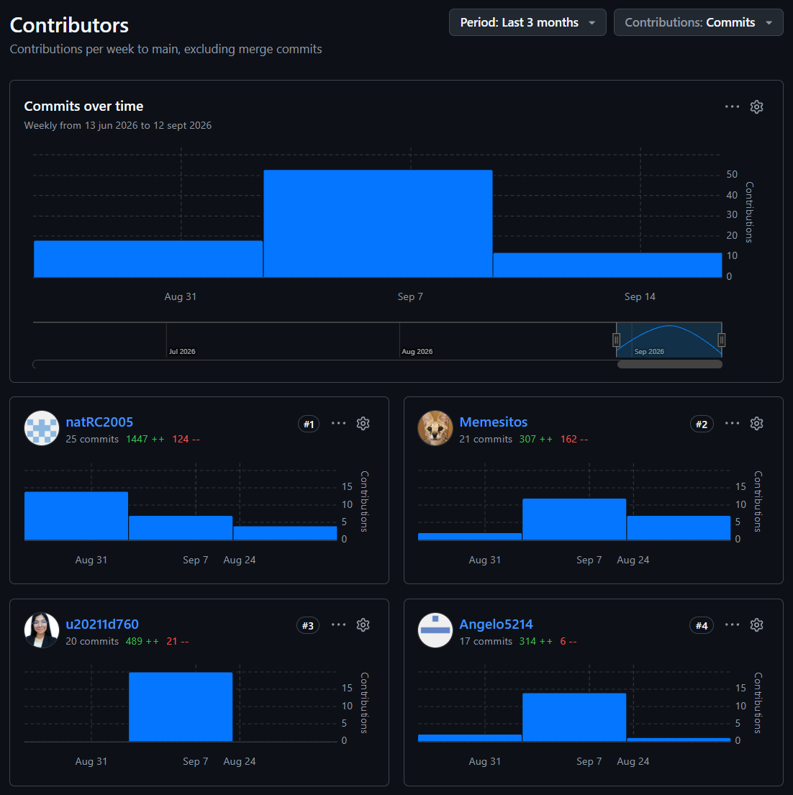<br></td>
  </tr>
</table>

<table>
  <tr>
    <td colspan="2" align="center" style="font-weight: bold; font-size: 20px;">Evidencias y comentarios del TP1</td>
  </tr>
  <tr>
    <td width="20%"><strong>Integrante</strong></td>
    <td width="80%"><strong>Descripción de actividades</strong></td>
  </tr>
  <tr>
    <td><strong>Roman Cruz, Natalia Bertha</strong></td>
    <td>Desarrollé la documentación del diseño táctico de los bounded contexts IAM, Consultation, Medical Bases y Case Management, detallando sus capas Domain, Interface, Application e Infrastructure. Definí los elementos de cada capa, sus atributos, funciones y responsabilidades, y elaboré los Domain Layer Class Diagrams de los cuatro contextos. Asimismo, actualicé el EventStorming para reflejar los flujos acordados para la aplicación.</td>
  </tr>
  <tr>
    <td><strong>Cacho Seminario, Diego Alonso</strong></td>
    <td>Desarrollé las General Style Guidelines y las Web, Mobile & Devices Style Guidelines de Lifeline, documentando la identidad visual, la paleta de colores, la tipografía y los criterios de presentación para las interfaces web y móviles. Incorporé los recursos gráficos que respaldan estas pautas y actualicé la tabla de contenido para organizar las nuevas secciones del informe.</td>
  </tr>
  <tr>
    <td><strong>Paico Calderon, July Zelmira</strong></td>
    <td>Elaboré los wireframes y el mock-up de la landing page, así como los Applications Wireframes para los flujos de acceso, ciudadanos y personal médico. También desarrollé los Applications Wireflow Diagrams para representar la navegación y las acciones de los usuarios, desde el ingreso a la aplicación y la solicitud de orientación hasta la atención y el cierre de casos. Incorporé las imágenes y descripciones correspondientes en el informe.</td>
  </tr>
  <tr>
    <td><strong>Solano Armas, Angelo Héctor</strong></td>
    <td>Actualicé los diagramas de arquitectura C4 e incorporé Cloudinary como sistema externo. Documenté los Component Level Diagrams y los Database Design Diagrams de los bounded contexts IAM, Consultation, Medical Bases y Case Management. Además, desarrollé las secciones Labeling Systems, Searching Systems, SEO Tags and Meta Tags y Navigation Systems de la arquitectura de información, y actualicé las conclusiones y recomendaciones del informe.</td>
  </tr>
  <tr>
    <td><strong>Conclusión</strong></td>
    <td>En esta entrega, el equipo avanzó en el diseño táctico y la experiencia de usuario de Lifeline mediante la definición de las capas y los modelos de cada bounded context, los diagramas de arquitectura y base de datos, y las pautas visuales y de navegación. La colaboración entre los integrantes permitió relacionar los flujos de la aplicación con sus responsabilidades técnicas y sus interfaces, dejando una base documentada para la implementación.</td>
  </tr>
  <tr>
    <td><strong>Evidencia</strong></td>
    <td><br>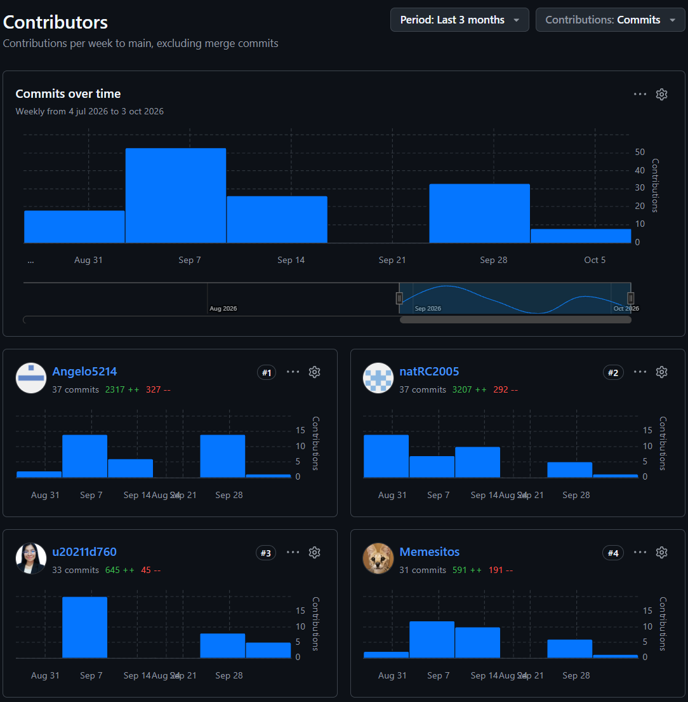<br></td>
  </tr>
</table>

<table>
  <tr>
    <td colspan="2" align="center" style="font-weight: bold; font-size: 20px;">Evidencias y comentarios de la TB2</td>
  </tr>
  <tr>
    <td width="20%"><strong>Integrante</strong></td>
    <td width="80%"><strong>Descripción de actividades</strong></td>
  </tr>
  <tr>
    <td><strong>Roman Cruz, Natalia Bertha</strong></td>
    <td>Actualicé el registro de versiones, el Project Report Collaboration Insights y la tabla de contenidos. Coordiné el Student Outcome del equipo y elaboré el Sprint Planning y el Sprint Backlog del Sprint 1, además del diseño de las entrevistas de validación y de parte de su registro. Planteé la estructura de los bounded contexts en el backend Spring Boot y en la aplicación móvil Flutter, y desarrollé la base de conocimientos médicos, la conexión del RAG con la IA on-device, el flujo principal de consulta, los flujos de manejo de casos, el inicio de sesión y los perfiles, y la integración con el frontend. También preparé la evaluación de integrantes y colaboré en la bibliografía, el PPT y el video de la entrega.</td>
  </tr>
  <tr>
    <td><strong>Cacho Seminario, Diego Alonso</strong></td>
    <td>Desarrollé los Applications User Flow Diagrams y documenté la evidencia de desarrollo y de la suite de pruebas del Sprint 1, así como las evaluaciones según heurísticas. Implementé el load balancer con NGINX para distribuir las solicitudes entre las instancias del backend. Asimismo, colaboré en la implementación de la landing page y en la mejora de la interfaz de la aplicación móvil, y participé en el Student Outcome, el registro de entrevistas de validación, la bibliografía y el material de exposición.</td>
  </tr>
  <tr>
    <td><strong>Paico Calderon, July Zelmira</strong></td>
    <td>Elaboré los Applications Mock-ups y el Applications Prototyping. Documenté la evidencia de ejecución y la documentación de servicios del Sprint 1. Colaboré en la implementación de la landing page y en la mejora de la interfaz de la aplicación móvil, y participé en el Student Outcome, el registro de entrevistas de validación, la bibliografía y el PPT con su video.</td>
  </tr>
  <tr>
    <td><strong>Solano Armas, Angelo Héctor</strong></td>
    <td>Documenté la configuración del entorno de desarrollo, la gestión del código fuente, la guía de estilo y la configuración de despliegue. Elaboré la evidencia de despliegue del Sprint Review, los insights de colaboración del sprint y el Video About-the-Product. Implementé el broker ActiveMQ para los trabajos asíncronos, el worker con el publicador del outbox y el procesamiento de Case Management, la persistencia offline y la sincronización, la integración de almacenamiento con Cloudinary y las notificaciones de sincronización y atención. Finalmente, actualicé las conclusiones y las recomendaciones, y participé en el Student Outcome, el registro de entrevistas de validación, la bibliografía y el material de exposición.</td>
  </tr>
  <tr>
    <td><strong>Conclusión</strong></td>
    <td>En esta entrega, el equipo pasó del diseño a la implementación y al despliegue de Lifeline. Cada integrante asumió tramos concretos del informe y del producto, desde la planificación del sprint y la experiencia de usuario hasta el backend, el broker, el worker, la landing y la aplicación móvil. La colaboración permitió dejar evidencia de desarrollo, pruebas, ejecución, servicios, despliegue y validación, y consolidar un avance coherente para la revisión del Sprint 1.</td>
  </tr>
  <tr>
    <td><strong>Evidencia</strong></td>
    <td><br>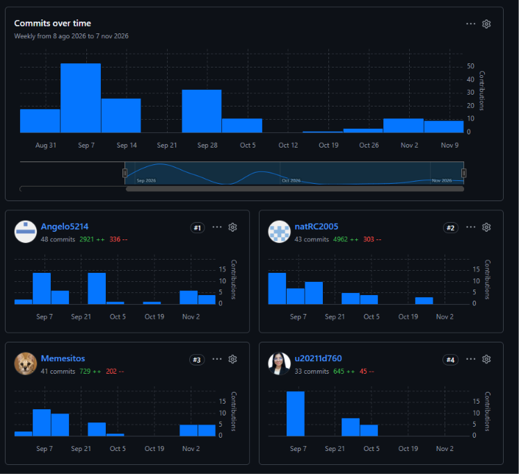<br></td>
  </tr>
</table>

<div style="page-break-after:always;break-after:page;">&nbsp;</div>

# Contenido

- [Student Outcome](#student-outcome)
- [Capítulo I: Introducción](#capítulo-i-introducción)
  - [1.1. Startup Profile](#11-startup-profile)
    - [1.1.1. Descripción de la Startup](#111-descripción-de-la-startup)
    - [1.1.2. Perfiles de integrantes del equipo](#112-perfiles-de-integrantes-del-equipo)
  - [1.2. Solution Profile](#12-solution-profile)
    - [1.2.1 Nombre del Producto](#121-nombre-del-producto)
    - [1.2.2 Lean UX Process.](#122-lean-ux-process)
    - [1.2.3. Antecedentes y problemática](#123-antecedentes-y-problemática)
      - [1.2.3.1. Lean UX Problem Statements.](#1231-lean-ux-problem-statements)
      - [1.2.3.2. Lean UX Assumptions.](#1232-lean-ux-assumptions)
      - [1.2.3.3. Lean UX Hypothesis Statements.](#1233-lean-ux-hypothesis-statements)
      - [1.2.3.4. Lean UX Canvas.](#1234-lean-ux-canvas)
  - [1.3. Segmentos objetivo.](#13-segmentos-objetivo)
- [Capítulo II: Requirements Elicitation & Analysis](#capítulo-ii-requirements-elicitation--analysis)
  - [2.1. Competidores](#21-competidores)
    - [2.1.1. Análisis competitivo](#211-análisis-competitivo)
    - [2.1.2. Estrategias y tácticas frente a competidores](#212-estrategias-y-tácticas-frente-a-competidores)
  - [2.2. Entrevistas](#22-entrevistas)
    - [2.2.1. Diseño de entrevistas](#221-diseño-de-entrevistas)
    - [2.2.2. Registro de entrevistas](#222-registro-de-entrevistas)
    - [2.2.3. Análisis de entrevistas](#223-análisis-de-entrevistas)
  - [2.3. Needfinding](#23-needfinding)
    - [2.3.1. User Personas](#231-user-personas)
    - [2.3.2. User Task Matrix](#232-user-task-matrix)
    - [2.3.3. Empathy Mapping](#233-empathy-mapping)
    - [2.3.4. As-is Scenario Mapping](#234-as-is-scenario-mapping)
  - [2.4. Ubiquitous Language](#24-ubiquitous-language)
- [Capítulo III: Requirements Specification](#capítulo-iii-requirements-specification)
  - [3.1. To-Be Scenario Mapping](#31-to-be-scenario-mapping)
  - [3.2. User Stories](#32-user-stories)
  - [3.3. Impact Mapping](#33-impact-mapping)
  - [3.4. Product Backlog](#34-product-backlog)
- [Capítulo IV: Strategic-Level Software Design](#capítulo-iv-strategic-level-software-design)
  - [4.1. Strategic-Level Attribute-Driven Design](#41-strategic-level-attribute-driven-design)
    - [4.1.1. Design Purpose](#411-design-purpose)
    - [4.1.2. Attribute-Driven Design Inputs](#412-attribute-driven-design-inputs)
      - [4.1.2.1. Primary Functionality (Primary User Stories)](#4121-primary-functionality-primary-user-stories)
      - [4.1.2.2. Quality Attribute Scenarios](#4122-quality-attribute-scenarios)
      - [4.1.2.3. Constraints](#4123-constraints)
    - [4.1.3. Architectural Drivers Backlog](#413-architectural-drivers-backlog)
    - [4.1.4. Architectural Design Decisions](#414-architectural-design-decisions)
    - [4.1.5. Quality Attribute Scenario Refinements](#415-quality-attribute-scenario-refinements)
  - [4.2. Strategic-Level Domain-Driven Design](#42-strategic-level-domain-driven-design)
    - [4.2.1. EventStorming](#421-eventstorming)
    - [4.2.2. Candidate Context Discovery](#422-candidate-context-discovery)
    - [4.2.3. Domain Message Flows Modeling](#423-domain-message-flows-modeling)
    - [4.2.4. Bounded Context Canvases](#424-bounded-context-canvases)
    - [4.2.5. Context Mapping](#425-context-mapping)
  - [4.3. Software Architecture](#43-software-architecture)
    - [4.3.1. Software Architecture System Landscape Diagram](#431-software-architecture-system-landscape-diagram)
    - [4.3.2. Software Architecture Context Level Diagrams](#432-software-architecture-context-level-diagrams)
    - [4.3.3. Software Architecture Container Level Diagrams](#433-software-architecture-container-level-diagrams)
    - [4.3.4. Software Architecture Deployment Diagrams](#434-software-architecture-deployment-diagrams)
    - [4.3.5. Software Architecture Component Level Diagrams](#435-software-architecture-component-level-diagrams)
- [Capítulo V: Tactical-Level Software Design](#capítulo-v-tactical-level-software-design)
  - [5.1. Bounded Context: IAM](#51-bounded-context-iam)
    - [5.1.1. Domain Layer.](#511-domain-layer)
    - [5.1.2. Interface Layer.](#512-interface-layer)
    - [5.1.3. Application Layer.](#513-application-layer)
    - [5.1.4. Infrastructure Layer.](#514-infrastructure-layer)
    - [5.1.5. Bounded Context Software Architecture Component Level Diagrams.](#515-bounded-context-software-architecture-component-level-diagrams)
    - [5.1.6. Bounded Context Software Architecture Code Level Diagrams.](#516-bounded-context-software-architecture-code-level-diagrams)
      - [5.1.6.1. Bounded Context Domain Layer Class Diagrams.](#5161-bounded-context-domain-layer-class-diagrams)
      - [5.1.6.2. Bounded Context Database Design Diagram.](#5162-bounded-context-database-design-diagram)
  - [5.2. Bounded Context: Consultation](#52-bounded-context-consultation)
    - [5.2.1. Domain Layer.](#521-domain-layer)
    - [5.2.2. Interface Layer.](#522-interface-layer)
    - [5.2.3. Application Layer.](#523-application-layer)
    - [5.2.4. Infrastructure Layer.](#524-infrastructure-layer)
    - [5.2.5. Bounded Context Software Architecture Component Level Diagrams.](#525-bounded-context-software-architecture-component-level-diagrams)
    - [5.2.6. Bounded Context Software Architecture Code Level Diagrams.](#526-bounded-context-software-architecture-code-level-diagrams)
      - [5.2.6.1. Bounded Context Domain Layer Class Diagrams.](#5261-bounded-context-domain-layer-class-diagrams)
      - [5.2.6.2. Bounded Context Database Design Diagram.](#5262-bounded-context-database-design-diagram)
  - [5.3. Bounded Context: Medical Bases](#53-bounded-context-medical-bases)
    - [5.3.1. Domain Layer.](#531-domain-layer)
    - [5.3.2. Interface Layer.](#532-interface-layer)
    - [5.3.3. Application Layer.](#533-application-layer)
    - [5.3.4. Infrastructure Layer.](#534-infrastructure-layer)
    - [5.3.5. Bounded Context Software Architecture Component Level Diagrams.](#535-bounded-context-software-architecture-component-level-diagrams)
    - [5.3.6. Bounded Context Software Architecture Code Level Diagrams.](#536-bounded-context-software-architecture-code-level-diagrams)
      - [5.3.6.1. Bounded Context Domain Layer Class Diagrams.](#5361-bounded-context-domain-layer-class-diagrams)
      - [5.3.6.2. Bounded Context Database Design Diagram.](#5362-bounded-context-database-design-diagram)
  - [5.4. Bounded Context: Case Management](#54-bounded-case-management)
    - [5.4.1. Domain Layer.](#541-domain-layer)
    - [5.4.2. Interface Layer.](#542-interface-layer)
    - [5.4.3. Application Layer.](#543-application-layer)
    - [5.4.4. Infrastructure Layer.](#544-infrastructure-layer)
    - [5.4.5. Bounded Context Software Architecture Component Level Diagrams.](#545-bounded-context-software-architecture-component-level-diagrams)
    - [5.4.6. Bounded Context Software Architecture Code Level Diagrams.](#546-bounded-context-software-architecture-code-level-diagrams)
      - [5.4.6.1. Bounded Context Domain Layer Class Diagrams.](#5461-bounded-context-domain-layer-class-diagrams)
      - [5.4.6.2. Bounded Context Database Design Diagram.](#5462-bounded-context-database-design-diagram)
- [Capítulo VI: Solution UX Design](#capítulo-vi-solution-ux-design)
  - [6.1. Style Guidelines.](#61-style-guidelines)
    - [6.1.1. General Style Guidelines.](#611-general-style-guidelines)
    - [6.1.2. Web, Mobile & Devices Style Guidelines.](#612-web-mobile--devices-style-guidelines)
  - [6.2. Information Architecture.](#62-information-architecture)
    - [6.2.2. Labeling Systems.](#622-labeling-systems)
    - [6.2.3. Searching Systems.](#623-searching-systems)
    - [6.2.4. SEO Tags and Meta Tags.](#624-seo-tags-and-meta-tags)
    - [6.2.5. Navigation Systems.](#625-navigation-systems)
  - [6.3. Landing Page UI Design.](#63-landing-page-ui-design)
    - [6.3.1. Landing Page Wireframe.](#631-landing-page-wireframe)
    - [6.3.2. Landing Page Mock-up.](#632-landing-page-mock-up)
  - [6.4. Applications UX/UI Design.](#64-applications-uxui-design)
    - [6.4.1. Applications Wireframes.](#641-applications-wireframes)
    - [6.4.2. Applications Wireflow Diagrams.](#642-applications-wireflow-diagrams)
    - [6.4.3. Applications Mock-ups.](#643-applications-mock-ups)
    - [6.4.4. Applications User Flow Diagrams.](#644-applications-user-flow-diagrams)
  - [6.5. Applications Prototyping.](#65-applications-prototyping)
- [Capítulo VII: Product Implementation, Validation & Deployment](#capítulo-vii-product-implementation-validation--deployment)
  - [7.1. Software Configuration Management.](#71-software-configuration-management)
    - [7.1.1. Software Development Environment Configuration.](#711-software-development-environment-configuration)
    - [7.1.2. Source Code Management.](#712-source-code-management)
    - [7.1.3. Source Code Style Guide & Conventions.](#713-source-code-style-guide--conventions)
    - [7.1.4. Software Deployment Configuration.](#714-software-deployment-configuration)
  - [7.2. Solution Implementation.](#72-solution-implementation)
    - [7.2.1. Sprint 1](#721-sprint-1)
      - [7.2.1.1. Sprint Planning 1.](#7211-sprint-planning-1)
      - [7.2.1.2. Sprint Backlog 1.](#7212-sprint-backlog-1)
      - [7.2.1.3. Development Evidence for Sprint Review.](#7213-development-evidence-for-sprint-review)
      - [7.2.1.4. Testing Suite Evidence for Sprint Review.](#7214-testing-suite-evidence-for-sprint-review)
      - [7.2.1.5. Execution Evidence for Sprint Review.](#7215-execution-evidence-for-sprint-review)
      - [7.2.1.6. Services Documentation Evidence for Sprint Review.](#7216-services-documentation-evidence-for-sprint-review)
      - [7.2.1.7. Software Deployment Evidence for Sprint Review.](#7217-software-deployment-evidence-for-sprint-review)
      - [7.2.1.8. Team Collaboration Insights during Sprint.](#7218-team-collaboration-insights-during-sprint)
  - [7.3. Validation Interviews.](#73-validation-interviews)
    - [7.3.1. Diseño de Entrevistas.](#731-diseño-de-entrevistas)
    - [7.3.2. Registro de Entrevistas.](#732-registro-de-entrevistas)
    - [7.3.3. Evaluaciones según heurísticas.](#733-evaluaciones-según-heurísticas)
  - [7.4. Video About-the-Product.](#74-video-about-the-product)
- [Conclusiones y recomendaciones](#conclusiones-y-recomendaciones)
- [Video About-the-Team](#video-about-the-team)
- [Bibliografía](#bibliografía)
- [Anexos](#anexos)

<div style="page-break-after:always;break-after:page;">&nbsp;</div>

# Student Outcome
<table>
  <tr>
    <td><strong>Criterio específico</strong></td>
    <td><strong>Acciones realizadas</strong></td>
    <td><strong>Conclusiones</strong></td>
  </tr>
  <tr>
    <td>Comunica oralmente ideas y/o resultados con objetividad a público de diferentes especialidades y niveles jerárquicos, en el marco del desarrollo de un proyecto de ingeniería.</td>
    <td>
      <strong>Solano Armas, Angelo Héctor</strong><br>
      <strong>TB1:</strong><br>
      Participé en el registro de entrevistas con ciudadanos y personal médico, lo que me exigió formular preguntas y consignar las respuestas de personas con perfiles distintos al de un estudiante de ingeniería de software. Además, presenté ante el equipo los diagramas de arquitectura de software (System Landscape, Context, Container, Deployment y Component) y el Design Purpose, explicando las decisiones tomadas para que el resto de integrantes pudiera alinear sus secciones del informe con la arquitectura propuesta.<br><br>
      <strong>TP1:</strong><br>
      Expliqué al equipo los criterios utilizados para los sistemas de etiquetado, búsqueda y navegación, así como el propósito de los SEO Tags y Meta Tags. También presenté los diagramas de arquitectura a nivel de componentes (C3) de todos los bounded contexts, describiendo las responsabilidades de sus componentes y sus relaciones. Utilicé los diagramas como apoyo para sustentar las decisiones técnicas y facilitar la comprensión de la organización de la solución.<br><br>
      <strong>TB2:</strong><br>
      Conduje entrevistas de validación con ciudadanos y personal médico, adaptando las preguntas al perfil de cada entrevistado y consignando sus respuestas para el registro del Sprint 1. En las reuniones del equipo expliqué el despliegue del broker, del worker y del backend, así como la evidencia de publicación de la landing y de la aplicación móvil. También presenté el Video About-the-Product y los insights de colaboración del sprint, de modo que el resto de integrantes pudiera alinear sus secciones con el estado real de la implementación.<br><br>
      <strong>Roman Cruz, Natalia Bertha</strong><br>
      <strong>TB1:</strong><br>
      Participé en las reuniones para la planificación, coordinación y discusión de acuerdos respecto a la elaboración del trabajo, así como me encargué de dirigir el EventStorming para formar los bounded contexts de la aplicación. Además, me encargué de parte del registro de entrevistas.<br><br>
      <strong>TP1:</strong><br>
      Convercé y llegué a acuerdos con mis compañeros mediante reuninoes en cuanto a los flujos que la aplicación debía seguir para los roles planteados, así como sobre la arquitectura que tendría la aplicación internamente tanto a nivel local como en el backend desplegado en la nube. Adicionalmente, expusé los artefactos que implementaríamos y la función que tendría cada uno, así como donde debía ser desplegado más adelante.<br><br>
      <strong>Cacho Seminario, Diego Alonso</strong><br>
      <strong>TB1:</strong><br>
      Participé activamente en las reuniones de equipo sustentando los artefactos de Lean UX, como los Empathy Maps y Scenario Maps, para alinear la visión del producto. Asimismo, argumenté y expuse las decisiones de diseño estratégico para el Impact Mapping y los retoques de los Bounded Context Canvases, asegurando que todos los miembros del equipo comprendieran la relación entre las necesidades de los usuarios y la arquitectura de la solución propuesta.<br><br>
      <strong>TP1:</strong><br>
      Expuse ante el equipo los avances documentales correspondientes a este entregable, detallando las correcciones implementadas tras las revisiones previas. Además, dirigí la presentación de los avances de las diapositivas y expuse los guiones de presentación diseñados para la sustentación (con énfasis en módulos como Lifeline), asegurando que el mensaje técnico y de diseño arquitectónico sea transmitido de manera clara, fluida y objetiva para el momento de la exposición.<br><br>
      <strong>TB2:</strong><br>
      Gestioné y conduje la grabación de la entrevista para el rol de Personal Médico, adaptando mi comunicación para interactuar fluidamente con profesionales de la salud. Asimismo, participé en las reuniones de sincronización del equipo, sustentando los avances de la interfaz (UI) y los flujos de usuario (User Flows) del Sprint 1 de manera clara y objetiva para alinear el desarrollo técnico con la experiencia de usuario final.<br><br>
      <strong>Paico Calderon, July Zelmira</strong><br>
      <strong>TB1:</strong><br>
      Participé en las reuniones del equipo explicando las estrategias frente a los competidores, los escenarios de calidad y las principales decisiones arquitectónicas. Esto permitió comunicar con claridad los criterios técnicos utilizados y coordinar su integración con las demás secciones del proyecto.<br><br>
      <strong>TP1:</strong><br>
      Presenté al equipo los wireframes de la aplicación móvil, los wireflows de cada User goal y la landing page, explicando cómo cada decisión de interfaz respondía a las General Style Guidelines, a las User Personas y a las historias de usuario. Adapté el mensaje según quién escuchaba: lenguaje sencillo para describir el recorrido del ciudadano en una emergencia, y lenguaje técnico para explicar al equipo los estados de pantalla, el modo sin conexión y la relación entre el diseño y la arquitectura, de modo que las demás secciones y el desarrollo se alinearan con el diseño propuesto.  
    </td>
    <td>
      <strong>TB1:</strong><br>
      Como equipo, logramos comunicar oralmente nuestras ideas y resultados de manera clara, objetiva y ordenada. Las entrevistas, reuniones de coordinación y exposiciones internas nos permitieron adaptar el mensaje a personas con distintos perfiles, cumpliendo con lo esperado para la presentación de nuestro proyecto.<br><br>
      <strong>TP1:</strong><br>
      Durante esta fase, el equipo logró coordinar eficientemente las correcciones y avances, estructurando las presentaciones orales y guiones de sustentación de manera objetiva para exponer el estado actual de la arquitectura y diseño con total claridad.<br><br>
      <strong>TB2:</strong><br>
      En esta entrega, la comunicación oral permitió articular de forma efectiva el trabajo técnico del Sprint 1 con las necesidades reales de los usuarios, logrando que el equipo comprendiera y priorizara las mejoras de interfaz tras analizar el feedback obtenido en la evaluación heurística y la entrevista con el personal médico.
    </td>
  </tr>
  <tr>
    <td>Comunica de forma escrita ideas y/o resultados con objetividad a público de diferentes especialidades y niveles jerárquicos, en el marco del desarrollo de un proyecto de ingeniería.</td>
    <td>
      <strong>Solano Armas, Angelo Héctor</strong><br>
      <strong>TB1:</strong><br>
      Redacté la sección de antecedentes y problemática, incorporé la bibliografía del informe y elaboré las User Personas. Definí el Ubiquitous Language y el Design Purpose, y documenté por escrito los diagramas de arquitectura en los niveles System Landscape, Context, Container, Deployment y Component. Finalmente, redacté las conclusiones y recomendaciones del informe, sintetizando los hallazgos del diseño estratégico para un lector académico y técnico.<br><br>
      <strong>TP1:</strong><br>
      Elaboré las secciones de Labeling Systems, Searching Systems, SEO Tags and Meta Tags y Navigation Systems, documentando los criterios para identificar, localizar y recorrer la información de la solución. Además, desarrollé los diagramas de arquitectura a nivel de componentes (C3) de todos los bounded contexts. Describí sus componentes, responsabilidades y relaciones, empleando términos consistentes y explicaciones claras para facilitar la comprensión de las decisiones de arquitectura y su integración con las demás secciones del informe.<br><br>
      <strong>TB2:</strong><br>
      Documenté la configuración del entorno de desarrollo, la gestión del código fuente, la guía de estilo y la configuración de despliegue. Elaboré la evidencia de despliegue del Sprint Review, los insights de colaboración del sprint y el Video About-the-Product. Redacté las conclusiones y recomendaciones de esta entrega, e incorporé en el informe la descripción escrita del broker ActiveMQ, del worker asíncrono, de la persistencia offline con sincronización, de la integración con Cloudinary y de las notificaciones de sincronización y atención, con un lenguaje claro para un lector académico y técnico.<br><br>
      <strong>Roman Cruz, Natalia Bertha</strong><br>
      <strong>TB1:</strong><br>
      Me encargué de la redacción del startup profile y del planteamiento del caso y solución que queríamos abordar. Además, redacté las user stories junto con sus criterios de aceptación, así como realicé el diseño y análisis de las entrevistas. Por último, me encargué de la documentación del EventStorming y justificación de los bounded contexts definidos.<br><br>
      <strong>TP1:</strong><br>
      Dentro del informé, colaboré junto a mis compañeros para el planteamiento de los diagramas de clases y bases de datos tanro a nivel local como la que se desplegaría para el backend en la nube. Asimismo, me encargué de la definición y registro de las capas de dominio, interface, aplicación e infraestructura, marcando la función de cada elemento y la jerarquía entre los mismos usando, a la vez, buenas prácticas y siguiendo la estructura de Domain Driven Design para facilitar la fase de implementación más adelante.<br><br>
      <strong>Cacho Seminario, Diego Alonso</strong><br>
      <strong>TB1:</strong><br>
      Me encargué de redactar y estructurar las secciones de Lean UX Assumptions y la User Task Matrix. Documenté por escrito los Empathy Maps y los Scenario Maps (As-Is y To-Be) para los segmentos de Ciudadanos y Personal Médico. Además, elaboré el Impact Map y el Product Backlog del proyecto, y retoqué la documentación detallada de los Bounded Context Canvases y el Context Mapping, traduciendo los requerimientos del negocio a especificaciones técnicas legibles para el resto del equipo.<br><br>
      <strong>TP1:</strong><br>
      Documenté los avances del proyecto y redacté las justificaciones de las correcciones aplicadas a los entregables y especificaciones de diseño anteriores. Asimismo, me encargué de estructurar por escrito el contenido de las diapositivas y de redactar los guiones de presentación, sintetizando la complejidad de la arquitectura y las especificaciones para garantizar que la documentación de apoyo sea profesional y fácilmente asimilable por el público evaluador.<br><br>
      <strong>TB2:</strong><br>
      Me encargué de estructurar los Applications User Flow Diagrams, detallando los caminos ideales y alternativos (Happy/Unhappy paths). Documenté rigurosamente las evidencias del Sprint 1 en el Development Evidence (commits y ramas de GitHub) y elaboré el Testing Suite Evidence utilizando sintaxis BDD (Gherkin). Además, redacté el reporte de Evaluaciones según heurísticas para sustentar las mejoras de usabilidad implementadas, y documenté la traducción de estos requerimientos a código durante la implementación de la landing page y la optimización de UI en la app móvil.<br><br>
      <strong>Paico Calderon, July Zelmira</strong><br>
      <strong>TB1:</strong><br>
      Documenté las estrategias frente a competidores, los escenarios y restricciones de calidad, el backlog de drivers y las decisiones arquitectónicas. También contribuí al modelado de flujos de dominio, los Bounded Context Canvases y el Context Mapping, presentando los resultados con un lenguaje técnico claro y ordenado.<br><br>
      <strong>TP1:</strong><br>
      Documenté los wireframes, wireflows y la landing page, explicando cómo las decisiones de interfaz respondían a las General Style Guidelines, User Personas e historias de usuario. Adapté el lenguaje y nivel de detalle según el público, utilizando una redacción sencilla para describir el recorrido del ciudadano y una redacción técnica para documentar los estados de pantalla, el modo sin conexión y su relación con la arquitectura, facilitando la alineación del equipo y el desarrollo.
    </td>
    <td>
      <strong>TB1:</strong><br>
      Como equipo, logramos comunicar por escrito las ideas, decisiones y resultados del proyecto de forma objetiva y comprensible. La documentación elaborada integra los aportes de todos los miembros y presenta la propuesta con un lenguaje adecuado tanto para lectores técnicos como para públicos de otras especialidades.<br><br>
      <strong>TP1:</strong><br>
      El equipo mantuvo la rigurosidad en la documentación escrita de los nuevos avances y las correcciones, logrando además plasmar el trabajo en diapositivas estructuradas con un nivel de redacción preciso, accesible y profesional según el público objetivo.<br><br>
      <strong>TB2:</strong><br>
      La rigurosidad en la documentación técnica (evidencias de repositorios y pruebas en Gherkin) junto con el análisis de usabilidad (heurísticas y flujos de usuario) aseguró la trazabilidad total del proyecto, uniendo formalmente la planificación del diseño de interacción con el producto final implementado en el Sprint 1.
    </td>
  </tr>
</table>

# Capítulo I: Introducción

## 1.1. Startup Profile

### 1.1.1. Descripción de la Startup

La startup RescueBridge nace con la idea de usar las herramientas tecnológicas para brindar apoyo y asistencia a las personas después de desastres naturales de forma en que se puedan evitar las pérdidas humanas incluso si los servicios de emergencia no han logrado llegar al lugar. Asimismo, esta startup tiene el objetivo de colaborar con los servicios de emergencia ya sea mediante aplicativos o brindandoles la información recolectada para que puedan desarrollar su labor con mayor efectividad.

En este caso, RescueBridge presenta su producto Lifeline, el cual es una aplicación móvil cuyo propósito consiste en ofrecer indicaciones médicas a la población después de un evento sísmico mediante el uso de un modelo de inteligencia artificial que basa su respuesta en una base de conocimientos médicos para asegurar que las indicaciones brindadas sean confiables y seguras. Adicionalmente, se usarán algunas estrategias para asegurar llegar al desempeño esperado. 

En primer lugar, se usará la técnica de la generación aumentada por recuperación (RAG) para vincular al modelo de lenguaje empleado con fuentes de datos de primeros auxilios y procedimientos médicos previamente seleccionados. En segundo lugar, se contará con un prompt prediseñado con indicaciones claras sobre como debe ser expresada la respuesta brindada al usuario de forma en que esta sea comprensible evitando el uso excesivo de términos médicos, precisa mencionando el paso a paso a seguir y adaptada al contexto post-sismo.

Otro aspecto a resaltar de la aplicación es que esta puede funcionar sin necesidad de Internet al utilizar IA on-device, de manera que la falta de señal después de un terremoto no será un impedimento para que la aplicación sea de ayuda en el momento crítico. Además, las consultas pueden ser realizadas en la aplicación tanto por texto como por medio de audio y cámara para poder ingresar imágenes de las heridas sobre las que se consulta. Por último, al contar con conexión a internet, se enviará una notificación a los rescatistas, así como la información de las consultas realizadas para que puedan ubicar a las personas que aún necesitan asistencia médica.

__Misión__

Brindar orientación confiable, accesible y oportuna a las personas afectadas por desastres naturales mediante soluciones tecnológicas capaces de funcionar incluso sin conexión a internet, y facilitar información relevante a los servicios de emergencia para contribuir a una atención y respuesta más efectiva.

__Visión__

Convertirnos en una organización referente en el uso responsable de la inteligencia artificial para la respuesta ante desastres, construyendo comunidades más preparadas y conectadas con los servicios de emergencia.

### 1.1.2. Perfiles de integrantes del equipo

<table>
  <tr>
    <th>Nombre</th>
    <th>Código</th>
    <th>Descripción</th>
    <th>Foto</th>
  </tr>
  <tr>
    <td>Roman Cruz, Natalia Bertha</td>
    <td>U202310148</td>
    <td>Mi nombre es Natalia Roman y actualmente me encuentro cursando el octavo ciclo de la carrera de ingeniería de software en la UPC. Anteriormente ya he colaborado en proyectos que utilizan tecnologías emergentes como IoT e inteligencia artificial. Siento que puedo aportarle al equipo a través de mis habilidades de desarrollo y al desarrollar el event storming y arquitectura de la aplicación.</td>
    <td></td>
  </tr>
  <tr>
    <td>Cacho Seminario, Diego Alonso</td>
    <td>U202223990</td>
    <td>Mi nombre es Diego Alonso Cacho Seminario y me encuentro cursando por el octavo ciclo de la carrera de Ingeniería de Software en la UPC. Al tener experiencia realizando proyectos de calibre similar en cursos pasados, me siento cómodo trabajando con las herramientas de desarrollo gestión grupal. Me considero como una persona responsable y lista para el cambio en cuanto se necesite. Espero lograr un buen desempeño junto a mis compañeros a lo largo de las actividades.</td>
    <td></td>
  </tr>
  <tr>
    <td>Paico Calderon, July Zelmira</td>
    <td>U20211d760</td>
    <td>Mi nombre es July Paico y actualmente estudio Ingeniería de Software en la UPC. Me considero una persona colaborativa, con interés en el análisis de datos y el diseño centrado en el usuario. Me motiva resolver problemas mediante la tecnología. Siento que puedo aportar al equipo a través de mi interés por la gestión de proyectos y mi capacidad de organización, además de mis ganas constantes de aprender cosas nuevas.</td>
    <td></td>
  </tr>
  <tr>
    <td>Solano Armas, Angelo Héctor</td>
    <td>U20231b775</td>
    <td>Mi nombre es Angelo Solano y actualmente curso el octavo ciclo de Ingeniería de Software en la UPC. Me motiva crear soluciones que realmente ayuden a las personas en situaciones difíciles. Siento que puedo aportar al equipo con dedicación y ganas de desarrollar una aplicación simple, confiable y fácil de usar.</td>
    <td></td>
  </tr>
</table>

## 1.2. Solution Profile

### 1.2.1 Nombre del Producto

El producto se llama __Lifeline__, y es una aplicación móvil que funciona con IA on-device para proporcionar indicaciones médicas en un escenario post-sismo.

### 1.2.2 Lean UX Process.

### 1.2.3. Antecedentes y problemática

Actualmente, en escenarios post-sismo en el Perú, los ciudadanos en peligro enfrentan un problema crítico: la falta de indicaciones médicas confiables de primeros auxilios en el momento inmediato de la emergencia, sumada a la dificultad de recibir ayuda profesional a tiempo. De acuerdo con el Instituto Geofísico del Perú (2020) y el Instituto Nacional de Defensa Civil (2023), eventos sísmicos como el de Pisco 2007 evidenciaron un alto impacto humano, con cientos de fallecidos, miles de heridos y cientos de miles de damnificados, lo que demuestra que la capacidad de respuesta puede verse rápidamente sobrepasada. En la misma línea, el Banco Mundial (2021) señala que el Perú presenta una alta vulnerabilidad frente a desastres naturales y que el riesgo sísmico constituye una de las principales amenazas del país.

Por otro lado, la Organización Mundial de la Salud (2022) reconoce que, en emergencias médicas y de trauma, la respuesta rápida es determinante para reducir muertes y complicaciones, lo que se relaciona con el concepto de “golden hour”. Asimismo, la Organización Mundial de la Salud (s. f.) destaca que la comunidad tiene un rol esencial en el reconocimiento temprano de signos de peligro y en la aplicación de primeros auxilios mientras llega la asistencia formal. Sin embargo, estudios locales en el Perú evidencian que el conocimiento de primeros auxilios en la población suele ser insuficiente o irregular, lo que aumenta el riesgo de una respuesta inadecuada en el momento más crítico (Llontop Llenque & Vidarte Farfan, 2018; Cerna Quispe et al., 2025).

A ello se suma un agravante tecnológico. Según la Unión Internacional de Telecomunicaciones (2020), las telecomunicaciones son un componente vital en la gestión de desastres, pero también resultan vulnerables ante fallas de infraestructura, cortes de energía y saturación de redes. Revisiones sobre telemedicina y herramientas digitales en desastres coinciden en que muchas soluciones de salud dependen de internet o de servicios en la nube, por lo que dejan de ser útiles precisamente cuando más se necesitan (Seliana et al., 2026; Salehinejad et al., 2020). En consecuencia, los ciudadanos quedan sin una guía confiable en los minutos posteriores al sismo, cuando la atención inmediata puede marcar la diferencia entre estabilizar a un herido o agravar su condición.

**Who (¿Quiénes?):**  
Nuestros principales usuarios serán ciudadanos en peligro afectados por sismos que requieren orientación médica inmediata de primeros auxilios, así como personal de asistencia médica que posteriormente pueda recibir información útil sobre la ubicación y el estado de las víctimas cuando se recupere la conectividad.

**What (¿Qué sucede?):**  
Actualmente, tras un sismo de gran magnitud, los afectados enfrentan emergencias médicas sin contar con conocimientos confiables de primeros auxilios ni con herramientas tecnológicas que funcionen sin internet. Las soluciones existentes suelen depender de conectividad en la nube, por lo que se vuelven inutilizables cuando fallan las telecomunicaciones, generando demora, desinformación y mayor riesgo para los heridos.

**When (¿Cuándo ocurre?):**  
Los problemas detectados suelen surgir en los minutos y primeras horas posteriores a un sismo, especialmente cuando los servicios de emergencia están saturados, las vías de acceso se ven afectadas y se producen cortes o congestión en las redes de comunicación. También se agrava cuando el ciudadano intenta buscar ayuda digital y no tiene señal ni acceso a internet.

**Where (¿Dónde ocurre?):**  
Esto ocurre en zonas urbanas y rurales afectadas por sismos en el Perú, incluyendo viviendas, vías públicas, zonas de colapso parcial y espacios de concentración temporal de afectados, es decir, cualquier escenario post-desastre donde exista una emergencia médica y no se cuente con asistencia inmediata ni con herramientas tecnológicas offline de apoyo.

**Why (¿Por qué es un problema?):**  
Esto es un problema porque la combinación de saturación de los servicios de emergencia, limitada preparación de la población en primeros auxilios y dependencia de soluciones que requieren internet dificulta una respuesta inmediata, reduce la capacidad de estabilizar a los heridos a tiempo y aumenta el riesgo de complicaciones o pérdidas humanas en el periodo más crítico.

**How (¿Cómo lo solucionan hoy?):**  
La solución que se utiliza hoy consiste en esperar la llegada del personal de emergencia, recurrir a conocimientos previos incompletos, consultar a otras personas cercanas o intentar usar aplicaciones y buscadores que requieren conexión a internet. En muchos casos, no existe una guía estructurada, confiable y accesible en el momento, lo que genera improvisación y aumenta la probabilidad de errores en la atención inicial.

**How much (¿Cuánto cuesta no resolverlo?):**  
Al no tomar acciones para implementar una solución, se mantiene una ventana crítica sin asistencia efectiva, se eleva el riesgo de deterioro de las víctimas antes de la llegada de ayuda profesional y se pierde la oportunidad de aprovechar los primeros minutos para estabilizar al herido. Además, en un país de alto riesgo sísmico como el Perú, no resolver este problema implica mayor vulnerabilidad poblacional, menor capacidad de respuesta comunitaria y un impacto humano potencialmente alto en futuros desastres.

#### 1.2.3.1. Lean UX Problem Statements.

En situaciones de desastre natural, como sismos de gran magnitud, los servicios de emergencia suelen colapsar o tardar en llegar a las zonas afectadas. Los **ciudadanos en peligro** enfrentan emergencias médicas y carecen de conocimientos de primeros auxilios confiables, un problema que se agrava por el corte temporal de los servicios de telecomunicaciones e internet. Hemos observado que las soluciones tecnológicas actuales dependen casi en su totalidad de conectividad en la nube, lo que las vuelve inútiles en el momento crítico. Esta falta de herramientas accesibles y offline limita la capacidad de respuesta inmediata y aumenta el riesgo de pérdidas humanas.

**¿Cómo podemos ayudar a los ciudadanos en peligro a recibir indicaciones médicas de primeros auxilios de forma inmediata, confiable y sin depender de una conexión a internet, para así estabilizar a los heridos mientras colaboramos con la llegada del personal de asistencia médica?**

#### 1.2.3.2. Lean UX Assumptions

**Business Assumptions**

1. El ciudadano necesita recibir indicaciones médicas de primeros auxilios inmediatas y confiables tras un sismo, sin depender de una conexión a internet ni de la llegada inmediata de equipos de rescate.
2. Las necesidades del ciudadano se resolverán mediante una aplicación móvil que integre IA on-device, capaz de funcionar offline, utilizando la técnica RAG para asegurar la precisión de las indicaciones médicas.
3. Nuestros usuarios iniciales son ciudadanos en zonas de alto riesgo sísmico y el personal de asistencia médica que requiere información adelantada para optimizar los rescates.
4. El principal valor que los ciudadanos esperan de Lifeline es una herramienta de supervivencia que brinde instrucciones claras, paso a paso y precisas en el momento de la emergencia.
5. El personal de asistencia médica también puede obtener beneficios adicionales al recibir notificaciones automáticas con la ubicación y triaje preliminar de las víctimas una vez que se restablezca la conexión.
6. Obtendremos nuestra base de usuarios mediante campañas de prevención de desastres, alianzas con municipalidades e instituciones de defensa civil.
7. Generaremos valor social a través de alianzas gubernamentales o de ONGs enfocadas en la respuesta a desastres naturales.
8. Nuestra principal competencia serán los manuales físicos de primeros auxilios y el conocimiento empírico de la población, dado que otras aplicaciones médicas dependen de conectividad a la nube.
9. Nuestro mayor riesgo es que el modelo de IA on-device requiera demasiados recursos de hardware (batería, memoria) y no funcione fluidamente en dispositivos de gama baja a media.
10. ¿Cuáles son las suposiciones que, si se demuestran falsas, harán que el proyecto fracase?
* Los ciudadanos no confiarán en las indicaciones de una IA durante una emergencia médica crítica.
* Los modelos on-device no logran la precisión médica necesaria, generando "alucinaciones" que ponen en riesgo la vida del usuario.
* Los dispositivos móviles se descargan rápidamente o sufren daños físicos durante el sismo, impidiendo el uso de la aplicación.

**Business Outcomes**

* Esperamos lograr que una base significativa de ciudadanos en zonas de riesgo descargue y mantenga la aplicación en sus dispositivos como medida preventiva en el primer año de lanzamiento.
* Queremos reducir el tiempo de atención inicial de heridas o emergencias estabilizables en un 50% durante simulacros, validando la efectividad del modelo de lenguaje y la arquitectura RAG.
* Proyectamos establecer alianzas estratégicas con servicios de emergencia locales para integrar nuestro sistema de notificaciones asíncronas de víctimas en sus protocolos de rescate.
* Alcanzar una precisión superior al 95% en las respuestas médicas generadas por la IA on-device, validado por profesionales de la salud.

**User Assumptions**

1. **¿Quién es el usuario?** Ciudadanos en peligro afectados por desastres naturales (sismos) que requieren asistencia médica de emergencia, así como el personal de asistencia médica que recibirá la información de las víctimas.

2. **¿Dónde encajaría nuestro producto en la vida (o trabajo) del usuario?** Lifeline se integra como una herramienta de supervivencia de primer contacto en los minutos y horas críticas tras un sismo, operando directamente desde el dispositivo móvil del ciudadano en peligro sin necesidad de señal.

3. **¿Qué problemas resuelve el producto para el usuario?**
* Riesgo de alucinaciones en la IA o indicaciones médicas erróneas: Solución mediante la técnica de Generación Aumentada por Recuperación (RAG) vinculada estrictamente a fuentes de primeros auxilios validadas.

* Dificultad de uso bajo estrés: Solución a través de un prompt prediseñado que fuerza a la IA a dar respuestas paso a paso, precisas y evitando jerga médica compleja.

* Limitación de escritura en emergencias: Solución permitiendo inputs mediante audio y cámara para evaluar heridas.

4. **¿En qué contexto utiliza el usuario el producto?** Se utiliza en el escenario inmediato post-sismo. El ciudadano en peligro consulta a la aplicación mediante texto, audio o fotos sobre una herida o síntoma. Posteriormente, de forma pasiva, la app se usa cuando el dispositivo recupera internet para notificar automáticamente la ubicación y el estado del paciente al personal de asistencia médica.

5. **¿Qué características son esenciales para el usuario? ¿Y por qué?**
* Procesamiento de IA On-Device (funcionamiento 100% offline).

* Base de conocimientos médicos curada e integrada mediante RAG.

* Soporte multimodal (texto, audio, imágenes).

* Sincronización en segundo plano para envío de notificaciones e información de consultas al personal de asistencia médica.

6. **¿Cómo debería verse y comportarse el producto?** Debe tener una interfaz sumamente limpia, de alto contraste y libre de distracciones. Su comportamiento debe ser rápido (baja latencia en la inferencia del modelo), empático y directo, transmitiendo calma al ciudadano en peligro.

**User Outcomes**

* Los ciudadanos en peligro quieren sentir seguridad y tranquilidad al saber qué pasos exactos seguir para atender una herida o estabilizar a un familiar herido en un momento de crisis.
* Los ciudadanos esperan que la interacción con la aplicación sea sumamente rápida y con la menor fricción posible (utilizando voz o fotografías) debido a la situación de alto estrés o limitaciones físicas temporales.
* El personal de asistencia médica quiere reducir el tiempo de localización de víctimas y disponer de un triaje preliminar automatizado para priorizar la atención una vez lleguen a la zona de desastre.

**Features Assumptions**

1. **Procesamiento IA On-Device (100% Offline)**
* **Suposición:** Si el modelo de inteligencia artificial se ejecuta localmente en el dispositivo, garantizamos que los ciudadanos puedan recibir asistencia inmediata incluso en un colapso total de las redes de telecomunicaciones.
* **Riesgo:** Si el modelo requiere excesivos recursos del dispositivo, la batería se agotará rápidamente o la latencia de respuesta será demasiado alta para ser útil en una emergencia.

2. **Generación Aumentada por Recuperación (RAG)**
* **Suposición:** Restringir el modelo de lenguaje a una base de datos validada de primeros auxilios pre-cargada reducirá a cero las alucinaciones peligrosas y asegurará instrucciones seguras.
* **Riesgo:** Si la base de conocimientos curada es demasiado limitada y no abarca el espectro de lesiones típicas de un sismo, el sistema no podrá ofrecer soluciones para casos complejos.

3. **Soporte Multimodal (Texto, Audio, Imágenes)**
* **Suposición:** Permitir que los usuarios ingresen síntomas o evidencien heridas mediante fotografías y mensajes de voz acelerará el flujo de triaje bajo condiciones donde escribir resulta físicamente difícil.
* **Riesgo:** Si el entorno post-sismo carece de buena iluminación o presenta altos niveles de ruido, el procesamiento de imágenes o el reconocimiento de voz podrían fallar repetidamente, causando frustración.

4. **Sincronización y Notificación en Segundo Plano**
* **Suposición:** Enviar un paquete de datos compactado con el estado del paciente, el diagnóstico preliminar de la IA y la ubicación al personal de rescate, en el instante en que se recupere la señal, optimizará radicalmente la logística de emergencia.
* **Riesgo:** Si la conexión recuperada es excesivamente débil o intermitente, el paquete de datos podría corromperse o nunca enviarse con éxito.

#### 1.2.3.3. Lean UX Hypothesis Statements.

- **Creemos que** al utilizar IA on-device para brindar indicaciones médicas, lograremos que los ciudadanos en peligro puedan atender emergencias críticas inmediatamente después de un desastre sin depender de internet. **Sabremos que hemos tenido éxito cuando** en pruebas controladas offline, el 80% de los usuarios logre completar un flujo de consulta de primeros auxilios en menos de 1 minuto.
- **Creemos que** al integrar la técnica RAG con bases de datos médicas y un prompt que evite términos complejos, lograremos que las instrucciones brindadas a los ciudadanos en peligro sean seguras, confiables y fáciles de seguir bajo presión. **Sabremos que hemos tenido éxito cuando** profesionales de la salud validen que el 95% de las respuestas generadas por el sistema son clínicamente correctas y seguras.
- **Creemos que** al habilitar la entrada de consultas mediante audio y cámara, lograremos reducir la fricción de uso para los ciudadanos en peligro que están heridos o en estado de shock. **Sabremos que hemos tenido éxito cuando** más del 50% de las consultas registradas en simulacros de uso utilicen métodos multimodales en lugar de texto escrito.
- **Creemos que** al enviar notificaciones automáticas con información de las consultas una vez recuperada la conexión, lograremos colaborar efectivamente con el personal de asistencia médica. **Sabremos que hemos tenido éxito cuando** el personal médico reciba alertas precisas de triaje y ubicación, reduciendo su tiempo de localización de víctimas simuladas en un 30% utilizando nuestros reportes.

#### 1.2.3.4. Lean UX Canvas.

El canvas colaborativo se encuentra en [Canva — Lean UX Canvas de Lifeline](https://canva.link/a0rosb44f3zycsg).

<p align="center">
  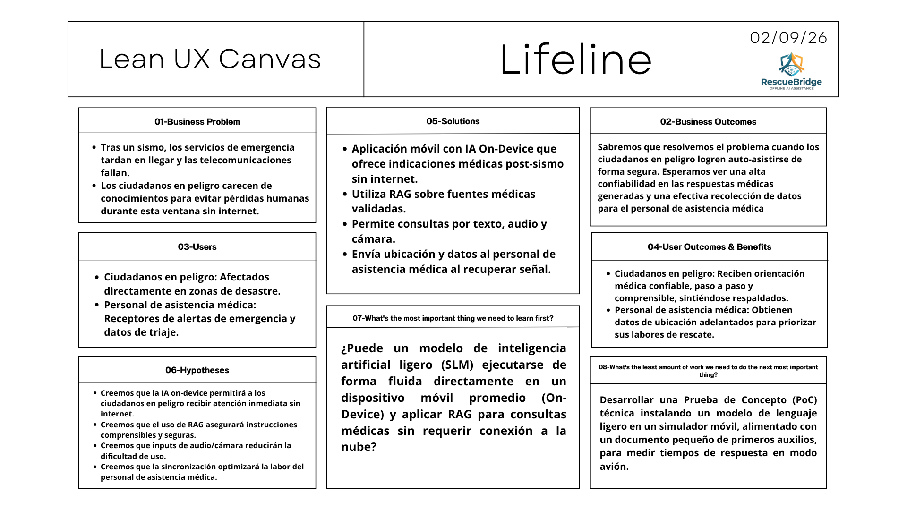
</p>

## 1.3. Segmentos objetivo.

Lifeline fue diseñada pensando en que la población en general logre contar con acceso inmediato a apoyo médico después de un sismo a través de indicaciones generadas por un modelo de inteligencia artificial que obtenga los datos de una base de conocimientos médicos provenientes de organizaciones o instituciones de renombre, de forma en que se pueda asegurar que estas indicaciones son seguras. A su vez, deseamos ayudar a que los servicios de emergencia estén informados de la situación vivida lo antes posible, así como buscamos conectar a las personas heridas con el personal médico. En ese sentido, estaremos tomando en cuenta estos dos segmentos objetivos.

__Ciudadanos__

- Rango de edad: 12 años a más
- Lugar de residencia: Lima, Perú
- Nivel educativo: Nivel primario de eduación básica a superior
- Idioma: Español
- Descripción:  
  Los ciudadanos son personas que estudian o trabajan ya sea de forma externa o en el hogar y que pueden verse afectados bajo un sismo. En este caso nos estamos centrado en Lima Metropolitana. Estas personas poseen un celular personal y, por lo general, carecen de la preparación médica necesaria para actuar en emergencias.
- Preocupaciones:  
  Los ciudadanos temen que ellos o sus familias se vean afectados físicamente después de un evento sísmico, así como al no lograr encontrar a una persona con conocimientos médicos que pueda apoyar a atender a los heridos. Les precoupa causar más daño a la víctima al intentar ayudar y desean poder encontrar un medio que los ayude a proveer primeros auxilios de forma segura, aún cuando informarse en internet no sea una opción dado en escenario.

__Personal médico__

- Rango de edad: 20 años a más
- Lugar de residencia: Lima, Perú
- Nivel educativo: Nivel universitario a superior
- Idioma: Español
- Descripción:  
  El personal médico abarca a los médicos, enfermeros, paramédicos, bomberos con entrenamientos médico, internos, residentes de medicina y demás personas entrenadas en el arte de la medicina que pueden proveer apoyo en la curación de heridas, estabilización de pacientes y atención a las víctimas en general después de un sismo o terremoto.
- Preocupaciones:  
  Al personal médico le preocupa la falta de preparación que existe en general dentro de la población para actuar frente a un sismo, en especial considerando la aplicación de primeros auxilios. Por otro lado, temen no conocer la situación de las víctimas después de un terremoto y, por ende, no llegar a ellos preparados para su atención o ni siquiera saber donde se encuentran.

# Capítulo II: Requirements Elicitation & Analysis

## 2.1. Competidores
El propósito de esta sección es reconocer a los competidores directos que operan con modelos de negocio sustentados en productos digitales similares, así como a los competidores indirectos que ofrecen soluciones que, aunque no idénticas, guardan cierta relación o cubren necesidades similares.

### 2.1.1. Análisis competitivo

<table border="1px">
    <thead>
        <th colspan="11">Competitive Analysis Landscape</th>
    </thead>
    <tbody>
        <tr>
            <td rowspan="2" colspan="2">¿Por qué realizar este análisis?</td>
            <td colspan="9">Indicar en este espacio la pregunta que se busca responder o el propósito principal del análisis.</td>
        </tr>
        <tr>
            <td colspan="9">El propósito de este análisis es entender cómo funcionan y qué características poseen los productos relacionados con la orientación médica y los primeros auxilios, con el fin de diseñar estrategias y tácticas que nos permitan potenciar las fortalezas de Lifeline y aprovechar las debilidades detectadas en la competencia, especialmente en el escenario de emergencia post-sismo.</td>
        </tr>
        <tr>
            <td colspan="3">(En la cabecera colocar nombre y logo de cada competidor)</td>
            <td colspan="2">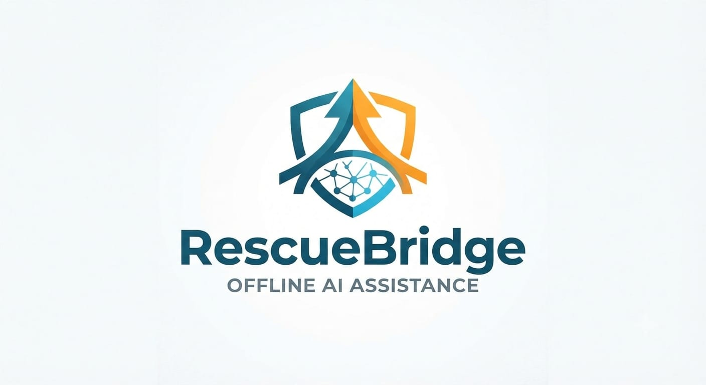<br>Lifeline (RescueBridge)</td>
            <td colspan="2"><br>Primeros Auxilios (Cruz Roja / IFRC)</td>
            <td colspan="2"><br>Ada Health</td>
            <td colspan="2"><br>Buoy Health</td>
        </tr>
        <tr>
            <td rowspan="2" colspan="1">Perfil</td>
            <td colspan="2">Descripción general</td>
            <td colspan="2">App móvil que brinda orientación médica de primeros auxilios en un escenario post-sismo, mediante un modelo de IA on-device (offline) que usa RAG sobre fuentes médicas validadas, con entrada multimodal (texto, voz, foto).</td>
            <td colspan="2">App oficial de la Cruz Roja / IFRC con guías precargadas de primeros auxilios, videos explicativos y cuestionarios interactivos para aprender y consultar en el momento.</td>
            <td colspan="2">App de evaluación de síntomas con IA conversacional que hace preguntas personalizadas y sugiere posibles causas médicas.</td>
            <td colspan="2">Plataforma de triaje con IA que analiza síntomas mediante preguntas y recomienda el nivel de atención médica a buscar.</td>
        </tr>
        <tr>
            <td colspan="2">Ventaja competitiva<br>¿Qué valor ofrece?</td>
            <td colspan="2">Es la única solución que combina funcionamiento 100% offline con indicaciones generadas por IA adaptadas al caso específico del usuario (no un checklist fijo), y que además notifica al personal médico la ubicación y estado del paciente al recuperar señal.</td>
            <td colspan="2">Respaldo institucional global de gran confianza, contenido validado clínicamente y disponible sin conexión.</td>
            <td colspan="2">IA conversacional validada clínicamente, con más de 10 años de desarrollo y una amplia base de datos de condiciones médicas.</td>
            <td colspan="2">Algoritmos entrenados con miles de datos clínicos reales; reporta una tasa de acierto cercana al 90% frente a diagnóstico médico.</td>
        </tr>
        <tr>
            <td rowspan="2" colspan="1">Perfil de Marketing</td>
            <td colspan="2">Mercado objetivo</td>
            <td colspan="2">Ciudadanos en zonas de alto riesgo sísmico en Lima Metropolitana y personal de asistencia médica (bomberos, paramédicos, enfermeros, personal de rescate).</td>
            <td colspan="2">Población general a nivel mundial interesada en aprender o consultar primeros auxilios.</td>
            <td colspan="2">Personas a nivel global preocupadas por síntomas de salud cotidianos, sistemas de salud y aseguradoras.</td>
            <td colspan="2">Empleados de empresas en EE.UU. con beneficios de salud contratados por sus empleadores.</td>
        </tr>
        <tr>
            <td colspan="2">Estrategia de Marketing</td>
            <td colspan="2">Alianzas con INDECI, municipalidades y Cruz Roja Peruana; distribución durante simulacros nacionales de sismo; campañas de prevención de desastres.</td>
            <td colspan="2">Distribución mediante cursos presenciales de primeros auxilios, campañas institucionales y alianzas gubernamentales.</td>
            <td colspan="2">Posicionamiento en tiendas de apps, alianzas con sistemas de salud y aseguradoras.</td>
            <td colspan="2">Alianzas B2B directas con empleadores y aseguradoras que ofrecen la herramienta como beneficio laboral.</td>
        </tr>
        <tr>
            <td rowspan="3" colspan="1">Perfil de Producto</td>
            <td colspan="2">Producto & Servicio</td>
            <td colspan="2">App móvil offline-first con IA on-device + RAG médico, entrada multimodal, sincronización bidireccional y gestión de casos para personal médico.</td>
            <td colspan="2">App con checklist estático de primeros auxilios, videos, cuestionarios y botón de llamada directa a emergencias.</td>
            <td colspan="2">Symptom checker con IA conversacional en la nube, recomendaciones de siguiente paso y opción de telemedicina paga.</td>
            <td colspan="2">Plataforma de triaje conversacional y marketplace de opciones de atención médica.</td>
        </tr>
        <tr>
            <td colspan="2">Precio & Costos</td>
            <td colspan="2">Modelo freemium: gratuito para ciudadanos; licenciamiento institucional para municipalidades/entidades de salud.</td>
            <td colspan="2">Totalmente gratuita.</td>
            <td colspan="2">Gratuita, con opción de consulta médica paga (aprox. $25).</td>
            <td colspan="2">Modelo B2B, cubierto dentro de los beneficios laborales del usuario.</td>
        </tr>
        <tr>
            <td colspan="2">Canales</td>
            <td colspan="2">Aplicación móvil (Android/iOS), funciona sin conexión a internet.</td>
            <td colspan="2">Aplicación móvil (Android/iOS), contenido precargado offline.</td>
            <td colspan="2">Aplicación móvil, requiere conexión a internet (procesamiento en la nube).</td>
            <td colspan="2">Aplicación web y móvil, requiere conexión a internet.</td>
        </tr>
        <tr>
            <td rowspan="5">Análisis SWOT</td>
            <td colspan="10">Elabore un análisis para su startup y competidores. Las fortalezas deben respaldar oportunidades y reforzar ventajas competitivas.</td>
        </tr>
        <tr>
            <td colspan="2">Fortalezas</td>
            <td colspan="2">Funciona sin conexión, indicaciones adaptadas al caso real mediante IA, entrada multimodal, conecta al ciudadano con personal médico.</td>
            <td colspan="2">Marca reconocida y confiable, contenido validado clínicamente, funciona sin internet.</td>
            <td colspan="2">IA robusta y validada, gran base de usuarios, evaluación personalizada de síntomas.</td>
            <td colspan="2">Precisión reportada alta, modelo de negocio B2B ya consolidado.</td>
        </tr>
        <tr>
            <td colspan="2">Debilidades</td>
            <td colspan="2">Startup nueva sin trayectoria; requiere validación clínica e institucional; depende de recursos de hardware del dispositivo (batería, memoria).</td>
            <td colspan="2">Contenido estático (checklist fijo); no analiza el caso específico del usuario; no admite fotos ni voz.</td>
            <td colspan="2">Depende 100% de internet; no está diseñada para emergencias agudas ni post-desastre; no permite adjuntar fotos de heridas.</td>
            <td colspan="2">No funciona offline; no orientada a emergencias físicas ni al contexto peruano; no permite intervención directa sobre heridas.</td>
        </tr>
        <tr>
            <td colspan="2">Oportunidades</td>
            <td colspan="2">Alto riesgo sísmico en Perú, alianzas gubernamentales, escaso mercado de soluciones offline + IA médica.</td>
            <td colspan="2">Podría incorporar IA en el futuro, aprovechando su respaldo institucional.</td>
            <td colspan="2">Podría expandirse a mercados de emergencia si desarrollara una versión offline.</td>
            <td colspan="2">Podría expandirse a mercados fuera de EE.UU.</td>
        </tr>
        <tr>
            <td colspan="2">Amenazas</td>
            <td colspan="2">Desconfianza de la población hacia decisiones médicas de una IA; necesidad de convencer a instituciones para validar el contenido.</td>
            <td colspan="2">Apps con IA más adaptativa (como Lifeline) podrían ofrecer mayor valor percibido en emergencias reales.</td>
            <td colspan="2">Ninguna amenaza directa en el nicho de emergencias post-desastre, dado que no compite en ese escenario.</td>
            <td colspan="2">Ninguna amenaza directa en el nicho de emergencias post-desastre, dado que no compite en ese escenario.</td>
        </tr>
    </tbody>
</table>

### 2.1.2. Estrategias y tácticas frente a competidores

Esta sección examina las acciones estratégicas y tácticas que se implementarán para contrarrestar las fortalezas de la competencia y capitalizar sus debilidades, sin dejar de considerar las oportunidades y amenazas presentes en el mercado.

* **Estrategia de diferenciación por inteligencia sin conexión:**
  * Se busca ofrecer una solución que combine lo que ninguna app existente logra simultáneamente: funcionar sin conexión a internet y razonar sobre el caso específico del usuario mediante IA. Frente a Ada Health y Buoy Health —que dependen de la nube— Lifeline mantiene su funcionalidad completa incluso cuando las telecomunicaciones colapsan tras un sismo.
    * **Tácticas:**
      * Comunicar en el onboarding y en material de difusión el mensaje "cuando ellos dejan de funcionar, Lifeline sigue".
      * Ejecutar todo el pipeline de IA (modelo + RAG + base médica) de forma local, sin llamadas externas.
* **Estrategia de confiabilidad clínica reforzada:**
  * El objetivo es que Lifeline no reemplace el contenido validado de instituciones como la Cruz Roja, sino que lo dinamice: en vez de un checklist fijo, adaptar la respuesta a la foto, el texto o el audio que describe el caso real del paciente.
    * **Tácticas:**
      * Sustentar cada indicación mediante RAG sobre fuentes médicas oficiales (MINSA, OMS, Cruz Roja Peruana).
      * Buscar alianzas de validación de contenido con estas instituciones para ganar legitimidad ante los usuarios.
* **Estrategia de accesibilidad multimodal:**
  * Ninguno de los competidores analizados permite adjuntar una fotografía de la herida o describir la emergencia por voz para que el sistema razone sobre ella; esta es la ventaja de uso bajo estrés que Lifeline explota.
    * **Tácticas:**
      * Priorizar en el diseño de UX flujos de consulta por voz y cámara antes que el ingreso por texto.
      * Optimizar el procesamiento multimodal para mantener baja latencia incluso en dispositivos de gama media.
* **Estrategia de cierre de brecha con el personal médico:**
  * Ninguna de las apps de primeros auxilios o symptom checkers analizadas conecta al ciudadano con el rescatista; todas terminan la interacción en el propio ciudadano. Lifeline convierte esa notificación en su diferenciador institucional.
    * **Tácticas:**
      * Enviar automáticamente ubicación y estado del paciente al personal médico al recuperar conexión.
      * Usar este flujo como argumento principal en conversaciones con INDECI, EsSalud y municipalidades para integraciones futuras.
* **Estrategia de entrada al mercado por prevención:**
  * Dado que un sismo corta la posibilidad de descargar cualquier app nueva en el momento, la meta es lograr que Lifeline ya esté instalada antes de que ocurra la emergencia.
    * **Tácticas:**
      * Distribuir la app durante simulacros de sismo nacionales, que ya cuentan con alta participación ciudadana en Perú.
      * Impulsar campañas de descarga junto a municipalidades y colegios en zonas de alto riesgo sísmico.

## 2.2. Entrevistas

### 2.2.1. Diseño de entrevistas

Para ambos segmentos, se estarán solicitando los datos de nombre completo, edad, nivel de estudios, distrito de residencia y opcupación antes de proceder con las preguntas específicas de segmento. A través de estas, se busca conocer la opinión de las personas respecto al usa de la inteligencia artificial en el ámbito médico y como apoyo de respuesta ante emergencias, así como su nivel de confianza hacia la misma.

**Segmento objetivo 1: Ciudadanos**

1. ¿Ha vivido alguna emergencia o urgencia médica durante o después de un sismo? Cuénteme qué ocurrió y qué hizo para ayudar a la persona.
2. Actualmente, si usted o alguien cercano resultara herido después de un sismo, ¿cuáles serían sus primeras acciones y en qué orden las realizaría?
3. ¿Qué sería lo más difícil o confuso al intentar ayudar a una persona herida sin contar inmediatamente con personal médico?
4. ¿Cómo cree que se sentiría en esa situación y cómo ello podría afectar su capacidad para seguir instrucciones?
5. ¿Qué señales tomaría en cuenta para decidir si puede atender temporalmente una herida o si debe buscar ayuda profesional de inmediato?
6. Si no tuviera internet, ¿dónde buscaría información de primeros auxilios y qué problemas podría encontrar?
7. En una emergencia, ¿cómo le resultaría más fácil explicar lo que está ocurriendo: escribiendo, hablando, tomando una fotografía o de otra manera? ¿Por qué?
8. Si usted fuera a atender a una persona herida después de un sismo, ¿cómo deberían presentarse las indicaciones médicas para que pueda comprenderlas y seguirlas sin problemas?
9. ¿Qué necesitaría ver o saber para confiar en indicaciones médicas proporcionadas por una aplicación que usa inteligencia artificial?
10. ¿Le gustaría que sea la inteligencia artificial de la aplicación la que le sugiera si solicitar o no apoyo médico profesional? ¿Por qué?
11. ¿Qué información personal, médica o de ubicación estaría dispuesto a compartir con el personal de emergencia?

**Segmento objetivo 2: Personal médico**

1. Desde su experiencia, ¿cree que son suficientes los conocimientos de primeros auxilios que posee la población en general? ¿Cuáles son los errores o desconocimientos más frecuentes?
2. En un escenario post-sismo, ¿cómo considera que una persona sin formación médica debería atender inicialmente a un familiar herido?
3. Durante una emergencia con múltiples víctimas, ¿qué dificultades encuentra para obtener información confiable y localizar a quienes necesitan ayuda?
4. ¿Cuál es la información mínima que necesita conocer para evaluar inicialmente la gravedad de un caso?
5. ¿Qué datos utiliza para decidir qué casos deben atenderse primero y cuáles pueden esperar?
6. ¿Qué opina de que, en una situación post sísmica en la que no han llegado los equipos de emergencia, un ciudadano reciba indicaciones de parte de una inteligencia artificial con conocimiento médico para atender a un familiar herido?
7. ¿Cómo influiría en su atención recibir a un paciente que antes fue atentido por otr persona que seguía indicaciones generadas por una IAcon conocimiento médico? ¿Qué beneficios o riesgos identifica?
8. ¿Qué necesitaría revisar para confiar en la información, indicaciones y recomendaciones generadas por una inteligencia artifial con conocimiento médico?
9. ¿Qué conocimientos, protocolos y procedimientos de primeros auxilios considera que debería dominar una inteligencia artificial diseñada para orientar a personas después de un sismo?
10. Antes de ofrecer una indicación, ¿qué preguntas debería realizar la IA sobre el paciente, la lesión y el entorno para comprender correctamente la situación?
11. ¿Qué síntomas, lesiones o señales de peligro debería reconocer la IA para recomendar esperar por atención profesional y evitar que el ciudadano continúe actuando por su cuenta?
12. ¿Qué acciones nunca debería recomendar una IA y qué advertencias, limitaciones o medidas de seguridad considera que tendría que comunicar al usuario?

### 2.2.2. Registro de entrevistas

**Segmento objetivo 1: Ciudadanos**

Entrevistado N°1: Barbara Eliana Seminario Leon

- Sexo: Femenino
- Edad: 52 años
- Distrito: Santiago de Surco
- Acerca de la entrevista:
  - Instante en el que inicia: 0:00
  - Duración: 4:49

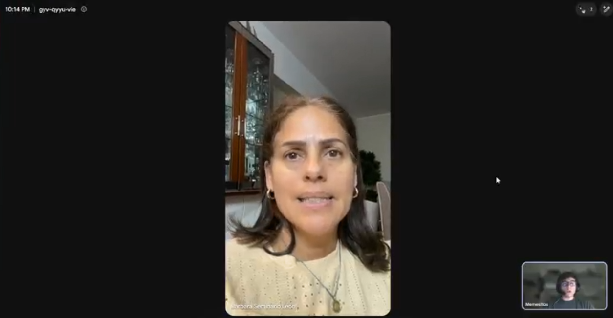

- Resumen:

  Para Barbara, enfrentar una emergencia médica post-sismo es una situación delicada y potencialmente frustrante, tal como lo experimentó al tener que evacuar cuidadosamente a una persona con el pie torcido. Su principal barrera actual es la incapacidad de comunicarse con servicios de emergencia o buscar información de primeros auxilios sin acceso a internet, lo que complica el manejo de heridas complejas o situaciones donde el paciente no puede ser movilizado. Frente a estos problemas, encuentra una gran oportunidad en una aplicación que le permita describir la emergencia combinando fotos y texto, recibiendo a cambio indicaciones médicas claras, concisas y ordenadas a modo de checklist. Para confiar plenamente en esta herramienta, recalca que la inteligencia artificial debe basarse en información verificada y no "alucinar", considerándola excelente para un triaje o descarte inicial, aunque manteniendo el deseo de una eventual interacción humana y mostrándose completamente dispuesta a compartir la información personal o de ubicación que sea necesaria para facilitar el rescate.

- Enlace a la entrevista: [Ver entrevista de Barbara Eliana Seminario Leon](https://upcedupe-my.sharepoint.com/:v:/g/personal/u202223990_upc_edu_pe/IQCN_juWlEoLTqJhCKvZk9JhAUL5UB2olgvMbwjLDSsdFE8?nav=eyJyZWZlcnJhbEluZm8iOnsicmVmZXJyYWxBcHAiOiJPbmVEcml2ZUZvckJ1c2luZXNzIiwicmVmZXJyYWxBcHBQbGF0Zm9ybSI6IldlYiIsInJlZmVycmFsTW9kZSI6InZpZXciLCJyZWZlcnJhbFZpZXciOiJNeUZpbGVzTGlua0NvcHkifX0&e=m4hGMX)

Entrevistado N°2: Roberto Mauricio Huertas Romero

- Sexo: Masculino
- Edad: 21 años
- Distrito: Ate Vitarte
- Ocupación: Estudiante
- Grado de instrucción: Universitario
- Acerca de la entrevista:
  - Instante en el que inicia: 0:00
  - Duración: 10:06


- Resumen:

  Para Roberto, su experiencia cercana con una emergencia post-sismo ocurrió cuando su primita se cayó de las escaleras al asustarse por el movimiento. Aunque las heridas fueron leves y sin mayor gravedad, el evento le dejó claro lo difícil que puede resultar actuar sin conocimientos médicos. En una situación similar, indica que primero revisaría los ojos y la cabeza, por considerarla la zona más frágil, y luego observaría el comportamiento de la persona para detectar signos de desorientación. Reconoce que lo más complicado sería determinar cómo ayudar correctamente, ya que no cuenta con preparación médica y teme realizar alguna acción inadecuada. Además, señala que los nervios y la ansiedad por querer ayudar podrían afectar su capacidad para seguir instrucciones de forma correcta. Respecto a la gravedad, considera que a veces es necesario actuar con rapidez, pero si la persona pierde el conocimiento buscaría ayuda profesional de inmediato. Sin internet, afirma que le resultaría muy difícil buscar información de primeros auxilios y preferiría acudir directamente a un profesional. En una emergencia, le resultaría más fácil explicar la situación hablando y tomando fotografías. Le gustaría que las indicaciones médicas se presenten paso a paso, con imágenes y textos precisos, y que estén avaladas para poder confiar plenamente en ellas. También considera útil que la inteligencia artificial sugiera si es necesario solicitar apoyo médico profesional, precisamente porque él no tiene formación en el área. Finalmente, estaría dispuesto a compartir información personal y médica en una emergencia, como el tipo de sangre o posibles alergias a medicamentos, porque considera que esos datos pueden facilitar una atención más segura.
- Enlace a la entrevista: [Ver entrevista de Roberto Mauricio Huertas Romero](https://upcedupe-my.sharepoint.com/:v:/g/personal/u20231b775_upc_edu_pe/IQDDWLQjGTGLTa7N3srs73xSAT-tzDIPOBWb65EZ3WDK6s4?e=gvbK6L&nav=eyJyZWZlcnJhbEluZm8iOnsicmVmZXJyYWxBcHAiOiJTdHJlYW1XZWJBcHAiLCJyZWZlcnJhbFZpZXciOiJTaGFyZURpYWxvZy1MaW5rIiwicmVmZXJyYWxBcHBQbGF0Zm9ybSI6IldlYiIsInJlZmVycmFsTW9kZSI6InZpZXcifX0%3D)

Entrevistada N°3: Araceli Felicia Reyna Caicedo

- Sexo: Femenino
- Edad: 21 años
- Distrito: Chorrillos
- Ocupación: Estudiante
- Grado de instrucción: Universitario
- Acerca de la entrevista:
  - Instante en el que inicia: 0:00
  - Duración: 13:17


- Resumen:

  Araceli no ha vivido una urgencia médica durante un sismo, pero al no contar con conocimientos en primeros auxilios, siente que sin internet no tendría una fuente de información. En una situación post sismo, siente que lo más difícil es no saber cuál sería el primer paso para tratar a un paciente. Siente que para comunicar una situación de emergencia, más fácil le parece a través de un audio porque simplifica el tiempo, y considera que tomar fotos ayudaría en la descripción. Al momento de recibir indicaciones valoraría la forma escrita y numerada de pasos, con imágenes adjuntas. Siente que confiaría más en las indicaciones de la ia, si éstas referencian a portales médicos o instituciones y sí está dispuesta a compartir su información personal. 

- Enlace a la entrevista: [Ver entrevista de Araceli Felicia Reyna Caicedo](https://upcedupe-my.sharepoint.com/:v:/g/personal/u20211d760_upc_edu_pe/IQDxWcXxxfLaTbVmJ0Re6ROyAVkQNEzOLj5AVEb6OsR-4u8?nav=eyJyZWZlcnJhbEluZm8iOnsicmVmZXJyYWxBcHAiOiJPbmVEcml2ZUZvckJ1c2luZXNzIiwicmVmZXJyYWxBcHBQbGF0Zm9ybSI6IldlYiIsInJlZmVycmFsTW9kZSI6InZpZXciLCJyZWZlcnJhbFZpZXciOiJNeUZpbGVzTGlua0NvcHkifX0&e=s5gC7L)

**Segmento objetivo 2: Personal médico**

Entrevistado N°1: Andre Ramirez Pella

- Sexo: Masculino
- Edad: 24 años
- Distrito: San Miguel
- Grado de instrucción: Universitario
- Acerca de la entrevista:
  - Instante en el que inicia: 0:00
  - Duración: 10:13

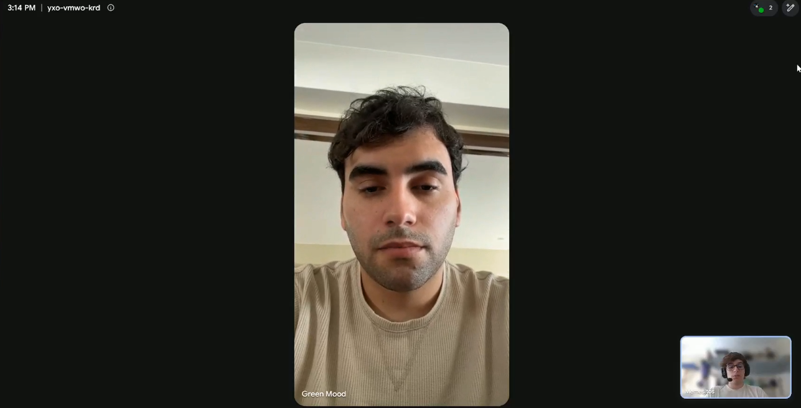

- Resumen:

  Para Andre, la alarmante falta de conocimientos en primeros auxilios por parte de la población representa un riesgo crítico, ya que la mayoría desconoce cómo realizar una evaluación inicial o aplicar maniobras básicas para salvar vidas. A esta barrera se le suma la gran dificultad que tienen los equipos médicos para localizar víctimas durante desastres con derrumbes. En este contexto, considera que recibir orientación de una inteligencia artificial sería una herramienta sumamente útil para empoderar a los ciudadanos, agilizando el proceso de atención y reduciendo riesgos antes de que llegue la ayuda. Para que el sistema sea confiable y seguro, la IA debe basarse en fuentes verificadas, realizar preguntas clave (como medir el pulso, nivel de conciencia, sangrados o fracturas) e identificar rápidamente si la situación requiere atención profesional inmediata. Finalmente, hace hincapié en que la aplicación nunca debe sugerir la automedicación ni indicar movimientos o tratamientos complejos que requieran entrenamiento previo, ya que un mal análisis o una ejecución incorrecta podrían empeorar gravemente el estado del paciente.

- Enlace a la entrevista: [Ver entrevista de Andre Ramirez Pella](https://upcedupe-my.sharepoint.com/:v:/g/personal/u202223990_upc_edu_pe/IQCN_juWlEoLTqJhCKvZk9JhAUL5UB2olgvMbwjLDSsdFE8?nav=eyJyZWZlcnJhbEluZm8iOnsicmVmZXJyYWxBcHAiOiJPbmVEcml2ZUZvckJ1c2luZXNzIiwicmVmZXJyYWxBcHBQbGF0Zm9ybSI6IldlYiIsInJlZmVycmFsTW9kZSI6InZpZXciLCJyZWZlcnJhbFZpZXciOiJNeUZpbGVzTGlua0NvcHkifX0&e=4iY6Ds)

Entrevistado N°2: Katia Milagros Saavedra Saavedra

- Sexo: Femenino
- Edad: 52 años
- Distrito: Santiago de Surco
- Grado de instrucción: Universitario
- Acerca de la entrevista:
  - Instante en el que inicia: 0:01
  - Duración: 13:36

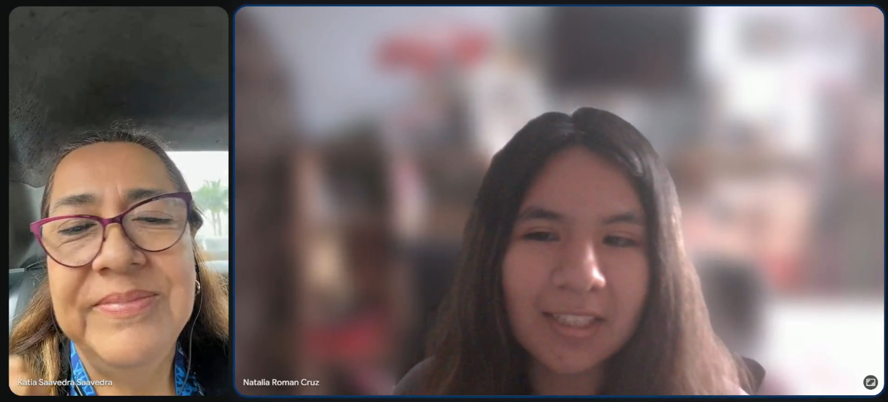

- Resumen:

  Para Katia, médica reumatóloga, la falta de una cultura de primeros auxilios y de acceso a capacitaciones representa un riesgo importante, pues muchas personas no saben reconocer señales de alarma ni actuar mientras llega la ayuda profesional. Considera que una inteligencia artificial podría ser útil para orientar a ciudadanos sin experiencia durante una emergencia posísmica, ayudándolos a evaluar la respiración y el pulso, recopilar información sobre el accidente y clasificar a las víctimas según su gravedad. Para brindar recomendaciones confiables, la IA debería preguntar por el mecanismo de la lesión, los síntomas, el tipo y la ubicación del dolor, el tiempo transcurrido y los antecedentes médicos, además de analizar signos vitales como la frecuencia cardíaca, la frecuencia respiratoria, la presión arterial y la temperatura, idealmente mediante sensores. Sin embargo, enfatiza que la IA no puede detectar con precisión problemas internos, como una hemorragia, ni reemplazar la evaluación clínica y la experiencia del personal médico. Finalmente, señala que nunca debería recomendar mover a un paciente sin la presencia de un profesional o paramédico, excepto cuando permanezca en una zona de peligro inminente, y siempre debe advertir que su función es únicamente orientar, acelerar la atención y facilitar la priorización de las personas con mayor riesgo.

- Enlace a la entrevista: [Ver entrevista de Katia Milagros Saavedra Saavedra](https://upcedupe-my.sharepoint.com/:v:/g/personal/u202310148_upc_edu_pe/IQA1eeA0b6IIQru3aWtYKV1rAbdlC0QFpfN6YejWyAcPw68?nav=eyJyZWZlcnJhbEluZm8iOnsicmVmZXJyYWxBcHAiOiJPbmVEcml2ZUZvckJ1c2luZXNzIiwicmVmZXJyYWxBcHBQbGF0Zm9ybSI6IldlYiIsInJlZmVycmFsTW9kZSI6InZpZXciLCJyZWZlcnJhbFZpZXciOiJNeUZpbGVzTGlua0NvcHkifX0&e=3A5JVQ)

Entrevistado N°3: Kevin Franco Escobar Coca

- Sexo: Masculino
- Edad: 27 años
- Distrito: Ate
- Grado de instrucción: Universitario
- Acerca de la entrevista:
  - Instante en el que inicia: 0:01
  - Duración: 17:02

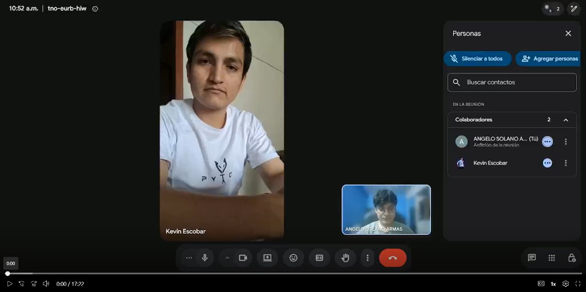

- Resumen:

  Para Kevin, enfermero especializado en el área de emergencias, la falta de conocimientos médicos en la población general representa un grave riesgo ante accidentes o desastres sísmicos, debido a que las personas suelen incurrir en prácticas perjudiciales como retirar objetos incrustados de una herida, dar agua a personas inconscientes o precipitarse a conclusiones sin una valoración previa. Señala que lo primero que debe evaluarse en una víctima es su estado neurológico y nivel de orientación (verificar si se encuentra desorientada o desconcertada), así como la presencia de contusiones y traumatismos. Explica además que, para gestionar la atención cuando hay múltiples heridos, se debe aplicar un triaje por colores y examinar signos visibles como hematomas para determinar con rapidez quiénes requieren auxilio inmediato. Respecto al uso de una inteligencia artificial en primeros auxilios, opina que representa tanto un beneficio como una amenaza latente: si bien puede ser de gran utilidad, indicaciones imprecisas o mal formuladas podrían complicar severamente el cuadro clínico del paciente y dificultar la labor posterior del equipo médico. Por ello, considera indispensable que la solución esté formalmente avalada y respaldada por métricas y resultados clínicos demostrables. En cuanto a las capacidades del sistema, resalta la necesidad de dominar protocolos fundamentales como RCP y soporte respiratorio, además de realizar un interrogatorio activo sobre el estado general del paciente (por ejemplo, detectar oportunamente si se encuentra en shock u otra condición crítica) para evitar equivocaciones. Finalmente, enfatiza que si un paciente se encuentra en estado grave, la aplicación debe ordenar de manera taxativa e inmediata la llamada a un profesional de la salud, recordando que la preservación de la vida es primordial.

- Enlace a la entrevista: [Ver entrevista de Kevin Franco Escobar Coca](https://upcedupe-my.sharepoint.com/:v:/g/personal/u20231b775_upc_edu_pe/IQBLygbC1TxOTb5NTfqPQJOjAb64A2MSoaNk_oWaEqQrRqQ?nav=eyJyZWZlcnJhbEluZm8iOnsicmVmZXJyYWxBcHAiOiJPbmVEcml2ZUZvckJ1c2luZXNzIiwicmVmZXJyYWxBcHBQbGF0Zm9ybSI6IldlYiIsInJlZmVycmFsTW9kZSI6InZpZXciLCJyZWZlcnJhbFZpZXciOiJNeUZpbGVzTGlua0NvcHkifX0&e=eTsKy4)


### 2.2.3. Análisis de entrevistas

#### Análisis del segmento de ciudadanos

Los ciudadanos entrevistados evidencian un nivel limitado de conocimientos en primeros auxilios y una marcada inseguridad para actuar ante una emergencia medica presentada posterior a un sismo. Aunque algunos han presenciado accidentes de gravedad leve, coinciden en que les resultaría difícil determinar cuál debe ser el primer paso, evaluar correctamente el estado de una víctima o aplicar una maniobra sin temor a empeorar su condición. Asimismo, los nervios y la ansiedad aparecen como factores que pueden afectar su capacidad para comprender y seguir indicaciones durante una situación crítica.

La falta de conexión a internet se identifica como una barrera común en este segmento. Los tres entrevistados reconocen que, sin conectividad, tendrían dificultades para buscar información o comunicarse con los servicios de emergencia. En este contexto, perciben de forma positiva una aplicación con inteligencia artificial que funcione sin conexión y brinde orientación inmediata mientras llega la ayuda profesional. La solución es valorada principalmente como una herramienta de apoyo para realizar una evaluación inicial, reconocer señales de peligro y determinar cuándo es indispensable solicitar asistencia médica.

En cuanto a la interacción con la aplicación, los entrevistados prefieren mecanismos rápidos y sencillos para describir la emergencia, como audios, fotografías y texto. También coinciden en que las indicaciones deben presentarse de manera clara, breve y secuencial, mediante pasos numerados, listas de verificación e imágenes que faciliten su ejecución aun bajo condiciones de estrés. Estas preferencias reflejan la necesidad de una experiencia accesible que reduzca la carga cognitiva del usuario y evite instrucciones ambiguas o excesivamente técnicas.

Finalmente, la confianza en la inteligencia artificial depende de que sus recomendaciones estén respaldadas por fuentes médicas verificadas o instituciones reconocidas, y de que el sistema evite generar información incorrecta. Los entrevistados también consideran importante que la aplicación recomiende oportunamente la intervención de un profesional y mantenga la posibilidad de contacto humano. Todos manifiestan disposición a compartir información personal, médica o de ubicación durante una emergencia, siempre que ello permita agilizar el rescate y recibir una atención más segura.

#### Análisis del segmento de personal médico

Los profesionales entrevistados coinciden en que la falta de conocimientos básicos de primeros auxilios en la población representa un riesgo considerable durante una emergencia. Desde su perspectiva, muchas personas no saben evaluar inicialmente a una víctima, reconocer señales de alarma ni aplicar maniobras básicas mientras esperan la llegada de los equipos especializados. A esta dificultad se suman los problemas de organización y localización de víctimas en escenarios con múltiples afectados, por lo que resaltan la importancia del triaje y de una clasificación clara que permita priorizar a quienes presentan mayor riesgo.

En este contexto, todos los entrevistados muestran una percepción favorable hacia el uso de una inteligencia artificial como herramienta de orientación previa a la atención profesional. Consideran que podría ayudar a ciudadanos sin formación médica a recopilar información relevante, realizar comprobaciones básicas y comunicar con mayor rapidez el estado de una víctima. Para ello, la IA debería formular preguntas sobre el mecanismo del accidente, el nivel de conciencia, la respiración, el pulso, los sangrados, las fracturas, el tipo y la localización del dolor, el tiempo transcurrido y los antecedentes médicos. Esta información permitiría efectuar un descarte inicial, identificar señales de peligro y apoyar la priorización de los casos.

Sin embargo, los especialistas enfatizan que la confiabilidad del sistema dependerá de que se base en fuentes verificadas y reconozca claramente sus limitaciones. La IA no puede sustituir el examen físico ni la experiencia clínica, y podría no detectar lesiones internas o cambios en el estado de un paciente que obliguen a modificar su nivel de prioridad. Por esta razón, toda clasificación realizada por el sistema debe considerarse preliminar y ser reevaluada por personal médico.

Finalmente, los profesionales señalan que la aplicación debe incorporar restricciones de seguridad estrictas. No debería recomendar la automedicación, el traslado innecesario de una víctima ni maniobras o tratamientos complejos que requieran entrenamiento, debido a que una indicación o ejecución incorrecta podría agravar el estado del paciente. La única excepción para mover a una persona sería la existencia de un peligro inminente en el entorno. En conjunto, las entrevistas muestran que la IA es aceptada como una herramienta complementaria para orientar, agilizar el triaje y reducir el tiempo de respuesta, pero nunca como un reemplazo de la atención médica profesional.

## 2.3. Needfinding

### 2.3.1. User Personas

**Ciudadanos**

<p align="center">
  
</p>

**Personal médico**

<p align="center">
  
</p>

### 2.3.2. User Task Matrix

La presente matriz identifica las tareas fundamentales que realizan los segmentos objetivo en un escenario de emergencia post-sismo, independientemente del uso de cualquier solución tecnológica. Estas tareas representan el estado actual (As-Is) del dominio del problema y permiten comprender las necesidades reales y los retos de los usuarios antes de la intervención de una herramienta digital.

Se consideran los dos User Personas representativos:

* **Adriana Rojas** - Ciudadano
* **Luis Mendoza** - Personal Médico

Cada tarea ha sido evaluada en función de:

* **Frecuencia:** Baja / Media / Alta
* **Importancia:** Baja / Media / Alta

Las tareas descritas corresponden a actividades propias del contexto de supervivencia, rescate y atención médica de emergencias, no a funcionalidades de software.

| Tarea | Adriana (Frecuencia) | Adriana (Importancia) | Luis (Frecuencia) | Luis (Importancia) |
| --- | --- | --- | --- | --- |
| **Evaluar el entorno y el estado físico inicial de los heridos** | Alta | Alta | Alta | Alta |
| **Buscar o recordar información sobre primeros auxilios** | Media | Alta | Baja | Baja |
| **Brindar atención inicial o estabilizar a un paciente** | Media | Alta | Alta | Alta |
| **Localizar físicamente a las víctimas en la zona de desastre** | Baja | Media | Alta | Alta |
| **Realizar el triaje y determinar la gravedad para priorizar casos** | Baja | Alta | Alta | Alta |
| **Contactar y solicitar ayuda a los servicios de emergencia** | Alta | Alta | Media | Alta |
| **Comunicar la ubicación exacta y el estado de salud de los afectados** | Alta | Alta | Alta | Alta |
| **Tomar decisiones críticas bajo altos niveles de estrés** | Alta | Alta | Alta | Alta |
| **Coordinar acciones de rescate con otros miembros de la comunidad o equipo** | Media | Media | Alta | Alta |

El análisis de la matriz de tareas evidencia que en un escenario post-sismo, ambos segmentos comparten el objetivo crítico de salvar vidas, pero abordan las tareas desde posiciones completamente distintas. Adriana (Ciudadano) se enfrenta a la necesidad de evaluar heridos, brindar atención inicial y comunicar su ubicación con una frecuencia media/alta y una importancia vital, pero careciendo de preparación técnica, lo que genera frustración y riesgo. Por su parte, Luis (Personal Médico) ejecuta labores de triaje, localización y atención experta de manera altamente frecuente, siendo su mayor desafío la falta de información oportuna para priorizar y llegar a los pacientes. Esto confirma que la brecha principal a resolver es la orientación asertiva para el ciudadano en el primer contacto y la posterior transmisión de datos clave hacia el rescatista.


### 2.3.3. Empathy Mapping

<p align="center">
  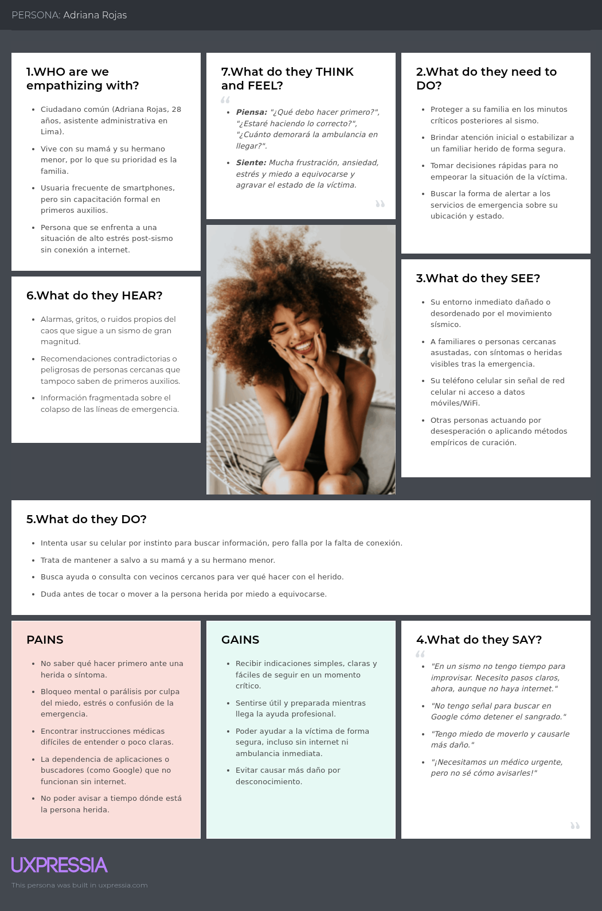
</p>

<p align="center">
  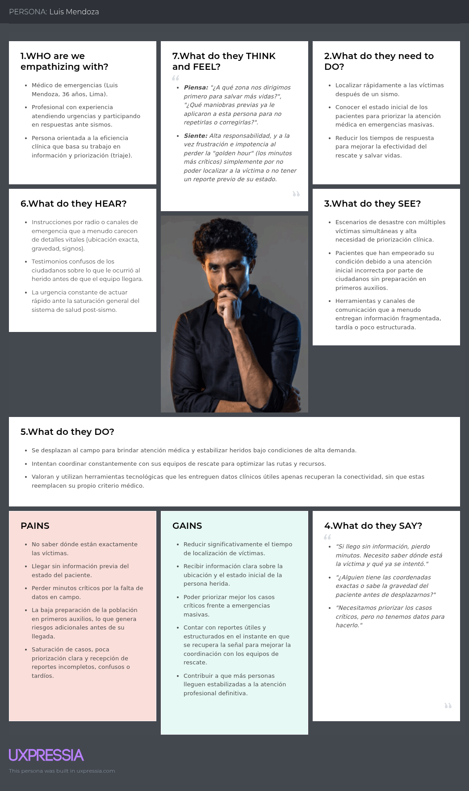
</p>

### 2.3.4. As-is Scenario Mapping

<p align="center">
  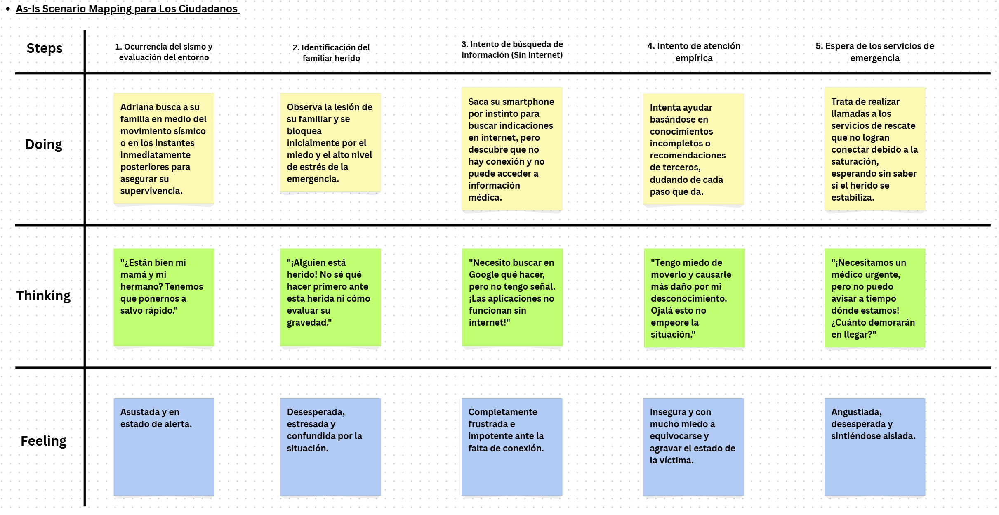
</p>

<p align="center">
  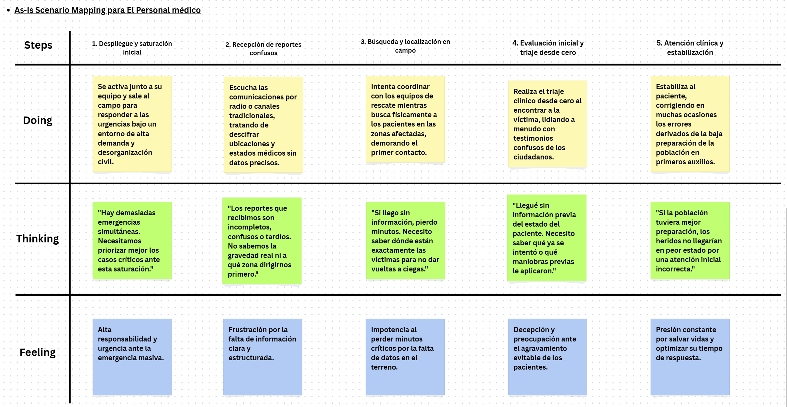
</p>

## 2.4. Ubiquitous Language

En este proyecto, el uso de Domain-Driven Design (DDD) permite alinear el desarrollo de software con la realidad del dominio de respuesta post-sismo y orientación médica asistida. Uno de los pilares de DDD es el Lenguaje Ubicuo (Ubiquitous Language), el cual es un conjunto de términos compartidos que se construyen en colaboración entre desarrolladores, diseñadores y expertos del dominio. En nuestro caso, entre el equipo de desarrollo, ciudadanos usuarios de la aplicación y personal médico vinculado a la atención de emergencias.

### Glosario de Términos

<table>
  <thead>
    <tr>
      <th>Término (Inglés)</th>
      <th>Término (Español)</th>
      <th>Definición</th>
    </tr>
  </thead>
  <tbody>
    <tr>
      <td>Citizen</td>
      <td>Ciudadano</td>
      <td>Usuario afectado por un sismo que solicita orientación de primeros auxilios desde la aplicación.</td>
    </tr>
    <tr>
      <td>Medical Staff</td>
      <td>Personal médico</td>
      <td>Profesional de salud o emergencia que visualiza, asigna, atiende y cierra casos sincronizados.</td>
    </tr>
    <tr>
      <td>Consultation</td>
      <td>Consulta</td>
      <td>Solicitud de orientación médica registrada por el ciudadano mediante texto, voz y/o fotografía.</td>
    </tr>
    <tr>
      <td>Patient</td>
      <td>Paciente</td>
      <td>Persona herida o con síntomas descrita dentro de una consulta.</td>
    </tr>
    <tr>
      <td>Medical Guidance</td>
      <td>Orientación médica</td>
      <td>Indicaciones paso a paso generadas por la IA a partir de la consulta y la base de conocimientos médicos.</td>
    </tr>
    <tr>
      <td>Medical Knowledge Base</td>
      <td>Base de conocimientos médicos</td>
      <td>Conjunto local de información de primeros auxilios utilizado para sustentar las respuestas del sistema.</td>
    </tr>
    <tr>
      <td>RAG</td>
      <td>Generación aumentada por recuperación</td>
      <td>Técnica que recupera información médica relevante antes de generar la orientación, para reducir respuestas sin respaldo.</td>
    </tr>
    <tr>
      <td>On-device AI</td>
      <td>IA on-device</td>
      <td>Modelo de inteligencia artificial que se ejecuta en el dispositivo sin depender de conexión a internet.</td>
    </tr>
    <tr>
      <td>Offline Mode</td>
      <td>Modo offline</td>
      <td>Operación de la aplicación sin conexión, permitiendo consultar y almacenar información localmente.</td>
    </tr>
    <tr>
      <td>Outbox</td>
      <td>Outbox / Cola de salida</td>
      <td>Registro local de elementos pendientes de envío hacia la nube cuando se recupere la conectividad.</td>
    </tr>
    <tr>
      <td>Synchronization</td>
      <td>Sincronización</td>
      <td>Proceso de envío y actualización de información entre el dispositivo y el backend al existir conexión.</td>
    </tr>
    <tr>
      <td>Case</td>
      <td>Caso</td>
      <td>Representación en la nube de una consulta sincronizada que puede ser gestionada por el personal médico.</td>
    </tr>
    <tr>
      <td>Case Status</td>
      <td>Estado del caso</td>
      <td>Situación actual de un caso, como pendiente, asignado, en atención o cerrado.</td>
    </tr>
    <tr>
      <td>Professional Support Request</td>
      <td>Solicitud de apoyo profesional</td>
      <td>Indicación del ciudadano para que el personal médico intervenga en la atención.</td>
    </tr>
    <tr>
      <td>Location</td>
      <td>Ubicación</td>
      <td>Referencia espacial asociada a la consulta o al paciente para facilitar su localización.</td>
    </tr>
    <tr>
      <td>Assignment</td>
      <td>Asignación</td>
      <td>Acción mediante la cual el personal médico toma responsabilidad de un caso.</td>
    </tr>
    <tr>
      <td>Care / Attention</td>
      <td>Atención</td>
      <td>Proceso en el que el personal médico inicia y desarrolla la intervención de un caso asignado.</td>
    </tr>
    <tr>
      <td>Case Closure</td>
      <td>Cierre de caso</td>
      <td>Finalización formal de un caso luego de la atención, incluyendo observaciones.</td>
    </tr>
    <tr>
      <td>History</td>
      <td>Historial</td>
      <td>Registro de consultas o casos previos asociados a un usuario.</td>
    </tr>
    <tr>
      <td>Profile</td>
      <td>Perfil</td>
      <td>Información personal y de cuenta del ciudadano o del personal médico.</td>
    </tr>
    <tr>
      <td>Role</td>
      <td>Rol</td>
      <td>Tipo de usuario en la aplicación que determina permisos y funcionalidades disponibles.</td>
    </tr>
    <tr>
      <td>Evidence</td>
      <td>Evidencia</td>
      <td>Fotografía u otro insumo adjunto que complementa la descripción de una consulta.</td>
    </tr>
    <tr>
      <td>Lifeline</td>
      <td>Lifeline</td>
      <td>Aplicación móvil de RescueBridge orientada a brindar primeros auxilios post-sismo y sincronizar casos.</td>
    </tr>
  </tbody>
</table>

# Capítulo III: Requirements Specification

## 3.1. To-Be Scenario Mapping

<p align="center">
  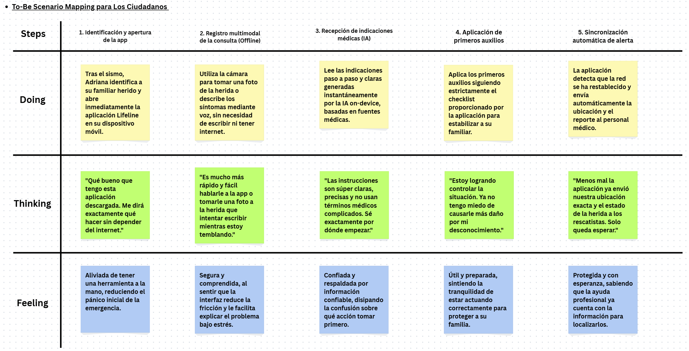
</p>

<p align="center">
  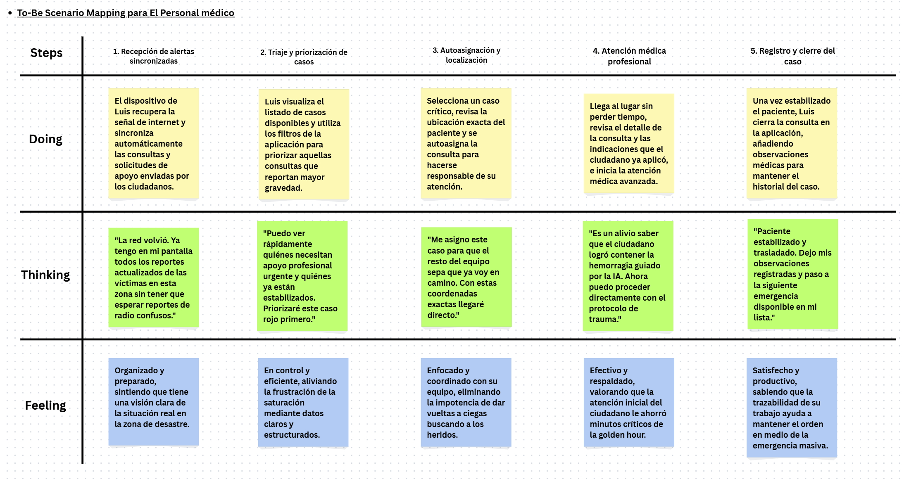
</p>

## 3.2. User Stories

__Epics__

| N.º | Título | Descripción |
|---|---|---|
| **EP-01** | **Gestión de identidad, acceso y perfiles** | Como ciudadano o personal médico, quiero ingresar a la aplicación y a mi perfil personal para utilizar las funcionalidades de la aplicación. |
| **EP-02** | **Registro de consultas médicas** | Como ciudadano, quiero registrar una consulta médica para recibir orientación de atención por medio de la inteligencia artificial. |
| **EP-03** | **Orientación médica mediante IA y bases médicas** | Como ciudadano, quiero recibir orientación médica basada en información confiable para poder ayudar a los heridos sin ponerlos en peligro. |
| **EP-04** | **Operación sin conexión y sincronización bidireccional** | Como ciudadano o personal médico, quiero utilizar la aplicación sin conexión y que mi información se sincronice al recibir señal para seguir empleando las funcionalidades de la aplicación sin internet. |
| **EP-05** | **Gestión e historial de consultas** | Como ciudadano o personal médico, quiero gestionar y dar seguimiento a las consultas para conocer el progreso de su atención. |

__User Stories__

<table>
<thead>
<tr>
<th>User Story ID</th>
<th>Título</th>
<th>Descripción</th>
<th>Criterios de Aceptación</th>
<th>Relacionado con (Epic ID)</th>
</tr>
</thead>
<tbody>
<tr>
<td>US01</td>
<td>Registro de una cuenta como ciudadano</td>
<td>Como ciudadano, quiero registrar una cuenta para ingresar a la aplicación y utilizar sus funcionalidades.</td>
<td><strong>Escenario 1:</strong> Registro exitoso del ciudadano.<br><strong>Dado que</strong> el ciudadano no cuenta con una cuenta registrada<br><strong>Cuando</strong> el ciudadano completa los datos obligatorios y confirma el registro<br><strong>Entonces</strong> el sistema crea la cuenta con el rol de ciudadano y permite su ingreso a la aplicación.<br><br><strong>Escenario 2:</strong> Datos de registro incompletos.<br><strong>Dado que</strong> el ciudadano no ha completado todos los datos obligatorios<br><strong>Cuando</strong> el ciudadano intenta registrar la cuenta<br><strong>Entonces</strong> el sistema no permite el registro.</td>
<td>EP-01</td>
</tr>
<tr>
<td>US02</td>
<td>Registro de una cuenta como personal médico</td>
<td>Como personal médico, quiero registrar una cuenta validando mi identificación profesional para acceder a las funcionalidades correspondientes a mi rol.</td>
<td><strong>Escenario 1:</strong> Registro válido del personal médico.<br><strong>Dado que</strong> la persona completa sus datos e ingresa una identificación profesional válida<br><strong>Cuando</strong> la persona confirma el registro<br><strong>Entonces</strong> el sistema crea la cuenta con el rol de personal médico.<br><br><strong>Escenario 2:</strong> Identificación profesional no válida.<br><strong>Dado que</strong> la identificación profesional ingresada no puede ser validada<br><strong>Cuando</strong> la persona intenta registrarse como personal médico<br><strong>Entonces</strong> el sistema no permite el registro con dicho rol.</td>
<td>EP-01</td>
</tr>
<tr>
<td>US03</td>
<td>Inicio de sesión</td>
<td>Como ciudadano o personal médico, quiero iniciar sesión para acceder a las funcionalidades disponibles para mi rol.</td>
<td><strong>Escenario 1:</strong> Inicio de sesión exitoso.<br><strong>Dado que</strong> la persona posee una cuenta registrada<br><strong>Cuando</strong> la persona ingresa credenciales válidas<br><strong>Entonces</strong> el sistema inicia su sesión y muestra las funcionalidades correspondientes a su rol.<br><br><strong>Escenario 2:</strong> Credenciales incorrectas.<br><strong>Dado que</strong> la persona ingresa credenciales que no coinciden con una cuenta registrada<br><strong>Cuando</strong> la persona intenta iniciar sesión<br><strong>Entonces</strong> el sistema rechaza el acceso y muestra un mensaje informativo.</td>
<td>EP-01</td>
</tr>
<tr>
<td>US04</td>
<td>Consulta del perfil personal</td>
<td>Como ciudadano o personal médico, quiero consultar mi perfil para revisar los datos asociados a mi cuenta.</td>
<td><strong>Escenario 1:</strong> Visualización del perfil.<br><strong>Dado que</strong> la persona ha iniciado sesión<br><strong>Cuando</strong> la persona accede a la sección de su perfil<br><strong>Entonces</strong> el sistema muestra los datos personales registrados en su cuenta.<br><br><strong>Escenario 2:</strong> Sesión no válida al consultar el perfil.<br><strong>Dado que</strong> la sesión de la persona ya no se encuentra activa<br><strong>Cuando</strong> la persona intenta acceder a su perfil<br><strong>Entonces</strong> el sistema solicita que vuelva a iniciar sesión antes de mostrar los datos personales.</td>
<td>EP-01</td>
</tr>
<tr>
<td>US05</td>
<td>Actualización de datos personales</td>
<td>Como ciudadano o personal médico, quiero actualizar mis datos personales para mantener vigente la información de mi perfil.</td>
<td><strong>Escenario 1:</strong> Actualización exitosa del perfil.<br><strong>Dado que</strong> la persona se encuentra en su perfil<br><strong>Cuando</strong> la persona modifica sus datos con valores válidos y guarda los cambios<br><strong>Entonces</strong> el sistema actualiza la información y muestra los nuevos datos.<br><br><strong>Escenario 2:</strong> Datos actualizados no válidos.<br><strong>Dado que</strong> la persona ha ingresado información que no cumple con el formato requerido<br><strong>Cuando</strong> la persona intenta guardar los cambios<br><strong>Entonces</strong> el sistema conserva la información anterior.</td>
<td>EP-01</td>
</tr>
<tr>
<td>US06</td>
<td>Cierre de sesión</td>
<td>Como ciudadano o personal médico, quiero cerrar mi sesión para impedir que otras personas accedan a mi cuenta desde el dispositivo.</td>
<td><strong>Escenario 1:</strong> Cierre de sesión exitoso.<br><strong>Dado que</strong> la persona mantiene una sesión activa<br><strong>Cuando</strong> la persona selecciona la opción de cerrar sesión<br><strong>Entonces</strong> el sistema finaliza la sesión y solicita autenticación para volver a ingresar.<br><br><strong>Escenario 2:</strong> Acceso posterior al cierre de sesión.<br><strong>Dado que</strong> la persona ha cerrado su sesión<br><strong>Cuando</strong> la persona intenta ingresar nuevamente a una funcionalidad restringida<br><strong>Entonces</strong> el sistema impide el acceso y muestra la pantalla de inicio de sesión.</td>
<td>EP-01</td>
</tr>
<tr>
<td>US07</td>
<td>Registro de una consulta mediante texto</td>
<td>Como ciudadano, quiero describir una consulta médica mediante texto para comunicar la situación del paciente.</td>
<td><strong>Escenario 1:</strong> Ingreso de una consulta escrita.<br><strong>Dado que</strong> el ciudadano se encuentra en el registro de una consulta<br><strong>Cuando</strong> el ciudadano escribe la situación médica del paciente<br><strong>Entonces</strong> el sistema incorpora el texto como parte de la consulta que será procesada.<br><br><strong>Escenario 2:</strong> Descripción vacía.<br><strong>Dado que</strong> el ciudadano no ha ingresado una descripción por texto ni por voz<br><strong>Cuando</strong> el ciudadano intenta procesar la consulta<br><strong>Entonces</strong> el sistema solicita que describa la situación antes de continuar.</td>
<td>EP-02</td>
</tr>
<tr>
<td>US08</td>
<td>Registro de una consulta mediante voz</td>
<td>Como ciudadano, quiero describir una consulta médica mediante voz para registrar la situación cuando no pueda escribirla con facilidad.</td>
<td><strong>Escenario 1:</strong> Registro de la descripción por voz.<br><strong>Dado que</strong> el ciudadano se encuentra en el registro de una consulta<br><strong>Cuando</strong> el ciudadano graba una descripción por voz<br><strong>Entonces</strong> el sistema convierte el audio en texto y lo incorpora a la consulta.<br><br><strong>Escenario 2:</strong> Audio que no logra ser transcrito.<br><strong>Dado que</strong> la grabación no tiene la calidad suficiente para ser transcrita<br><strong>Cuando</strong> la aplicación intenta convertirla en texto<br><strong>Entonces</strong> informa que no pudo completar la transcripción y permite volver a grabar o escribir la consulta.</td>
<td>EP-02</td>
</tr>
<tr>
<td>US09</td>
<td>Adjunto de fotografías a una consulta</td>
<td>Como ciudadano, quiero adjuntar fotografías a una consulta para complementar la descripción de la situación del paciente.</td>
<td><strong>Escenario 1:</strong> Fotografía agregada correctamente.<br><strong>Dado que</strong> el ciudadano está registrando una consulta<br><strong>Cuando</strong> el ciudadano selecciona o captura una fotografía compatible<br><strong>Entonces</strong> el sistema adjunta la imagen y la muestra como parte de la consulta.<br><br><strong>Escenario 2:</strong> Fotografía no compatible.<br><strong>Dado que</strong> el ciudadano selecciona una imagen con un formato no admitido o que no puede ser procesada<br><strong>Cuando</strong> el ciudadano intenta adjuntarla<br><strong>Entonces</strong> el sistema rechaza el archivo e informa que debe seleccionar otra fotografía.</td>
<td>EP-02</td>
</tr>
<tr>
<td>US10</td>
<td>Ingreso de datos del paciente</td>
<td>Como ciudadano, quiero ingresar los datos del paciente cuando solicite apoyo profesional para facilitar la atención del caso.</td>
<td><strong>Escenario 1:</strong> Solicitud de datos del paciente.<br><strong>Dado que</strong> el ciudadano está registrando una consulta<br><strong>Cuando</strong> el ciudadano selecciona la opción de solicitar apoyo profesional<br><strong>Entonces</strong> el sistema solicita los datos del paciente.<br><br><strong>Escenario 2:</strong> Consulta sin solicitud de apoyo profesional.<br><strong>Dado que</strong> el ciudadano está registrando una consulta<br><strong>Cuando</strong> el ciudadano continúa sin seleccionar la opción de solicitar apoyo profesional<br><strong>Entonces</strong> el sistema permite continuar con el registro de la consulta sin pedir información del paciente.<br><br><strong>Escenario 3:</strong> Datos obligatorios del paciente incompletos.<br><strong>Dado que</strong> el ciudadano seleccionó la opción de solicitar apoyo profesional y que no completó todos los datos del paciente<br><strong>Cuando</strong> el ciudadano intenta registrar la solicitud de apoyo<br><strong>Entonces</strong> el sistema solicita completar la información del paciente antes de continuar.</td>
<td>EP-02</td>
</tr>
<tr>
<td>US11</td>
<td>Registro de la ubicación de la consulta</td>
<td>Como ciudadano, quiero registrar la ubicación del paciente para que el personal médico pueda conocer dónde se encuentra.</td>
<td><strong>Escenario 1:</strong> Ubicación obtenida correctamente.<br><strong>Dado que</strong> el dispositivo puede acceder a la ubicación actual<br><strong>Cuando</strong> el ciudadano registra la consulta<br><strong>Entonces</strong> el sistema guarda las coordenadas y las asocia con la consulta.<br><br><strong>Escenario 2:</strong> Ubicación no disponible.<br><strong>Dado que</strong> el dispositivo no puede obtener la ubicación actual<br><strong>Cuando</strong> el ciudadano registra la consulta<br><strong>Entonces</strong> el sistema guarda la consulta sin ubicación.</td>
<td>EP-02</td>
</tr>
<tr>
<td>US12</td>
<td>Elección de solicitud de apoyo profesional</td>
<td>Como ciudadano, quiero indicar si necesito apoyo profesional para que el personal médico llegue en mi apoyo si lo requiero.</td>
<td><strong>Escenario 1:</strong> Solicitud de apoyo profesional.<br><strong>Dado que</strong> el ciudadano ha recibido las indicaciones médicas<br><strong>Cuando</strong> el ciudadano selecciona la opción de solicitar apoyo profesional<br><strong>Entonces</strong> el sistema registra la solicitud dentro de la consulta.<br><br><strong>Escenario 2:</strong> Consulta sin solicitud de apoyo.<br><strong>Dado que</strong> el ciudadano ha recibido las indicaciones médicas<br><strong>Cuando</strong> el ciudadano continúa sin seleccionar la opción de apoyo profesional<br><strong>Entonces</strong> el sistema registra la consulta sin solicitar la intervención del personal médico.</td>
<td>EP-02</td>
</tr>
<tr>
<td>US13</td>
<td>Incorporación de fuentes médicas autorizadas</td>
<td>Como desarrollador, quiero incorporar y validar fuentes autorizadas para sustentar la orientación generada por la aplicación.</td>
<td><strong>Escenario 1:</strong> Incorporación de una fuente autorizada.<br><strong>Dado que</strong> se dispone de un documento proveniente de una fuente médica autorizada<br><strong>Cuando</strong> el responsable confirma su validez y lo incorpora<br><strong>Entonces</strong> el contenido queda disponible para su procesamiento en la base médica.<br><br><strong>Escenario 2:</strong> Fuente no validada.<br><strong>Dado que</strong> no se puede comprobar la procedencia o validez de una fuente<br><strong>Cuando</strong> el responsable intenta incorporarla<br><strong>Entonces</strong> el contenido no queda habilitado para sustentar las orientaciones médicas.</td>
<td>EP-03</td>
</tr>
<tr>
<td>US14</td>
<td>Obtención de indicaciones médicas sin conexión</td>
<td>Como ciudadano, quiero obtener indicaciones médicas basadas en mi consulta sin conexión a internet para actuar ante la emergencia.</td>
<td><strong>Escenario 1:</strong> Orientación generada sin conexión.<br><strong>Dado que</strong> el dispositivo no tiene acceso a internet<br><strong>Y que</strong> se cuenta con los componentes locales necesarios<br><strong>Cuando</strong> el ciudadano envía una consulta<br><strong>Entonces</strong> la aplicación procesa la información localmente<br><strong>Y</strong> muestra indicaciones basadas en la base médica disponible.<br><br><strong>Escenario 2:</strong> Componentes locales no disponibles.<br><strong>Dado que</strong> el dispositivo no tiene conexión<br><strong>Y que</strong> no puede cargar el modelo o la base médica local<br><strong>Cuando</strong> el ciudadano intenta procesar la consulta<br><strong>Entonces</strong> la aplicación informa que no puede generar la orientación<strong><br>Y</strong> evita mostrar indicaciones incompletas.<br></td>
<td>EP-03</td>
</tr>
<tr>
<td>US15</td>
<td>Indicaciones médicas claras y ordenadas</td>
<td>Como ciudadano, quiero recibir indicaciones claras y ordenadas para comprender las acciones que debo realizar.</td>
<td><strong>Escenario 1:</strong> Presentación comprensible de las indicaciones.<br><strong>Dado que</strong> la aplicación ha procesado la consulta<br><strong>Cuando</strong> la aplicación muestra la orientación médica<br><strong>Entonces</strong> presenta las acciones en un orden lógico, con lenguaje claro y sin términos técnicos innecesarios.<br><br><strong>Escenario 2:</strong> Procedimiento compuesto por varios pasos.<br><strong>Dado que</strong> la orientación requiere realizar más de una acción<br><strong>Cuando</strong> la aplicación presenta la respuesta<br><strong>Entonces</strong> enumera los pasos en la secuencia en la que deben realizarse.</td>
<td>EP-03</td>
</tr>
<tr>
<td>US16</td>
<td>Respuesta segura ante información insuficiente</td>
<td>Como ciudadano, quiero ser informado cuando no exista información suficiente para recibir una orientación confiable y evitar realizar acciones inseguras.</td>
<td><strong>Escenario 1:</strong> Información insuficiente para orientar.<br><strong>Dado que</strong> la consulta no contiene datos suficientes o la base médica no permite sustentar una respuesta<br><strong>Cuando</strong> la aplicación procesa la solicitud<br><strong>Entonces</strong> informa que no puede brindar una orientación confiable y evita generar instrucciones no sustentadas.<br><br><strong>Escenario 2:</strong> Consulta fuera del contenido disponible.<br><strong>Dado que</strong> la situación descrita no está cubierta por la base médica local<br><strong>Cuando</strong> la aplicación busca información para responder<br><strong>Entonces</strong> comunica la limitación y recomienda solicitar apoyo profesional.</td>
<td>EP-03</td>
</tr>
<tr>
<td>US17</td>
<td>Recomendación de atención profesional</td>
<td>Como ciudadano, quiero recibir una recomendación de atención profesional cuando se identifiquen señales de gravedad para buscar ayuda especializada.</td>
<td><strong>Escenario 1:</strong> Consulta con señales de gravedad.<br><strong>Dado que</strong> la información de la consulta presenta señales configuradas como graves<br><strong>Cuando</strong> la aplicación genera las indicaciones<br><strong>Entonces</strong> incluye al final la recomendación de solicitar atención de un profesional.<br><br><strong>Escenario 2:</strong> Consulta sin señales de gravedad identificadas.<br><strong>Dado que</strong> la información registrada no coincide con las reglas de gravedad configuradas<br><strong>Cuando</strong> la aplicación genera las indicaciones<br><strong>Entonces</strong> presenta las indicaciones médicas sin indicar solicitar apoyo profesional.</td>
<td>EP-03</td>
</tr>
<tr>
<td>US18</td>
<td>Guardado de una consulta pendiente de sincronización</td>
<td>Como ciudadano, quiero que mi consulta se guarde cuando no exista conexión para que pueda enviarse posteriormente.</td>
<td><strong>Escenario 1:</strong> Consulta guardada sin conexión.<br><strong>Dado que</strong> el dispositivo no tiene acceso a internet<br><strong>Cuando</strong> el ciudadano completa el registro de la consulta<br><strong>Entonces</strong> la aplicación la almacena localmente con el estado pendiente de sincronización.<br><br><strong>Escenario 2:</strong> Persistencia de la consulta pendiente.<br><strong>Dado que</strong> una consulta fue guardada localmente y aún no se ha sincronizado<br><strong>Cuando</strong> el ciudadano cierra y vuelve a abrir la aplicación<br><strong>Entonces</strong> la consulta continúa disponible con el estado pendiente de sincronización.</td>
<td>EP-04</td>
</tr>
<tr>
<td>US19</td>
<td>Visualización de consultas almacenadas localmente</td>
<td>Como ciudadano, quiero visualizar las consultas almacenadas en mi dispositivo para conocer cuáles están pendientes de sincronización.</td>
<td><strong>Escenario 1:</strong> Consulta de registros locales.<br><strong>Dado que</strong> existen consultas guardadas en el dispositivo<br><strong>Cuando</strong> el ciudadano accede a sus consultas locales<br><strong>Entonces</strong> la aplicación muestra cada consulta con su estado de sincronización.<br><br><strong>Escenario 2:</strong> Ausencia de consultas locales.<br><strong>Dado que</strong> el dispositivo no contiene consultas almacenadas localmente<br><strong>Cuando</strong> el ciudadano accede a esta sección<br><strong>Entonces</strong> la aplicación informa que no existen consultas pendientes en el dispositivo.</td>
<td>EP-04</td>
</tr>
<tr>
<td>US20</td>
<td>Sincronización automática de consultas y actualizaciones</td>
<td>Como ciudadano o personal médico, quiero que las consultas y sus actualizaciones se sincronicen automáticamente para mantener la información disponible y actualizada.</td>
<td><strong>Escenario 1:</strong> Envío de consultas pendientes.<br><strong>Dado que</strong> existen consultas guardadas localmente<br><strong>Cuando</strong> la aplicación recupera la conexión a internet<br><strong>Entonces</strong> envía automáticamente las consultas pendientes al backend.<br><br><strong>Escenario 2:</strong> Recepción de actualizaciones de las consultas.<br><strong>Dado que</strong> una consulta sincronizada cambió de estado o fue tomada por personal médico<br><strong>Cuando</strong> la aplicación se conecta con el backend<br><strong>Entonces</strong> actualiza la copia local con el nuevo estado y la información del profesional asignado.</td>
<td>EP-04</td>
</tr>
<tr>
<td>US21</td>
<td>Notificaciones sobre la sincronización y atención del caso</td>
<td>Como ciudadano, quiero recibir notificaciones sobre la sincronización y atención de mi consulta para mantenerme informado sobre su progreso.</td>
<td><strong>Escenario 1:</strong> Consulta tomada por personal médico.<br><strong>Dado que</strong> una consulta sincronizada ha sido autoasignada por personal médico<br><strong>Cuando</strong> la aplicación recibe la actualización<br><strong>Entonces</strong> notifica al ciudadano sobre la atención de su caso.<br><br><strong>Escenario 2:</strong> Sincronización no completada.<br><strong>Dado que</strong> la aplicación intentó sincronizar una consulta y el proceso falló<br><strong>Cuando</strong> la aplicación registra el resultado del intento<br><strong>Entonces</strong> informa al ciudadano que la consulta continúa pendiente de sincronización.</td>
<td>EP-04</td>
</tr>
<tr>
<td>US22</td>
<td>Consulta del historial de consultas realizadas</td>
<td>Como ciudadano, quiero consultar mi historial para revisar las consultas médicas que he realizado.</td>
<td><strong>Escenario 1:</strong> Historial disponible.<br><strong>Dado que</strong> el ciudadano ha registrado consultas anteriormente<br><strong>Cuando</strong> el ciudadano accede a su historial<br><strong>Entonces</strong> la aplicación muestra las consultas asociadas con su cuenta.<br><br><strong>Escenario 2:</strong> Historial sin consultas.<br><strong>Dado que</strong> el ciudadano todavía no ha registrado consultas<br><strong>Cuando</strong> el ciudadano accede a su historial<br><strong>Entonces</strong> la aplicación informa que aún no existen consultas para mostrar.</td>
<td>EP-05</td>
</tr>
<tr>
<td>US23</td>
<td>Visualización del detalle actualizado de una consulta</td>
<td>Como ciudadano, quiero visualizar el detalle actualizado de una consulta para conocer su información y el progreso de la atención.</td>
<td><strong>Escenario 1:</strong> Detalle de una consulta asignada.<br><strong>Dado que</strong> el ciudadano selecciona una consulta tomada por personal médico<br><strong>Cuando</strong> el ciudadano abre su detalle<br><strong>Entonces</strong> la aplicación muestra la información ingresada, las indicaciones generadas, el estado de sincronización, el estado de atención y el nombre del profesional asignado.<br><br><strong>Escenario 2:</strong> Detalle de una consulta sin asignación.<br><strong>Dado que</strong> el ciudadano selecciona una consulta que todavía no ha sido tomada<br><strong>Cuando</strong> el ciudadano abre su detalle<br><strong>Entonces</strong> la aplicación muestra la información disponible e indica que aún no existe personal médico asignado.</td>
<td>EP-05</td>
</tr>
<tr>
<td>US24</td>
<td>Visualización de consultas que solicitan apoyo profesional</td>
<td>Como personal médico, quiero visualizar las consultas que solicitan apoyo profesional para identificar casos que puedo atender.</td>
<td><strong>Escenario 1:</strong> Listado de consultas disponibles.<br><strong>Dado que</strong> existen consultas sincronizadas con solicitud de apoyo profesional<br><strong>Cuando</strong> el personal médico accede al listado de casos<br><strong>Entonces</strong> la aplicación muestra las consultas que pueden ser revisadas para su atención.<br><br><strong>Escenario 2:</strong> Ausencia de consultas disponibles.<br><strong>Dado que</strong> no existen consultas disponibles que soliciten apoyo profesional<br><strong>Cuando</strong> el personal médico accede al listado de casos<br><strong>Entonces</strong> la aplicación informa que no hay consultas disponibles para atender.</td>
<td>EP-05</td>
</tr>
<tr>
<td>US25</td>
<td>Filtrado de consultas por estado</td>
<td>Como personal médico, quiero filtrar las consultas por estado para encontrar los casos que necesito revisar.</td>
<td><strong>Escenario 1:</strong> Aplicación del filtro de estado.<br><strong>Dado que</strong> el personal médico visualiza el listado de consultas<br><strong>Cuando</strong> el personal médico selecciona un estado como criterio de filtrado<br><strong>Entonces</strong> la aplicación muestra únicamente las consultas que poseen dicho estado.<br><br><strong>Escenario 2:</strong> Retiro del filtro aplicado.<br><strong>Dado que</strong> el listado se encuentra filtrado por un estado<br><strong>Cuando</strong> el personal médico elimina el filtro<br><strong>Entonces</strong> la aplicación vuelve a mostrar todas las consultas disponibles.</td>
<td>EP-05</td>
</tr>
<tr>
<td>US26</td>
<td>Visualización de consultas autoasignadas</td>
<td>Como personal médico, quiero visualizar las consultas que me he autoasignado para organizar los casos bajo mi atención.</td>
<td><strong>Escenario 1:</strong> Listado de casos autoasignados.<br><strong>Dado que</strong> el personal médico se ha autoasignado una o más consultas<br><strong>Cuando</strong> el personal médico accede a sus consultas asignadas<br><strong>Entonces</strong> la aplicación muestra únicamente los casos asociados con su cuenta.<br><br><strong>Escenario 2:</strong> Ausencia de casos autoasignados.<br><strong>Dado que</strong> el personal médico no tiene consultas bajo su responsabilidad<br><strong>Cuando</strong> el personal médico accede a sus consultas asignadas<br><strong>Entonces</strong> la aplicación informa que todavía no posee casos asignados.</td>
<td>EP-05</td>
</tr>
<tr>
<td>US27</td>
<td>Consulta del detalle completo de un caso</td>
<td>Como personal médico, quiero consultar el detalle completo de un caso para evaluar la información registrada y la orientación proporcionada.</td>
<td><strong>Escenario 1:</strong> Visualización del caso seleccionado.<br><strong>Dado que</strong> el personal médico tiene acceso a una consulta<br><strong>Cuando</strong> el personal médico selecciona el caso<br><strong>Entonces</strong> la aplicación muestra los datos del paciente, la descripción, las fotografías, la orientación generada y el estado actual.<br><br><strong>Escenario 2:</strong> Consulta sin fotografía adjunta.<br><strong>Dado que</strong> el ciudadano registró una consulta sin fotografía<br><strong>Cuando</strong> el personal médico revisa el detalle del caso<br><strong>Entonces</strong> la aplicación muestra la información restante e indica que no se adjuntaron imágenes.</td>
<td>EP-05</td>
</tr>
<tr>
<td>US28</td>
<td>Visualización de la ubicación del paciente</td>
<td>Como personal médico, quiero visualizar la ubicación registrada del paciente para conocer dónde se encuentra el caso.</td>
<td><strong>Escenario 1:</strong> Ubicación disponible en la consulta.<br><strong>Dado que</strong> la consulta posee coordenadas registradas<br><strong>Cuando</strong> el personal médico revisa la ubicación del caso<br><strong>Entonces</strong> la aplicación muestra la posición asociada con la consulta.<br><br><strong>Escenario 2:</strong> Ubicación no registrada.<br><strong>Dado que</strong> la consulta no contiene coordenadas disponibles<br><strong>Cuando</strong> el personal médico revisa su detalle<br><strong>Entonces</strong> la aplicación informa que no se pudo registrar la ubicación del paciente.</td>
<td>EP-05</td>
</tr>
<tr>
<td>US29</td>
<td>Autoasignación de una consulta disponible</td>
<td>Como personal médico, quiero autoasignarme una consulta disponible para hacerme responsable de su atención.</td>
<td><strong>Escenario 1:</strong> Autoasignación exitosa.<br><strong>Dado que</strong> la consulta se encuentra disponible y no tiene personal médico asignado<br><strong>Cuando</strong> el profesional confirma la autoasignación<br><strong>Entonces</strong> la aplicación lo registra como responsable y actualiza el estado del caso.<br><br><strong>Escenario 2:</strong> Consulta asignada previamente.<br><strong>Dado que</strong> otro profesional ya tomó la consulta<br><strong>Cuando</strong> otro integrante del personal médico intenta autoasignarse esa consulta<br><strong>Entonces</strong> la aplicación no muestra la opción disponible.</td>
<td>EP-05</td>
</tr>
<tr>
<td>US30</td>
<td>Inicio de la atención de una consulta</td>
<td>Como personal médico, quiero iniciar la atención de una consulta autoasignada para registrar que el caso se encuentra en progreso.</td>
<td><strong>Escenario 1:</strong> Atención iniciada.<br><strong>Dado que</strong> la consulta está asignada al personal médico y permanece pendiente de atención<br><strong>Cuando</strong> el profesional inicia la atención<br><strong>Entonces</strong> la aplicación actualiza el caso al estado en progreso.<br><br><strong>Escenario 2:</strong> Inicio solicitado por otro profesional.<br><strong>Dado que</strong> la consulta está asignada a una persona diferente<br><strong>Cuando</strong> otro integrante del personal médico intenta iniciar la atención<br><strong>Entonces</strong> la aplicación no muestra la opción disponible.</td>
<td>EP-05</td>
</tr>
<tr>
<td>US31</td>
<td>Cierre de una consulta con observaciones</td>
<td>Como personal médico, quiero cerrar una consulta y registrar observaciones para dejar constancia de la atención realizada.</td>
<td><strong>Escenario 1:</strong> Cierre exitoso del caso.<br><strong>Dado que</strong> la consulta se encuentra en atención por el personal médico<br><strong>Cuando</strong> el personal médico asignado registra sus observaciones y confirma el cierre<br><strong>Entonces</strong> la aplicación guarda las observaciones y actualiza la consulta al estado cerrado.<br><br><strong>Escenario 2:</strong> Cierre solicitado por personal no asignado.<br><strong>Dado que</strong> la consulta está bajo la responsabilidad de otro profesional<br><strong>Cuando</strong> una persona diferente intenta cerrarla<br><strong>Entonces</strong> la aplicación rechaza la operación y conserva el estado actual del caso.</td>
<td>EP-05</td>
</tr>
<tr>
<td>US32</td>
<td>Consulta del historial de casos atendidos</td>
<td>Como personal médico, quiero consultar el historial de casos que he atendido para revisar las atenciones realizadas.</td>
<td><strong>Escenario 1:</strong> Historial de atenciones disponible.<br><strong>Dado que</strong> el personal médico ha atendido consultas anteriormente<br><strong>Cuando</strong> el personal médico accede a su historial<br><strong>Entonces</strong> la aplicación muestra los casos atendidos asociados con su cuenta.<br><br><strong>Escenario 2:</strong> Historial sin casos atendidos.<br><strong>Dado que</strong> el personal médico todavía no ha cerrado ninguna consulta<br><strong>Cuando</strong> el personal médico accede a su historial<br><strong>Entonces</strong> la aplicación informa que aún no posee casos atendidos.</td>
<td>EP-05</td>
</tr>
<tr>
</tr>
<tr>
<td>TS01</td>
<td>Protección de la sesión almacenada en el dispositivo</td>
<td>Como desarrollador, quiero proteger la sesión almacenada en el dispositivo para evitar el acceso no autorizado a la cuenta.</td>
<td><strong>Escenario 1:</strong> Almacenamiento seguro de la sesión.<br><strong>Dado que</strong> una persona ha iniciado sesión correctamente<br><strong>Cuando</strong> la aplicación conserva la información necesaria para mantenerla activa<br><strong>Entonces</strong> los datos de sesión se almacenan mediante un mecanismo seguro y dejan de ser válidos al cerrar la sesión.<br><br><strong>Escenario 2:</strong> Sesión expirada.<br><strong>Dado que</strong> la información de sesión superó su período de validez<br><strong>Cuando</strong> la aplicación intenta utilizarla para acceder a una función restringida<br><strong>Entonces</strong> rechaza la sesión almacenada y solicita una nueva autenticación.</td>
<td>EP-01</td>
</tr>
<tr>
<td>TS02</td>
<td>Conversión local de voz a texto</td>
<td>Como desarrollador, quiero implementar la conversión local de voz a texto para registrar consultas habladas sin depender de internet.</td>
<td><strong>Escenario 1:</strong> Transcripción sin conexión.<br><strong>Dado que</strong> el dispositivo no tiene acceso a internet y el ciudadano ha grabado una descripción<br><strong>Cuando</strong> la aplicación procesa el audio<br><strong>Entonces</strong> genera localmente el texto correspondiente y lo incorpora a la consulta.<br><br><strong>Escenario 2:</strong> Fallo del motor de transcripción.<br><strong>Dado que</strong> el componente local no puede procesar el audio recibido<br><strong>Cuando</strong> intenta generar la transcripción<br><strong>Entonces</strong> devuelve un resultado controlado, no incorpora texto incompleto y permite realizar un nuevo intento.</td>
<td>EP-02</td>
</tr>
<tr>
<td>TS03</td>
<td>Compresión y optimización de fotografías adjuntas</td>
<td>Como desarrollador, quiero comprimir las fotografías adjuntas para reducir el almacenamiento y la transferencia sin impedir su revisión.</td>
<td><strong>Escenario 1:</strong> Optimización de una fotografía.<br><strong>Dado que</strong> el ciudadano ha seleccionado una imagen compatible<br><strong>Cuando</strong> la aplicación la incorpora a la consulta<br><strong>Entonces</strong> genera una versión optimizada que respeta el límite configurado y mantiene una calidad suficiente para su visualización.<br><br><strong>Escenario 2:</strong> Fallo durante la compresión.<br><strong>Dado que</strong> la aplicación no puede generar la versión optimizada de una fotografía<br><strong>Cuando</strong> finaliza el intento de procesamiento<br><strong>Entonces</strong> no marca la imagen como lista para enviar y devuelve un error controlado.</td>
<td>EP-02</td>
</tr>
<tr>
<td>TS04</td>
<td>Optimización del procesamiento de entradas multimodales</td>
<td>Como desarrollador, quiero optimizar el procesamiento de texto, voz y fotografías para mantener una respuesta fluida durante el registro de la consulta.</td>
<td><strong>Escenario 1:</strong> Procesamiento conjunto de las entradas.<br><strong>Dado que</strong> una consulta contiene texto transcrito y fotografías<br><strong>Cuando</strong> la aplicación prepara la información para su análisis<br><strong>Entonces</strong> procesa las entradas dentro de los objetivos de tiempo y uso de recursos definidos para el producto.<br><br><strong>Escenario 2:</strong> Recursos limitados en el dispositivo.<br><strong>Dado que</strong> el dispositivo posee recursos disponibles cercanos al límite permitido<br><strong>Cuando</strong> la aplicación procesa las entradas multimodales<br><strong>Entonces</strong> controla el uso de memoria y evita el cierre inesperado de la aplicación.</td>
<td>EP-02</td>
</tr>
<tr>
<td>TS05</td>
<td>Procesamiento e indexación de documentos médicos por tipo de procedimiento</td>
<td>Como desarrollador, quiero procesar e indexar los documentos médicos por tipo de procedimiento para facilitar la recuperación de información relevante.</td>
<td><strong>Escenario 1:</strong> Indexación de un documento médico.<br><strong>Dado que</strong> una fuente médica fue autorizada para su incorporación<br><strong>Cuando</strong> se ejecuta el proceso de preparación de la base<br><strong>Entonces</strong> el contenido se divide, clasifica por tipo de procedimiento e incorpora al índice de búsqueda.<br><br><strong>Escenario 2:</strong> Documento que no puede ser procesado.<br><strong>Dado que</strong> el contenido de una fuente autorizada está vacío o posee un formato no compatible<br><strong>Cuando</strong> se ejecuta la indexación<br><strong>Entonces</strong> el documento no se incorpora al índice y el proceso registra el motivo del rechazo.</td>
<td>EP-03</td>
</tr>
<tr>
<td>TS06</td>
<td>Almacenamiento local del índice médico</td>
<td>Como desarrollador, quiero implementar el almacenamiento local del índice médico para permitir su consulta sin conexión a internet.</td>
<td><strong>Escenario 1:</strong> Disponibilidad local del índice.<br><strong>Dado que</strong> la base médica ha sido procesada e indexada<br><strong>Cuando</strong> la aplicación se ejecuta sin conexión<br><strong>Entonces</strong> puede cargar y consultar el índice desde el almacenamiento del dispositivo.<br><br><strong>Escenario 2:</strong> Índice local no disponible.<br><strong>Dado que</strong> el índice médico no existe o no puede ser leído en el dispositivo<br><strong>Cuando</strong> la aplicación intenta iniciar una búsqueda<br><strong>Entonces</strong> detiene el procesamiento y devuelve un estado controlado que impide generar una orientación sin respaldo.</td>
<td>EP-03</td>
</tr>
<tr>
<td>TS07</td>
<td>Optimización de la búsqueda de información médica</td>
<td>Como desarrollador, quiero optimizar la búsqueda en la base médica para recuperar información relevante con rapidez.</td>
<td><strong>Escenario 1:</strong> Recuperación eficiente de información.<br><strong>Dado que</strong> una consulta fue preparada para buscar información médica<br><strong>Cuando</strong> el sistema consulta el índice local<br><strong>Entonces</strong> recupera los contenidos relevantes dentro del objetivo de tiempo definido para la aplicación.<br><br><strong>Escenario 2:</strong> Ausencia de resultados relevantes.<br><strong>Dado que</strong> ningún contenido supera el nivel mínimo de relevancia configurado<br><strong>Cuando</strong> el sistema completa la búsqueda<br><strong>Entonces</strong> devuelve un resultado vacío en lugar de seleccionar información que no corresponda con la consulta.</td>
<td>EP-03</td>
</tr>
<tr>
<td>TS08</td>
<td>Integración del modelo de IA local</td>
<td>Como desarrollador, quiero integrar un modelo de inteligencia artificial local para generar orientación sin depender de servicios en la nube.</td>
<td><strong>Escenario 1:</strong> Inferencia ejecutada localmente.<br><strong>Dado que</strong> el modelo se encuentra instalado y disponible en el dispositivo<br><strong>Cuando</strong> la aplicación procesa una consulta sin conexión<br><strong>Entonces</strong> ejecuta localmente la inferencia y obtiene una respuesta sin comunicarse con un servicio externo.<br><br><strong>Escenario 2:</strong> Modelo local no disponible.<br><strong>Dado que</strong> la aplicación no puede cargar el modelo en el dispositivo<br><strong>Cuando</strong> intenta procesar una consulta<br><strong>Entonces</strong> detiene la inferencia y comunica el fallo mediante el mecanismo de respuesta segura.</td>
<td>EP-03</td>
</tr>
<tr>
<td>TS09</td>
<td>Implementación del flujo de recuperación aumentada por generación</td>
<td>Como desarrollador, quiero implementar el flujo RAG para generar orientación utilizando información recuperada de la base médica.</td>
<td><strong>Escenario 1:</strong> Ejecución completa del flujo RAG.<br><strong>Dado que</strong> el ciudadano ha registrado una consulta<br><strong>Cuando</strong> la aplicación inicia su procesamiento<br><strong>Entonces</strong> recupera información médica relacionada, la entrega al modelo local y genera una respuesta basada en dicho contexto.<br><br><strong>Escenario 2:</strong> Contexto médico insuficiente.<br><strong>Dado que</strong> la búsqueda no recupera información con relevancia suficiente<br><strong>Cuando</strong> el flujo RAG intenta generar la orientación<br><strong>Entonces</strong> evita producir indicaciones no sustentadas y deriva el resultado al mecanismo de respuesta segura.</td>
<td>EP-03</td>
</tr>
<tr>
<td>TS10</td>
<td>Diseño del prompt de orientación médica</td>
<td>Como desarrollador, quiero diseñar un prompt de orientación médica para obtener respuestas claras, ordenadas y prudentes.</td>
<td><strong>Escenario 1:</strong> Aplicación del formato de orientación.<br><strong>Dado que</strong> el modelo cuenta con la consulta y la información médica recuperada<br><strong>Cuando</strong> genera la respuesta mediante el prompt diseñado<br><strong>Entonces</strong> presenta instrucciones ordenadas, utiliza lenguaje comprensible y evita afirmar información que no esté sustentada.<br><br><strong>Escenario 2:</strong> Información incompleta en el contexto.<br><strong>Dado que</strong> el contenido recuperado no permite responder una parte de la consulta<br><strong>Cuando</strong> el modelo aplica el prompt<br><strong>Entonces</strong> expresa la limitación y no completa la respuesta con información inventada.</td>
<td>EP-03</td>
</tr>
<tr>
<td>TS11</td>
<td>Validación del sustento de las respuestas en la base médica</td>
<td>Como desarrollador, quiero validar que las respuestas se sustenten en la base médica para reducir la generación de indicaciones sin respaldo.</td>
<td><strong>Escenario 1:</strong> Respuesta respaldada por el contexto recuperado.<br><strong>Dado que</strong> el modelo ha generado una orientación<br><strong>Cuando</strong> se contrasta su contenido con la información recuperada<br><strong>Entonces</strong> la aplicación permite la respuesta únicamente si mantiene relación con el contexto médico proporcionado.<br><br><strong>Escenario 2:</strong> Respuesta sin sustento suficiente.<br><strong>Dado que</strong> la orientación contiene indicaciones que no pueden relacionarse con el contexto recuperado<br><strong>Cuando</strong> se ejecuta la validación<br><strong>Entonces</strong> la aplicación descarta la respuesta y activa el mecanismo de respuesta segura.</td>
<td>EP-03</td>
</tr>
<tr>
<td>TS12</td>
<td>Optimización de la latencia y el consumo de recursos de la IA</td>
<td>Como desarrollador, quiero optimizar la ejecución local de la inteligencia artificial para brindar respuestas rápidas sin sobrecargar el dispositivo.</td>
<td><strong>Escenario 1:</strong> Procesamiento bajo carga esperada.<br><strong>Dado que</strong> la aplicación procesa una consulta con el modelo y la base médica local<br><strong>Cuando</strong> se ejecutan las pruebas de rendimiento<br><strong>Entonces</strong> la latencia, el uso de memoria y el consumo de procesamiento se mantienen dentro de los límites definidos para el producto.<br><br><strong>Escenario 2:</strong> Incumplimiento de un límite de rendimiento.<br><strong>Dado que</strong> una prueba supera el tiempo o consumo máximo establecido<br><strong>Cuando</strong> se analizan sus resultados<br><strong>Entonces</strong> el caso queda registrado como no conforme y no se considera cumplido el objetivo de rendimiento.</td>
<td>EP-03</td>
</tr>
<tr>
<td>TS13</td>
<td>Mecanismos de respuesta segura ante fallos</td>
<td>Como desarrollador, quiero implementar mecanismos de respuesta segura para controlar los fallos ocurridos durante la generación de orientación.</td>
<td><strong>Escenario 1:</strong> Fallo del procesamiento de la orientación.<br><strong>Dado que</strong> ocurre un error en la búsqueda médica o en la ejecución del modelo<br><strong>Cuando</strong> la aplicación no puede completar la respuesta<br><strong>Entonces</strong> muestra un mensaje controlado, evita presentar indicaciones incompletas y permite que la aplicación continúe funcionando.<br><br><strong>Escenario 2:</strong> Recuperación después del fallo.<br><strong>Dado que</strong> un procesamiento anterior terminó con un error controlado<br><strong>Cuando</strong> el ciudadano corrige la consulta o realiza un nuevo intento<br><strong>Entonces</strong> la aplicación permite volver a ejecutar el flujo sin conservar resultados parciales del intento fallido.</td>
<td>EP-03</td>
</tr>
<tr>
<td>TS14</td>
<td>Evaluación de la precisión y claridad de las indicaciones</td>
<td>Como desarrollador, quiero evaluar la precisión y claridad de las indicaciones generadas para comprobar la calidad de la orientación médica.</td>
<td><strong>Escenario 1:</strong> Ejecución de pruebas de calidad.<br><strong>Dado que</strong> se dispone de un conjunto de consultas y resultados esperados<br><strong>Cuando</strong> se ejecuta la evaluación del modelo<br><strong>Entonces</strong> se registran resultados de precisión, sustento y claridad que pueden compararse con los criterios definidos para la aplicación.<br><br><strong>Escenario 2:</strong> Resultado inferior al criterio esperado.<br><strong>Dado que</strong> una evaluación no alcanza los niveles definidos de precisión o claridad<br><strong>Cuando</strong> se genera el reporte de resultados<br><strong>Entonces</strong> el caso queda identificado para ajustar el modelo, el prompt o la recuperación de información.</td>
<td>EP-03</td>
</tr>
<tr>
<td>TS15</td>
<td>Reglas de identificación de señales de gravedad</td>
<td>Como desarrollador, quiero implementar reglas para identificar señales de gravedad y añadir una recomendación de atención profesional cuando corresponda.</td>
<td><strong>Escenario 1:</strong> Identificación de una señal configurada como grave.<br><strong>Dado que</strong> la consulta contiene información que coincide con una regla de gravedad definida<br><strong>Cuando</strong> la aplicación genera la orientación<br><strong>Entonces</strong> incluye la recomendación de solicitar atención profesional al finalizar la respuesta.<br><br><strong>Escenario 2:</strong> Ausencia de señales configuradas como graves.<br><strong>Dado que</strong> la consulta no coincide con ninguna regla de gravedad definida<br><strong>Cuando</strong> la aplicación evalúa la información<br><strong>Entonces</strong> no marca el caso como grave y continúa con el flujo normal de orientación.</td>
<td>EP-03</td>
</tr>
<tr>
<td>TS16</td>
<td>Implementación de la base de datos local</td>
<td>Como desarrollador, quiero implementar una base de datos local para conservar la información necesaria cuando no exista conexión.</td>
<td><strong>Escenario 1:</strong> Persistencia local de la información.<br><strong>Dado que</strong> la aplicación debe guardar una consulta en el dispositivo<br><strong>Cuando</strong> se ejecuta la operación de almacenamiento<br><strong>Entonces</strong> la información queda disponible en la base local para su posterior consulta y sincronización.<br><br><strong>Escenario 2:</strong> Lectura posterior de la información.<br><strong>Dado que</strong> una consulta fue almacenada correctamente y la aplicación se ha reiniciado<br><strong>Cuando</strong> se consulta la base local<br><strong>Entonces</strong> se recuperan los datos completos y el estado previamente guardado.</td>
<td>EP-04</td>
</tr>
<tr>
<td>TS17</td>
<td>Almacenamiento seguro de fotografías y datos médicos</td>
<td>Como desarrollador, quiero almacenar de forma segura las fotografías y los datos médicos para proteger la información guardada en el dispositivo.</td>
<td><strong>Escenario 1:</strong> Protección de información local.<br><strong>Dado que</strong> una consulta contiene datos médicos o fotografías<br><strong>Cuando</strong> la aplicación los guarda localmente<br><strong>Entonces</strong> utiliza los mecanismos de protección definidos y restringe su acceso al contexto autorizado de la aplicación.<br><br><strong>Escenario 2:</strong> Intento de acceso sin autorización.<br><strong>Dado que</strong> un proceso ajeno al contexto autorizado intenta leer la información protegida<br><strong>Cuando</strong> solicita acceso a los datos almacenados<br><strong>Entonces</strong> el mecanismo de protección impide obtener el contenido legible.</td>
<td>EP-04</td>
</tr>
<tr>
<td>TS18</td>
<td>Implementación de una cola local de consultas pendientes</td>
<td>Como desarrollador, quiero implementar una cola local para organizar las consultas que deben enviarse al recuperar la conexión.</td>
<td><strong>Escenario 1:</strong> Incorporación de una consulta a la cola.<br><strong>Dado que</strong> una consulta fue registrada sin conexión<br><strong>Cuando</strong> la aplicación finaliza su almacenamiento local<br><strong>Entonces</strong> agrega la consulta a la cola con el estado pendiente de sincronización.<br><br><strong>Escenario 2:</strong> Consulta sincronizada correctamente.<br><strong>Dado que</strong> una consulta pendiente fue confirmada por el backend<br><strong>Cuando</strong> la cola procesa el resultado de la sincronización<br><strong>Entonces</strong> marca el elemento como enviado y evita que permanezca entre los registros pendientes.</td>
<td>EP-04</td>
</tr>
<tr>
<td>TS19</td>
<td>Transacciones atómicas para la persistencia local</td>
<td>Como desarrollador, quiero implementar transacciones atómicas para evitar que una consulta quede almacenada de forma parcial.</td>
<td><strong>Escenario 1:</strong> Escritura local completada.<br><strong>Dado que</strong> todos los componentes de una consulta pueden ser almacenados<br><strong>Cuando</strong> la transacción finaliza correctamente<br><strong>Entonces</strong> confirma todos los cambios como una sola operación.<br><br><strong>Escenario 2:</strong> Escritura local interrumpida.<br><strong>Dado que</strong> la aplicación está guardando los componentes de una consulta<br><strong>Cuando</strong> una parte de la operación no puede completarse<br><strong>Entonces</strong> la transacción revierte los cambios incompletos y conserva un estado consistente.</td>
<td>EP-04</td>
</tr>
<tr>
<td>TS20</td>
<td>Gestión eficiente del almacenamiento del dispositivo</td>
<td>Como desarrollador, quiero gestionar eficientemente el almacenamiento local para evitar un consumo innecesario de espacio.</td>
<td><strong>Escenario 1:</strong> Control del espacio utilizado.<br><strong>Dado que</strong> la aplicación mantiene consultas y archivos en el dispositivo<br><strong>Cuando</strong> administra el almacenamiento local<br><strong>Entonces</strong> optimiza el tamaño de los archivos y conserva sin pérdida las consultas que continúan pendientes.<br><br><strong>Escenario 2:</strong> Espacio disponible insuficiente.<br><strong>Dado que</strong> el dispositivo no posee espacio suficiente para almacenar una nueva consulta<br><strong>Cuando</strong> la aplicación intenta guardarla<br><strong>Entonces</strong> evita un registro parcial e informa que se necesita liberar espacio.</td>
<td>EP-04</td>
</tr>
<tr>
<td>TS21</td>
<td>Detección de la recuperación de la conexión a internet</td>
<td>Como desarrollador, quiero detectar la recuperación de la conexión para iniciar automáticamente la sincronización pendiente.</td>
<td><strong>Escenario 1:</strong> Conexión recuperada.<br><strong>Dado que</strong> la aplicación se encuentra sin conexión y existen consultas pendientes<br><strong>Cuando</strong> el dispositivo recupera el acceso a internet<br><strong>Entonces</strong> la aplicación detecta el cambio e inicia el proceso de sincronización.<br><br><strong>Escenario 2:</strong> Conexión detectada sin acceso efectivo.<br><strong>Dado que</strong> el dispositivo se conecta a una red que no permite comunicarse con el backend<br><strong>Cuando</strong> la aplicación verifica la conectividad<br><strong>Entonces</strong> conserva las consultas como pendientes y no registra una sincronización exitosa.</td>
<td>EP-04</td>
</tr>
<tr>
<td>TS22</td>
<td>Sincronización bidireccional en segundo plano</td>
<td>Como desarrollador, quiero implementar la sincronización bidireccional en segundo plano para enviar consultas y recibir sus actualizaciones sin interrumpir el uso de la aplicación.</td>
<td><strong>Escenario 1:</strong> Intercambio bidireccional de información.<br><strong>Dado que</strong> existe conexión y hay cambios locales o remotos pendientes<br><strong>Cuando</strong> se ejecuta la sincronización en segundo plano<br><strong>Entonces</strong> la aplicación envía la información local y actualiza los datos del dispositivo con los cambios recibidos.<br><br><strong>Escenario 2:</strong> Sincronización repetida de una consulta.<br><strong>Dado que</strong> una consulta ya fue recibida correctamente por el backend<br><strong>Cuando</strong> la aplicación vuelve a ejecutar la sincronización<br><strong>Entonces</strong> el sistema reconoce el registro existente y evita crear una consulta duplicada.</td>
<td>EP-04</td>
</tr>
<tr>
<td>TS23</td>
<td>Reintentos automáticos ante fallos de sincronización</td>
<td>Como desarrollador, quiero implementar reintentos automáticos para completar la sincronización después de fallos temporales.</td>
<td><strong>Escenario 1:</strong> Reintento de una consulta no enviada.<br><strong>Dado que</strong> un intento de sincronización no pudo completarse<br><strong>Cuando</strong> se cumplen las condiciones configuradas para un nuevo intento<br><strong>Entonces</strong> la aplicación vuelve a procesar la consulta sin requerir una acción manual.<br><br><strong>Escenario 2:</strong> Reintentos temporalmente agotados.<br><strong>Dado que</strong> los intentos configurados continúan fallando<br><strong>Cuando</strong> finaliza el ciclo automático de reintentos<br><strong>Entonces</strong> la consulta permanece pendiente y puede procesarse en un ciclo posterior.</td>
<td>EP-04</td>
</tr>
<tr>
<td>TS24</td>
<td>Tolerancia a fallos del servicio de sincronización</td>
<td>Como desarrollador, quiero implementar tolerancia a fallos en el servicio de sincronización para conservar la continuidad y la fiabilidad del intercambio de información.</td>
<td><strong>Escenario 1:</strong> Servicio de sincronización temporalmente no disponible.<br><strong>Dado que</strong> el servicio no puede atender una solicitud<br><strong>Cuando</strong> la aplicación intenta sincronizar información<br><strong>Entonces</strong> conserva los datos pendientes, registra el fallo y permite procesarlos cuando el servicio vuelva a estar disponible.<br><br><strong>Escenario 2:</strong> Recuperación del servicio de sincronización.<br><strong>Dado que</strong> existen operaciones pendientes por una interrupción anterior<br><strong>Cuando</strong> el servicio vuelve a estar disponible<br><strong>Entonces</strong> la aplicación retoma el procesamiento sin perder ni duplicar las consultas pendientes.</td>
<td>EP-04</td>
</tr>
<tr>
<td>TS25</td>
<td>Registro y monitoreo de errores de sincronización</td>
<td>Como desarrollador, quiero registrar y monitorear los errores de sincronización para detectar problemas y facilitar su corrección.</td>
<td><strong>Escenario 1:</strong> Registro de un error de sincronización.<br><strong>Dado que</strong> ocurre un fallo durante el envío o recepción de información<br><strong>Cuando</strong> el proceso de sincronización finaliza sin éxito<br><strong>Entonces</strong> el sistema registra el tipo de error, la operación afectada y el estado pendiente correspondiente.<br><br><strong>Escenario 2:</strong> Detección de errores repetidos.<br><strong>Dado que</strong> el mismo tipo de fallo se presenta de forma reiterada<br><strong>Cuando</strong> el sistema analiza los registros de sincronización<br><strong>Entonces</strong> permite identificar la frecuencia y las operaciones afectadas para facilitar su diagnóstico.</td>
<td>EP-04</td>
</tr>
<tr>
<td>TS26</td>
<td>Mantenimiento de una copia local actualizada del historial</td>
<td>Como desarrollador, quiero mantener una copia local actualizada del historial para permitir su consulta desde el dispositivo.</td>
<td><strong>Escenario 1:</strong> Actualización de la copia local.<br><strong>Dado que</strong> la aplicación recibe cambios de una consulta sincronizada<br><strong>Cuando</strong> procesa la actualización<br><strong>Entonces</strong> modifica la copia local del historial con el nuevo estado y la información del personal médico asignado.<br><br><strong>Escenario 2:</strong> Consulta del historial sin conexión.<br><strong>Dado que</strong> la aplicación posee una copia local del historial y pierde la conexión<br><strong>Cuando</strong> la persona consulta sus registros<br><strong>Entonces</strong> muestra la última información sincronizada disponible en el dispositivo.</td>
<td>EP-05</td>
</tr>
<tr>
<td>TS27</td>
<td>Consistencia concurrente de los casos</td>
<td>Como desarrollador, quiero mantener la consistencia concurrente de los casos para impedir asignaciones o cambios incompatibles realizados al mismo tiempo.</td>
<td><strong>Escenario 1:</strong> Autoasignaciones simultáneas.<br><strong>Dado que</strong> dos integrantes del personal médico intentan tomar la misma consulta disponible<br><strong>Cuando</strong> el backend procesa ambas solicitudes<br><strong>Entonces</strong> acepta solamente la primera operación válida y rechaza la otra sin generar estados contradictorios.<br><br><strong>Escenario 2:</strong> Cambios simultáneos sobre un caso asignado.<br><strong>Dado que</strong> se reciben dos operaciones incompatibles para una misma consulta<br><strong>Cuando</strong> el backend valida su estado y responsable actual<br><strong>Entonces</strong> aplica únicamente la operación válida y conserva un estado consistente.</td>
<td>EP-05</td>
</tr>
<tr>
<td>TS28</td>
<td>Trazabilidad de asignaciones y cambios de estado</td>
<td>Como desarrollador, quiero registrar la trazabilidad de las asignaciones y los cambios de estado para conservar el historial de la atención de cada caso.</td>
<td><strong>Escenario 1:</strong> Registro de una transición del caso.<br><strong>Dado que</strong> una consulta es asignada o cambia de estado<br><strong>Cuando</strong> la operación se completa correctamente<br><strong>Entonces</strong> el sistema registra la acción, el momento en que ocurrió y el personal médico relacionado.<br><br><strong>Escenario 2:</strong> Consulta de la trazabilidad.<br><strong>Dado que</strong> un caso ha tenido asignaciones o cambios de estado<br><strong>Cuando</strong> se revisan sus registros de trazabilidad<br><strong>Entonces</strong> las acciones aparecen ordenadas y vinculadas con la consulta correspondiente.</td>
<td>EP-05</td>
</tr>
<tr>
<td>TS29</td>
<td>Tolerancia a fallos en la gestión de casos</td>
<td>Como desarrollador, quiero implementar tolerancia a fallos en la gestión de casos para evitar la pérdida o corrupción de cambios durante la atención.</td>
<td><strong>Escenario 1:</strong> Fallo durante una operación del caso.<br><strong>Dado que</strong> ocurre una interrupción al asignar, iniciar o cerrar una consulta<br><strong>Cuando</strong> la operación no puede confirmarse correctamente<br><strong>Entonces</strong> el sistema conserva un estado consistente y permite recuperar o reintentar la operación sin duplicarla.<br><br><strong>Escenario 2:</strong> Recuperación del servicio de gestión de casos.<br><strong>Dado que</strong> una operación quedó pendiente por una interrupción temporal<br><strong>Cuando</strong> el servicio vuelve a estar disponible<br><strong>Entonces</strong> valida el estado actual del caso antes de completar o rechazar la operación pendiente.</td>
<td>EP-05</td>
</tr>
</tbody>
</table>

## 3.3. Impact Mapping

<p align="center">
  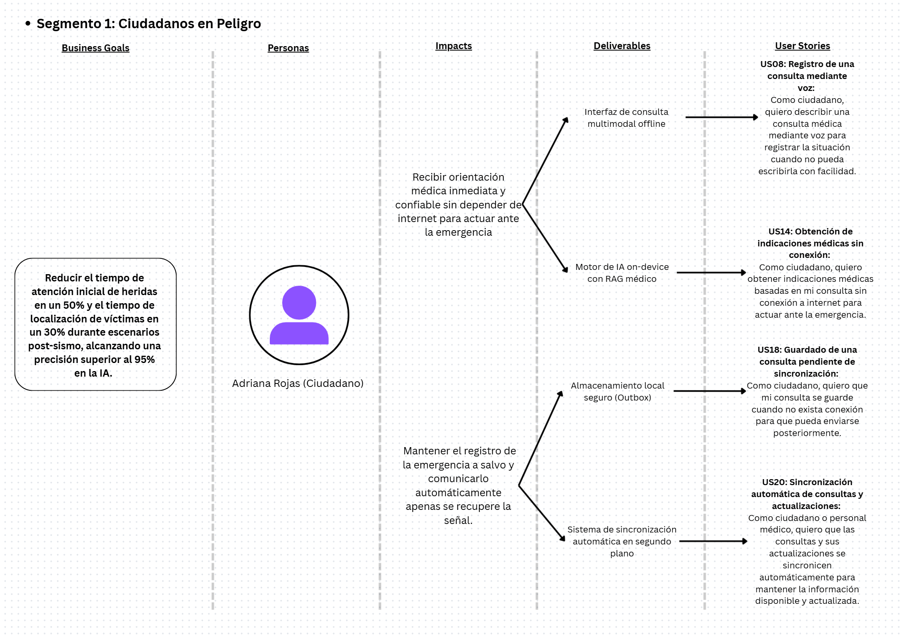
</p>

<p align="center">
  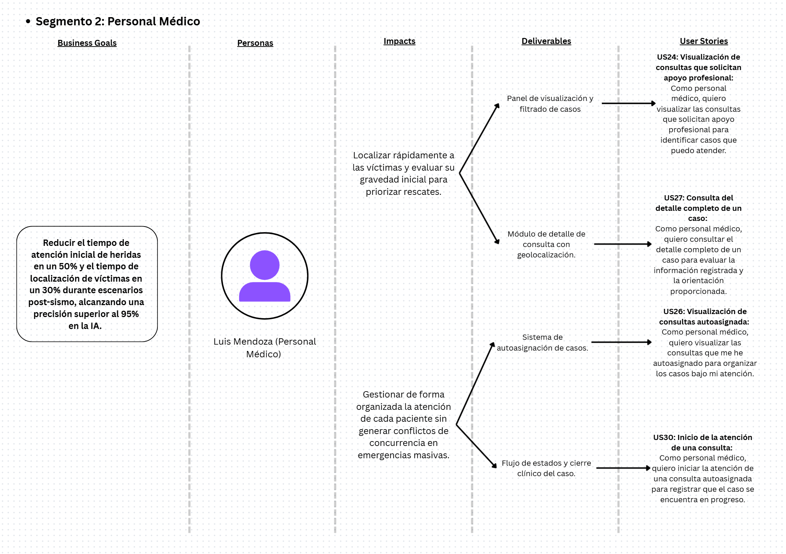
</p>

## 3.4. Product Backlog

| Orden | ID | Título | Descripción | Story Points |
| :--- | :--- | :--- | :--- | :--- |
| 1 | US01 | Registro de una cuenta como ciudadano | Como ciudadano, quiero registrar una cuenta para ingresar a la aplicación y utilizar sus funcionalidades. | 3 |
| 2 | US02 | Registro de una cuenta como personal médico | Como personal médico, quiero registrar una cuenta validando mi identificación profesional para acceder a las funcionalidades correspondientes a mi rol. | 5 |
| 3 | US03 | Inicio de sesión | Como ciudadano o personal médico, quiero iniciar sesión para acceder a las funcionalidades disponibles para mi rol. | 2 |
| 4 | US04 | Consulta del perfil personal | Como ciudadano o personal médico, quiero consultar mi perfil para revisar los datos asociados a mi cuenta. | 2 |
| 5 | US05 | Actualización de datos personales | Como ciudadano o personal médico, quiero actualizar mis datos personales para mantener vigente la información de mi perfil. | 2 |
| 6 | US06 | Cierre de sesión | Como ciudadano o personal médico, quiero cerrar mi sesión para impedir que otras personas accedan a mi cuenta desde el dispositivo. | 1 |
| 7 | TS01 | Protección de la sesión almacenada en el dispositivo | Como desarrollador, quiero proteger la sesión almacenada en el dispositivo para evitar el acceso no autorizado a la cuenta. | 3 |
| 8 | US07 | Registro de una consulta mediante texto | Como ciudadano, quiero describir una consulta médica mediante texto para comunicar la situación del paciente. | 2 |
| 9 | US08 | Registro de una consulta mediante voz | Como ciudadano, quiero describir una consulta médica mediante voz para registrar la situación cuando no pueda escribirla con facilidad. | 5 |
| 10 | TS02 | Conversión local de voz a texto | Como desarrollador, quiero implementar la conversión local de voz a texto para registrar consultas habladas sin depender de internet. | 8 |
| 11 | US09 | Adjunto de fotografías a una consulta | Como ciudadano, quiero adjuntar fotografías a una consulta para complementar la descripción de la situación del paciente. | 3 |
| 12 | TS03 | Compresión y optimización de fotografías adjuntas | Como desarrollador, quiero comprimir las fotografías adjuntas para reducir el almacenamiento y la transferencia sin impedir su revisión. | 5 |
| 13 | TS04 | Optimización del procesamiento de entradas multimodales | Como desarrollador, quiero optimizar el procesamiento de texto, voz y fotografías para mantener una respuesta fluida durante el registro de la consulta. | 5 |
| 14 | US10 | Ingreso de datos del paciente | Como ciudadano, quiero ingresar los datos del paciente cuando solicite apoyo profesional para facilitar la atención del caso. | 2 |
| 15 | US11 | Registro de la ubicación de la consulta | Como ciudadano, quiero registrar la ubicación del paciente para que el personal médico pueda conocer dónde se encuentra. | 3 |
| 16 | US12 | Elección de solicitud de apoyo profesional | Como ciudadano, quiero indicar si necesito apoyo profesional para que el personal médico llegue en mi apoyo si lo requiero. | 2 |
| 17 | US13 | Incorporación de fuentes médicas autorizadas | Como desarrollador, quiero incorporar y validar fuentes autorizadas para sustentar la orientación generada por la aplicación. | 5 |
| 18 | TS05 | Procesamiento e indexación de documentos médicos por tipo de procedimiento | Como desarrollador, quiero procesar e indexar los documentos médicos por tipo de procedimiento para facilitar la recuperación de información relevante. | 8 |
| 19 | TS06 | Almacenamiento local del índice médico | Como desarrollador, quiero implementar el almacenamiento local del índice médico para permitir su consulta sin conexión a internet. | 5 |
| 20 | TS07 | Optimización de la búsqueda de información médica | Como desarrollador, quiero optimizar la búsqueda en la base médica para recuperar información relevante con rapidez. | 5 |
| 21 | TS08 | Integración del modelo de IA local | Como desarrollador, quiero integrar un modelo de inteligencia artificial local para generar orientación sin depender de servicios en la nube. | 8 |
| 22 | TS09 | Implementación del flujo de recuperación aumentada por generación | Como desarrollador, quiero implementar el flujo RAG para generar orientación utilizando información recuperada de la base médica. | 8 |
| 23 | TS10 | Diseño del prompt de orientación médica | Como desarrollador, quiero diseñar un prompt de orientación médica para obtener respuestas claras, ordenadas y prudentes. | 3 |
| 24 | TS11 | Validación del sustento de las respuestas en la base médica | Como desarrollador, quiero validar que las respuestas se sustenten en la base médica para reducir la generación de indicaciones sin respaldo. | 5 |
| 25 | US14 | Obtención de indicaciones médicas sin conexión | Como ciudadano, quiero obtener indicaciones médicas basadas en mi consulta sin conexión a internet para actuar ante la emergencia. | 8 |
| 26 | US15 | Indicaciones médicas claras y ordenadas | Como ciudadano, quiero recibir indicaciones claras y ordenadas para comprender las acciones que debo realizar. | 2 |
| 27 | US16 | Respuesta segura ante información insuficiente | Como ciudadano, quiero ser informado cuando no exista información suficiente para recibir una orientación confiable y evitar realizar acciones inseguras. | 3 |
| 28 | TS13 | Mecanismos de respuesta segura ante fallos | Como desarrollador, quiero implementar mecanismos de respuesta segura para controlar los fallos ocurridos durante la generación de orientación. | 3 |
| 29 | TS12 | Optimización de la latencia y el consumo de recursos de la IA | Como desarrollador, quiero optimizar la ejecución local de la inteligencia artificial para brindar respuestas rápidas sin sobrecargar el dispositivo. | 8 |
| 30 | TS14 | Evaluación de la precisión y claridad de las indicaciones | Como desarrollador, quiero evaluar la precisión y claridad de las indicaciones generadas para comprobar la calidad de la orientación médica. | 5 |
| 31 | TS15 | Reglas de identificación de señales de gravedad | Como desarrollador, quiero implementar reglas para identificar señales de gravedad y añadir una recomendación de atención profesional cuando corresponda. | 5 |
| 32 | US17 | Recomendación de atención profesional | Como ciudadano, quiero recibir una recomendación de atención profesional cuando se identifiquen señales de gravedad para buscar ayuda especializada. | 2 |
| 33 | TS16 | Implementación de la base de datos local | Como desarrollador, quiero implementar una base de datos local para conservar la información necesaria cuando no exista conexión. | 5 |
| 34 | TS17 | Almacenamiento seguro de fotografías y datos médicos | Como desarrollador, quiero almacenar de forma segura las fotografías y los datos médicos para proteger la información guardada en el dispositivo. | 5 |
| 35 | US18 | Guardado de una consulta pendiente de sincronización | Como ciudadano, quiero que mi consulta se guarde cuando no exista conexión para que pueda enviarse posteriormente. | 3 |
| 36 | TS18 | Implementación de una cola local de consultas pendientes | Como desarrollador, quiero implementar una cola local para organizar las consultas que deben enviarse al recuperar la conexión. | 5 |
| 37 | TS19 | Transacciones atómicas para la persistencia local | Como desarrollador, quiero implementar transacciones atómicas para evitar que una consulta quede almacenada de forma parcial. | 5 |
| 38 | US19 | Visualización de consultas almacenadas localmente | Como ciudadano, quiero visualizar las consultas almacenadas en mi dispositivo para conocer cuáles están pendientes de sincronización. | 3 |
| 39 | TS20 | Gestión eficiente del almacenamiento del dispositivo | Como desarrollador, quiero gestionar eficientemente el almacenamiento local para evitar un consumo innecesario de espacio. | 3 |
| 40 | TS21 | Detección de la recuperación de la conexión a internet | Como desarrollador, quiero detectar la recuperación de la conexión para iniciar automáticamente la sincronización pendiente. | 3 |
| 41 | TS22 | Sincronización bidireccional en segundo plano | Como desarrollador, quiero implementar la sincronización bidireccional en segundo plano para enviar consultas y recibir sus actualizaciones sin interrumpir el uso de la aplicación. | 8 |
| 42 | US20 | Sincronización automática de consultas y actualizaciones | Como ciudadano o personal médico, quiero que las consultas y sus actualizaciones se sincronicen automáticamente para mantener la información disponible y actualizada. | 5 |
| 43 | TS23 | Reintentos automáticos ante fallos de sincronización | Como desarrollador, quiero implementar reintentos automáticos para completar la sincronización después de fallos temporales. | 3 |
| 44 | TS24 | Tolerancia a fallos del servicio de sincronización | Como desarrollador, quiero implementar tolerancia a fallos en el servicio de sincronización para conservar la continuidad y la fiabilidad del intercambio de información. | 5 |
| 45 | TS25 | Registro y monitoreo de errores de sincronización | Como desarrollador, quiero registrar y monitorear los errores de sincronización para detectar problemas y facilitar su corrección. | 3 |
| 46 | US21 | Notificaciones sobre la sincronización y atención del caso | Como ciudadano, quiero recibir notificaciones sobre la sincronización y atención de mi consulta para mantenerme informado sobre su progreso. | 3 |
| 47 | TS26 | Mantenimiento de una copia local actualizada del historial. | Como desarrollador, quiero mantener una copia local actualizada del historial para permitir su consulta desde el dispositivo. | 5 |
| 48 | US22 | Consulta del historial de consultas realizadas | Como ciudadano, quiero consultar mi historial para revisar las consultas médicas que he realizado. | 2 |
| 49 | US23 | Visualización del detalle actualizado de una consulta | Como ciudadano, quiero visualizar el detalle actualizado de una consulta para conocer su información y el progreso de la atención. | 3 |
| 50 | US24 | Visualización de consultas que solicitan apoyo profesional | Como personal médico, quiero visualizar las consultas que solicitan apoyo profesional para identificar casos que puedo atender. | 3 |
| 51 | US25 | Filtrado de consultas por estado | Como personal médico, quiero filtrar las consultas por estado para encontrar los casos que necesito revisar. | 2 |
| 52 | US26 | Visualización de consultas autoasignadas | Como personal médico, quiero visualizar las consultas que me he autoasignado para organizar los casos bajo mi atención. | 2 |
| 53 | US27 | Consulta del detalle completo de un caso | Como personal médico, quiero consultar el detalle completo de un caso para evaluar la información registrada y la orientación proporcionada. | 3 |
| 54 | US28 | Visualización de la ubicación del paciente | Como personal médico, quiero visualizar la ubicación registrada del paciente para conocer dónde se encuentra el caso. | 2 |
| 55 | TS27 | Consistencia concurrente de los casos | Como desarrollador, quiero mantener la consistencia concurrente de los casos para impedir asignaciones o cambios incompatibles realizados al mismo tiempo. | 5 |
| 56 | US29 | Autoasignación de una consulta disponible | Como personal médico, quiero autoasignarme una consulta disponible para hacerme responsable de su atención. | 3 |
| 57 | TS28 | Trazabilidad de asignaciones y cambios de estado | Como desarrollador, quiero registrar la trazabilidad de las asignaciones y los cambios de estado para conservar el historial de la atención de cada caso. | 3 |
| 58 | US30 | Inicio de la atención de una consulta | Como personal médico, quiero iniciar la atención de una consulta autoasignada para registrar que el caso se encuentra en progreso. | 2 |
| 59 | TS29 | Tolerancia a fallos en la gestión de casos | Como desarrollador, quiero implementar tolerancia a fallos en la gestión de casos para evitar la pérdida o corrupción de cambios durante la atención. | 5 |
| 60 | US31 | Cierre de una consulta con observaciones | Como personal médico, quiero cerrar una consulta y registrar observaciones para dejar constancia de la atención realizada. | 2 |
| 61 | US32 | Consulta del historial de casos atendidos | Como personal médico, quiero consultar el historial de casos que he atendido para revisar las atenciones realizadas. | 2 |

# Capítulo IV: Strategic-Level Software Design

## 4.1. Strategic-Level Attribute-Driven Design

### 4.1.1. Design Purpose

El propósito del proceso de diseño de Lifeline consiste en definir una arquitectura de software capaz de responder a la problemática identificada en escenarios post-sismo, donde los servicios de emergencia pueden saturarse o demorar, las telecomunicaciones pueden fallar y la población suele carecer de conocimientos suficientes de primeros auxilios. En ese contexto, el diseño busca asegurar que la solución brinde orientación médica inmediata, comprensible y confiable incluso sin conexión a internet, evitando la dependencia de aplicaciones basadas únicamente en la nube que dejan de ser útiles en el momento crítico. De esta manera, el proceso de diseño no se limita a organizar componentes técnicos, sino a traducir un problema real de respuesta ante desastres en decisiones arquitectónicas orientadas a preservar la continuidad del apoyo a las personas afectadas.

En coherencia con los segmentos objetivo, el diseño se orienta a satisfacer las necesidades del ciudadano en peligro, quien requiere pasos claros, usables bajo estrés y disponibles offline, así como del personal médico, quien necesita información de ubicación, estado del caso, asignación y seguimiento cuando existe conectividad. Esta doble orientación permite que Lifeline apoye tanto la estabilización inicial de víctimas como la colaboración posterior con la atención profesional. Desde la perspectiva de negocio de RescueBridge, el diseño también busca materializar la propuesta de valor de la startup, reduciendo el riesgo de pérdidas humanas mediante tecnología emergente y facilitando información útil para una respuesta de emergencia más efectiva.

Para lograrlo, el proceso de diseño se guía por Attribute-Driven Design (ADD) y Domain-Driven Design (DDD) a nivel estratégico, de modo que las decisiones arquitectónicas consideren atributos de calidad como usabilidad, disponibilidad, performance y fiabilidad, junto con la organización del dominio en bounded contexts. En particular, se adopta un enfoque offline-first con IA on-device y RAG sobre una base médica local para la orientación inmediata, complementado con un backend modular que permite sincronizar y gestionar casos de forma confiable cuando se recupera la conexión. Este propósito de diseño constituye el punto de partida para las siguientes secciones del informe, en las que se desarrollan los drivers arquitectónicos, los escenarios de calidad y las decisiones de arquitectura que concretan la solución.

### 4.1.2. Attribute-Driven Design Inputs

#### 4.1.2.1. Primary Functionality (Primary User Stories)

Dentro del sistema, si bien se contempla la implementación de numerosas user stories, se deben priorizar aquellas que cubren las funcionalidades principales de la aplicación. En este caso, se tomarán como user stories principales aquellas centradas en la generación de indicaciones médicas por parte del modelo de inteligencia artificial, así como las orientadas a la gestión de los casos una vez que estos han sido enviados hacia el backend.

A continuación, presentamos las user stories seleccionadas:

__US07: Registro de una consulta mediante texto__

Descripción: Como ciudadano, quiero describir una consulta médica mediante texto para comunicar la situación del paciente.

Impacto: Esta user story requiere que se logre proporcionar el registro de consultas mediante texto y que el mismo sea enviado hacia el modelo de IA empleado para su procesamiento siguiendo el flujo planteado. Así, los ciudadanos logran registrar su consulta y pasan a contar con las indicaciones médicas proporcionadas.

__US09: Adjunto de fotografías a una consulta__

Descripción: Como ciudadano, quiero adjuntar fotografías a una consulta para complementar la descripción de la situación del paciente.

Impacto: Esta user story requiere que la imagen se almacene de forma óptima localmente hasta lograr ser sincronizada hacia el backend, así como esta debe ser integrada con el procesamiento multimodal. En cuanto a negocio, permite que los ciudadanos puedan proporcionar mayor claridad sobre la emergencia médica por la que consultan.

__US13: Incorporación de fuentes médicas autorizadas__

Descripción: Como desarrollador, quiero incorporar y validar fuentes autorizadas para sustentar la orientación generada por la aplicación.

Impacto: Requiere que las fuentes recolectadas sean validadas, segmentadas e indexadas en un formato que el modelo pueda procesar con velocidad y precisión mediante el RAG aplicado. Además, incrementa la veracidad de las indicaciones que la IA brindará a los ciudadanos.

__US14: Obtención de indicaciones médicas sin conexión__

Descripción: Como ciudadano, quiero obtener indicaciones médicas basadas en mi consulta sin conexión a internet para actuar ante la emergencia.

Impacto: Esta user story contempla que el modelo de IA pueda ejecutarse localmente junto con el RAG y contando con acceso a la base médica, mientras se controla el rendimiento y los recursos del dispositivo para evitar fallos al generar respuestas. En cuanto a negocio, permite que las indicaciones médicas brindadas se sustenten en conocimientos de organizaciones oficiales sin necesidad de conexión a internet.

__US15: Indicaciones médicas claras y ordenadas__

Descripción: Como ciudadano, quiero recibir indicaciones claras y ordenadas para comprender las acciones que debo realizar.

Impacto: Esta user story requiere que se regule la estructura y lenguaje empleado en las indicaciones médicas generadas por medio de un prompt previamente implementado y probado, así como que se cuente con mecanismos de validación de la respuesta. De esta forma, los ciudadanos no tendrán problemas para comprender las instrucciones presentadas.

__US17: Recomendación de atención profesional__

Descripción: Como ciudadano, quiero recibir una recomendación de atención profesional cuando se identifiquen señales de gravedad para buscar ayuda especializada.

Impacto: Requiere que dentro del prompt implementado se especifiquen los criterios para identificar las señales de gravedad en las consultas ingresadas, de forma en que la indicación final sugiera solicitar atención médica profesional. Esto ayuda a los ciudadanos puesto que les permite conocer con mayor seguridad las situaciones en las que es necesario buscar atención especializada.

__US20: Sincronización automática de consultas y actualizaciones__

Descripción: Como ciudadano o personal médico, quiero que las consultas y sus actualizaciones se sincronicen automáticamente para mantener la información disponible y actualizada.

Impacto: Requiere una arquitectura offline-first con almacenamiento local, sincronización bidireccional, reintentos, control de duplicados y manejo de fallos que permita ejecutar la sincronización de envío y actualización de consultas evitando la pérdida de alguna en el camino. Así, tanto los ciudadanos como el personal médico cuentan con una vista real hacia la última situación registrada.

__US29: Autoasignación de una consulta disponible__

Descripción: Como personal médico, quiero autoasignarme una consulta disponible para hacerme responsable de su atención.

Impacto: Requiere control de concurrencia y consistencia para impedir que una consulta sea asignada por dos o más profesionales al mismo tiempo. En cuanto a negocio, posee un gran impacto puesto que marca el inicio de la atención profesional de la consulta y su camino hacia lograr ser cerrada.

#### 4.1.2.2. Quality Attribute Scenarios

En esta sección se incluye la especificación de la primera versión de los escenarios de atributos de calidad que tienen mayor impacto en la arquitectura de la solución, los cuales sirven de input para el proceso de diseño. Dado el contexto de Lifeline, la cual es una aplicación que debe operar sin conexión durante una emergencia, generar orientación médica confiable y sincronizar información al recuperar señal, se priorizaron los atributos de alta disponibilidad, fiabilidad, performance y usabilidad.

<table>
  <thead>
    <tr>
      <th>ID</th>
      <th>Atributo</th>
      <th>Fuente</th>
      <th>Estímulo</th>
      <th>Artefacto</th>
      <th>Entorno</th>
      <th>Respuesta</th>
      <th>Medida</th>
    </tr>
  </thead>
  <tbody>
    <tr>
      <td>QAS-01</td>
      <td><strong>Alta disponibilidad</strong></td>
      <td>Usuario de tipo ciudadano</td>
      <td>Registra una consulta médica cuando no dispone de conexión a Internet.</td>
      <td>On-Device AI Engine, Medical Knowledge Store y Local Database.</td>
      <td>Escenario post-sismo sin conexión a internet</td>
      <td>El sistema procesa la consulta localmente, muestra las indicaciones médicas y guarda la información en local.</td>
      <td>Sin llamadas al backend externo y el 99.5% de las consultas de prueba finalizan satisfactoriamente.</td>
    </tr>
    <tr>
      <td>QAS-02</td>
      <td><strong>Alta disponibilidad</strong></td>
      <td>Usuario de tipo personal médico</td>
      <td>Autoasignación de un caso</td>
      <td>Balanceador</td>
      <td>Falla de una instancia del backend</td>
      <td>Solicitud redirigida hacia las instancias disponibles y autoasignación completada satisfactoriamente.</td>
      <td>Solicitud redirigida en un máximo de 3 segundos y 99% de solicitudes completadas.</td>
    </tr>
    <tr>
      <td>QAS-03</td>
      <td><strong>Fiabilidad</strong></td>
      <td>Usuario de tipo ciudadano</td>
      <td>Envía una consulta con síntomas contemplados en la base de conocimientos médicos.</td>
      <td>Medical Knowledge Service y Semantic Retriever</td>
      <td>Escenario post-sismo sin conexión a internet</td>
      <td>Información de base médica recuperada e indicaciones médicas coherentes generadas.</td>
      <td>90% de las indicaciones generadas clasificadas como eficientes o muy eficientes.</td>
    </tr>
    <tr>
      <td>QAS-04</td>
      <td><strong>Fiabilidad</strong></td>
      <td>On-Device AI Engine</td>
      <td>No se encuentra información suficiente en la base de conocimientos médicos para responder a una consulta</td>
      <td>Consultation Domain</td>
      <td>Consulta offline después de un sismo</td>
      <td>Mensaje de error seguro mostrado al usuario.</td>
      <td>Cero indicaciones médicas no sustentadas mostradas al usuario.</td>
    </tr>
    <tr>
      <td>QAS-05</td>
      <td><strong>Fiabilidad</strong></td>
      <td>Usuario de tipo ciudadano</td>
      <td>Registra una consulta médica contando con conexión a Internet</td>
      <td>Local Persistence</td>
      <td>La conexión de internet se pierde y recupera durante el envío de la consulta</td>
      <td>El sistema reintenta el envío de la consulta y la registra una sola vez en backend.</td>
      <td>Cero consultas perdidas, duplicadas o corruptas en su envío al backend.</td>
    </tr>
    <tr>
      <td>QAS-06</td>
      <td><strong>Usabilidad</strong></td>
      <td>Usuario de tipo ciudadano</td>
      <td>Intenta registrar una emergencia mediante voz</td>
      <td>Interfaz de usuario del registro de consultas</td>
      <td>Poca iluminación y sin posibilidad de apoyo externo</td>
      <td>Ciudadano guiado por la interfaz intuitiva y consulta registrada satisfactoriamente.</td>
      <td>El 90% de los usuarios logra completar una consulta en menos de dos minutos y sin ayuda externa.</td>
    </tr>
    <tr>
      <td>QAS-07</td>
      <td><strong>Performance</strong></td>
      <td>Mil usuarios de tipo ciudadano</td>
      <td>Mil dispositivos recuperan la conexión a internet y sincronizan su información</td>
      <td>Broker y balanceador</td>
      <td>Restablecimiento de las telecomunicaciones horas después de un sismo</td>
      <td>Sincronizaciones encoladas y procesadas progresivamente hacia el backend.</td>
      <td>Se pierden cero operaciones y el backlog es procesado en menos de 10 minutos.</td>
    </tr>
  </tbody>
</table>

#### 4.1.2.3. Constraints

En esta sección se especifican las restricciones que condicionan el diseño y la implementación de Lifeline. Estas restricciones provienen principalmente de la necesidad de operar después de un evento sísmico sin depender de las telecomunicaciones, de la seguridad requerida al proporcionar orientación de primeros auxilios, del tratamiento de información personal y médica, y del acceso controlado a los casos sincronizados. En consecuencia, el diseño se enfoca en que el procesamiento crítico de la orientación se realice localmente y en asegurar que las respuestas proporcionadas sean seguras y cuenten con un sustento verificable.

<table>
  <thead>
    <tr>
      <th>Technical Story ID</th>
      <th>Título</th>
      <th>Descripción</th>
      <th>Criterios de Aceptación</th>
      <th>Relacionado con (Epic ID)</th>
    </tr>
  </thead>
  <tbody>
    <tr>
      <td>TS-C01</td>
      <td>Ejecución local del flujo crítico de procesamiento de consultas médicas</td>
      <td>Como desarrollador, debo garantizar que el modelo de IA y la persistencia local se ejecuten en el dispositivo sin depender del backend en la nube ni de servicios externos, para que la orientación esté disponible cuando las telecomunicaciones colapsen.</td>
      <td><strong>Escenario 1:</strong> Orientación médica sin conexión.<br><strong>Dado que</strong> el dispositivo no dispone de conexión a Internet y cuenta con los componentes locales instalados<br><strong>Cuando</strong> el ciudadano registra una consulta<br><strong>Entonces</strong> el sistema genera una orientación sustentada o una respuesta segura, almacena la consulta localmente y no realiza solicitudes a servicios externos.</td>
      <td>EP-02, EP-03, EP-04</td>
    </tr>
    <tr>
      <td>TS-C02</td>
      <td>Uso exclusivo de fuentes médicas autorizadas</td>
      <td>Como desarrollador, debo asegurarme de que la información introducida en la base de conocimientos médicos sea verídica para que las indicaciones sean seguras.</td>
      <td><strong>Escenario 1:</strong> Rechazo de una fuente médica no autorizada.<br><strong>Dado que</strong> un documento no cuenta con procedencia, versión o validación verificable<br><strong>Cuando</strong> se intenta incorporarlo a la base de conocimientos médicos<br><strong>Entonces</strong> se rechaza su inclusión y el documento no queda disponible para el flujo RAG.<br><br><strong>Escenario 2:</strong> Orientación sin sustento suficiente.<br><strong>Dado que</strong> el contexto recuperado no contiene evidencia médica aprobada suficiente<br><strong>Cuando</strong> la orientación generada es validada<br><strong>Entonces</strong> el sistema no la muestra al ciudadano y activa una respuesta segura.</td>
      <td>EP-03</td>
    </tr>
    <tr>
      <td>TS-C03</td>
      <td>Limitación del alcance clínico de la inteligencia artificial</td>
      <td>Como desarrollador, debo limitar la IA a proporcionar orientación inicial de primeros auxilios y apoyo médico para evitar que se realicen procedimientos riesgos o se intente reemplazar al personal médico real.</td>
      <td><strong>Escenario 1:</strong> Bloqueo de una indicación fuera del alcance permitido.<br><strong>Dado que</strong> la IA genera una respuesta que incluye un diagnóstico, una prescripción, automedicación o una acción clínica prohibida<br><strong>Cuando</strong> la respuesta pasa por la validación clínica<br><strong>Entonces</strong> el sistema bloquea la indicación y muestra una alternativa segura.<br><br><strong>Escenario 2:</strong> Detección de señales de gravedad.<br><strong>Dado que</strong> la consulta contiene señales de gravedad configuradas en las reglas clínicas<br><strong>Cuando</strong> el sistema procesa la consulta<br><strong>Entonces</strong> la orientación recomienda solicitar atención profesional e indica que no reemplaza la evaluación médica.</td>
      <td>EP-03</td>
    </tr>
    <tr>
      <td>TS-C04</td>
      <td>Cumplimiento de la normativa de protección de datos personales</td>
      <td>Como desarrollador, debo tratar los datos de identidad, salud, fotografías, audios y ubicación conforme a la Ley N.° 29733 y su reglamento vigente durante su recolección y procesamiento para cumplir los requisitos reales.</td>
      <td><strong>Escenario 1:</strong> Tratamiento autorizado de datos personales y médicos.<br><strong>Dado que</strong> una funcionalidad requiere recopilar o procesar datos personales o médicos<br><strong>Cuando</strong> el usuario utiliza dicha funcionalidad<br><strong>Entonces</strong> el sistema trata únicamente los datos necesarios para la finalidad documentada y protege la información durante su almacenamiento y transmisión.</td>
      <td>EP-01, EP-02, EP-03, EP-04, EP-05</td>
    </tr>
    <tr>
      <td>TS-C05</td>
      <td>Acceso exclusivo del personal médico validado a la gestión de casos</td>
      <td>Como desarrollador, debo restringir la visualización, asignación y modificación de casos médicos a usuarios autenticados como personal médico para garantizar que quienes brinden apoyo sean profesionales verificados.</td>
      <td><strong>Escenario 1:</strong> Acceso autorizado del personal médico.<br><strong>Dado que</strong> el usuario mantiene una sesión válida y su identificación profesional registrada<br><strong>Cuando</strong> intenta visualizar o gestionar un caso<br><strong>Entonces</strong> el sistema permite únicamente las operaciones autorizadas para su rol.<br><br><strong>Escenario 2:</strong> Acceso no autorizado a un caso.<br><strong>Dado que</strong> el usuario no posee una sesión válida, tiene un rol diferente al de personal médico o su identificación profesional no ha sido validada<br><strong>Cuando</strong> intenta visualizar, autoasignarse, atender o cerrar un caso<br><strong>Entonces</strong> el sistema rechaza la operación.</td>
      <td>EP-01, EP-05</td>
    </tr>
    <tr>
      <td>TS-C06</td>
      <td>Sincronización diferida obligatoria de consultas</td>
      <td>Como desarrollador, debo conservar las consultas registradas sin conexión y sincronizarlas automáticamente cuando se recupere la conectividad para que el personal médico pueda visualizar los casos registrados y ofrecer ayuda.</td>
      <td><strong>Escenario 1:</strong> Sincronización automática al recuperar la conexión.<br><strong>Dado que</strong> existe una consulta pendiente almacenada localmente<br><strong>Cuando</strong> el dispositivo recupera la conexión a Internet<br><strong>Entonces</strong> el sistema envía la consulta al backend y la marca como sincronizada después de recibir la confirmación.<br><br><strong>Escenario 2:</strong> Interrupción durante la sincronización.<br><strong>Dado que</strong> una consulta pendiente está siendo enviada al backend<br><strong>Cuando</strong> la conexión se interrumpe antes de recibir la confirmación<br><strong>Entonces</strong> el sistema conserva la consulta como pendiente y vuelve a intentar su envío al recuperar la conexión, sin crear un segundo caso con el mismo identificador.</td>
      <td>EP-04, EP-05</td>
    </tr>
  </tbody>
</table>

### 4.1.3. Architectural Drivers Backlog

El Architectural Drivers Backlog se construyó a partir de los hallazgos del capítulo II (entrevistas, user personas y needfinding), del análisis de la problemática post-sismo desarrollado en el capítulo I y de los insumos consolidados en la sección 4.1.2. De este cruce se obtuvieron tres tipos de drivers: los funcionales, derivados de las user stories principales; los de calidad, derivados de los escenarios de atributos de calidad; y los constraints, que corresponden a condiciones no negociables del dominio.

Durante el *Quality Attribute Workshop* (QAW), el equipo priorizó estos drivers empleando dos criterios: la importancia para los stakeholders identificados (ciudadano, personal médico y RescueBridge) y el impacto sobre la complejidad técnica de la arquitectura. Los drivers calificados como **High/High** encabezan el backlog porque determinan las características esenciales de Lifeline, esto es, la generación de orientación médica sin conexión mediante IA local y RAG, la confiabilidad clínica de las respuestas entregadas y la sincronización con el backend sin pérdida de consultas. El backlog reúne 21 drivers en total (8 funcionales, 7 correspondientes a los escenarios QAS-01 a QAS-07 y 6 asociados a las restricciones TS-C01 a TS-C06), ordenados de mayor a menor prioridad según los criterios descritos.

<table>
  <thead>
    <tr>
      <th>Driver ID</th>
      <th>Título de Driver</th>
      <th>Descripción</th>
      <th>Importancia para Stakeholders</th>
      <th>Impacto en Architecture Technical Complexity</th>
    </tr>
  </thead>
  <tbody>
    <tr>
      <td>AD-01</td>
      <td>Orientación médica sin conexión (US14)</td>
      <td>El ciudadano debe obtener indicaciones de primeros auxilios procesando la consulta localmente mediante IA on-device y RAG, sin depender de servicios en la nube durante la emergencia.</td>
      <td>High</td>
      <td>High</td>
    </tr>
    <tr>
      <td>AD-02</td>
      <td>Ejecución local del flujo crítico (TS-C01)</td>
      <td>El procesamiento de consultas médicas (inferencia, recuperación RAG y persistencia) debe ejecutarse íntegramente en el dispositivo cuando no exista conectividad, sin llamadas a servicios externos.</td>
      <td>High</td>
      <td>High</td>
    </tr>
    <tr>
      <td>AD-03</td>
      <td>Disponibilidad offline de la orientación médica (QAS-01)</td>
      <td>Ante la pérdida de internet post-sismo, el sistema debe procesar la consulta, generar indicaciones y almacenar la información localmente, alcanzando el 99.5% de consultas finalizadas satisfactoriamente en pruebas controladas.</td>
      <td>High</td>
      <td>High</td>
    </tr>
    <tr>
      <td>AD-04</td>
      <td>Fiabilidad de indicaciones sustentadas en base médica (QAS-03)</td>
      <td>Las respuestas generadas deben recuperar contexto desde la Medical Knowledge Store y mantener coherencia clínica, alcanzando al menos 90% de indicaciones clasificadas como eficientes o muy eficientes.</td>
      <td>High</td>
      <td>High</td>
    </tr>
    <tr>
      <td>AD-05</td>
      <td>Respuesta segura ante contexto insuficiente (QAS-04)</td>
      <td>Si el RAG no recupera evidencia médica suficiente, el sistema debe bloquear indicaciones no sustentadas y mostrar un mensaje seguro al ciudadano, sin entregar respuestas carentes de respaldo.</td>
      <td>High</td>
      <td>High</td>
    </tr>
    <tr>
      <td>AD-06</td>
      <td>Sincronización diferida obligatoria (TS-C06)</td>
      <td>Toda consulta registrada offline debe conservarse localmente y enviarse automáticamente al backend cuando se recupere la conectividad, sin duplicar casos ante interrupciones de red.</td>
      <td>High</td>
      <td>High</td>
    </tr>
    <tr>
      <td>AD-07</td>
      <td>Sincronización automática de consultas y actualizaciones (US20)</td>
      <td>Ciudadanos y personal médico deben contar con sincronización bidireccional en segundo plano que mantenga actualizada la información de casos entre dispositivo y backend.</td>
      <td>High</td>
      <td>High</td>
    </tr>
    <tr>
      <td>AD-08</td>
      <td>Idempotencia y tolerancia en sincronización intermitente (QAS-05)</td>
      <td>Ante pérdida y recuperación de conexión durante el envío, el sistema debe reintentar la operación y registrar la consulta una sola vez en backend, sin pérdidas ni duplicados.</td>
      <td>High</td>
      <td>High</td>
    </tr>
    <tr>
      <td>AD-09</td>
      <td>Escalabilidad de sincronización masiva post-sismo (QAS-07)</td>
      <td>Cuando miles de dispositivos recuperan señal simultáneamente, el backend debe encolar y procesar sincronizaciones progresivamente mediante broker y balanceador, sin pérdida de operaciones y con backlog procesado en menos de 10 minutos.</td>
      <td>High</td>
      <td>High</td>
    </tr>
    <tr>
      <td>AD-10</td>
      <td>Uso exclusivo de fuentes médicas autorizadas (TS-C02)</td>
      <td>Solo documentos con procedencia y validación verificable pueden indexarse en la base de conocimientos; las fuentes no autorizadas deben rechazarse antes de entrar al flujo RAG.</td>
      <td>High</td>
      <td>Medium</td>
    </tr>
    <tr>
      <td>AD-11</td>
      <td>Limitación del alcance clínico de la IA (TS-C03)</td>
      <td>La IA debe limitarse a orientación inicial de primeros auxilios, bloqueando diagnósticos, prescripciones, automedicación y acciones clínicas fuera de alcance, e indicando derivación profesional ante señales de gravedad.</td>
      <td>High</td>
      <td>Medium</td>
    </tr>
    <tr>
      <td>AD-12</td>
      <td>Incorporación de fuentes médicas autorizadas (US13)</td>
      <td>El equipo debe validar, segmentar e indexar fuentes oficiales en un formato consumible por el índice RAG local para sustentar las indicaciones generadas.</td>
      <td>High</td>
      <td>Medium</td>
    </tr>
    <tr>
      <td>AD-13</td>
      <td>Autoasignación de consulta disponible (US29)</td>
      <td>El personal médico debe poder autoasignarse un caso disponible de forma exclusiva, iniciando el ciclo de atención sin conflictos de concurrencia entre profesionales.</td>
      <td>High</td>
      <td>Medium</td>
    </tr>
    <tr>
      <td>AD-14</td>
      <td>Disponibilidad del backend en autoasignación (QAS-02)</td>
      <td>Ante la caída de una instancia del backend, el balanceador debe redirigir la solicitud de autoasignación en menos de 3 segundos, completando el 99% de solicitudes exitosamente.</td>
      <td>High</td>
      <td>Medium</td>
    </tr>
    <tr>
      <td>AD-15</td>
      <td>Acceso exclusivo del personal médico validado (TS-C05)</td>
      <td>Solo usuarios autenticados con rol de personal médico e identificación profesional validada pueden visualizar, autoasignarse, atender o cerrar casos sincronizados.</td>
      <td>High</td>
      <td>Medium</td>
    </tr>
    <tr>
      <td>AD-16</td>
      <td>Indicaciones médicas claras y ordenadas (US15)</td>
      <td>Las indicaciones deben entregarse en pasos numerados, con lenguaje comprensible y validación de formato, para reducir errores de interpretación bajo estrés.</td>
      <td>High</td>
      <td>Medium</td>
    </tr>
    <tr>
      <td>AD-17</td>
      <td>Cumplimiento de la Ley N° 29733 (TS-C04)</td>
      <td>Los datos de identidad, salud, fotografías, audios y ubicación deben tratarse conforme a la normativa peruana, aplicando principios de finalidad, minimización y protección en almacenamiento y transmisión.</td>
      <td>High</td>
      <td>Medium</td>
    </tr>
    <tr>
      <td>AD-18</td>
      <td>Usabilidad bajo estrés (QAS-06)</td>
      <td>En condiciones de poca iluminación y sin apoyo externo, al menos el 90% de usuarios debe completar una consulta por voz en menos de 2 minutos mediante una interfaz guiada e intuitiva.</td>
      <td>High</td>
      <td>Medium</td>
    </tr>
    <tr>
      <td>AD-19</td>
      <td>Recomendación de atención profesional (US17)</td>
      <td>El sistema debe detectar señales de gravedad configuradas y recomendar explícitamente solicitar atención médica especializada cuando corresponda.</td>
      <td>High</td>
      <td>Low</td>
    </tr>
    <tr>
      <td>AD-20</td>
      <td>Adjunto de fotografías a una consulta (US09)</td>
      <td>El ciudadano debe poder adjuntar evidencia visual que se almacene localmente, se integre al procesamiento multimodal y se sincronice al backend cuando exista conectividad.</td>
      <td>Medium</td>
      <td>Medium</td>
    </tr>
    <tr>
      <td>AD-21</td>
      <td>Registro de consulta mediante texto (US07)</td>
      <td>El ciudadano debe poder describir la emergencia médica mediante texto como mecanismo base de entrada al flujo de orientación offline.</td>
      <td>Medium</td>
      <td>Low</td>
    </tr>
  </tbody>
</table>

A continuación, se sustentan los criterios que determinaron el orden de priorización del backlog:

- El análisis de la problemática desarrollado en el capítulo I y las entrevistas realizadas a ciudadanos en el capítulo II coinciden en que, tras un sismo de magnitud considerable, la conectividad suele interrumpirse precisamente cuando la orientación de primeros auxilios resulta más necesaria. Por ello, la operación sin conexión mediante IA local encabeza el backlog.
- Las entrevistas con personal médico evidenciaron que la inteligencia artificial puede cumplir un rol orientador, pero no debe generar indicaciones carentes de respaldo ni sustituir la evaluación de un profesional. Este hallazgo justifica priorizar las respuestas sustentadas en fuentes médicas autorizadas, el bloqueo de indicaciones sin evidencia suficiente y la delimitación explícita del alcance clínico de la solución.
- Asimismo, se consideró el comportamiento esperado del sistema cuando un número elevado de dispositivos recupera la señal de manera simultánea. En ese escenario, la sincronización no puede perder ni duplicar consultas, y el backend debe sostener la carga mediante un esquema de encolamiento y balanceo.
- Finalmente, las restricciones definidas en la sección 4.1.2.3 no fueron tratadas como requisitos opcionales. El cumplimiento de la Ley N° 29733, el uso exclusivo de fuentes autorizadas y la restricción de la gestión de casos al personal médico validado constituyen condiciones del dominio que la arquitectura debe respetar desde su concepción.

### 4.1.4. Architectural Design Decisions

Con el Architectural Drivers Backlog ya priorizado, el equipo aplicó el proceso iterativo de *Attribute-Driven Design* (ADD) sobre los drivers **High/High** antes de pasar a los de prioridad media. Cada iteración cerró una decisión estructural que después se reflejó en los diagramas C2 y C3.

**Iteración 1 — Orientación offline con IA local**

Drivers considerados: orientación médica sin conexión (AD-01), ejecución local del flujo crítico (AD-02) y disponibilidad offline de la orientación (AD-03).

Patrones evaluados: inferencia **on-device**, inferencia en **nube** e inferencia **híbrida** (local con fallback cloud).

Criterio de decisión: TS-C01 y la problemática post-sismo exigen que la orientación funcione sin internet en el minuto crítico. Se descartó la nube pura porque deja al ciudadano sin ayuda cuando caen las telecomunicaciones; el híbrido tampoco resuelve ese escenario si no hay señal. Se eligió **IA on-device con modelo cuantizado** y **Medical Knowledge Store local** para sostener el flujo offline.

**Iteración 2 — Fiabilidad clínica de las respuestas**

Drivers considerados: fiabilidad de indicaciones sustentadas (AD-04), respuesta segura ante contexto insuficiente (AD-05), uso exclusivo de fuentes autorizadas (AD-10), limitación del alcance clínico (AD-11) e incorporación de fuentes médicas (AD-12).

Patrones evaluados: **RAG local + reglas de validación clínica**, **LLM sin retrieval** y **base de conocimiento remota**.

Criterio de decisión: las entrevistas con personal médico evidenciaron que la inteligencia artificial no debe generar indicaciones carentes de respaldo. Se descartó el uso de un modelo sin recuperación de contexto porque incrementa el riesgo de alucinaciones clínicas, mientras que la base de conocimiento remota resulta inoperante sin conectividad. Se optó por **RAG on-device** sobre fuentes previamente validadas, complementado con **Safety / Policy Checks** que bloquean toda respuesta sin sustento o fuera del alcance clínico permitido.

**Iteración 3 — Sincronización resiliente device → cloud**

Drivers considerados: sincronización diferida obligatoria (AD-06), sincronización automática (AD-07) e idempotencia ante red intermitente (AD-08).

Patrones evaluados: **Offline-first + Outbox**, **sync síncrona directa al reconectar** y **sync event-driven remota sin cola local**.

Criterio de decisión: QAS-05 exige cero consultas perdidas o duplicadas si la conexión se corta a mitad del envío. La sync directa bloquea al usuario y no tolera intermitencia; la remota sin Outbox pierde datos offline. Se eligió **Local Database + Outbox** con reintentos automáticos e **idempotencia** por identificador de consulta.

**Iteración 4 — Escala de sincronización post-sismo**

Drivers considerados: escalabilidad de sync masiva (AD-09) y disponibilidad del backend en autoasignación (AD-14).

Patrones evaluados: **procesamiento síncrono masivo en API**, **Load Balancer + Message Broker + Async Workers** y **única instancia monolítica sin balanceo**.

Criterio de decisión: QAS-07 plantea miles de dispositivos reconectándose a la vez; una API síncrona saturaría el backend y afectaría operaciones inmediatas del personal médico. Se eligió **Load Balancer** frente a la API y **Message Broker + Async Workers** para procesar el backlog de sync sin bloquear las operaciones síncronas de casos.

**Iteración 5 — Gestión de casos por personal médico**

Drivers considerados: autoasignación de consulta (AD-13) y acceso exclusivo del personal médico validado (AD-15).

Patrones evaluados: **concurrencia optimista** sobre el estado del caso, **bloqueo pesimista distribuido** y **autoasignación sin control de colisiones**.

Criterio de decisión: la contención esperada es baja o moderada, dado que resulta poco frecuente que varios profesionales intenten tomar el mismo caso de forma simultánea. El bloqueo pesimista introduce una complejidad operativa que no se justifica en ese contexto, mientras que la ausencia de control de colisiones permitiría asignaciones duplicadas. Se optó por **concurrencia optimista (compare-and-swap)** en Case Management, con **IAM** validando el rol y la identificación profesional antes de autorizar la operación.

**Candidate Pattern Evaluation Matrix**

<table>
  <thead>
    <tr>
      <th rowspan="2">Driver ID</th>
      <th rowspan="2">Título de Driver</th>
      <th colspan="2">Patrón 1</th>
      <th colspan="2">Patrón 2</th>
      <th colspan="2">Patrón 3</th>
    </tr>
    <tr>
      <th>Pro</th>
      <th>Con</th>
      <th>Pro</th>
      <th>Con</th>
      <th>Pro</th>
      <th>Con</th>
    </tr>
  </thead>
  <tbody>
    <tr>
      <td>AD-01 / AD-02 / AD-03</td>
      <td>Orientación offline con IA local</td>
      <td><strong>On-device inference + RAG local:</strong> funciona sin red, baja latencia percibida, cumple TS-C01</td>
      <td>Mayor consumo de batería/memoria; limita tamaño del modelo</td>
      <td><strong>Cloud inference:</strong> modelos más grandes y actualizables</td>
      <td>Inutilizable sin conexión; incumple el escenario post-sismo</td>
      <td><strong>Híbrido on-device + fallback cloud:</strong> mayor precisión cuando hay red</td>
      <td>El fallback no sirve en el minuto crítico sin señal; mayor complejidad</td>
    </tr>
    <tr>
      <td>AD-04 / AD-05</td>
      <td>Fiabilidad clínica de respuestas</td>
      <td><strong>RAG local + Safety Checks:</strong> respuestas sustentadas; bloquea indicaciones sin contexto (0% inventadas)</td>
      <td>Requiere indexación y mantenimiento de fuentes validadas</td>
      <td><strong>LLM sin retrieval:</strong> implementación más simple</td>
      <td>Mayor riesgo de alucinaciones clínicas; incumple expectativas del personal médico</td>
      <td><strong>Knowledge base remota:</strong> catálogo centralizado siempre actualizado</td>
      <td>Depende de conectividad; no usable offline</td>
    </tr>
    <tr>
      <td>AD-06 / AD-07 / AD-08</td>
      <td>Sincronización resiliente</td>
      <td><strong>Offline-first + Outbox + idempotencia:</strong> no pierde consultas; tolera red intermitente</td>
      <td>Lógica extra de reconciliación y estados pending/synced</td>
      <td><strong>Sync síncrona directa al reconectar:</strong> flujo simple de implementar</td>
      <td>Bloquea UI; falla con cortes mid-flight; riesgo de duplicados</td>
      <td><strong>Sync remota sin cola local:</strong> menos estado en dispositivo</td>
      <td>Pierde consultas si falla antes de confirmación; no cumple TS-C06</td>
    </tr>
    <tr>
      <td>AD-09 / AD-14</td>
      <td>Escala y disponibilidad cloud</td>
      <td><strong>LB + Broker + Async Workers:</strong> absorbe picos post-sismo; API sigue respondiendo operaciones síncronas</td>
      <td>Mayor costo e infraestructura cloud</td>
      <td><strong>API síncrona masiva sin cola:</strong> menos componentes</td>
      <td>Saturación del backend; incumple QAS-07 (&lt;10 min backlog)</td>
      <td><strong>Instancia única sin balanceo:</strong> despliegue simple</td>
      <td>Single point of failure; incumple QAS-02 de redirección &lt;3 s</td>
    </tr>
    <tr>
      <td>AD-13 / AD-15</td>
      <td>Autoasignación de casos médicos</td>
      <td><strong>Concurrencia optimista + IAM:</strong> bajo overhead; solo médico validado asigna</td>
      <td>Reintento manual o automático si hay colisión</td>
      <td><strong>Bloqueo pesimista distribuido:</strong> evita colisiones de forma estricta</td>
      <td>Mayor complejidad operativa y menor throughput</td>
      <td><strong>Sin control de concurrencia:</strong> implementación mínima</td>
      <td>Riesgo de doble asignación del mismo caso</td>
    </tr>
  </tbody>
</table>

**Cobertura de los drivers de prioridad media**

Los drivers AD-16 a AD-21 no requirieron una iteración estructural propia, ya que quedan satisfechos por las decisiones adoptadas en las cinco iteraciones anteriores. La entrega de indicaciones claras y ordenadas (AD-16) y la recomendación de atención profesional ante señales de gravedad (AD-19) se resuelven mediante los *Safety / Policy Checks* y la plantilla de salida definidos en la segunda iteración, que regulan tanto el formato como el contenido de la respuesta antes de mostrarla al ciudadano. El cumplimiento de la Ley N° 29733 (AD-17) se sostiene en la ejecución local del flujo crítico decidida en la primera iteración, que evita transmitir datos de salud durante la emergencia, y en el cifrado del canal de sincronización establecido en la tercera. La usabilidad bajo estrés (AD-18) corresponde al diseño de la interfaz del cliente móvil y no altera la descomposición en módulos, por lo que se aborda en el nivel de diseño de detalle. Finalmente, el adjunto de fotografías (AD-20) y el registro de consultas mediante texto (AD-21) constituyen entradas del mismo flujo de orientación local, de modo que se apoyan en el procesamiento multimodal del *On-Device AI Engine* y en el patrón Outbox ya definido para su posterior sincronización.

De esta manera, los 21 drivers del backlog quedan cubiertos por el conjunto de decisiones arquitectónicas documentadas, y la arquitectura resultante se materializa en los diagramas de contenedores y componentes presentados en las secciones 4.3.3 y 4.3.5.

### 4.1.5. Quality Attribute Scenario Refinements

Al cerrar el *Quality Attribute Workshop*, el equipo confirmó que los atributos que realmente condicionan la arquitectura de Lifeline son la disponibilidad offline, la fiabilidad clínica de la orientación generada y la resiliencia de la sincronización cuando vuelve la señal. Esas tres preocupaciones fueron las que más se repitieron al revisar la problemática post-sismo del capítulo I y las entrevistas del capítulo II, y son las que sostienen las decisiones tomadas en la sección 4.1.4: IA on-device con RAG local, *Safety / Policy Checks* antes de mostrar cualquier indicación, y un esquema *offline-first* con Outbox e idempotencia respaldado por *Load Balancer*, *Message Broker* y *Async Workers* en el backend.

A partir de ello se refinaron los siete escenarios definidos en la sección 4.1.2.2, conservando sus identificadores (QAS-01 a QAS-07) y las medidas de respuesta ya acordadas, pero agregando el objetivo de negocio asociado, las preguntas abiertas que quedaron del taller y los *issues* que el equipo debe resolver durante la implementación. Los escenarios se presentan en el mismo orden de prioridad establecido en el Architectural Drivers Backlog de la sección 4.1.3: primero los que afectan la operación sin conexión y la seguridad clínica del ciudadano, luego los que garantizan que ninguna consulta se pierda al sincronizar, y finalmente los relacionados con la operación del personal médico y la usabilidad bajo estrés.

<table>
  <tbody>
    <tr>
      <td colspan="3"><strong>Scenario Refinement for Scenario N° 1</strong></td>
    </tr>
    <tr>
      <td colspan="2" width="30%"><strong>Scenario(s):</strong></td>
      <td width="70%">QAS-01 — Disponibilidad de la orientación médica sin conexión</td>
    </tr>
    <tr>
      <td colspan="2"><strong>Business Goals:</strong></td>
      <td>Garantizar que el ciudadano reciba orientación de primeros auxilios en el minuto crítico posterior a un sismo, aun cuando las telecomunicaciones hayan colapsado, cumpliendo la propuesta de valor de RescueBridge.</td>
    </tr>
    <tr>
      <td colspan="2"><strong>Relevant Quality Attributes:</strong></td>
      <td>Disponibilidad, Fiabilidad</td>
    </tr>
    <tr>
      <td width="12%"></td>
      <td width="18%"><strong>Stimulus:</strong></td>
      <td>El ciudadano registra una consulta médica cuando el dispositivo no dispone de conexión a Internet.</td>
    </tr>
    <tr>
      <td rowspan="5"><strong>Scenario Components</strong></td>
      <td><strong>Stimulus Source:</strong></td>
      <td>Usuario de tipo ciudadano afectado por el sismo.</td>
    </tr>
    <tr>
      <td><strong>Environment:</strong></td>
      <td>Escenario post-sismo sin cobertura de red móvil ni Wi-Fi.</td>
    </tr>
    <tr>
      <td><strong>Artifact (if Known)</strong></td>
      <td>On-Device AI Engine, Medical Knowledge Store y Local Database.</td>
    </tr>
    <tr>
      <td><strong>Response:</strong></td>
      <td>El sistema procesa la consulta localmente, muestra las indicaciones médicas y almacena la información en la base de datos del dispositivo sin invocar servicios externos.</td>
    </tr>
    <tr>
      <td><strong>Response Measure:</strong></td>
      <td>Cero llamadas al backend externo durante el flujo y 99.5% de las consultas de prueba finalizadas satisfactoriamente.</td>
    </tr>
    <tr>
      <td colspan="2"><strong>Questions:</strong></td>
      <td>¿Qué ocurre si el modelo cuantizado o el índice RAG local no pueden cargarse por falta de espacio o por corrupción de archivos en el dispositivo?</td>
    </tr>
    <tr>
      <td colspan="2"><strong>Issues:</strong></td>
      <td>Definir el tamaño máximo aceptable del modelo para dispositivos de gama media sin sacrificar precisión clínica, y establecer una verificación de integridad del índice local al iniciar la aplicación.</td>
    </tr>
  </tbody>
</table>

<table>
  <tbody>
    <tr>
      <td colspan="3"><strong>Scenario Refinement for Scenario N° 2</strong></td>
    </tr>
    <tr>
      <td colspan="2" width="30%"><strong>Scenario(s):</strong></td>
      <td width="70%">QAS-03 — Fiabilidad de las indicaciones sustentadas en la base médica</td>
    </tr>
    <tr>
      <td colspan="2"><strong>Business Goals:</strong></td>
      <td>Sostener la confianza del ciudadano y del personal médico asegurando que toda orientación entregada provenga de fuentes médicas autorizadas y no de contenido generado sin respaldo.</td>
    </tr>
    <tr>
      <td colspan="2"><strong>Relevant Quality Attributes:</strong></td>
      <td>Fiabilidad, Precisión funcional</td>
    </tr>
    <tr>
      <td width="12%"></td>
      <td width="18%"><strong>Stimulus:</strong></td>
      <td>El ciudadano envía una consulta con síntomas contemplados en la base de conocimientos médicos.</td>
    </tr>
    <tr>
      <td rowspan="5"><strong>Scenario Components</strong></td>
      <td><strong>Stimulus Source:</strong></td>
      <td>Usuario de tipo ciudadano.</td>
    </tr>
    <tr>
      <td><strong>Environment:</strong></td>
      <td>Escenario post-sismo sin conexión a Internet.</td>
    </tr>
    <tr>
      <td><strong>Artifact (if Known)</strong></td>
      <td>Medical Knowledge Service y Semantic Retriever del flujo RAG local.</td>
    </tr>
    <tr>
      <td><strong>Response:</strong></td>
      <td>El sistema recupera la información relevante de la base médica y genera indicaciones coherentes, ordenadas y trazables a la fuente consultada.</td>
    </tr>
    <tr>
      <td><strong>Response Measure:</strong></td>
      <td>90% de las indicaciones generadas clasificadas como eficientes o muy eficientes en la evaluación con personal médico.</td>
    </tr>
    <tr>
      <td colspan="2"><strong>Questions:</strong></td>
      <td>¿Cómo se revalida la calidad clínica de las respuestas cada vez que se actualiza o amplía la base de conocimientos médicos?</td>
    </tr>
    <tr>
      <td colspan="2"><strong>Issues:</strong></td>
      <td>Definir la cantidad de fragmentos recuperados y el umbral de similitud que equilibre precisión clínica y tiempo de respuesta en dispositivos de gama media.</td>
    </tr>
  </tbody>
</table>

<table>
  <tbody>
    <tr>
      <td colspan="3"><strong>Scenario Refinement for Scenario N° 3</strong></td>
    </tr>
    <tr>
      <td colspan="2" width="30%"><strong>Scenario(s):</strong></td>
      <td width="70%">QAS-04 — Respuesta segura ante contexto médico insuficiente</td>
    </tr>
    <tr>
      <td colspan="2"><strong>Business Goals:</strong></td>
      <td>Evitar que la aplicación exponga al ciudadano a indicaciones sin respaldo clínico, respetando los límites de alcance acordados con el personal médico entrevistado.</td>
    </tr>
    <tr>
      <td colspan="2"><strong>Relevant Quality Attributes:</strong></td>
      <td>Fiabilidad, Seguridad de uso</td>
    </tr>
    <tr>
      <td width="12%"></td>
      <td width="18%"><strong>Stimulus:</strong></td>
      <td>No se encuentra información suficiente en la base de conocimientos médicos para responder a la consulta registrada.</td>
    </tr>
    <tr>
      <td rowspan="5"><strong>Scenario Components</strong></td>
      <td><strong>Stimulus Source:</strong></td>
      <td>On-Device AI Engine durante la evaluación del contexto recuperado.</td>
    </tr>
    <tr>
      <td><strong>Environment:</strong></td>
      <td>Consulta realizada sin conexión después de un sismo.</td>
    </tr>
    <tr>
      <td><strong>Artifact (if Known)</strong></td>
      <td>Consultation Domain y componente de Safety / Policy Checks.</td>
    </tr>
    <tr>
      <td><strong>Response:</strong></td>
      <td>El sistema bloquea la entrega de la indicación no sustentada y muestra un mensaje seguro que recomienda buscar atención profesional.</td>
    </tr>
    <tr>
      <td><strong>Response Measure:</strong></td>
      <td>Cero indicaciones médicas no sustentadas mostradas al usuario.</td>
    </tr>
    <tr>
      <td colspan="2"><strong>Questions:</strong></td>
      <td>¿Cómo se diferencia una consulta sin contexto suficiente de una consulta que está fuera del alcance clínico permitido por TS-C03?</td>
    </tr>
    <tr>
      <td colspan="2"><strong>Issues:</strong></td>
      <td>Calibrar el umbral de confianza que dispara la respuesta segura, de modo que proteja al usuario sin activarse con tanta frecuencia que la aplicación deje de ser útil.</td>
    </tr>
  </tbody>
</table>

<table>
  <tbody>
    <tr>
      <td colspan="3"><strong>Scenario Refinement for Scenario N° 4</strong></td>
    </tr>
    <tr>
      <td colspan="2" width="30%"><strong>Scenario(s):</strong></td>
      <td width="70%">QAS-05 — Integridad de la consulta ante conexión intermitente</td>
    </tr>
    <tr>
      <td colspan="2"><strong>Business Goals:</strong></td>
      <td>Asegurar que ninguna consulta registrada se pierda ni se duplique, para que el personal médico trabaje siempre sobre la situación real reportada por el ciudadano.</td>
    </tr>
    <tr>
      <td colspan="2"><strong>Relevant Quality Attributes:</strong></td>
      <td>Fiabilidad, Tolerancia a fallos</td>
    </tr>
    <tr>
      <td width="12%"></td>
      <td width="18%"><strong>Stimulus:</strong></td>
      <td>La conexión a Internet se pierde y se recupera mientras la consulta está siendo enviada al backend.</td>
    </tr>
    <tr>
      <td rowspan="5"><strong>Scenario Components</strong></td>
      <td><strong>Stimulus Source:</strong></td>
      <td>Usuario de tipo ciudadano con conectividad inestable.</td>
    </tr>
    <tr>
      <td><strong>Environment:</strong></td>
      <td>Zona afectada con red intermitente o de baja calidad tras el sismo.</td>
    </tr>
    <tr>
      <td><strong>Artifact (if Known)</strong></td>
      <td>Local Persistence con patrón Outbox y Sync Service del dispositivo.</td>
    </tr>
    <tr>
      <td><strong>Response:</strong></td>
      <td>El sistema conserva la consulta como pendiente, reintenta el envío automáticamente y la registra una sola vez en el backend gracias al identificador idempotente.</td>
    </tr>
    <tr>
      <td><strong>Response Measure:</strong></td>
      <td>Cero consultas perdidas, duplicadas o corruptas en su envío al backend.</td>
    </tr>
    <tr>
      <td colspan="2"><strong>Questions:</strong></td>
      <td>¿Cuántos reintentos deben ejecutarse antes de marcar la consulta como error persistente y notificar al ciudadano?</td>
    </tr>
    <tr>
      <td colspan="2"><strong>Issues:</strong></td>
      <td>Definir la política de backoff exponencial y el tiempo de vida de la clave de idempotencia almacenada en el backend.</td>
    </tr>
  </tbody>
</table>

<table>
  <tbody>
    <tr>
      <td colspan="3"><strong>Scenario Refinement for Scenario N° 5</strong></td>
    </tr>
    <tr>
      <td colspan="2" width="30%"><strong>Scenario(s):</strong></td>
      <td width="70%">QAS-07 — Escalabilidad de la sincronización masiva post-sismo</td>
    </tr>
    <tr>
      <td colspan="2"><strong>Business Goals:</strong></td>
      <td>Mantener operativo el servicio cuando la conectividad se restablece de forma simultánea en toda la zona afectada, para que el personal médico acceda a los casos sin demoras significativas.</td>
    </tr>
    <tr>
      <td colspan="2"><strong>Relevant Quality Attributes:</strong></td>
      <td>Performance, Escalabilidad</td>
    </tr>
    <tr>
      <td width="12%"></td>
      <td width="18%"><strong>Stimulus:</strong></td>
      <td>Mil dispositivos recuperan la conexión a Internet y sincronizan su información al mismo tiempo.</td>
    </tr>
    <tr>
      <td rowspan="5"><strong>Scenario Components</strong></td>
      <td><strong>Stimulus Source:</strong></td>
      <td>Mil usuarios de tipo ciudadano con consultas pendientes de envío.</td>
    </tr>
    <tr>
      <td><strong>Environment:</strong></td>
      <td>Restablecimiento de las telecomunicaciones horas después del sismo.</td>
    </tr>
    <tr>
      <td><strong>Artifact (if Known)</strong></td>
      <td>Load Balancer, Message Broker y Async Workers del backend.</td>
    </tr>
    <tr>
      <td><strong>Response:</strong></td>
      <td>Las sincronizaciones se encolan y se procesan progresivamente, sin bloquear las operaciones síncronas que realiza el personal médico sobre los casos.</td>
    </tr>
    <tr>
      <td><strong>Response Measure:</strong></td>
      <td>Cero operaciones perdidas y backlog de sincronización procesado en menos de 10 minutos.</td>
    </tr>
    <tr>
      <td colspan="2"><strong>Questions:</strong></td>
      <td>¿Qué debe ocurrir si el broker acumula más mensajes de los que los workers pueden procesar dentro de la ventana esperada?</td>
    </tr>
    <tr>
      <td colspan="2"><strong>Issues:</strong></td>
      <td>Definir la política de autoescalado de los workers y el tamaño máximo de cola a partir del cual se aplica backpressure sobre los dispositivos.</td>
    </tr>
  </tbody>
</table>

<table>
  <tbody>
    <tr>
      <td colspan="3"><strong>Scenario Refinement for Scenario N° 6</strong></td>
    </tr>
    <tr>
      <td colspan="2" width="30%"><strong>Scenario(s):</strong></td>
      <td width="70%">QAS-02 — Disponibilidad del backend durante la autoasignación de casos</td>
    </tr>
    <tr>
      <td colspan="2"><strong>Business Goals:</strong></td>
      <td>Permitir que el personal médico se haga cargo de los casos sin interrupciones, incluso ante fallas parciales de la infraestructura en la nube.</td>
    </tr>
    <tr>
      <td colspan="2"><strong>Relevant Quality Attributes:</strong></td>
      <td>Disponibilidad</td>
    </tr>
    <tr>
      <td width="12%"></td>
      <td width="18%"><strong>Stimulus:</strong></td>
      <td>El personal médico intenta autoasignarse un caso mientras una instancia del backend deja de responder.</td>
    </tr>
    <tr>
      <td rowspan="5"><strong>Scenario Components</strong></td>
      <td><strong>Stimulus Source:</strong></td>
      <td>Usuario de tipo personal médico validado.</td>
    </tr>
    <tr>
      <td><strong>Environment:</strong></td>
      <td>Falla de una instancia del backend durante la operación normal del sistema.</td>
    </tr>
    <tr>
      <td><strong>Artifact (if Known)</strong></td>
      <td>Load Balancer e instancias disponibles de la API de Case Management.</td>
    </tr>
    <tr>
      <td><strong>Response:</strong></td>
      <td>La solicitud es redirigida hacia una instancia disponible y la autoasignación se completa satisfactoriamente.</td>
    </tr>
    <tr>
      <td><strong>Response Measure:</strong></td>
      <td>Solicitud redirigida en un máximo de 3 segundos y 99% de solicitudes completadas.</td>
    </tr>
    <tr>
      <td colspan="2"><strong>Questions:</strong></td>
      <td>¿Cómo se evita una doble asignación si la instancia falla justo después de haber escrito el nuevo estado del caso?</td>
    </tr>
    <tr>
      <td colspan="2"><strong>Issues:</strong></td>
      <td>Definir la frecuencia de los health checks y los timeouts del balanceador, y asegurar que el reintento sea idempotente bajo el esquema de concurrencia optimista adoptado.</td>
    </tr>
  </tbody>
</table>

<table>
  <tbody>
    <tr>
      <td colspan="3"><strong>Scenario Refinement for Scenario N° 7</strong></td>
    </tr>
    <tr>
      <td colspan="2" width="30%"><strong>Scenario(s):</strong></td>
      <td width="70%">QAS-06 — Usabilidad del registro de consultas bajo estrés</td>
    </tr>
    <tr>
      <td colspan="2"><strong>Business Goals:</strong></td>
      <td>Lograr que cualquier persona sin formación médica pueda pedir ayuda desde la aplicación en condiciones adversas, ampliando el alcance real de la solución.</td>
    </tr>
    <tr>
      <td colspan="2"><strong>Relevant Quality Attributes:</strong></td>
      <td>Usabilidad</td>
    </tr>
    <tr>
      <td width="12%"></td>
      <td width="18%"><strong>Stimulus:</strong></td>
      <td>El ciudadano intenta registrar una emergencia mediante voz.</td>
    </tr>
    <tr>
      <td rowspan="5"><strong>Scenario Components</strong></td>
      <td><strong>Stimulus Source:</strong></td>
      <td>Usuario de tipo ciudadano sin conocimientos previos de primeros auxilios.</td>
    </tr>
    <tr>
      <td><strong>Environment:</strong></td>
      <td>Poca iluminación, situación de estrés y sin posibilidad de apoyo externo.</td>
    </tr>
    <tr>
      <td><strong>Artifact (if Known)</strong></td>
      <td>Interfaz de registro de consultas en modo voz.</td>
    </tr>
    <tr>
      <td><strong>Response:</strong></td>
      <td>La interfaz guía al ciudadano paso a paso y la consulta queda registrada satisfactoriamente.</td>
    </tr>
    <tr>
      <td><strong>Response Measure:</strong></td>
      <td>El 90% de los usuarios logra completar una consulta en menos de dos minutos y sin ayuda externa.</td>
    </tr>
    <tr>
      <td colspan="2"><strong>Questions:</strong></td>
      <td>¿Qué alternativa se ofrece cuando el ruido del entorno impide transcribir correctamente la descripción por voz?</td>
    </tr>
    <tr>
      <td colspan="2"><strong>Issues:</strong></td>
      <td>Definir el mecanismo de respaldo hacia texto o fotografía y programar pruebas de usabilidad con usuarios reales en condiciones simuladas de emergencia.</td>
    </tr>
  </tbody>
</table>


## 4.2. Strategic-Level Domain-Driven Design

### 4.2.1. EventStorming

A cotinuación, se presentará el event storming realizado por el equipo y del cual se lograron formar cuatro bounded contexts para el desarrollo.

__Step 1: Unstructured Exploration__

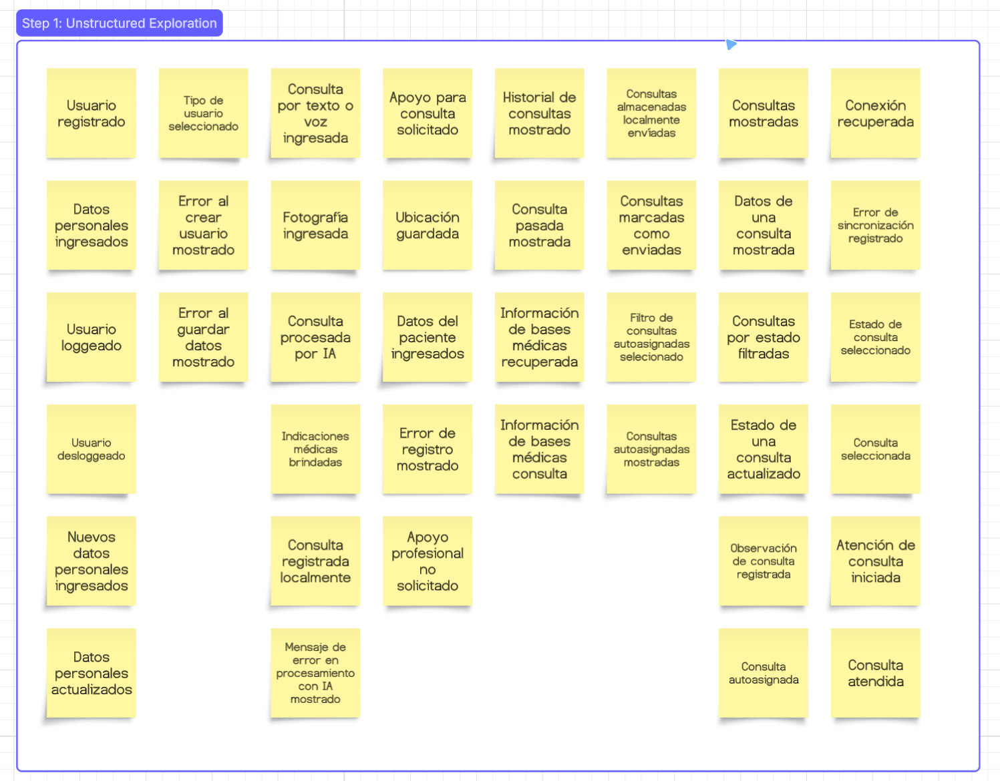

En el primer paso, colocamos todos los eventos que ocurrirían dentro de la aplicación, los cuales se centran en el proceso que sigue una consulta desde que es realizada por el ciudadano hasta que llega a ser visible y posiblementes tomada por parte del personal médico, pasando por el análisis y respuesta del modelo de inteligencia artificial local empleado.

__Step 2: Timelines__

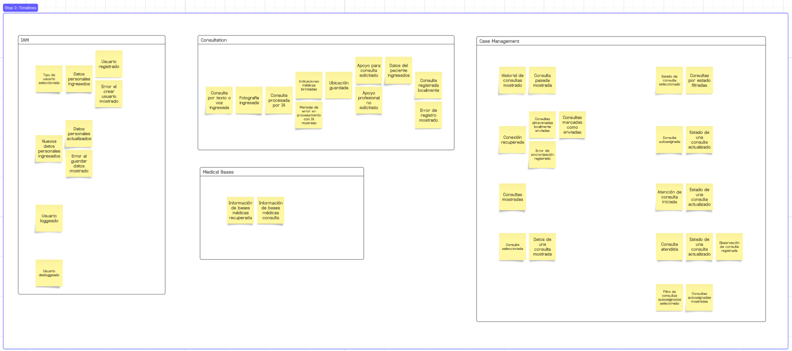

En el segundo paso, organizamos los eventos lineal para definir el orden en que ocurrirían y en que bunded context debían existir. Dentro de estos, definimos las sencuencias para el registro, configuración, ingreso y salida de los usuarios, así como el camino que seguirían las consultas para ser debidamente procesadas y mostradas con su estado al personal médico. Por otro lado, tmabién consideramos los momentos en que, al fallar algo a nivel interno, es apropiado tener listo un mensaje y caso de error.

__Step 3: Pain Points__

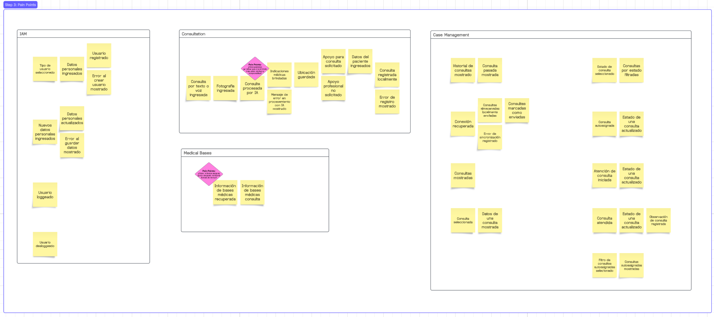

En el tercer paso, agregamos dos pain points para los casos en los que consideramos debemos hacer una mayor investigación y futuramente pruebas con la aplicación para aegurar el desempeño esperado. Estos se refieren precisamente a el cómo asegurar que el modelo brindará respuestas adecuadas que no pongan la vida de las personas en riesgo y en cómo prevenir que la consulta hacia la base de conocimientos médicos tome más tiempo del prudente durante una emergencia.

__Step 4: Pivotal Points__

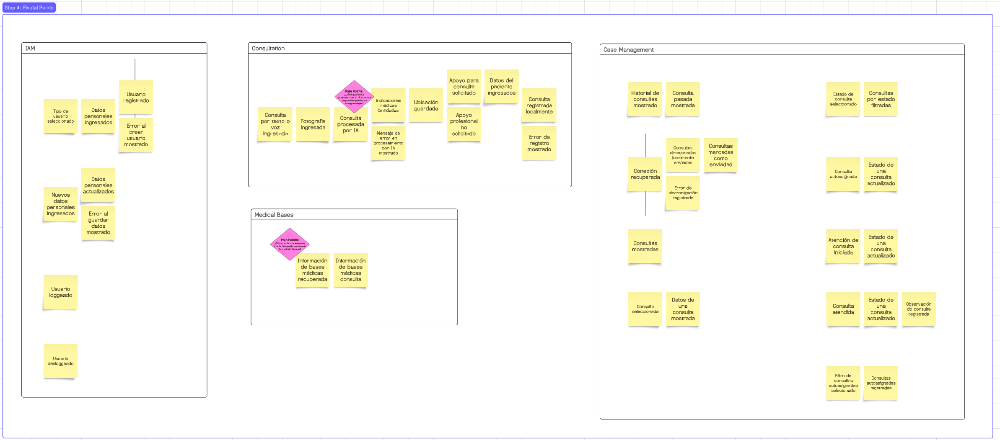

En el paso cuatro, señalamos dos pivotal points que nos parecen importantes dentro del flujo que seguirán los usuarios en la aplicación. Estos son el registro del usuario que le permite usar las funcionalidades consideradas y la entrada de conexión a internet, puesto que esta permite que las consultas guardadas localmente sean enviadas al backend y que el personal médico pueda visualizarlas y/o darles la atención debida.

__Step 5: Commands__

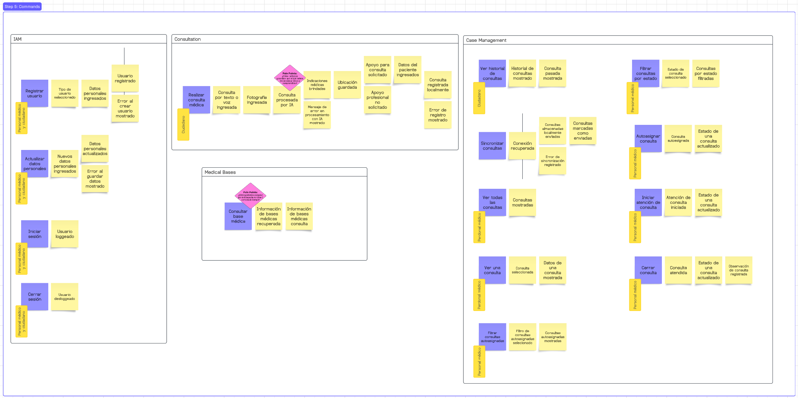

En el quinto paso, agregamos los comando que accionarían los flujos formados, así como los usuarios que tendrían permitido utilizarlos. Como se puede ver, la mayoría son activados por los usuarios, mas existen dos que se accionan como efecto de otro flujo. En el caso de la base médica, esta es consultada cuando se ha realizado una consulta Por el otro lado, la sincronización se da únicamente al percibir que el dispositivo se pudo conectar a internet y existen consultas sin enviar al backend.

__Step 6: Policies__

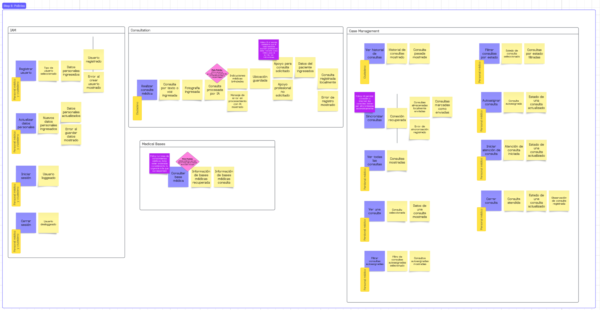

En el paso seis, agregamos tres policies que referencias perfectamenre las reglas de negocio que se han estado mencionando. Dos de estas policies especifican que el modelo de lenguaje debe consultar la base de conocimientos médicos antes de brindar las indicaciones médicas para asgurar que estas no están siendo inventadas, y que, por el otro lado, contienen un sustento, así como debe mencionar como último paso el buscar ayuda médica profesional si la situación lo amerita. Asimismo, se tiene una policy explicando que, al recibir internet, se debe dar la sincronización hacia el backend considerando todas las consultas que no han sido enviadas antes.

__Step 7: Read Models__

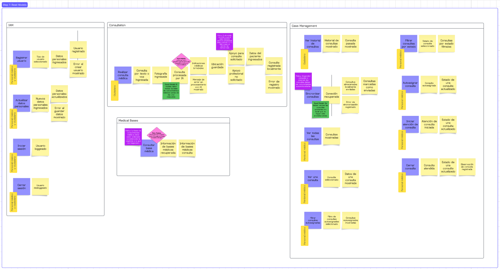

En el paso siete, los read models agregados recalcan la necesidad de leer tanto la base de conocimientos médicos antes de que la inteligencia artificial genere la respuesta, como de revisar las consultas que no han sido sincronizadas antes para garantizar que no quede ninguna sin registrar ni que se haga un doble envío.

__Step 8: External Systems__

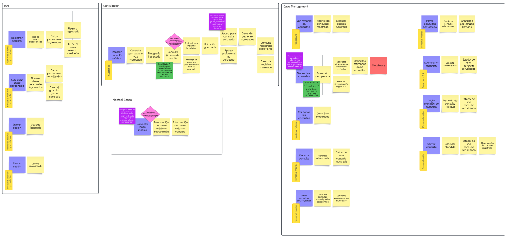

Al realizar el paso ocho, notamos que era necesario guardar las imágenes en la nube cuando se hiciera la sincronización para que estas sean correctamente almacenados y accesibles por parte tanto de los ciudadanos como del personal médico que atiende los casos.

__Step 9: Aggregates__

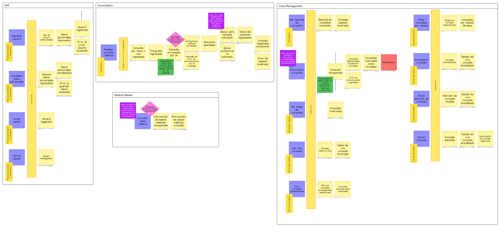

Para el paso nueve, consideramos tres aggregates centrales. Primero, tenemos user, el cual aplicará tanto para los ciudadanos como para el personal médico. Asimismo, contamos con consultation, el cual hace referencia a la consulta que se le realiza a la IA sobre la urgencia o emergencia ocurrida. Por último, el aggregate case representa aquella consulta que ya logró pasar al backend y contiene datos como estado o personal asignado.

__Step 10: Bounded Context__

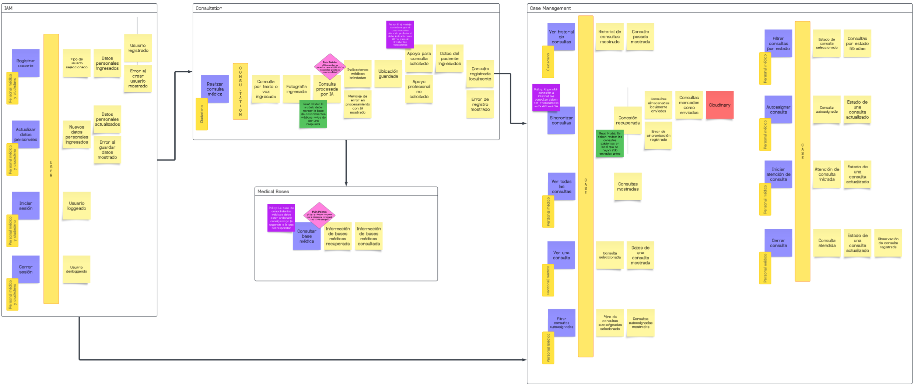

Para el último paso, conectamos nuestros Bounded Contexts formados, considerando las funcionalidades a las quw tendría acceso cada tipo de usuario, así como el flujo que se seguiría y la dependencia que existía de uno a otro. Por ejemplo, existe una conexión directa entre Consultation y Medical Bases puesto que el modelo de IA debe recuperar información de la base de conocimientos médicos cada vez que se le realice una consulta.

El tablero colaborativo se encuentra en [Lucidchart — EventStorming de Lifeline](https://lucid.app/lucidchart/d0f602b7-11f4-48bb-a4d7-7e7e20013e43/edit?viewport_loc=-8281%2C23529%2C16955%2C8315%2C0_0&invitationId=inv_aa5a24a1-6795-41ee-beeb-4de03eed109a).

### 4.2.2. Candidate Context Discovery

__IAM Bounded Context__

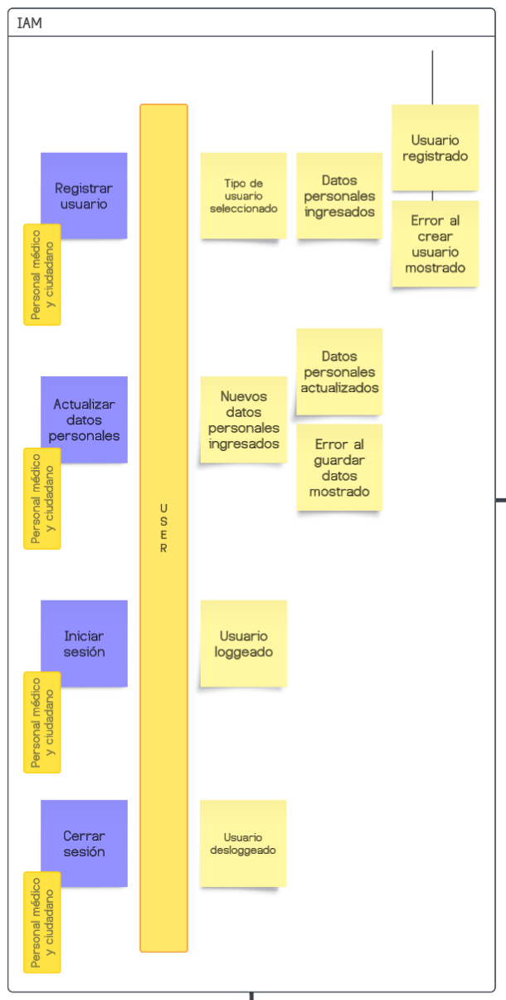  

Límite: Este bounded context se encarga de la gestión de nuestros dos tipos de usuarios y de su información personal. Además, aquí se gestiona el ingreso y autenticación, así como se registran los datos específicos necesarios para los ciudadanos y para el personal médico.  

Eventos clave: Usuario registrado, usuario loggeado, datos personales actualizados.  

Justificación: Este dominio se separa los demás ya que tiene el propósito de gestionar a los usuarios registrados, resultando aquí los roles que se tendrán. Además, si bien buscamos garantizar un ingreso sencillo para los ciudadanos puesto usarán la aplicación durante emergencias, consideramos necesario que se realice la autenticación con tokens JWT de forma obligatoria en el caso del personal médico, dado que poseerán información personal de quienes necesitan ayuda.  

__Consultation Bounded Context__

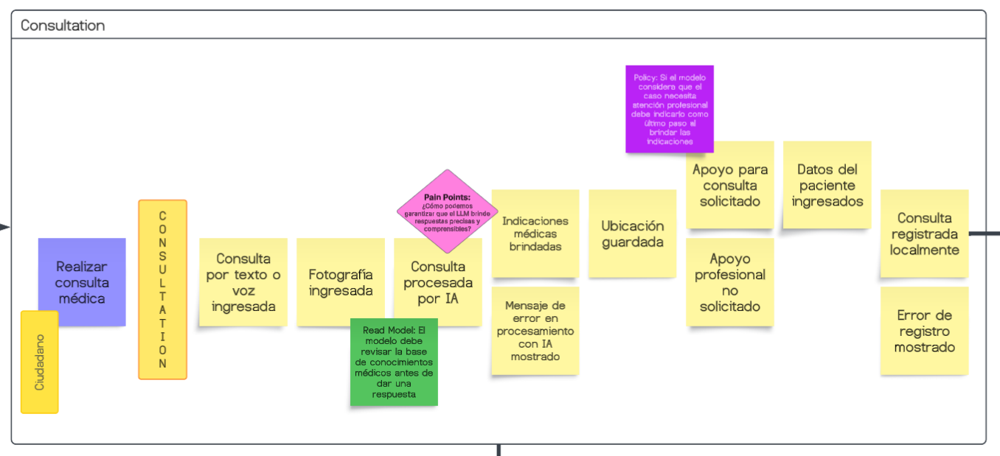  

Límite: Este bounded context se estará encargando de la parte central de la aplicación, siendo esta la referente a las consultas procesadas por el modelo de inteligencia artificial empleado. Aquí, llegará la consulta del usuario con fotografías adjuntas si las hubiera. El modelo se encargará de formar las indicaciones habiendo consultado antes la base médica y terminando por permitir el registro de la consulta ingresada en local.

Eventos clave: Consulta por texto o vox ingresada, indicaciones médicas brindadas, consulta registrada localmente.

Justificación: Este dominio viene a ser el core y se separa de los demás por motivos centrales. En primer lugar, porque representa un procesa central, por lo que debe ser desarrollado con prioridad y cuidado en cuanto a las herrmientas que integra y el flujo que sigue. En segundo lugar, porque este proceso debe darse localmente, por lo que ocurrirá dentro del dispositivo del ciudadano sin poder conectarse al backend en la nube a falta de conexión a internet.

__Medical Bases Bounded Context__

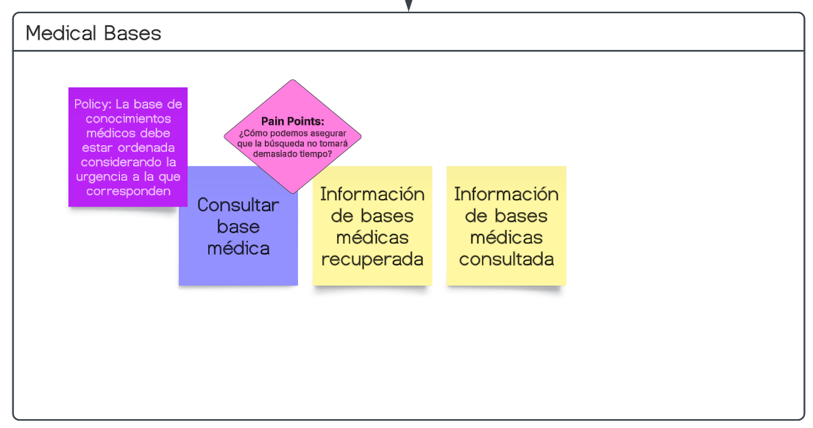  

Límite: Este bounded context se centra solo en las consultas hacia la base de conocimientos médicos, asegurando que el proceso se de con precisión y eficiencia.

Eventos clave: Información de bases médicas recuperada, información de bases médicas consultada.

Justificación: Este dominio existe por su cuenta puesto que consideramos importante poseer un espacio en el cual organizar y clasificar la información recolectada para que el modelo de inteligenia artificial logre revisar los datos que necesita de manera más directa y rápida.

__Case Management Bounded Context__

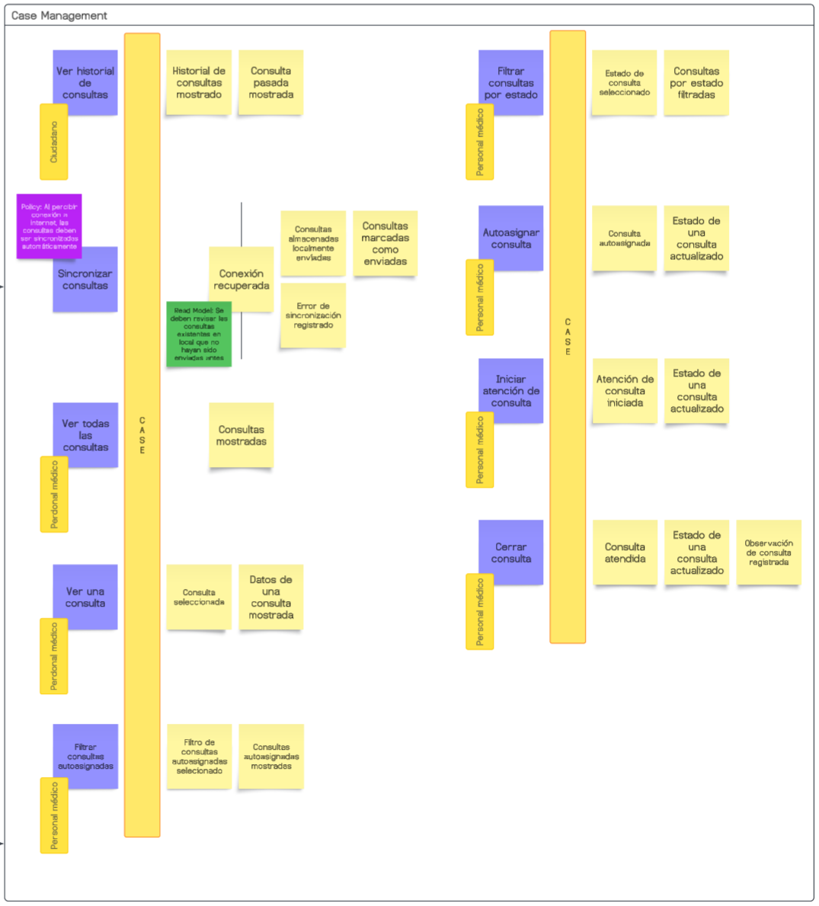  

Límite: Este bounded context abarca todo el flujo que siguen las consultas antes realizadas por los ciudadanos después de haber podido ser enviadas hacia el backend en la nube y, por ende, mostradas al personal médico. Aquí, el personal médico podrá conocer los datos de las emergencias médicas registradas, así como asignárselos en el caso de aquellos que solicitan una atención profesional. Los asos registrados irán pasando por estados hasta llegar a ser cerrados indicando que el paciente fue atendido.

Eventos clave: Conexión recuperada, consulta autoasignada, estado de consulta actualizado, consultas almacenadas localmente enviadas.

Justificación: Este dominio existe para lograr gestionar por separado el flujo de los casos registrados, así como para contar con el historial guardado en la nube y ofrecer la información y posibilidad de ayudar al personal médico.

### 4.2.3. Domain Message Flows Modeling

Para visualizar cómo deben colaborar los bounded contexts identificados (IAM, Consultation, Medical Bases y Case Management) al resolver los casos de uso principales del negocio, el equipo aplicó la técnica de **Domain Storytelling**. Esta técnica permite representar, mediante pictogramas de actores, objetos de trabajo y flechas numeradas, la secuencia de acciones que ocurre entre los usuarios (ciudadano, personal médico) y los sistemas involucrados para completar una historia concreta del dominio.

__Domain Story 1: Registro de consulta y obtención de orientación offline__

En este flujo se puede observar el camino que sigue una consulta al ser realizada por un ciudadano y procesada de forma local.

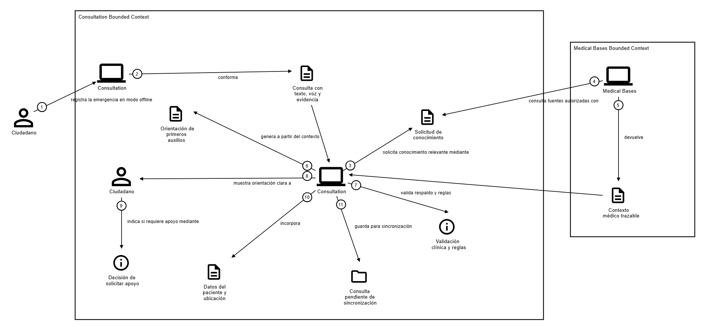

__Domain Story 2: Respuesta segura ante información médica insuficiente__

En este flujo se observa como se consulta la información de la base de datos de conocimientos médicos antes de ofrecer una respuesta. Al no contar con información suficiente, se opta por enviar el mensaje al ciudadano y sugerirle esperar la ayuda profesional.

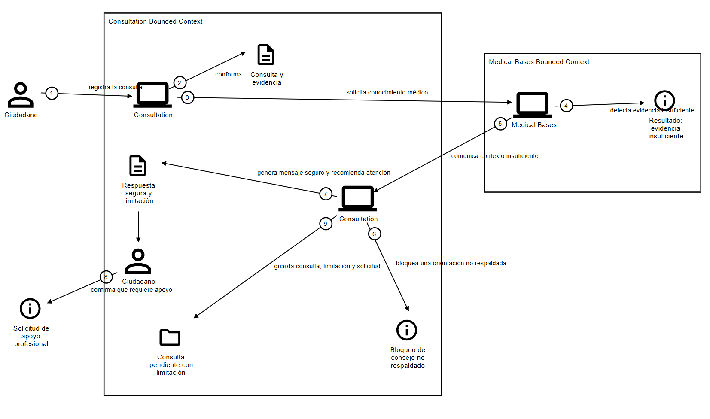

__Domain Story 3: Sincronización de consulta y creación del caso__

En este flujo se observa el camino que sigue el sistema cuando recibe la conexión de internet y debe sincronizar los casos almacenados localmente para que sean revisados por el personal médico mientras aseguro que estos no se pierdan en el camino.

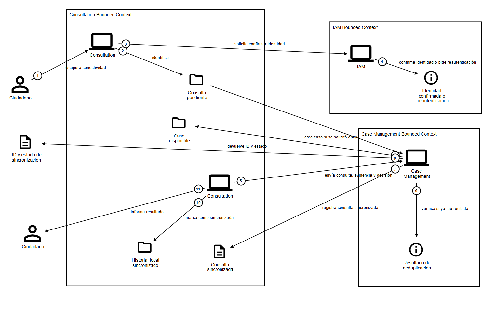

__Domain Story 4: Asignación, atención y seguimiento del caso__

En este flujo se puede ver como el personal médico recibe acceso a los casos previamente registrados y realiza procesos como la autoasignación, atención y cambio de estado de los mismos.

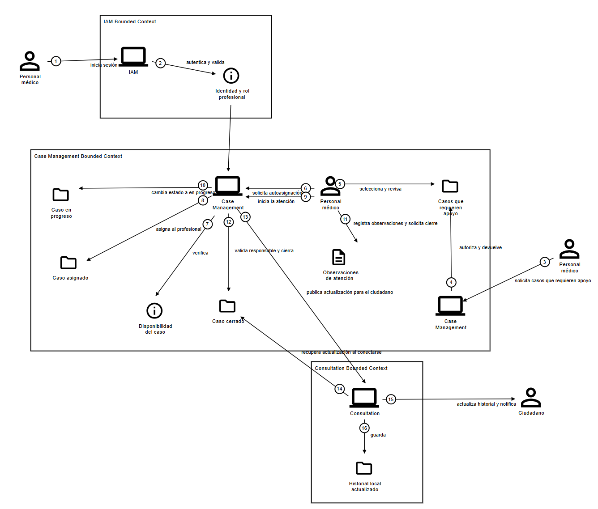

### 4.2.4. Bounded Context Canvases

En esta sección el equipo diseña los candidate bounded contexts identificados durante el EventStorming (IAM, Consultation, Medical Bases y Case Management), siguiendo el proceso iterativo del Bounded Context Canvas: Context Overview Definition, Business Rules Distillation & Ubiquitous Language Capture, Capability Analysis, Capability Layering, Dependencies Capture y Design Critique. Se priorizó **Consultation** por ser el core domain del producto, seguido de **Case Management**, **Medical Bases** e **IAM**.

Los canvases colaborativos se encuentran en [Miro — Bounded Context Canvases de Lifeline](https://miro.com/welcomeonboard/UkpaOFN5cko0U0VDWm51T2FtMjVVY1N2akQvTSt5eTFJZkxJYnB0TVpaQ2xha1U3VGpwQ051bFZKUVMvQzNtaUY1dWZkc2ExcDVBMjM3aDZwRXl5V1ljTzZORXAvU1JmSGQ0cDZZNG9RR0NWc1MvVHVWTHBrNDBHd0VjOFJSMEdQdGo1ZEV3bUdPQWRZUHQzSGl6V2NBPT0hdjE=?share_link_id=452015576853).

#### Bounded Context Canvas: Consultation

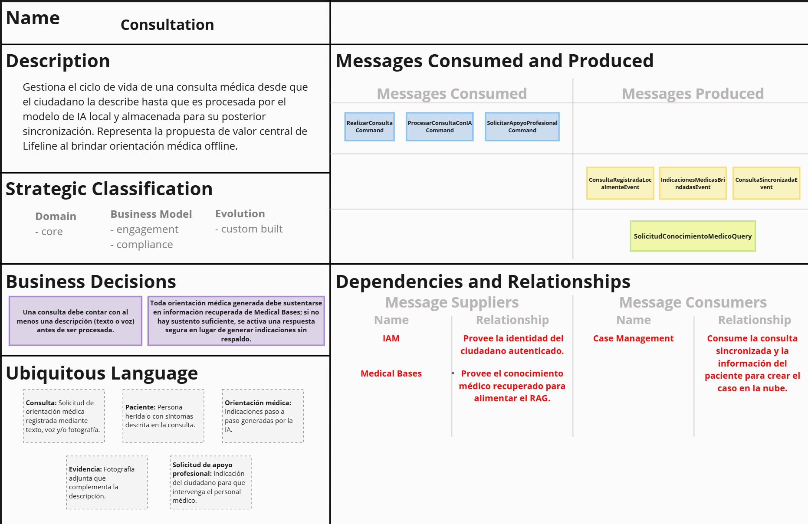  

---

#### Bounded Context Canvas: Medical Bases

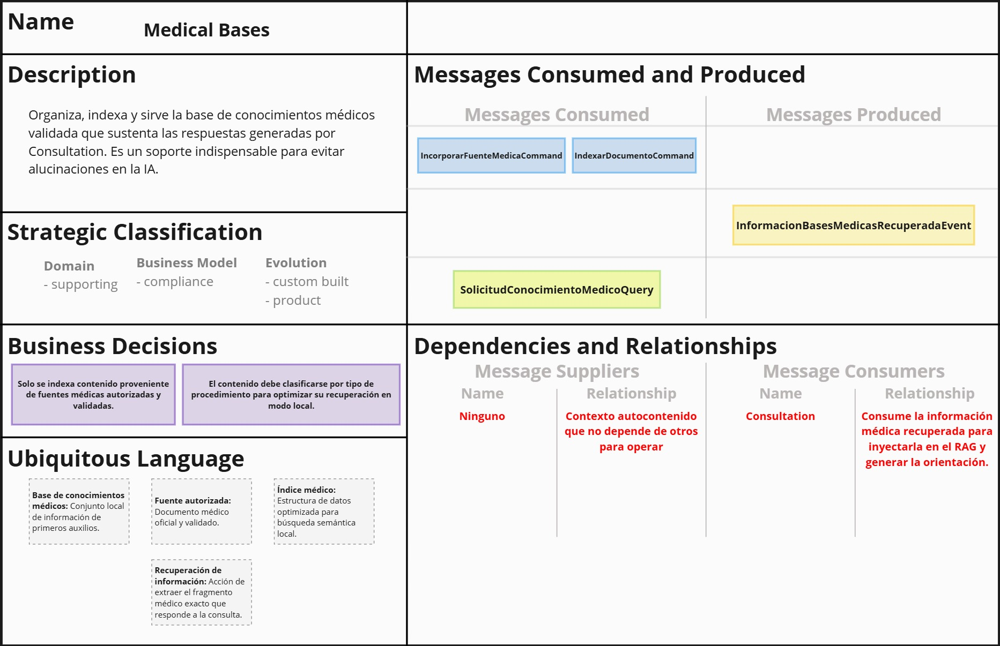  

---

#### Bounded Context Canvas: Case Management

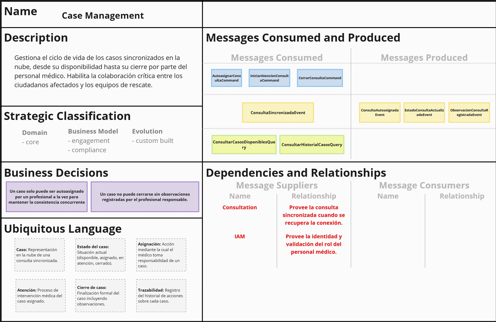  

---

#### Bounded Context Canvas: IAM

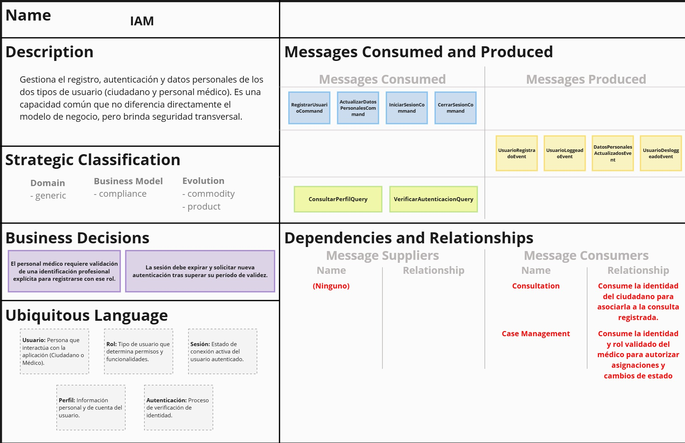  

---

### 4.2.5. Context Mapping

El proceso de Context Mapping nos permitió representar las relaciones estructurales y los contratos de integración entre los bounded contexts definidos en Lifeline (IAM, Consultation, Medical Bases y Case Management). Mientras que los Bounded Context Canvases detallan cada contexto de manera aislada, el Context Map ofrece una visión sistémica de cómo colaboran e intercambian información dentro de los límites de la solución.

Para su elaboración se aplicaron preguntas de exploración sugeridas en Domain-Driven Design:
*   **¿Qué pasaría si movemos el capability de "recomendación de atención profesional" de Consultation a un nuevo context?** Se descartó, ya que esta capability depende directamente del resultado generado por el modelo de IA dentro de Consultation; separarla generaría una dependencia circular innecesaria.
*   **¿Qué pasaría si descomponemos Medical Bases y movemos la indexación a Consultation?** Se descartó, porque acoplaría la lógica de gestión de contenido médico (incorporación y validación de fuentes) con la lógica de orquestación de consultas, dificultando el mantenimiento independiente de la base.
*   **¿Qué pasaría si duplicamos el modelo de "Paciente" entre Consultation y Case Management para romper la dependencia directa?** Se aceptó parcialmente: ambos contextos comparten un Shared Kernel con los datos esenciales del paciente (nombre, edad, ubicación) para evitar que Case Management dependa de cambios internos en el modelo de Consultation.

A partir de este análisis, se identificaron y aplicaron los siguientes **patrones de relación y mapeo** entre contextos:

1.  **Customer/Supplier con Open Host Service (OHS):** 
    Se aplica en la interacción de **IAM** (Upstream) con **Consultation** y **Case Management** (Downstream). IAM actúa como proveedor exponiendo un servicio abierto y estandarizado (API REST/gRPC) para la autenticación y validación de roles (Ciudadano o Personal Médico). Esto permite que los otros contextos consuman la identidad sin que IAM deba adaptarse a las necesidades específicas o lógicas internas de cada uno.
2.  **Anti-Corruption Layer (ACL):** 
    Se implementa fuertemente en **Consultation** para integrarse de forma segura con **Medical Bases** e **IAM**. Dado que Consultation es el Core Domain principal (ejecución de IA on-device), utiliza una capa anticorrupción para aislar su modelo de dominio puro, traduciendo los esquemas de datos del índice RAG local y los tokens de usuario a su propio lenguaje ubicuo. **Case Management** también utiliza una ACL al integrarse con IAM para no contaminar su lógica de atención clínica con detalles técnicos de autenticación.
3.  **Shared Kernel:** 
    Aplicado en la estrecha intersección entre **Consultation** y **Case Management**. Dado que ambos son Core Domains acoplados temporalmente (una consulta registrada *offline* en Consultation se convierte eventualmente en un caso *online* en Case Management), comparten un modelo de datos centralizado y mínimo: el **Patient Data Model** (datos esenciales del paciente y ubicación). Esto evita la duplicación de código y asegura una consistencia total al momento de sincronizar la emergencia hacia la nube.
4.  **Event-Driven / Asynchronous Messaging:** 
    Define la comunicación diferida entre **Consultation** y **Case Management**. Debido a la estricta naturaleza *offline-first* de Lifeline, Consultation publica eventos de dominio en una cola local (Outbox) cuando no hay internet. Al recuperar conectividad, envía asíncronamente estos eventos hacia Case Management, desacoplando la disponibilidad inmediata de ambos contextos y garantizando que no se pierda información vital durante los apagones de red.

**Context Map final y resumen de relaciones**

El siguiente diagrama, generado con **ContextMapper**, resume la relación estructural final entre los cuatro bounded contexts de Lifeline:

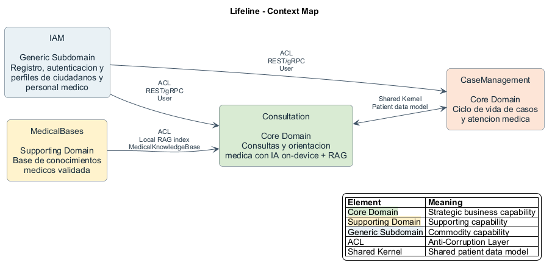

Se aprecia este cuadro con la relación estructural final entre los cuatro bounded contexts de Lifeline, reflejados en el diagrama visual de Context Map:

| Relación | Upstream (U) | Downstream (D) | Patrón DDD aplicado | Justificación |
| :--- | :--- | :--- | :--- | :--- |
| **IAM → Consultation** | IAM | Consultation | Customer/Supplier (OHS/ACL) | IAM provee el modelo de identidad y rol mediante un Open Host Service; Consultation lo protege e integra con una Anti-Corruption Layer. |
| **IAM → Case Management** | IAM | Case Management | Customer/Supplier (OHS/ACL) | Case Management depende del rol "Personal Médico" validado por IAM para habilitar la autoasignación y atención de casos en la nube. |
| **Medical Bases → Consultation** | Medical Bases | Consultation | Customer/Supplier (ACL) | Consultation es cliente de la capacidad de búsqueda semántica que expone Medical Bases mediante un índice RAG local, traduciendo los hallazgos mediante ACL. |
| **Consultation ↔ Case Management** | Consultation | Case Management | Shared Kernel / Event-Driven | Ambos contextos (Core Domains) comparten un modelo mínimo de datos del paciente (Patient Data Model) para mantener la consistencia al sincronizar la consulta a la nube. |

**Conclusión:** El diseño final privilegia Bounded Contexts altamente desacoplados mediante relaciones tipo *Open Host Service* y *Anti-Corruption Layer* para salvaguardar los Core Domains (Consultation y Case Management), reservando el patrón *Shared Kernel* únicamente para el conjunto crítico de datos del paciente que transita desde la emergencia offline hasta la atención médica online.

## 4.3. Software Architecture

### 4.3.1. Software Architecture System Landscape Diagram

El landscape sitúa a Lifeline frente a sus dos actores —ciudadano y personal médico— y al único sistema externo de la solución: **Cloudinary**, servicio de almacenamiento, transformación y entrega de evidencias fotográficas. El ciudadano solicita orientación y consulta el estado de sus casos; el personal médico gestiona y atiende los casos sincronizados. Lifeline almacena y entrega las evidencias fotográficas en Cloudinary mediante HTTPS/REST cuando existe conectividad; la captura de la fotografía permanece en el dispositivo.

<p align="center">
  
</p>

### 4.3.2. Software Architecture Context Level Diagrams

El diagrama de contexto (C1) mantiene el mismo recorte: Lifeline es la plataforma móvil *offline-first* con IA on-device y RAG, y sincroniza casos con un backend modular cuando hay red. Cloudinary aparece como sistema de software externo; no hay otros sistemas vecinos en esta versión.

<p align="center">
  
</p>

### 4.3.3. Software Architecture Container Level Diagrams

En el nivel de contenedores (C2) se separa lo que corre en el dispositivo de lo que corre en la nube. La *Mobile App* (Flutter/Dart) usa la cámara local, persiste consultas y evidencias en *Local Database* (SQLite) y recupera conocimiento del *Medical Knowledge Store* para RAG. La sincronización sale por el *Load Balancer* hacia el *Backend Modular API* (Spring Boot). Ese backend es el único contenedor que se relaciona con **Cloudinary**: almacena y entrega las evidencias fotográficas ya sincronizadas. El *Message Broker* y los *Async Workers* absorben el trabajo secundario, y *Cloud Database* (PostgreSQL) queda como fuente de verdad de identidades, roles, casos e historial.

<p align="center">
  
</p>

### 4.3.4. Software Architecture Deployment Diagrams

El despliegue distingue el *Smartphone* (app, SQLite e índice médico local) de *Microsoft Azure* (ingress, pool de dos instancias del backend, mensajería, workers y PostgreSQL). **Cloudinary Cloud** se despliega fuera de Azure, como SaaS. Las instancias del *Backend Modular API* son las que publican y consultan evidencias fotográficas en Cloudinary; el teléfono no tiene esa dependencia, de modo que la consulta de emergencia sigue funcionando sin internet.

<p align="center">
  
</p>

### 4.3.5. Software Architecture Component Level Diagrams

A continuación se presentan los diagramas de componentes (C3) por bounded context, desglosando la estructura interna de cada módulo definido en el nivel de contenedores. Consultation y Medical Bases viven en la *Mobile App*; IAM y Case Management viven en el *Backend Modular API*. Cloudinary solo aparece en Case Management, porque es el backend quien persiste las evidencias tras la sincronización.

**Consultation**

El ciudadano describe la emergencia en *Emergency Consultation UI* (texto, voz o fotografía tomada con la cámara del dispositivo). *Consultation Service* orquesta el flujo, pide contexto a *Medical Knowledge API*, ejecuta inferencia en *On-Device AI Engine* y aplica reglas en *Consultation Domain*. *Local Persistence and Sync* guarda la consulta y las evidencias en SQLite y, al recuperar señal, sincroniza el pendiente hacia el *Load Balancer*. No hay conexión desde este contexto hacia Cloudinary.

<p align="center">
  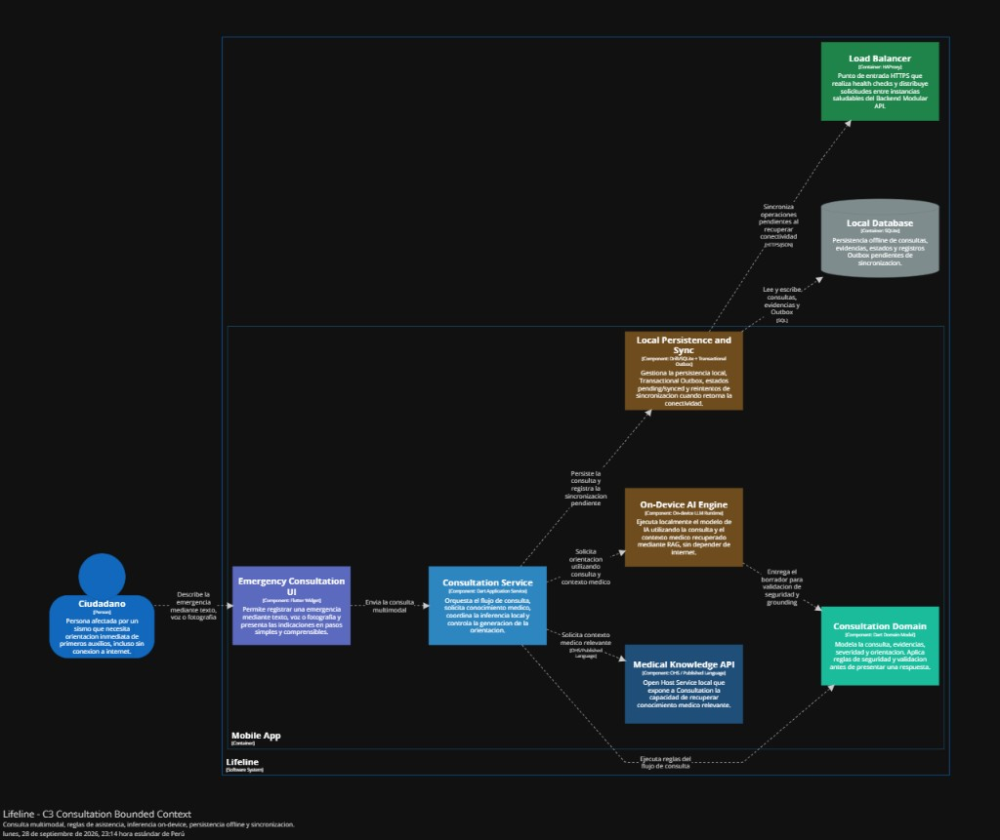
</p>

**Medical Bases**

*Consultation Service* solicita contexto médico a *Medical Knowledge API* (OHS / Published Language). *Medical Knowledge Service* coordina la recuperación sobre fuentes validadas; *Semantic Retriever* selecciona fragmentos para RAG y *Knowledge Repository* consulta el *Medical Knowledge Store* local.

<p align="center">
  
</p>

**Case Management**

El *Load Balancer* enruta operaciones de casos a *Case Management API* y autenticación a *IAM Interface*. *Case Management Service* aplica el ciclo de vida en *Case Domain*, persiste en *Case Repository* / *Cloud Database*, publica trabajo secundario vía *Async Event Publisher* y es el componente que **almacena y obtiene evidencias fotográficas en Cloudinary** tras la sincronización.

<p align="center">
  
</p>

**IAM**

*Case Management Service* consulta identidad y rol del profesional en *IAM Interface*. *IAM Service* aplica reglas de *Identity and Access Domain* y persiste usuarios, perfiles y roles mediante *IAM Repository* en *Cloud Database*.

<p align="center">
  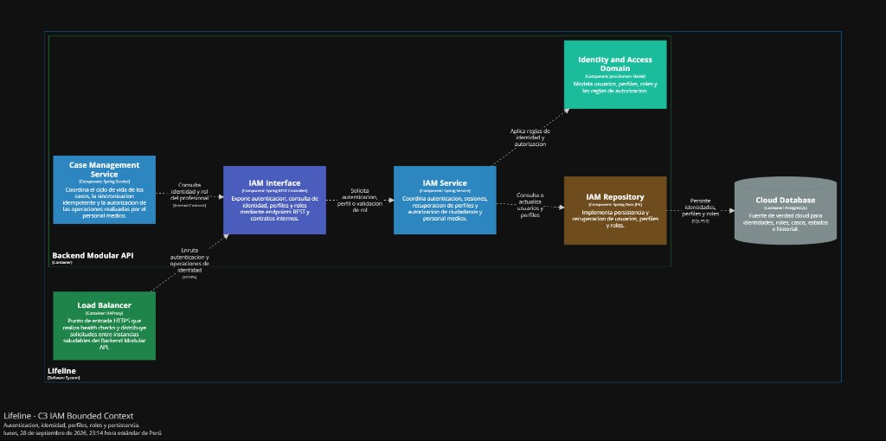
</p>

# Capítulo V: Tactical-Level Software Design

Los elementos siguientes describen la estructura propuesta de Lifeline en cuanto a los Bounded Contexts considerando tanto en el backend desplegado en la nube como de forma local dentro de aplicación móvil. IAM y Case Management se implementan como módulos del mismo backend Spring Boot; Consultation y Medical Bases ejecutan su lógica en Flutter. Los nombres de clases y funciones se ajustan al diseño acordado y aún no representan código implementado.

## 5.1. Bounded Context: IAM

IAM administra cuentas, roles y perfiles. Case Management verifica la habilitación de un profesional mediante una interfaz interna que solo devuelve un booleano.

### 5.1.1. Domain Layer.

#### Aggregates

**User**

Representa la cuenta común del ciudadano o del profesional médico.

- **Atributos**
  - `id: UUID`
  - `email: String`
  - `password: String` (hash)
  - `roleId: UUID`
  - `firstName: String`
  - `lastName: String`
  - `phone: String?`
  - `createdAt: Instant`
  - `updatedAt: Instant`
- **Funciones**
  - `register(email, passwordHash, roleId, firstName, lastName, phone): User`
  - `updatePersonalData(firstName, lastName, phone): void`

**CitizenProfile**

Agrupa la información relevante para ubicar y proveer atención a un ciudadano.

- **Atributos**
  - `id: UUID`
  - `userId: UUID`
  - `city: String`
  - `district: String`
  - `address: String`
  - `dateOfBirth: LocalDate`
  - `preExistingConditions: String?`
  - `allergies: String?`
  - `emergencyContact: EmergencyContact?`
  - `createdAt: Instant`
  - `updatedAt: Instant`
- **Funciones**
  - `updateHealthData(preExistingConditions, allergies): void`
  - `updateContactAndAddress(city, district, address, emergencyContact): void`

**MedicalProfile**

Conserva las credenciales e información del profesional médico.

- **Atributos**
  - `id: UUID`
  - `userId: UUID`
  - `professionalCategory: ProfessionalCategory`
  - `professionalLicenseNumber: String`
  - `specialty: String?`
  - `verificationStatus: String`
  - `verifiedAt: Instant?`
  - `createdAt: Instant`
  - `updatedAt: Instant`
- **Funciones**
  - `updateProfessionalData(professionalCategory, professionalLicenseNumber, specialty): void`
  - `verify(verifiedAt): void`
  - `isEnabled(): boolean`

#### Entities

**Role**

Lista los roles disponibles dentro de la aplicación.

- **Atributos**
  - `id: UUID`
  - `code: RolesCode`
  - `name: RolesName`
- **Funciones**
  - `create(code, name): Role`

#### Value Objects

**RolesCode**

Expresa el código único de un rol, en este caso para los roles de `CITIZEN` y `MEDICAL_PROFESSIONAL`.

- **Atributos**
  - `value: String`
- **Funciones**
  - `RolesCode(value: String)`

**RolesName**

Expresa el nombre visible cada rol.

- **Atributos**
  - `value: String`
- **Funciones**
  - `RolesName(value: String)`

**EmergencyContact**

Agrupa nombre y teléfono del contacto de emergencia dentro de `CitizenProfile`.

- **Atributos**
  - `name: String`
  - `phone: String`
- **Funciones**
  - `EmergencyContact(name: String, phone: String)`

**ProfessionalCategory**

Lista la categoría de profesional admitidos como personal médico en la aplicación.

- **Atributos**
  - `value: String`
- **Funciones**
  - `from(value: String): ProfessionalCategory`

---

### 5.1.2. Interface Layer.

#### Controllers

**AuthController**

Expone el registro y el inicio de sesión mediante recursos REST.

- **Funciones**
  - `registerCitizen(RegisterCitizenResource): AuthenticatedUserResource`.
  - `registerMedicalProfessional(RegisterMedicalProfessionalResource): AuthenticatedUserResource`.
  - `signIn(SignInResource): AuthenticatedUserResource`.

**UsersController**

Expone la lectura y actualización autorizada de datos personales y generales del usuario.

- **Funciones**
  - `getUserById(id: UUID): UserResource`.
  - `updateUser(id: UUID, UpdateUserResource): UserResource`.

**CitizenProfilesController**

Expone y permite actualizar los datos específicos del ciudadano autenticado.

- **Funciones**
  - `getCitizenProfile(userId: UUID): CitizenProfileResource`.
  - `updateCitizenProfile(userId: UUID, UpdateCitizenProfileResource): CitizenProfileResource`.

**MedicalProfilesController**

Expone el perfil de profesional médico y su verificación autorizada.

- **Funciones**
  - `getMedicalProfile(userId: UUID): MedicalProfileResource`.
  - `updateMedicalProfile(userId: UUID, UpdateMedicalProfileResource): MedicalProfileResource`.
  - `verifyMedicalProfile(userId: UUID, VerifyMedicalProfileResource): MedicalProfileResource`.

**RoleController**

Publica el catálogo de roles disponibles que necesita la interfaz de registro.

- **Funciones**
  - `getAllRoles(): List<RoleResource>`.

#### Resources and Assemblers

**RegisterCitizenResource**

Recibe los datos públicos necesarios para crear `User` y `CitizenProfile` sin exponer la columna `password` cifrada.

- **Atributos**: `email`, `password`, `firstName`, `lastName`, `phone`, `city`, `district`, `address`, `dateOfBirth`, `emergencyContact`.

**RegisterMedicalProfessionalResource**

Recibe los datos comunes de cuenta y los propios del profesional médico.

- **Atributos**: `email`, `password`, `firstName`, `lastName`, `phone`, `professionalCategory`, `professionalLicenseNumber`, `specialty`.

**RegisterCitizenCommandFromResourceAssembler**

Traduce el registro de ciudadano al comado correspondiente.

- **Funciones**: `toCommand(RegisterCitizenResource): RegisterCitizenCommand`.

**RegisterMedicalProfessionalCommandFromResourceAssembler**

Traduce el registro de profesional médico al comando correspondiente.

- **Funciones**: `toCommand(RegisterMedicalProfessionalResource): RegisterMedicalProfessionalCommand`.

**UserContextFacade**

Publica hacia Case Management la verificación mínima de habilitación profesional dentro del mismo backend.

- **Funciones**: `isEnabledMedicalProfessional(userId: UUID): boolean`.

---

### 5.1.3. Application Layer.

#### Commands

**RegisterCitizenCommand**

Solicita crear la cuenta y su perfil como ciudadano.

- **Atributos**: `email`, `password`, `firstName`, `lastName`, `phone`, `city`, `district`, `address`, `dateOfBirth`, `emergencyContact`.

**RegisterMedicalProfessionalCommand**

Solicita crear la cuenta y su perfil como profesional médico.

- **Atributos**: `email`, `password`, `firstName`, `lastName`, `phone`, `professionalCategory`, `professionalLicenseNumber`, `specialty`.

**SignInUserCommand**

Solicita autenticar una cuenta ya registrada.

- **Atributos**: `email: String`, `password: String`.

**UpdateUserCommand**

Solicita modificar datos generales del usuario autorizado.

- **Atributos**: `userId: UUID`, `firstName: String`, `lastName: String`, `phone: String?`.

**UpdateCitizenProfileCommand**

Solicita modificar datos personales y de salud del ciudadano.

- **Atributos**: `userId: UUID`, `city`, `district`, `address`, `emergencyContact`, `preExistingConditions`, `allergies`.

**UpdateMedicalProfileCommand**

Solicita actualizar los datos profesionales del perfil médico.

- **Atributos**: `userId: UUID`, `professionalCategory`, `professionalLicenseNumber`, `specialty`.

**VerifyMedicalProfileCommand**

Solicita registrar la verificación de un profesional médico.

- **Atributos**: `userId: UUID`, `verifiedAt: Instant`.

**SeedRolesCommand**

Solicita crear los roles iniciales que aún no existan.

No necesita atributos: el catálogo inicial se define en el servicio de IAM.

#### Queries

**GetUserByIdQuery**

Recupera una cuenta por su identificador.

- **Atributos**: `userId: UUID`.

**GetCitizenProfileByUserIdQuery**

Recupera el perfil de ciudadano asociado a una cuenta.

- **Atributos**: `userId: UUID`.

**GetMedicalProfileByUserIdQuery**

Recupera el perfil de profesional médico asociado a una cuenta.

- **Atributos**: `userId: UUID`.

**GetAllRolesQuery**

Solicita los roles disponibles en el catálogo.

#### Services

**UserCommandServiceImpl**

Implementa `UserCommandService`

- **Funciones**: `handle(RegisterCitizenCommand)`, `handle(RegisterMedicalProfessionalCommand)`, `handle(SignInUserCommand)`, `handle(UpdateUserCommand)`.

**CitizenProfileCommandServiceImpl**

Implementa `CitizenProfileCommandService`.

- **Funciones**: `handle(UpdateCitizenProfileCommand): CitizenProfile`.

**MedicalProfileCommandServiceImpl**

Implementa `MedicalProfileCommandService`.

- **Funciones**: `handle(UpdateMedicalProfileCommand)`, `handle(VerifyMedicalProfileCommand)`.

**RoleCommandServiceImpl**

Implementa la precarga idempotente del catálogo de roles.

- **Funciones**: `handle(SeedRolesCommand): void`.

**UserQueryServiceImpl**

Implementa `UserQueryService`.

- **Funciones**: `handle(GetUserByIdQuery): User`.

**CitizenProfileQueryServiceImpl**

Implementa `CitizenProfileQueryService` para leer perfiles ciudadanos.

- **Funciones**: `handle(GetCitizenProfileByUserIdQuery): CitizenProfile`.

**MedicalProfileQueryServiceImpl**

Implementa `MedicalProfileQueryService` para leer perfiles médicos.

- **Funciones**: `handle(GetMedicalProfileByUserIdQuery): MedicalProfile`.

**RoleQueryServiceImpl**

Implementa `RoleQueryService` para consultar el catálogo de roles.

- **Funciones**: `handle(GetAllRolesQuery): List<Role>`.

**ApplicationReadyEventHandler**

Al iniciar Spring Boot, solicita a `RoleCommandService` la precarga de `CITIZEN` y `MEDICAL_PROFESSIONAL`.

- **Funciones**: `onApplicationReady(ApplicationReadyEvent): void`.

**UserContextFacadeImpl**

Consulta internamente rol y verificación y devuelve a la ACL solo un booleano.

- **Funciones**: `isEnabledMedicalProfessional(userId: UUID): boolean`.

---

### 5.1.4. Infrastructure Layer.

#### Repositories

**UserRepository**

Persiste el agregado `User` y permite hacer búsquedas de usuarios.

- **Funciones**: `findById(UUID)`, `findByEmail(String)`, `save(User)`.

**CitizenProfileRepository**

Persiste `CitizenProfile` con una referencia por UUID a `User`.

- **Funciones**: `findByUserId(UUID)`, `save(CitizenProfile)`.

**MedicalProfileRepository**

Persiste `MedicalProfile` con una referencia por UUID a `User`.

- **Funciones**: `findByUserId(UUID)`, `save(MedicalProfile)`.

**RoleRepository**

Persiste y consulta el catálogo de roles.

- **Funciones**: `findByCode(RolesCode): Optional<Role>`, `findAll(): List<Role>`, `save(Role): Role`.

#### Security and Client Adapters

**BCryptPasswordHasher**

Implementa `PasswordHasher` para almacenar y comprobar `password` de `User` como hash.

- **Funciones**: `hash(rawPassword: String): String`, `matches(rawPassword: String, storedHash: String): boolean`.

**JwtAccessTokenIssuer**

Implementa `AccessTokenIssuer` para emitir la credencial de una sesión autenticada.

- **Funciones**: `issue(userId: UUID, role: RolesCode): String`.

---

### 5.1.5. Bounded Context Software Architecture Component Level Diagrams.

El *Component Diagram* del bounded context IAM muestra cómo se descompone el contenedor *Backend Modular API* cuando se trata de cuentas, perfiles, roles y autorización del personal médico. Lo elaboramos con Structurizr DSL y sigue las cuatro capas de Clean Architecture. *IAM Interface* pertenece a Interface y ofrece tanto los endpoints REST como el contrato interno que usa Case Management. *IAM Service* vive en Application y coordina el registro, la sesión y la validación de rol. Las reglas de usuario y autorización quedan en *Identity and Access Domain*. *IAM Repository* está en Infrastructure y se encarga de persistir ese modelo. Hacia afuera, el *Load Balancer* dirige el tráfico HTTPS a la interfaz. *Cloud Database* en PostgreSQL guarda identidades, perfiles y roles. Case Management queda *downstream* y solo pregunta por la identidad y el rol del profesional. No llega al modelo interno de IAM.

### 5.1.6. Bounded Context Software Architecture Code Level Diagrams.

<p align="center">
  
</p>

#### 5.1.6.1. Bounded Context Domain Layer Class Diagrams.

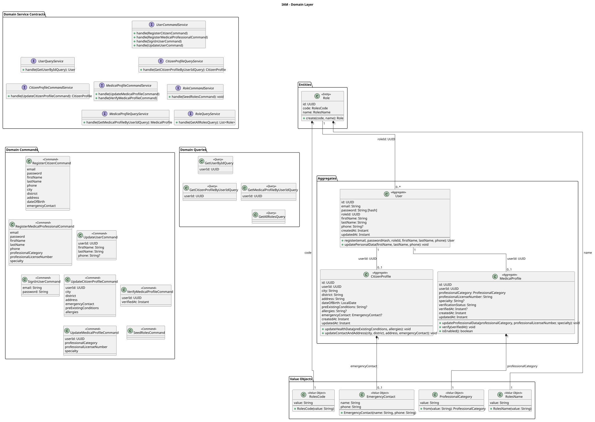

#### 5.1.6.2. Bounded Context Database Design Diagram.

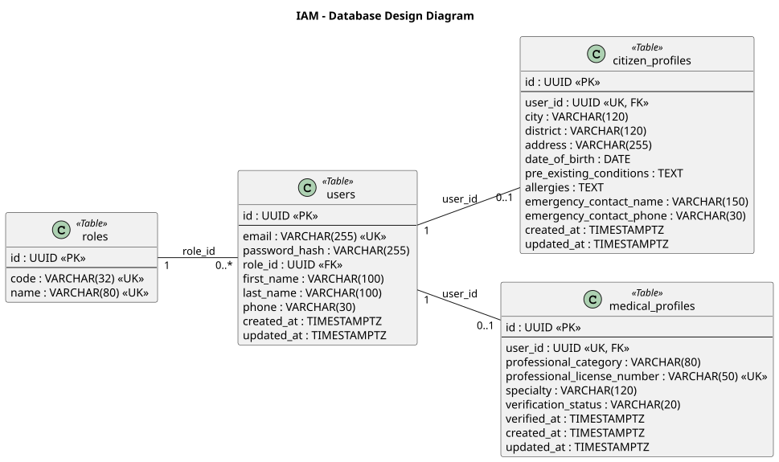

## 5.2. Bounded Context: Consultation

Consultation registra la emergencia y genera orientación con IA on-device, sin depender de internet ni de una sesión previa.

### 5.2.1. Domain Layer.

#### Aggregates

**Consultation**

Es la raíz local de una consulta de emergencia que se crea en Flutter aun sin internet o sin sesión.

- **Atributos**
  - `id: UUID`
  - `ownerUserId: UUID?`
  - `inputText: String?`
  - `photoLocalPath: String?`
  - `photoStorageKey: String?`
  - `helpRequested: boolean`
  - `createdAt: DateTime`
  - `updatedAt: DateTime`
  - `serverAckAt: DateTime?`
  - `patient: Patient?`
  - `answer: ConsultationAnswer?`
- **Funciones**
  - `create(inputText, photoLocalPath, patient): Consultation`
  - `requestHelp(): void`
  - `recordServerAck(ackAt: DateTime): void`

#### Entities

**Patient**

Describe a la persona afectada y el lugar del incidente.

- **Atributos**
  - `id: UUID`
  - `consultationId: UUID`
  - `name: String?`
  - `ageYears: int?`
  - `locationDescription: String?`
  - `province: String?`
  - `latitude: double?`
  - `longitude: double?`

`province` guarda el nombre de la provincia seleccionada; puede quedar vacío si no se conoce la ubicación.

**ConsultationAnswer**

Conserva la orientación que se mostró al usuario y las fuentes utilizadas.

- **Atributos**
  - `id: UUID`
  - `consultationId: UUID`
  - `guidanceText: String?`
  - `guidanceStatus: GuidanceStatus`
  - `preliminaryPriority: String?`
  - `professionalHelpRecommended: boolean`
  - `sourceReferences: List<Map<String, dynamic>>`
  - `createdAt: DateTime`

#### Models

**EvidenceSnippet**

Expresa una fuente médica recuperada en el lenguaje de Consultation, sin exponer las entidades de `Medical Bases`.

- **Atributos**
  - `text: String`
  - `sourceReference: String`

**GuidanceStatus**

Representa el estado de la respuesta de orientación generada en el dispositivo.

- **Atributos**
  - `value: String`

#### Services

**GuidanceSafetyPolicy**

Comprueba que la respuesta generada tenga sustento suficiente antes de presentarla como orientación.

- **Funciones**: `evaluate(answer: ConsultationAnswer, evidence: List<EvidenceSnippet>): ConsultationAnswer`.

---

### 5.2.2. Interface Layer.

#### Controllers

**ConsultationController**

Coordina el estado de las pantallas y llama a los servicios de aplicación, sin leer SQLite ni ejecutar Gemma directamente.

- **Funciones**: `createConsultation()`, `generateGuidance()`, `requestHelp()`, `showSyncStatus()`.

---

### 5.2.3. Application Layer.

#### Services

**CreateConsultationService**

Valida texto o fotografía y guarda la consulta con su paciente opcional.

- **Funciones**: `create(inputText, photoLocalPath, patient): Consultation`.

**GenerateGuidanceService**

Obtiene evidencia desde Medical Bases, ejecuta la inferencia local y aplica `GuidanceSafetyPolicy`.

- **Funciones**: `generate(consultationId: UUID): ConsultationAnswer`.

**RequestHelpService**

Marca la solicitud de atención y prepara la entrega pendiente.

- **Funciones**: `request(consultationId: UUID): Consultation`.

**SyncPendingConsultationsService**

Reintenta las entregas pendientes con el mismo UUID e `idempotencyKey`, así como confirma la consulta solo al recibir respuesta del servidor.

- **Funciones**: `syncPending(): void`.

#### Ports

**MedicalEvidencePort**

Solicita fragmentos pertinentes de Medical Bases y los traduce a `EvidenceSnippet`.

- **Funciones**: `search(inputText: String): List<EvidenceSnippet>`.

**OnDeviceInferencePort**

Abstrae la variante y el runtime de Gemma elegidos para el teléfono.

- **Funciones**: `infer(consultation: Consultation, evidence: List<EvidenceSnippet>): ConsultationAnswer`.

**CurrentUserPort**

Proporciona el UUID de una sesión existente, si la hay, sin bloquear una consulta invitada.

- **Funciones**: `currentUserId(): UUID?`.

---

### 5.2.4. Infrastructure Layer.

En Flutter, esta capa se implementa bajo el nombre de `data`.

#### Local Persistence

**ConsultationsDao**

Guarda `consultations` en SQLite.

- **Funciones**: `insert(ConsultationEntity)`, `findById(UUID)`, `update(ConsultationEntity)`.

**PatientsDao**

Guarda los datos del paciente en `patients`.

- **Funciones**: `insert(PatientEntity)`, `findByConsultationId(UUID)`.

**Provinces**

Proporciona sin conexión los nombres seleccionables de las provincias para el formulario de consulta.

- **Funciones**: `listProvinceNames(): List<String>`.

**ConsultationAnswersDao**

Guarda `consultation_answers` en SQLite.

- **Funciones**: `insert(ConsultationAnswerEntity)`, `findByConsultationId(UUID)`.

**SyncOutboxDao**

Guarda el trabajo de sincronización, el vencimiento de su reserva y su confirmación.

- **Funciones**: `enqueue(consultationId, idempotencyKey)`, `leasePending(now)`, `recordRetry(id, nextAttemptAt)`, `acknowledge(id, ackedAt)`.

**ConsultationRepositoryImpl**

Traduce las entidades SQLite hacia `ConsultationRepository`.

- **Funciones**: `save(Consultation)`, `findById(UUID)`.

**ConsultationSyncRepositoryImpl**

Traduce los trabajos de `sync_outbox` hacia `ConsultationSyncRepository`.

- **Funciones**: `enqueue(consultationId, idempotencyKey)`, `pendingSync()`.

**PrivatePhotoStore**

Conserva una sola fotografía por consulta en el almacenamiento privado del dispositivo mientras esté pendiente de carga.

- **Funciones**: `save(consultationId, image): String`, `read(localPath): bytes`.

#### AI and External Adapters

**GemmaInferenceAdapter**

Ejecuta la inferencia en el dispositivo a partir de la información ingresada por el usuario.

- **Funciones**: `infer(Consultation, List<EvidenceSnippet>): ConsultationAnswer`.

**MedicalBasesEvidenceAdapter**

Es el ACL que transforma los resultados de Medical Bases en `EvidenceSnippet`.

- **Funciones**: `search(inputText: String): List<EvidenceSnippet>`.

**IamCurrentUserAdapter**

Lee el identificador de la sesión local.

- **Funciones**: `currentUserId(): UUID?`.

**PhotoUploadApiService**

Envía por HTTPS la fotografía a Spring Boot y recibe `photoStorageKey`.

- **Funciones**: `uploadPhoto(consultationId, image): String`.

**ConsultationApiService**

Envía la consulta después de obtener la clave de foto con la misma clave de idempotencia en cada reintento.

- **Funciones**: `submitConsultation(Consultation, idempotencyKey): serverAck`.

---

### 5.2.5. Bounded Context Software Architecture Component Level Diagrams.

El *Component Diagram* del bounded context Consultation muestra cómo se descompone el contenedor *Mobile App* cuando se registra una emergencia y se genera orientación en el dispositivo. Lo elaboramos con Structurizr DSL y sigue las cuatro capas de Clean Architecture. *Emergency Consultation UI* pertenece a Interface y recibe texto, voz o una fotografía tomada con la cámara local. *Consultation Service* vive en Application y orquesta la consulta, la evidencia y la inferencia. Las reglas de la consulta y de seguridad de la orientación quedan en *Consultation Domain*. *Local Persistence and Sync* está en Infrastructure y guarda el agregado en SQLite junto con el trabajo pendiente de entrega. *On-Device AI Engine* ejecuta el modelo en el teléfono. Hacia Medical Bases, *Medical Knowledge API* expone la búsqueda local que alimenta el RAG. Al recuperar señal, la sincronización sale hacia el *Load Balancer*. Este contexto no habla con Cloudinary.

### 5.2.6. Bounded Context Software Architecture Code Level Diagrams.

<p align="center">
  
</p>

#### 5.2.6.1. Bounded Context Domain Layer Class Diagrams.

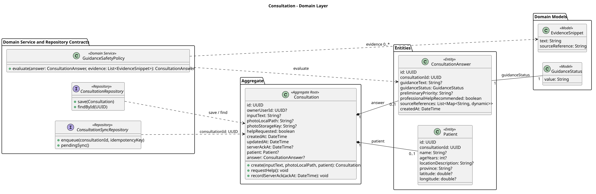

#### 5.2.6.2. Bounded Context Database Design Diagram.

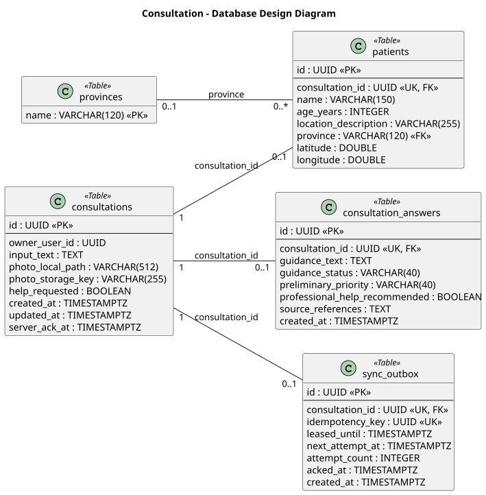

## 5.3. Bounded Context: Medical Bases

Medical Bases conserva en la aplicación móvil las fuentes médicas validadas y un índice local para las consultas RAG sin internet.

### 5.3.1. Domain Layer.

#### Aggregates

**KnowledgePackage**

Representa una versión del conocimiento médico incluida en la aplicación y disponible sin conexión.

- **Atributos**
  - `id: UUID`
  - `version: String`
  - `indexFilePath: String`
  - `status: String`
  - `installedAt: DateTime`
- **Funciones**
  - `activate(): void`
  - `isActive(): bool`


#### Entities

**MedicalSource**

Describe un documento revisado que pertenece a un paquete.

- **Atributos**
  - `id: UUID`
  - `packageId: UUID`
  - `title: String`
  - `publisher: String`
  - `sourceUrl: String?`
  - `edition: String?`
  - `validatedAt: DateTime`
  - `license: String?`

**MedicalChunk**

Representa un fragmento de una fuente para la búsqueda RAG.

- **Atributos**
  - `id: UUID`
  - `sourceId: UUID`
  - `ordinal: int`
  - `content: String`
  - `indexKey: String`
  - `tokenCount: int?`

#### Repositories

**MedicalKnowledgeRepository**

Declara el acceso al paquete activo y a sus fuentes sin exponer SQLite a la aplicación.

- **Funciones**: `getActivePackage(): KnowledgePackage?`, `getSources(packageId: UUID): List<MedicalSource>`, `getChunks(sourceId: UUID): List<MedicalChunk>`.

---

### 5.3.2. Interface Layer.

#### Pages

**KnowledgeStatusPage**

Muestra si el paquete médico incluido con la aplicación está instalado y listo para las consultas.

- **Funciones**: `showStatus(KnowledgePackage?)`.

Consultation consume la búsqueda mediante su `MedicalEvidencePort`.

---

### 5.3.3. Application Layer.

#### Services

**GetActiveKnowledgePackageService**

Obtiene la versión instalada que está habilitada para búsquedas.

- **Funciones**: `getActive(): KnowledgePackage?`.

**SearchMedicalKnowledgeService**

Recupera fragmentos del paquete activo y conserva la referencia a su fuente para que Consultation pueda citarla.

- **Funciones**: `search(query: String): List<MedicalChunk>`.

**InstallKnowledgePackageService**

Coordina la instalación del paquete incluido en una versión de la app y activa la nueva versión cuando datos e índice están listos.

- **Funciones**: `installBundledPackage(): KnowledgePackage`.

---

### 5.3.4. Infrastructure Layer.

En Flutter, los adaptadores de infraestructura están bajo el nombre de `data` y los archivos del paquete se distribuyen en `assets/medical_bases`.

#### Local Persistence and Index

**KnowledgePackagesDao**

Persiste `knowledge_packages` y permite encontrar el paquete activo.

- **Funciones**: `insert(KnowledgePackageEntity)`, `findActive()`.

**MedicalSourcesDao**

Persiste las fuentes médicas de cada paquete.

- **Funciones**: `insert(MedicalSourceEntity)`, `listByPackageId(UUID)`.

**MedicalChunksDao**

Persiste los fragmentos de cada fuente.

- **Funciones**: `insert(MedicalChunkEntity)`, `listBySourceId(UUID)`.

**MedicalIndexReader**

Consulta el índice semántico local y enlaza sus resultados con `indexKey` de `MedicalChunk`.

- **Funciones**: `search(indexFilePath, query): List<String>`.

**KnowledgePackageInstaller**

Copia al dispositivo las fuentes, fragmentos e índice empaquetados con la aplicación y comprueba que puedan leerse antes de activar el paquete.

- **Funciones**: `install(bundlePath): KnowledgePackage`.

**MedicalKnowledgeRepositoryImpl**

Traduce registros SQLite y resultados del índice a `MedicalKnowledgeRepository`.

- **Funciones**: `getActivePackage()`, `getSources(packageId)`, `getChunks(sourceId)`.

---

### 5.3.5. Bounded Context Software Architecture Component Level Diagrams.

El *Component Diagram* del bounded context Medical Bases muestra cómo se descompone el contenedor *Mobile App* cuando se recupera conocimiento médico validado para el RAG. Lo elaboramos con Structurizr DSL y sigue las cuatro capas de Clean Architecture. *Medical Knowledge API* pertenece a Interface y es el contrato abierto que consume Consultation. *Medical Knowledge Service* vive en Application y coordina la búsqueda sobre el paquete activo. La selección semántica queda en *Semantic Retriever*. *Knowledge Repository* está en Infrastructure y lee fuentes, fragmentos e índice local. Hacia afuera, *Medical Knowledge Store* conserva el paquete instalado en el dispositivo. Consultation queda *downstream* y solo recibe fragmentos citados. Este contexto no sale a internet ni a Cloudinary.

### 5.3.6. Bounded Context Software Architecture Code Level Diagrams.

<p align="center">
  
</p>

#### 5.3.6.1. Bounded Context Domain Layer Class Diagrams.

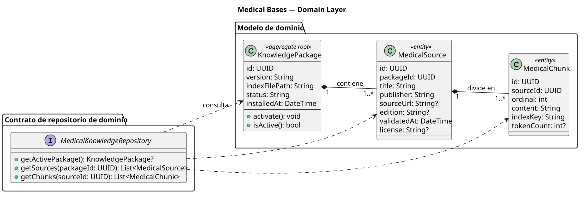

#### 5.3.6.2. Bounded Context Database Design Diagram.

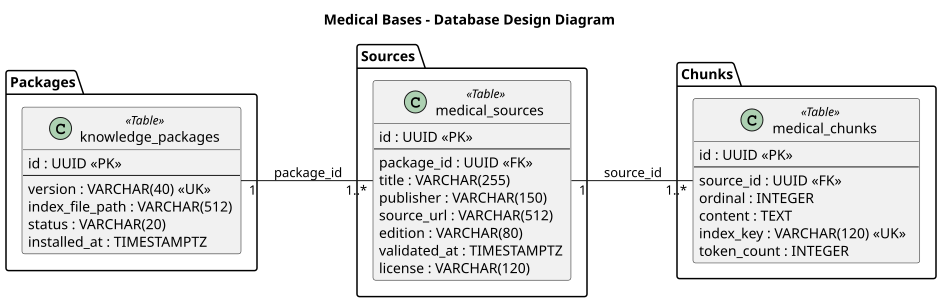

## 5.4. Bounded Context: Case Management

Case Management recibe las consultas sincronizadas y gestiona la atención posterior dentro del backend.

### 5.4.1. Domain Layer.

#### Aggregates

**ConsultationSubmission**

Representa la consulta recibida desde la aplicación móvil y conserva como identificador el UUID creado en el teléfono.

- **Atributos**
  - `id: UUID`
  - `citizenUserId: UUID?`
  - `inputText: String?`
  - `photoStorageKey: String?`
  - `helpRequested: boolean`
  - `consultationRecordedAt: Instant`
  - `receivedAt: Instant`
  - `patient: Patient?`
  - `answer: ConsultationAnswer?`
- **Funciones**
  - `receive(id: UUID, citizenUserId: UUID?, inputText: String?, photoStorageKey: String?, helpRequested: boolean, consultationRecordedAt: Instant, receivedAt: Instant, patient: Patient?, answer: ConsultationAnswer?): ConsultationSubmission`
  - `hasTextOrPhoto(): boolean`

**Case**

Representa la atención profesional que se forma a partir de una consulta recibida.

- **Atributos**
  - `id: UUID`
  - `consultationId: UUID`
  - `status: CaseStatus`
  - `observation: String?`
  - `createdAt: Instant`
  - `updatedAt: Instant`
  - `closedAt: Instant?`
  - `assignations: List<Assignation>`
  - `statusHistory: List<CaseStatusHistory>`
- **Funciones**
  - `assign(professionalUserId: UUID): Assignation`
  - `changeStatus(newStatus: CaseStatus, userId: UUID?): void`
  - `close(observation: String, userId: UUID): void`

#### Entities

**Patient**

Conserva los datos de la persona afectada y la ubicación del incidente recibidos con la consulta.

- **Atributos**
  - `id: UUID`
  - `consultationId: UUID`
  - `name: String?`
  - `ageYears: Integer?`
  - `locationDescription: String?`
  - `province: String?`
  - `latitude: Decimal?`
  - `longitude: Decimal?`

`province` conserva el nombre de provincia seleccionado en el móvil para filtrar las consultas recibidas.

**ConsultationAnswer**

Conserva la orientación generada en el móvil y sus fuentes médicas.

- **Atributos**
  - `id: UUID`
  - `consultationId: UUID`
  - `guidanceText: String?`
  - `guidanceStatus: GuidanceStatus`
  - `preliminaryPriority: PreliminaryPriority?`
  - `professionalHelpRecommended: boolean`
  - `sourceReferences: List<Map<String, Object>>`
  - `createdAt: Instant`

**Assignation**

Registra una asignación histórica de un profesional a un caso.

- **Atributos**
  - `id: UUID`
  - `caseId: UUID`
  - `professionalUserId: UUID`
  - `assignedAt: Instant`
  - `closedAt: Instant?`
- **Funciones**
  - `close(closedAt: Instant): void`
  - `isActive(): boolean`

**CaseStatusHistory**

Es la entidad que registra cada transición del estado del caso.

- **Atributos**
  - `id: UUID`
  - `caseId: UUID`
  - `fromStatus: CaseStatus?`
  - `toStatus: CaseStatus`
  - `actorType: String`
  - `userId: UUID?`
  - `occurredAt: Instant`

#### Value Objects

**CaseStatus**

Restringe los estados válidos y sus transiciones.

- **Atributos**
  - `value: String`
- **Funciones**
  - `canTransitionTo(next: CaseStatus): boolean`

**PreliminaryPriority**

Representa la prioridad orientativa recibida del dispositivo.

- **Atributos**
  - `value: String`

**GuidanceStatus**

Representa el estado de la orientación recibida con la consulta.

- **Atributos**
  - `value: String`

---

### 5.4.2. Interface Layer.

#### Controllers

**ConsultationSubmissionsController**

Recibe consultas sincronizadas y publica la lectura filtrada de las que todavía no son casos.

- **Funciones**: `receive(ReceiveConsultationSubmissionResource, idempotencyKey: UUID)`, `getById(id: UUID)`, `filter(province, helpRequested, page)`.

**ConsultationPhotosController**

Recibe una foto de emergencia y devuelve una clave de almacenamiento asociada al UUID de la consulta.

- **Funciones**: `upload(consultationId: UUID, image): PhotoUploadResource`.

**CasesController**

Expone detalle, historial, autoasignación y cambios autorizados de los casos.

- **Funciones**: `getById(id: UUID)`, `getCasesByFilter(status, assignmentRelation, page)`, `getMyCases()`, `assign(id: UUID)`, `changeStatus(id: UUID, ChangeCaseStatusResource)`, `close(id: UUID, CloseCaseResource)`, `getStatusHistory(id: UUID)`.

**InternalCaseProcessingController**

Recibe resultados del worker mediante una operación interna autenticada; la lógica del caso sigue en los servicios del backend.

- **Funciones**: `processJob(jobId: UUID): void`.

#### Resources and Assemblers

**ReceiveConsultationSubmissionResource**

Define el contrato de recepción con la información recibida del teléfono.

- **Atributos**: `id`, `citizenUserId?`, `inputText?`, `photoStorageKey?`, `helpRequested`, `patient?`, `answer?`, `consultationRecordedAt`.

**CaseResource**

Devuelve al usuario autorizado el estado, la observación y la asignación visible del caso.

- **Atributos**: `id`, `consultationId`, `status`, `observation?`, `assignedProfessional?`, `createdAt`, `updatedAt`.

**PhotoUploadResource**

Devuelve la clave del activo almacenado sin exponer credenciales de Cloudinary.

- **Atributos**: `photoStorageKey: String`.

**ChangeCaseStatusResource**

Recibe el nuevo estado actualizado por el profesional médico autorizado.

- **Atributos**: `newStatus: String`.

**CloseCaseResource**

Recibe la observación para cerrar el caso.

- **Atributos**: `observation: String`.

**ReceiveConsultationSubmissionCommandFromResourceAssembler**

Traduce el recurso y la clave de idempotencia recibida hacia el comando.

- **Funciones**: `toCommand(ReceiveConsultationSubmissionResource, idempotencyKey: UUID): ReceiveConsultationSubmissionCommand`.

**CaseResourceFromEntityAssembler**

Construye la respuesta autorizada de un caso a partir del aggregate.

- **Funciones**: `toResource(Case): CaseResource`.

---

### 5.4.3. Application Layer.

#### Commands

**ReceiveConsultationSubmissionCommand**

Solicita guardar la consulta con datos opcionales de paciente y respuesta.

- **Atributos**: `consultationId: UUID`, `citizenUserId: UUID?`, `inputText: String?`, `photoStorageKey: String?`, `helpRequested: boolean`, `patient?`, `answer?`, `consultationRecordedAt: Instant`, `idempotencyKey: UUID`.

**UploadConsultationPhotoCommand**

Solicita almacenar en Cloudinary una foto asociada a una consulta.

- **Atributos**: `consultationId: UUID`, `image: bytes`, `contentType: String`.

**CreateCaseFromSubmissionCommand**

Solicita formar un caso a partir de una consulta recibida.

- **Atributos**: `consultationId: UUID`.

**AssignCaseCommand**

Solicita la autoasignación de un caso disponible al profesional médico autenticado.

- **Atributos**: `caseId: UUID`, `professionalUserId: UUID` obtenido de la sesión.

**ChangeCaseStatusCommand**

Solicita una transición de estado válida y su entrada de historial.

- **Atributos**: `caseId: UUID`, `newStatus: CaseStatus`, `userId: UUID`.

**CloseCaseCommand**

Solicita cerrar el caso con observación.

- **Atributos**: `caseId: UUID`, `observation: String`, `userId: UUID`.

#### Queries

**GetConsultationSubmissionByIdQuery**

Solicita una consulta recibida por UUID.

- **Atributos**: `consultationId: UUID`.

**FilterConsultationSubmissionsQuery**

Busca consultas aún sin caso, con filtros opcionales de provincia y solicitud de atención, aplicados por el servidor con paginación.

- **Atributos**: `province: String?`, `helpRequested: boolean?`, `page`, `size`.

**GetCasesByFilterQuery**

Busca casos por estado y por relación de asignación con el profesional médico de la sesión.

- **Atributos**: `status: CaseStatus?`, `assignmentRelation`, `currentProfessionalUserId: UUID`, `page`, `size`.

**GetCaseByIdQuery**

Solicita el detalle de un caso autorizado.

- **Atributos**: `caseId: UUID`.

**GetMyCasesQuery**

Solicita los casos del ciudadano autenticado para su historial.

- **Atributos**: `currentCitizenUserId: UUID`.

**GetCaseStatusHistoryByCaseIdQuery**

Solicita la secuencia de transiciones de un caso.

- **Atributos**: `caseId: UUID`.

#### Services

**ConsultationSubmissionCommandServiceImpl**

Implementa la recepción idempotente y la carga de imagen mediante `ImageStorageService`.

- **Funciones**: `handle(ReceiveConsultationSubmissionCommand)`, `handle(UploadConsultationPhotoCommand)`.

**ConsultationSubmissionQueryServiceImpl**

Recupera consultas recibidas y ejecuta los filtros de pendientes.

- **Funciones**: `handle(GetConsultationSubmissionByIdQuery)`, `handle(FilterConsultationSubmissionsQuery)`.

**CaseCommandServiceImpl**

Crea y modifica el agregado `Case`, así como registra asignaciones e historial dentro de una transacción.

- **Funciones**: `handle(CreateCaseFromSubmissionCommand)`, `handle(AssignCaseCommand)`, `handle(ChangeCaseStatusCommand)`, `handle(CloseCaseCommand)`.

**CaseQueryServiceImpl**

Ejecuta consultas paginadas y aplica los límites de acceso del usuario autenticado.

- **Funciones**: `handle(GetCasesByFilterQuery)`, `handle(GetCaseByIdQuery)`, `handle(GetMyCasesQuery)`.

**CaseStatusHistoryQueryServiceImpl**

Lee el historial generado por `CaseCommandService`.

- **Funciones**: `handle(GetCaseStatusHistoryByCaseIdQuery): List<CaseStatusHistory>`.

**ExternalUserService**

Es la ACL de Case Management hacia IAM. Consulta la habilitación profesional con un UUID y recibe un booleano sin importar agregados o repositorios IAM.

- **Funciones**: `isEnabledMedicalProfessional(userId: UUID): boolean`.

**ImageStorageService**

Es el puerto compartido de aplicación que permite cargar la imagen sin acoplar Case Management al SDK de Cloudinary.

- **Funciones**: `store(consultationId: UUID, image: bytes): String`.

---

### 5.4.4. Infrastructure Layer.

#### Repositories

**ConsultationSubmissionRepository**

Persiste `consultation_submissions`, `patients` y `consultation_answers`

- **Funciones**: `findById(UUID)`, `save(ConsultationSubmission)`.

**CaseRepository**

Persiste los registros de `¿cases`, `assignations` y `case_status_history`.

- **Funciones**: `findById(UUID)`, `findByConsultationId(UUID)`, `save(Case)`.

**OutboxEventRepository**

Guarda eventos técnicos en la misma transacción que los cambios de negocio para su publicación posterior.

- **Funciones**: `save(OutboxEvent)`, `claimPending(batchSize)`.

#### Persistence Entities

**OutboxEvent**

Es una entidad técnica de persistencia en `outbox_events`.

- **Atributos**: `id: UUID`, `aggregateId: UUID`, `eventType: String`, `payload: JSONB`, `status: String`, `attempts: int`, `nextAttemptAt: Instant?`, `createdAt: Instant`, `publishedAt: Instant?`.

#### Storage and Messaging

**CloudinaryService**

Implementa `ImageStorageService` con la configuración del backend. Guarda la foto como activo protegido y devuelve su `public_id` para `photo_storage_key` en vez de una URL pública.

- **Funciones**: `store(consultationId: UUID, image: bytes): String`.

**OutboxPublisher**

Reclama eventos pendientes de PostgreSQL de manera coordinada entre las dos instancias del backend.

- **Funciones**: `publishPending()`.

---

### 5.4.5. Bounded Context Software Architecture Component Level Diagrams.

El *Component Diagram* del bounded context Case Management muestra cómo se descompone el contenedor *Backend Modular API* cuando se recibe una consulta sincronizada y se atiende el caso. Lo elaboramos con Structurizr DSL y sigue las cuatro capas de Clean Architecture. *Case Management API* pertenece a Interface y expone sincronización, asignación, cambio de estado y cierre. *Case Management Service* vive en Application y coordina el ciclo de vida con autorización del profesional. Las reglas de estado, asignación e historial quedan en *Case Domain*. *Case Repository* está en Infrastructure y persiste el modelo. *Async Event Publisher* descarga trabajo secundario hacia el *Message Broker*. Hacia afuera, el *Load Balancer* dirige el tráfico HTTPS. *Cloud Database* en PostgreSQL guarda envíos, casos e historial. Este contexto es el que almacena y recupera evidencias en Cloudinary. IAM queda *upstream* y solo responde si el profesional está habilitado.

### 5.4.6. Bounded Context Software Architecture Code Level Diagrams.

<p align="center">
  
</p>

#### 5.4.6.1. Bounded Context Domain Layer Class Diagrams.

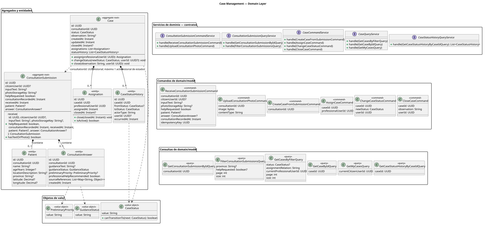

#### 5.4.6.2. Bounded Context Database Design Diagram.

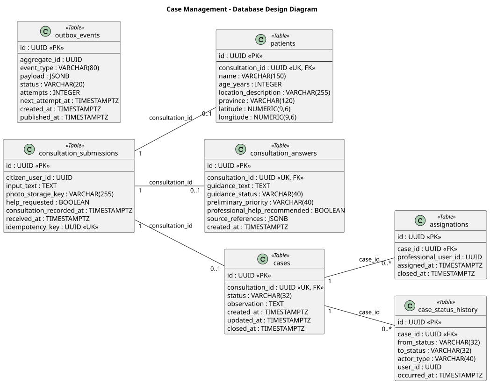

# Capítulo VI: Solution UX Design

## 6.1. Style Guidelines.

### 6.1.1. General Style Guidelines.

**Branding**

El branding de **Lifeline** (desarrollado por la startup *RescueBridge*) está diseñado para transmitir serenidad, respaldo clínico y resiliencia en situaciones críticas de supervivencia post-sismo. La identidad visual evita la saturación gráfica y se apoya en formas limpias, escudos de protección y elementos de conexión que reflejan tanto el auxilio inmediato al ciudadano afectado como el puente de información hacia los equipos médicos de rescate. El objetivo es proyectar una imagen de alta confiabilidad técnica e institucional, fundamental para que el usuario confíe en las indicaciones generadas por la inteligencia artificial local cuando las telecomunicaciones colapsan.

**Typography**

La tipografía de Lifeline fue seleccionada priorizando la legibilidad extrema en pantallas móviles bajo condiciones adversas, tales como poca iluminación, polvo en el ambiente o lectura rápida con manos temblorosas producto del estrés post-sismo. Utilizamos la fuente **Montserrat** (en sus pesos *Bold* y *SemiBold*) para los títulos, encabezados de emergencia y botones de llamada a la acción, lo que permite jerarquizar visualmente las alertas y los pasos numerados con firmeza. Para el cuerpo del texto, descripciones de primeros auxilios y formularios, empleamos la fuente **Inter** (o *Roboto* como fallback nativo), una tipografía *sans-serif* optimizada para interfaces digitales que garantiza una lectura clara, sin fatiga visual y de rápida comprensión incluso en tamaños reducidos.

**Ejemplo Montserrat**

<p align="center">
  
</p>


**Ejemplo Inter**

<p align="center">
  
</p>

**Colors**

La paleta de colores de Lifeline equilibra la urgencia médica con la necesidad psicológica de mantener la calma durante un desastre natural. Se utilizan tonos azules profundos y cianes clínicos para transmitir seguridad, profesionalismo e innovación tecnológica (asociados al motor de IA *on-device*), complementados con colores semánticos de alto contraste (ámbar y rojo) tomados de los estándares internacionales de triaje médico para advertir peligros, señalar estados de conexión y priorizar casos críticos.

- **Deep Rescue Teal (`#0D3B4C`):** Color primario de marca; transmite solidez, autoridad médica y confianza.

- **Lifeline Cyan (`#1CA3C8`):** Color de acento e interactividad; representa la asistencia de la IA local y acciones principales de navegación.

- **Alert Amber (`#F59E0B`):** Color semántico de advertencia; utilizado para indicar el funcionamiento en *Modo Offline*, consultas pendientes en la cola local (*Outbox*) o casos de prioridad media.

- **Emergency Red (`#DC2626`):** Color semántico crítico; reservado exclusivamente para señales de gravedad clínica, bloqueos de seguridad y solicitudes urgentes de apoyo profesional.

- **Clinical White (`#F8FAFC`) y Dark Slate (`#0F172A`):** Fondos claros y textos de muy alto contraste que aseguran una lectura inmediata sin deslumbramiento.

**Ejemplo Paleta de Colores**

<p align="center">
  
</p>

**Spacing**

Se ha implementado un sistema de espaciado amplio y estructurado (basado en una grilla de **8dp**) en toda la interfaz móvil para eliminar la sobrecarga visual y reducir la carga cognitiva del usuario en peligro. Los márgenes generosos entre tarjetas, los pasos numerados de primeros auxilios bien separados y las áreas táctiles amplias (mínimo **48x48dp** por botón) están diseñados específicamente para prevenir toques accidentales cuando el ciudadano opera el teléfono bajo altos niveles de ansiedad o movimiento.

**Tono de Comunicación**

El tono de comunicación de Lifeline es **empático, directo, respetuoso y sereno**, adaptándose a las exigencias emocionales de nuestros dos segmentos objetivo:

- **Serio y Sereno (no alarmista):** Frente al ciudadano herido o asustado, el sistema evita el pánico utilizando oraciones cortas, imperativas pero calmadas, guiándolo paso a paso sin emplear jerga médica compleja.

- **Formal y Objetivo:** Frente al personal médico, la aplicación presenta los reportes sincronizados, los síntomas y la geolocalización con un lenguaje clínico estructurado y conciso, facilitando el triaje rápido sin pretender reemplazar el criterio del profesional de la salud.

- **Transparente y Prudente:** La aplicación comunica claramente sus limitaciones cuando no cuenta con contexto suficiente en la base médica local y ordena de forma taxativa buscar ayuda profesional ante signos de gravedad.

### 6.1.2. Web, Mobile & Devices Style Guidelines.

Dado que **Lifeline** está realizada arquitectónicamente como una solución móvil *offline-first* con procesamiento de inteligencia artificial *on-device*, los lineamientos de diseño de interfaz se concentran íntegramente en el entorno de dispositivos móviles (**Android e iOS**). El objetivo es ofrecer una experiencia de usuario (UX) intuitiva, de mínima fricción y adaptada a las convenciones operativas móviles para garantizar que cualquier persona pueda actuar en menos de dos minutos durante una emergencia sísmica.

**Estructura y Navegación**

- **Móvil (Android e iOS):** Se prioriza el diseño centrado en la ergonomía a una sola mano (*thumb-friendly zone*), ubicando los controles principales en la mitad inferior de la pantalla. Se implementa una barra de navegación inferior (*Bottom Navigation Bar* basada en *Material Design 3* para Android y *Tab Bar* en iOS) que divide claramente las vistas según el rol autenticado: acceso inmediato a "Nueva Consulta", "Historial Local / Outbox" y "Perfil" para el ciudadano; y acceso a "Casos Disponibles", "Mis Asignaciones" e "Historial" para el personal médico.

- **Visibilidad del Estado del Sistema:** En la parte superior de todas las pantallas se mantiene un indicador persistente y no intrusivo que informa al usuario si la aplicación está operando en **Modo Offline (IA Local Activa)** o **Conectado (Sincronizando con la nube)**, brindando certeza operativa en todo momento. Las transiciones entre pantallas son rápidas y lineales, eliminando menús ocultos o animaciones pesadas que retrasen la atención de una herida.

**Tipografía y Espaciado**

Para garantizar la máxima legibilidad en escenarios de desastre (baja luminosidad o lectura en movimiento), se respeta una jerarquía visual estricta mediante márgenes amplios que aíslan cada instrucción médica. Las respuestas generadas por el flujo RAG no se muestran como bloques densos de texto, sino que se estructuran en tarjetas secuenciales numeradas a modo de *checklist*. Asimismo, las fuentes se configuran con escalado dinámico (*sp* en Android y *Dynamic Type* en iOS) para adaptarse a las preferencias de accesibilidad visual del sistema operativo sin romper la estructura de las vistas.

**Elementos Visuales**

- **Iconografía y Controles Multimodales:** Se utilizan íconos vectoriales minimalistas, de trazo grueso y universalmente reconocibles (*Material Symbols* y *SF Symbols*) acompañados siempre de etiquetas de texto claras. Dado que escribir texto resulta difícil bajo estado de shock, la pantalla de registro de consultas destaca controles multimodales de gran tamaño para la **grabación de voz** y la **captura fotográfica de heridas**.

- **Componentes de Triaje y Gestión:** Para el personal médico, la información se organiza mediante *Chips* de filtrado rápido por estado (`Disponible`, `Asignado`, `En progreso`, `Cerrado`), insignias (*Badges*) de color que resaltan las consultas que solicitan apoyo profesional urgente, y paneles desplegables inferiores (*Bottom Sheets*) para visualizar las coordenadas de ubicación y registrar las observaciones de cierre sin perder el contexto de la lista principal.

**Interacción**

- **Botones:** Siguen un patrón de ubicación inferior de fácil alcance para el pulgar, utilizando botones elevados (*Elevated / Filled Buttons*) de alto contraste para las acciones críticas como *"Obtener Orientación Médica"*, *"Solicitar Apoyo Profesional"* o *"Autoasignar Caso"*. Se aplica estrictamente la teoría del color para diferenciar acciones constructivas (azul/cian), advertencias de emergencia (rojo) y acciones secundarias o de cancelación (gris neutro).

- **Validación de Procesos y Feedback:** Para operaciones críticas —como confirmar la solicitud de rescate médico, autoasignarse la responsabilidad de un paciente o cerrar formalmente un caso clínico—, el sistema exige una confirmación explícita mediante cuadros de diálogo breves (*Modal Dialogs*) o *Bottom Sheets* de seguridad, previniendo errores involuntarios en campo.

## 6.2. Information Architecture.

### 6.2.2. Labeling Systems.

El sistema de etiquetado de Lifeline está pensado para dos públicos que leen la misma aplicación en condiciones distintas. El ciudadano lo usa con prisa, miedo o poca luz, a menudo sin formación médica. El personal médico lo usa para triaje cuando ya hay señal. En ambos casos las etiquetas son cortas, en español de Perú y iguales en Android e iOS. No se muestra jerga de arquitectura. Palabras como Outbox, RAG, SQLite, Cloudinary o *backend* no aparecen en la interfaz.

**Principios generales**

Se nombra lo que la persona ve, no lo que el sistema hace por dentro. En lugar de "cola de salida" se usa **Pendientes**. En lugar de "inferencia on-device" se usa **Orientación**. En lugar de "photo storage key" se usa **Foto**.

Los verbos son de acción y caben en un botón. **Nueva consulta**, **Obtener orientación**, **Solicitar apoyo**, **Autoasignar**, **Cerrar caso**.

Una misma idea tiene una sola etiqueta en toda la app. Si el caso se llama Caso en la lista, también se llama Caso en el detalle y en el historial.

Cada conjunto de información lleva texto. El ícono acompaña, no reemplaza.

**Conjuntos de información y asociaciones**

La información se agrupa en pocos conjuntos, ligados entre sí para que el usuario no tenga que adivinar el recorrido.

**Consulta** es el registro de la emergencia. Reúne texto, voz, foto y, si se indica, datos de la **Persona afectada**. De esa consulta sale la **Orientación**, una secuencia numerada de pasos. Si el ciudadano pide ayuda, la consulta queda marcada como **Solicita apoyo**. Cuando hay red, esa misma consulta se envía y, en el lado médico, nace un **Caso**. El caso tiene **Estado**, **Asignación** e **Historial de estados**. El **Perfil** identifica si quien usa el teléfono es ciudadano o personal médico y no mezcla esas vistas.

La asociación se lee en una línea: Consulta → Orientación → Pendiente de envío → Caso → Asignación → Cierre. Ninguna pantalla inventa un nombre nuevo para el mismo objeto.

**Secciones principales**

Las etiquetas de la barra inferior cambian según el rol, con tres destinos como máximo.

Para el **ciudadano**:

- **Nueva consulta** — registrar la emergencia con texto, voz o foto.
- **Pendientes** — consultas guardadas en el teléfono que aún no se enviaron o que esperan confirmación.
- **Perfil** — cuenta, rol y aviso de si las fuentes médicas del teléfono están listas.

Para el **personal médico**:

- **Casos disponibles** — casos sin profesional asignado, listos para autoasignar.
- **Mis asignaciones** — casos que el profesional autenticado ya tomó.
- **Historial** — casos cerrados y consultas propias del ciudadano cuando inicia sesión.

Otras etiquetas de pantalla, también de pocas palabras:

- **Orientación** — pasos mostrados después de obtener ayuda en el dispositivo.
- **Persona afectada** — nombre, edad, provincia y lugar del incidente.
- **Fuentes médicas** — aviso de que el paquete local está instalado. No se habla de índice ni de embeddings.
- **Iniciar sesión** / **Crear cuenta** — acceso. No se usa "IAM" ni "autenticación".

**Estados y etiquetas de conexión**

El estado de red se ve arriba, sin tapar la acción principal.

- **Sin conexión** — la orientación sigue disponible en el teléfono (indicador ámbar `#F59E0B`).
- **Enviando** — hay pendientes en camino (indicador ámbar).
- **Enviado** — el servidor confirmó la consulta (indicador cian `#1CA3C8`).

La orientación al ciudadano usa dos etiquetas, nunca un código interno:

- **Lista** — hay pasos para seguir (texto sereno, sin alarma).
- **Busca ayuda profesional** — la evidencia local no basta o hay signos de gravedad (indicador rojo `#DC2626`).

Los casos del personal médico usan nomenclatura de triaje, con color e ícono:

- **Disponible** — sin profesional asignado (cian).
- **Asignado** — un profesional ya lo tomó (ámbar).
- **En atención** — el profesional está actuando (teal `#0D3B4C`).
- **Cerrado** — hay observación de cierre (gris de texto sobre fondo clínico).

La prioridad recibida del teléfono, si existe, se muestra como **Prioridad** con valores **Baja**, **Media** o **Alta**. No se expone el nombre técnico *preliminaryPriority*.

**Formularios y acciones**

Los campos del ciudadano usan palabras cotidianas: **Qué ocurrió**, **Foto**, **Voz**, **Nombre**, **Edad**, **Provincia**, **Lugar**. Se evita "latitud", "longitud" y "payload" en pantalla. La ubicación se lee como **Lugar** o **Provincia**.

Los campos del profesional usan **Estado**, **Observación**, **Persona afectada** y **Pasos dados**. La foto se llama **Foto**, no "evidencia Cloudinary".

Acciones de confirmación: **Guardar**, **Enviar**, **Confirmar**, **Autoasignar**, **Cerrar caso**.

Acciones de salida o destrucción: **Cancelar**, **Salir**. **Solicitar apoyo** pide confirmación porque avisa a un profesional. **Autoasignar** y **Cerrar caso** también piden confirmación. No hay "Eliminar consulta" en el flujo de emergencia, para no borrar un registro bajo estrés.

**Iconografía**

Los íconos refuerzan la etiqueta para quien lee poco o ve mal el brillo de la pantalla. Se usan *Material Symbols* en Android y *SF Symbols* en iOS, siempre junto al texto.

- Nueva consulta: cruz o estetoscopio simplificado más la palabra **Consulta**.
- Foto y voz: cámara y micrófono más **Foto** y **Voz**.
- Pendientes: reloj o nube con flecha más **Pendientes**.
- Solicita apoyo: distintivo rojo más **Solicita apoyo**.
- Estados de caso: punto de color más el nombre del estado.

Nunca se deja un ícono solo en una acción crítica.

### 6.2.3. Searching Systems.

El sistema de búsqueda de Lifeline no está pensado para explorar un catálogo grande. Está pensado para que nadie se pierda entre consultas, pendientes y casos cuando hay poco tiempo. El ciudadano casi no busca. Registra, recibe orientación y mira lo que aún no se envió. El personal médico sí filtra, porque al volver la red pueden acumularse muchos casos. Las opciones usan las mismas etiquetas de la sección 6.2.2. No hay un buscador de lenguaje natural sobre casos. El campo **Qué ocurrió** alimenta la orientación, no una lista.

**Principios generales**

Cada búsqueda queda dentro del contexto de quien usa el teléfono. El ciudadano solo ve sus consultas locales y, si inició sesión, sus casos enviados. El profesional solo ve casos que la API le autoriza. Nadie recorre datos de otro usuario.

Si no hay coincidencias, la lista se reemplaza por un mensaje explícito. No se deja una pantalla en blanco.

Los filtros son *chips* en Android y controles segmentados o selectores en iOS. Van sobre la lista, al alcance del pulgar.

Sin conexión, el ciudadano sigue filtrando lo que está en el teléfono. El profesional necesita señal para filtrar en el servidor. Si no hay red, se indica **Sin conexión** y no se finge un listado vacío de casos.

**Pendientes del ciudadano**

Es la única búsqueda del flujo de emergencia. En **Pendientes** el ciudadano distingue lo guardado de lo ya confirmado por el servidor.

Filtros, con chips: **Sin enviar**, **Enviando**, **Enviado**. Se pueden combinar con **Solicita apoyo**.

Los resultados son tarjetas. Cada una muestra un recorte de **Qué ocurrió**, si hay **Foto**, la hora y el punto de color del envío. Un distintivo rojo marca **Solicita apoyo**. El orden es el más reciente arriba.

Si no hay ítems, el mensaje es **No hay consultas pendientes**. Si el filtro es demasiado estrecho, el mensaje es **Ninguna consulta coincide**. Desde ahí se puede ir a **Nueva consulta**.

**Historial del ciudadano**

Con sesión iniciada, **Historial** lista los casos propios que ya existen en la nube (`GetMyCasesQuery`). El filtro es el **Estado**: **Asignado**, **En atención**, **Cerrado**.

Cada tarjeta muestra estado, fecha de envío y un recorte de la orientación. Al abrirla se ve la **Persona afectada** y el **Historial de estados**, de más reciente a más antiguo. Si aún no hay casos, el mensaje es **Aún no tienes casos enviados**.

**Casos disponibles**

Es la búsqueda principal del personal médico. Recorre consultas recibidas que todavía no son caso, o casos en estado **Disponible**, según la vista. El servidor pagina el resultado.

Filtros: **Provincia** (lista de nombres, la misma del formulario), **Solicita apoyo** (sí o todas) y **Prioridad** (**Alta**, **Media**, **Baja**). No hay caja de texto libre sobre síntomas. El triaje no depende de que el médico recuerde una palabra exacta.

Los resultados son tarjetas con provincia, distintivo de **Solicita apoyo**, prioridad y hora de recepción. Arriba quedan las de prioridad alta y las que solicitan apoyo. El ícono de **Casos disponibles** muestra un *badge* con la cantidad nueva para no abrir el módulo a ciegas.

Si el filtro no da resultados, el mensaje es **No hay casos con esos filtros**. Si no hay red, **Sin conexión. No se pueden cargar casos**.

**Mis asignaciones**

El filtro de relación ya está en la pestaña. Aquí el profesional solo ve lo que tomó.

Filtros de estado: **Asignado**, **En atención**, **Cerrado**. El valor por defecto es **En atención**.

Las tarjetas muestran estado con color, nombre o edad de la **Persona afectada** si existe, y provincia. Al tocarlas se abre el detalle con foto, pasos dados, mapa o lugar, y acciones **Autoasignar** no aplica aquí. Sí aplican cambiar estado y **Cerrar caso**.

Lista vacía: No tienes asignaciones en este estado.

**Historial de un caso**

Dentro del detalle, el **Historial de estados** es una búsqueda temporal. No hay campo de texto. El orden es cronológico. Cada fila muestra de qué estado se pasó, a cuál, quién actuó y cuándo.

Si el caso recién se creó, hay al menos el paso a **Disponible**. No se muestra un vacío técnico.

**Qué no se busca en pantalla**

Las **Fuentes médicas** no se ofrecen como buscador al usuario. El índice local lo usa la app al pulsar **Obtener orientación**. Mezclar esa recuperación con un buscador de casos confundiría al ciudadano y al médico.

La landing no indexa consultas ni casos. El visitante no busca datos clínicos.

### 6.2.4. SEO Tags and Meta Tags.

Los SEO Tags, Meta Tags y elementos ASO de Lifeline sirven para que un visitante encuentre la landing de RescueBridge y descargue la app. No indexan consultas, casos ni datos de salud. El producto clínico es nativo (Android e iOS). No hay una web application pública del flujo de emergencia. Un panel web autenticado, si existiera después, iría con `noindex`.

La URL canónica prevista es `https://rescuebridge.pe`. El informe en GitHub Pages no es la landing de producto.

**SEO Tags de la landing**

El Title aparece en la pestaña y en Google. La Description resume la oferta. Keywords y Author cubren el mínimo pedido. H1 a H3 marcan la jerarquía de la página de inicio.

```html
<title>Lifeline | Primeros auxilios post-sismo sin internet</title>
<meta name="description" content="Lifeline, de RescueBridge, da orientación de primeros auxilios con IA en el teléfono cuando un sismo deja sin red. El ciudadano recibe pasos claros. El personal médico ve los casos al volver la señal." />
<meta name="keywords" content="primeros auxilios, sismo, terremoto, emergencia, IA on-device, app offline, Lima, Perú, triaje, RescueBridge, Lifeline" />
<meta name="author" content="RescueBridge" />
```

**Header Tags**

```html
<h1>Orientación de primeros auxilios aunque no haya internet</h1>
<h2>IA en el teléfono para ciudadanos y casos para el personal médico</h2>
<h3>Pasos claros, foto o voz, y envío cuando vuelve la señal</h3>
```

**Meta Tags técnicos**

```html
<meta charset="UTF-8" />
<meta name="viewport" content="width=device-width, initial-scale=1.0" />
<meta name="robots" content="index, follow" />
<meta name="theme-color" content="#0D3B4C" />
<link rel="canonical" href="https://rescuebridge.pe" />
```

**Páginas principales del sitio estático**

Cada página pública tiene Title, Description, Keywords y Author. El contenido de salud no se indexa.

**Inicio (`/`)**

```html
<title>Lifeline | Primeros auxilios post-sismo sin internet</title>
<meta name="description" content="App peruana de RescueBridge para primeros auxilios tras un sismo. Funciona sin red, con IA local y fuentes médicas en el teléfono." />
<meta name="keywords" content="Lifeline, RescueBridge, primeros auxilios, sismo Perú, app emergencia offline" />
<meta name="author" content="RescueBridge" />
<link rel="canonical" href="https://rescuebridge.pe" />
```

**Descargar (`/descargar`)**

```html
<title>Descargar Lifeline | Android e iOS</title>
<meta name="description" content="Descarga Lifeline para Android e iOS. Obtén orientación de primeros auxilios en el dispositivo y sincroniza casos cuando haya señal." />
<meta name="keywords" content="descargar Lifeline, app primeros auxilios, Google Play, App Store, emergencia sismo" />
<meta name="author" content="RescueBridge" />
<link rel="canonical" href="https://rescuebridge.pe/descargar" />
```

**Cómo funciona (`/como-funciona`)**

```html
<title>Cómo funciona Lifeline | IA local y envío de casos</title>
<meta name="description" content="El ciudadano describe la emergencia con texto, voz o foto. Lifeline responde en el teléfono. Al volver internet, el caso llega al personal médico." />
<meta name="keywords" content="cómo funciona Lifeline, IA local, primeros auxilios, sincronización casos" />
<meta name="author" content="RescueBridge" />
<link rel="canonical" href="https://rescuebridge.pe/como-funciona" />
```

**Privacidad (`/privacidad`)**

```html
<title>Privacidad | Lifeline RescueBridge</title>
<meta name="description" content="Lifeline guarda la consulta en el teléfono durante la emergencia. La foto y los datos se envían después, cifrados, cuando hay conexión." />
<meta name="keywords" content="privacidad Lifeline, datos de salud, Ley 29733" />
<meta name="author" content="RescueBridge" />
<link rel="canonical" href="https://rescuebridge.pe/privacidad" />
<meta name="robots" content="index, follow" />
```

Rutas de sesión o de casos, si se publicaran en web, usarían `<meta name="robots" content="noindex, nofollow" />`. No son puerta de descubrimiento.

**ASO (Google Play y App Store)**

Lifeline se descubre sobre todo en las tiendas. Los elementos respetan límites de caracteres y el mismo lenguaje de 6.2.2.

**App Title** (máx. 30) — `Lifeline: Auxilio post-sismo`

**App subtitle** (App Store, máx. 30) — `Primeros auxilios sin red`

**App keywords** (App Store, máx. 100, separadas por coma) — `primeros auxilios,sismo,terremoto,emergencia,offline,IA,triaje,RCP,Lima,Perú,rescate,heridas`

**Short description** (Google Play, máx. 80) — `Primeros auxilios con IA en tu teléfono, aun sin internet, tras un sismo.`

**App description** (ambas tiendas, texto completo):

Lifeline, de RescueBridge, te guía en los minutos posteriores a un sismo aunque no haya señal.

Si eres ciudadano, abre **Nueva consulta**, describe qué ocurrió con texto, voz o foto y pulsa **Obtener orientación**. Los pasos salen en el teléfono, con fuentes médicas locales. Si la situación es grave, la app te indica **Busca ayuda profesional** y puedes **Solicitar apoyo**.

Tus consultas quedan en **Pendientes** hasta que vuelve la red. Entonces se envían solas.

Si eres personal médico, con conexión ves **Casos disponibles**, te **Autoasignas** y sigues el caso hasta **Cerrar caso**.

Lifeline no reemplaza a un profesional. Te ayuda a actuar ya y a pasar el caso cuando hay señal.

Disponible en Android e iOS. Sin cuenta se puede pedir orientación. La cuenta sirve para historial y para el trabajo médico.

### 6.2.5. Navigation Systems.

Los sistemas de navegación de Lifeline están pensados para que el ciudadano llegue a la **Orientación** en pocos toques, incluso sin cuenta y sin red, y para que el personal médico recorra **Casos disponibles** → detalle → **Autoasignar** cuando hay señal. No hay menús ocultos ni un panel web clínico. La landing convence y descarga. La app ejecuta.

El recorrido usa las mismas etiquetas de 6.2.2. Android usa *Bottom Navigation* (Material 3). iOS usa *Tab Bar*. El contenido crítico queda en la zona del pulgar.

**Recorridos principales**

**Visitante, landing** — Navbar → ancla de valor → **Descargar App** → tienda.

**Ciudadano, emergencia** — Abre la app en **Nueva consulta** → texto, **Voz** o **Foto** → **Obtener orientación** → pasos numerados. Si hace falta, **Solicitar apoyo**. La consulta pasa a **Pendientes**. No hace falta iniciar sesión.

**Ciudadano, después** — **Pendientes** para ver envío. Con cuenta, **Historial** en **Perfil** o en la pestaña de historial según el rol.

**Personal médico** — Inicia sesión → **Casos disponibles** → filtros → detalle → **Autoasignar** → **Mis asignaciones** → **En atención** → **Cerrar caso**.

**App móvil — Ciudadano**

<table>
  <thead>
    <tr>
      <th>Elemento</th>
      <th>Cómo guía</th>
    </tr>
  </thead>
  <tbody>
    <tr>
      <td>Barra inferior</td>
      <td>Tres destinos: <strong>Nueva consulta</strong>, <strong>Pendientes</strong>, <strong>Perfil</strong>. Visible en las pantallas raíz. Se oculta en la orientación a pantalla completa para no tapar los pasos.</td>
    </tr>
    <tr>
      <td>Destino inicial</td>
      <td>Al abrir, <strong>Nueva consulta</strong>. La meta es actuar, no explorar.</td>
    </tr>
    <tr>
      <td>Navegación jerárquica</td>
      <td>Consulta → <strong>Orientación</strong> → confirmación de <strong>Solicitar apoyo</strong>. Atrás del sistema o gesto iOS vuelve a la consulta sin perder el texto.</td>
    </tr>
    <tr>
      <td>Indicador de red</td>
      <td>Fijo arriba: <strong>Sin conexión</strong>, <strong>Enviando</strong> o <strong>Enviado</strong>. No es un menú. Evita que el ciudadano busque un ajuste de “modo offline”.</td>
    </tr>
    <tr>
      <td>Badge en Pendientes</td>
      <td>Número de consultas <strong>Sin enviar</strong> o <strong>Enviando</strong>.</td>
    </tr>
    <tr>
      <td>CTA inferiores</td>
      <td><strong>Obtener orientación</strong> (cian) y <strong>Solicitar apoyo</strong> (rojo), al alcance del pulgar.</td>
    </tr>
    <tr>
      <td>Controles multimodales</td>
      <td>Cámara y micrófono en la misma pantalla de consulta. No hay un FAB de chat.</td>
    </tr>
    <tr>
      <td>Bottom sheet</td>
      <td>Confirma <strong>Solicitar apoyo</strong>. El gesto de cierre o <strong>Cancelar</strong> vuelve sin enviar el aviso.</td>
    </tr>
    <tr>
      <td>Retroalimentación</td>
      <td>El tab activo usa <strong>Lifeline Cyan</strong>. Ícono y texto juntos.</td>
    </tr>
    <tr>
      <td>Gestos</td>
      <td>Scroll de los pasos. Swipe atrás. No hay swipe entre tabs, para no cambiar de módulo por error bajo estrés.</td>
    </tr>
  </tbody>
</table>

**App móvil — Personal médico**

<table>
  <thead>
    <tr>
      <th>Elemento</th>
      <th>Cómo guía</th>
    </tr>
  </thead>
  <tbody>
    <tr>
      <td>Barra inferior</td>
      <td><strong>Casos disponibles</strong>, <strong>Mis asignaciones</strong>, <strong>Historial</strong>. Tres destinos, distinto set que el ciudadano.</td>
    </tr>
    <tr>
      <td>Destino inicial</td>
      <td><strong>Casos disponibles</strong>, con <em>badge</em> de casos nuevos o que <strong>Solicitan apoyo</strong>.</td>
    </tr>
    <tr>
      <td>Navegación jerárquica</td>
      <td>Lista → detalle del <strong>Caso</strong> → <strong>Historial de estados</strong>.</td>
    </tr>
    <tr>
      <td>Navegación contextual</td>
      <td>En el detalle, <strong>Autoasignar</strong>, cambio de <strong>Estado</strong> y <strong>Cerrar caso</strong> van junto a la <strong>Persona afectada</strong> y la <strong>Foto</strong>. No hay un menú hamburguesa.</td>
    </tr>
    <tr>
      <td>Chips de filtro</td>
      <td>Sobre la lista: <strong>Provincia</strong>, <strong>Solicita apoyo</strong>, <strong>Prioridad</strong> y <strong>Estado</strong>. Reducen recorrido sin una pantalla extra de búsqueda.</td>
    </tr>
    <tr>
      <td>Bottom sheet</td>
      <td>Mapa o <strong>Lugar</strong>, y el cierre con <strong>Observación</strong>, sin salir de la lista o del detalle.</td>
    </tr>
    <tr>
      <td>Indicadores de color</td>
      <td>Punto de <strong>Disponible</strong>, <strong>Asignado</strong>, <strong>En atención</strong> o <strong>Cerrado</strong> en cada tarjeta.</td>
    </tr>
    <tr>
      <td>Sesión</td>
      <td>Sin login no hay tabs médicos. <strong>Iniciar sesión</strong> está en <strong>Perfil</strong> si el dispositivo se usó como invitado.</td>
    </tr>
    <tr>
      <td>Gestos</td>
      <td>Scroll de la lista paginada. Pull to refresh cuando hay red. Swipe atrás desde el detalle.</td>
    </tr>
    <tr>
      <td>Sin conexión</td>
      <td>Las tabs médicas muestran el aviso <strong>Sin conexión. No se pueden cargar casos</strong>. No se inventa un listado.</td>
    </tr>
  </tbody>
</table>

No hay aplicación web de gestión. Un menú lateral tipo VacApp rompería el diseño <em>offline-first</em> y duplicaría Case Management en el navegador. El médico trabaja en el mismo binario Flutter, con otra barra inferior.

**Landing page — Público general**

<table>
  <thead>
    <tr>
      <th>Elemento</th>
      <th>Cómo guía</th>
    </tr>
  </thead>
  <tbody>
    <tr>
      <td>Navbar fijo</td>
      <td>Enlaces: <strong>Inicio</strong>, <strong>Cómo funciona</strong>, <strong>Para ciudadanos</strong>, <strong>Para personal médico</strong>, <strong>Descargar</strong>. Sigue visible al hacer scroll.</td>
    </tr>
    <tr>
      <td>Anclas</td>
      <td><code>#como-funciona</code>, <code>#ciudadanos</code>, <code>#medicos</code>, <code>#descargar</code>. El visitante recorre una sola página larga.</td>
    </tr>
    <tr>
      <td>CTA de marca</td>
      <td><strong>Descargar App</strong> en teal <code>#0D3B4C</code> y cian <code>#1CA3C8</code>, en el hero y al final. Lleva a <code>/descargar</code> o a la tienda según el dispositivo.</td>
    </tr>
    <tr>
      <td>Jerarquía visual</td>
      <td>H1 del valor (auxilio sin internet), H2 de los dos roles, H3 de pasos. Coincide con los Header Tags de 6.2.4.</td>
    </tr>
    <tr>
      <td>Footer</td>
      <td><strong>Privacidad</strong>, contacto de RescueBridge y redes. Acceso secundario, no de emergencia.</td>
    </tr>
    <tr>
      <td>Sin buscador clínico</td>
      <td>El visitante no navega consultas ni casos. Eso queda en la app, con sesión.</td>
    </tr>
  </tbody>
</table>

La navegación es corta a propósito. El ciudadano recorre una línea: consulta, orientación, pendientes. El médico recorre otra: disponibles, asignación, cierre. La landing solo empuja a **Descargar**. Misma paleta, mismas palabras, mismos estados de color en todos los puntos.

## 6.3. Landing Page UI Design.

### 6.3.1. Landing Page Wireframe.

La landing page de Lifeline es el punto de entrada web del producto de RescueBridge. Su finalidad es dar a conocer la aplicación y motivar su descarga antes de que ocurra una emergencia, ya que tras un sismo las telecomunicaciones pueden colapsar y no sería posible instalar una aplicación nueva. Por ello, el diseño comunica con claridad tres ideas: qué hace Lifeline (indicaciones de primeros auxilios post-sismo mediante IA local basada en fuentes médicas verificadas), en qué se diferencia (funciona sin conexión a internet) y cómo obtenerla.

El diseño sigue las General Style Guidelines definidas en la sección 6.1: la paleta Deep Rescue Teal, Lifeline Cyan, Alert Amber y Emergency Red, la tipografía Montserrat para títulos y Inter para el cuerpo, y un tono empático, sereno y no alarmista. En esta sección se presentan el wireframe, que define la estructura y jerarquía del contenido, y el mock-up, que aplica sobre esa estructura la identidad visual de la marca.


### 6.3.2. Landing Page Mock-up.

El mock-up traslada el wireframe a un diseño de alta fidelidad con la identidad visual de Lifeline. Se emplea Deep Rescue Teal en el encabezado, los títulos y los fondos principales para transmitir serenidad y respaldo institucional. Lifeline Cyan se reserva para los botones de descarga y las acciones principales. Alert Amber y Emergency Red se usan solo para destacar mensajes críticos, como el funcionamiento sin conexión o el apoyo profesional urgente, siguiendo su significado semántico dentro de la aplicación.

Los títulos y botones utilizan Montserrat en pesos Bold y SemiBold, y el cuerpo de texto Inter, para mantener la legibilidad en pantallas de distintos tamaños. Se conservaron márgenes amplios, formas limpias y [capturas de la aplicación en teléfonos] que muestran al visitante cómo se verá Lifeline en uso, de modo que la página adelante la experiencia de la app y genere confianza antes de la descarga.


## 6.4. Applications UX/UI Design.

Esta sección presenta el diseño de la interfaz de la aplicación móvil de Lifeline, que es la única aplicación dentro del alcance y atiende a dos roles autenticados: el ciudadano (representado por la persona Adriana Rojas) y el personal médico (representado por Luis Mendoza). El diseño parte del Product Backlog y de las General Style Guidelines del capítulo, y se presenta en dos niveles: los wireframes de cada pantalla (6.4.1) y los wireflows que muestran cómo se recorren las pantallas para cumplir cada User goal (6.4.2).

El diseño completo puede consultarse en [Figma — Diseño de la aplicación Lifeline](https://www.figma.com/design/CRiupyF7Y7lgMrmHATV1up/Landing---Application-wieframes?node-id=30-46&t=enQlztgjAvrXmFMz-1).

### 6.4.1. Applications Wireframes.

Los wireframes de la aplicación móvil representan la estructura de cada pantalla, sin color ni identidad visual definitiva. Se elaboraron 18 pantallas, que cubren las historias de usuario de interfaz del Product Backlog (US01 a US32, sin las historias técnicas).

**Acceso (A-01 a A-03).**

* A-01 permite iniciar sesión, crear una cuenta o abrir una consulta de emergencia sin cuenta. 
* A-02 y A-03 corresponden al registro de ciudadano y de personal médico, que se alternan con un selector de rol. El registro de ciudadano pide nombres, apellidos, correo, teléfono opcional, ciudad, distrito, dirección, fecha de nacimiento y contraseña. El de personal médico pide además la categoría profesional y el N.º de identificación profesional, y deja la especialidad como dato opcional.


**Ciudadano (C-01 a C-09).**

* C-01 Nueva consulta: campo de descripción, controles grandes de voz y foto, ubicación GPS registrada y el interruptor «Necesito apoyo profesional».
* C-02 Datos del paciente: nombre, edad, provincia, referencia de ubicación y mapa.
* C-03 Procesamiento: muestra el avance del análisis en el dispositivo.
* C-04 Orientación médica: prioridad preliminar, señales de gravedad, pasos numerados y fuentes utilizadas.
* C-05 Respuesta segura: aparece cuando no hay información suficiente.
* C-06 Confirmación: cuadro de confirmación de la solicitud de apoyo profesional.


* C-07 Historial local / Outbox: consultas con su estado de sincronización.
* C-08 Detalle de consulta: progreso de la atención.
* C-09 Perfil: datos de la cuenta.

 

**Personal Médico (M-01 a M-07).**

* M-01 Casos disponibles: filtros por estado e insignias para los casos de apoyo urgente.
* M-02 Detalle del caso: paciente, descripción, foto, orientación generada y ubicación en el mapa.
* M-03 Autoasignación: cuadro de confirmación.


* M-04 Mis asignaciones: casos asignados y en progreso, con las acciones de iniciar atención y cerrar caso.
* M-05 Cierre de caso: panel inferior para registrar observaciones.
* M-06 Historial: casos atendidos.
* M-07 Perfil: categoría profesional, N.º de identificación, especialidad y estado de verificación; se abre desde el avatar del encabezado.


### 6.4.2. Applications Wireflow Diagrams.

La aplicación móvil de Lifeline atiende a dos User Personas: Adriana Rojas (ciudadano) y Luis Mendoza (personal médico). Se presenta un Wireflow por cada User goal principal, con su Task Flow numerado en el diagrama y una breve explicación. Las zonas resaltadas indican lo que toca el usuario y los pasos marcados como «Nuevo estado» muestran la pantalla tras la interacción.

**Rol: Ciudadano**

Wireflow W-01: Crear cuenta e iniciar sesión

User Persona: Adriana Rojas · User goal: Como ciudadano, quiero crear una cuenta o iniciar sesión para acceder a la aplicación.


Explicación: Adriana toca «Crear cuenta» en A-01, completa el formulario en A-02 y accede a C-01. Si ya tiene cuenta, inicia sesión desde A-01 y entra directamente a C-01.

Wireflow W-02: Obtener orientación sin conexión

User Persona: Adriana Rojas · User goal: Como ciudadano, quiero describir la emergencia y recibir indicaciones claras sin conexión, para actuar a tiempo.


Explicación: Adriana describe la situación en C-01 con texto, voz o foto y solicita la orientación. C-03 la procesa en el dispositivo, sin internet, y C-04 muestra la prioridad, los pasos numerados y las fuentes médicas. Si no hay información suficiente, se muestra C-05 (ver W-03).

Wireflow W-03: Respuesta segura ante información insuficiente

User Persona: Adriana Rojas · User goal: Como ciudadano, quiero ser informado cuando no hay información suficiente, para evitar acciones inseguras.


Explicación: C-05 avisa que no se puede dar una orientación confiable. Adriana edita su consulta en C-01, agrega más detalles y la reenvía; con la información ampliada, C-04 muestra la orientación.

Wireflow W-04: Solicitar apoyo profesional

User Persona: Adriana Rojas · User goal: Como ciudadano, quiero solicitar apoyo profesional para el paciente, aun sin conexión.


Explicación: Adriana activa «Necesito apoyo profesional» en C-01, registra los datos del paciente en C-02, revisa la orientación en C-04 y confirma la solicitud en C-06. Sin conexión, la consulta queda en el Outbox (C-07) como pendiente de sincronizar.

**Rol: Personal médico**

Wireflow W-05: Crear cuenta e iniciar sesión

User Persona: Luis Mendoza · User goal: Como personal médico, quiero registrarme validando mi identificación profesional (o iniciar sesión) para acceder a mi rol.


Explicación: Luis elige «Personal médico» en el registro (A-02 a A-03), completa su categoría profesional y su número de identificación, y accede a M-01. Si ya tiene cuenta, inicia sesión desde A-01.

Wireflow W-06: Asumir un caso disponible

User Persona: Luis Mendoza · User goal: Como personal médico, quiero revisar los casos disponibles y asumir uno para atenderlo.


Explicación: Luis filtra los casos en M-01 y abre uno en M-02 para revisar paciente, foto, orientación y ubicación. Lo autoasigna y confirma en M-03; el caso aparece como «Asignado» en M-04.

Wireflow W-07: Atender y cerrar un caso

User Persona: Luis Mendoza · User goal: Como personal médico, quiero atender un caso asignado y cerrarlo con observaciones.


Explicación: Luis inicia la atención en M-04 y, al terminar, toca «Cerrar caso». En M-05 escribe las observaciones y confirma; el caso queda «Cerrado» en el historial (M-06).

Wireflow W-08: Actualizar perfil y cerrar sesión

User Persona: Luis Mendoza · User goal: Como personal médico, quiero actualizar mis datos profesionales y cerrar sesión.


Explicación: Luis abre su perfil desde el avatar (M-07), edita sus datos profesionales y guarda. Luego cierra sesión y la app regresa a A-01.

### 6.4.3. Applications Mock-ups.

### 6.4.4. Applications User Flow Diagrams.

Se detallan los flujos de usuario (User Flows) de la aplicación Lifeline, contemplando el camino ideal (Happy Path) y los caminos alternativos o de error (Unhappy Path) para las tareas principales de los dos segmentos objetivo: Ciudadanos y Personal Médico. Estos flujos han sido mapeados a partir de los Wireflow Diagrams y los Mock-ups de la aplicación.


## 6.5. Applications Prototyping.

# Capítulo VII: Product Implementation, Validation & Deployment

## 7.1. Software Configuration Management.

### 7.1.1. Software Development Environment Configuration.

El equipo usa el mismo conjunto de herramientas para planear, diseñar, programar, probar, desplegar y documentar Lifeline. Las que se abren en el navegador se indican con su sitio. Las que se instalan en la computadora se indican con la página de descarga.

<table>
  <thead>
    <tr>
      <th>Actividad</th>
      <th>Imagen</th>
      <th>Producto</th>
      <th>Propósito en el proyecto</th>
      <th>Referencia</th>
    </tr>
  </thead>
  <tbody>
    <tr>
      <td>Project Management y Requirements Management</td>
      <td></td>
      <td>Trello</td>
      <td>Tablero del equipo. Ahí se ordenan las historias, el backlog y el avance de cada sprint.</td>
      <td><a href="https://trello.com">trello.com</a></td>
    </tr>
    <tr>
      <td>Product Design</td>
      <td></td>
      <td>Figma</td>
      <td>Diseño de las pantallas de la aplicación móvil y de la landing.</td>
      <td><a href="https://www.figma.com">figma.com</a></td>
    </tr>
    <tr>
      <td>Software Development</td>
      <td></td>
      <td>Flutter</td>
      <td>Aplicación móvil del ciudadano y del personal médico.</td>
      <td><a href="https://docs.flutter.dev/get-started/install">docs.flutter.dev</a></td>
    </tr>
    <tr>
      <td>Software Development</td>
      <td></td>
      <td>Angular</td>
      <td>Landing page de RescueBridge, donde el visitante conoce el producto y descarga la app.</td>
      <td><a href="https://angular.dev/installation">angular.dev</a></td>
    </tr>
    <tr>
      <td>Software Development</td>
      <td></td>
      <td>Java Development Kit (Eclipse Temurin)</td>
      <td>Lenguaje y runtime del backend Spring Boot, de los workers y del broker en local.</td>
      <td><a href="https://adoptium.net">adoptium.net</a></td>
    </tr>
    <tr>
      <td>Software Development</td>
      <td></td>
      <td>Visual Studio Code</td>
      <td>Editor con el que el equipo escribe el código de la app, la landing y el backend.</td>
      <td><a href="https://code.visualstudio.com/download">code.visualstudio.com</a></td>
    </tr>
    <tr>
      <td>Software Development</td>
      <td></td>
      <td>ActiveMQ Artemis</td>
      <td>Broker de la cola de trabajos del backend. En local se levanta con Docker.</td>
      <td><a href="https://activemq.apache.org/components/artemis/download">activemq.apache.org</a></td>
    </tr>
    <tr>
      <td>Software Testing</td>
      <td></td>
      <td>Postman</td>
      <td>Pruebas manuales de los endpoints del backend antes de integrarlos con la app.</td>
      <td><a href="https://www.postman.com/downloads/">postman.com</a></td>
    </tr>
    <tr>
      <td>Software Deployment</td>
      <td></td>
      <td>Docker Desktop</td>
      <td>Ejecuta en la computadora del equipo los servicios de apoyo, empezando por ActiveMQ.</td>
      <td><a href="https://www.docker.com/products/docker-desktop/">docker.com</a></td>
    </tr>
    <tr>
      <td>Software Deployment</td>
      <td></td>
      <td>Microsoft Azure</td>
      <td>Nube donde se despliegan el backend, PostgreSQL, el broker y los workers.</td>
      <td><a href="https://azure.microsoft.com">azure.microsoft.com</a></td>
    </tr>
    <tr>
      <td>Software Documentation y Source Code Management</td>
      <td></td>
      <td>GitHub</td>
      <td>Repositorios del equipo, revisión de cambios y publicación de este informe y de los README.</td>
      <td><a href="https://github.com/emergentes-project">github.com/emergentes-project</a></td>
    </tr>
  </tbody>
</table>

### 7.1.2. Source Code Management.

GitHub es el control de versiones de Lifeline. El código y este informe viven en la organización <a href="https://github.com/emergentes-project">emergentes-project</a>. Cada producto digital tiene su propio repositorio.

<table>
  <thead>
    <tr>
      <th>Producto</th>
      <th>Repositorio</th>
    </tr>
  </thead>
  <tbody>
    <tr>
      <td>Informe</td>
      <td><a href="https://github.com/emergentes-project/Report">github.com/emergentes-project/Report</a></td>
    </tr>
    <tr>
      <td>Aplicación móvil</td>
      <td><a href="https://github.com/emergentes-project/lifeline-mobile">github.com/emergentes-project/lifeline-mobile</a></td>
    </tr>
    <tr>
      <td>Landing page</td>
      <td><a href="https://github.com/emergentes-project/lifeline-landing-page">github.com/emergentes-project/lifeline-landing-page</a></td>
    </tr>
    <tr>
      <td>Backend</td>
      <td><a href="https://github.com/emergentes-project/lifeline-backend">github.com/emergentes-project/lifeline-backend</a></td>
    </tr>
    <tr>
      <td>Broker</td>
      <td><a href="https://github.com/emergentes-project/lifeline-broker">github.com/emergentes-project/lifeline-broker</a></td>
    </tr>
    <tr>
      <td>Worker</td>
      <td><a href="https://github.com/emergentes-project/lifeline-worker">github.com/emergentes-project/lifeline-worker</a></td>
    </tr>
    <tr>
      <td>Load balancer</td>
      <td><a href="https://github.com/emergentes-project/lifeline-load-balancer">github.com/emergentes-project/lifeline-load-balancer</a></td>
    </tr>
  </tbody>
</table>

El backend incluye el proyecto y los archivos `.feature` de las pruebas del servicio. El worker hace lo mismo con las pruebas de los trabajos que consume de la cola.

<table>
  <thead>
    <tr>
      <th>Integrante</th>
      <th>Usuario de GitHub</th>
    </tr>
  </thead>
  <tbody>
    <tr>
      <td>Solano Armas, Angelo Héctor</td>
      <td><a href="https://github.com/Angelo5214">Angelo5214</a></td>
    </tr>
    <tr>
      <td>Cacho Seminario, Diego Alonso</td>
      <td><a href="https://github.com/Memesitos">Memesitos</a></td>
    </tr>
    <tr>
      <td>Roman Cruz, Natalia Bertha</td>
      <td><a href="https://github.com/natRC2005">natRC2005</a></td>
    </tr>
    <tr>
      <td>Paico Calderon, July Zelmira</td>
      <td><a href="https://github.com/u20211d760">u20211d760</a></td>
    </tr>
  </tbody>
</table>

El trabajo paralelo sigue GitFlow. main guarda lo publicado. develop integra el sprint. Cada historia sale de develop en una rama feature/ y el nombre va en minúsculas, separado por guiones, por ejemplo feature/sync-consultation. Una versión se prepara en release/x.y.z, por ejemplo release/1.2.0. Una corrección de lo ya publicado sale de main en hotfix/x.y.z, por ejemplo hotfix/1.2.1, y vuelve a main y a develop.

El número x.y.z sigue Semantic Versioning 2.0.0. x sube cuando el cambio rompe algo que la aplicación ya usaba. y sube cuando hay una función nueva compatible. z sube cuando el cambio solo corrige un error.

Cada commit sigue Conventional Commits: tipo(alcance): descripción. Los tipos que usa el equipo son feat, fix, docs, test, refactor y chore. Un ejemplo es feat(consultation): receive offline consultation.

### 7.1.3. Source Code Style Guide & Conventions.

Lifeline escribe todo el código en inglés. Clases, métodos, variables, archivos, rutas, ramas y commits van en inglés. El texto que ve el usuario y la documentación funcional pueden ir en español. Las reglas de abajo se muestran con IAM y Case Management, y se aplican igual a Consultation y Medical Bases.

<table>
  <thead>
    <tr>
      <th>Lenguaje</th>
      <th>Referencia</th>
    </tr>
  </thead>
  <tbody>
    <tr>
      <td>Java / Spring Boot</td>
      <td>Google Java Style Guide</td>
    </tr>
    <tr>
      <td>Dart / Flutter</td>
      <td>Effective Dart</td>
    </tr>
    <tr>
      <td>TypeScript / Angular</td>
      <td>Angular Style Guide</td>
    </tr>
    <tr>
      <td>Gherkin / archivos feature</td>
      <td>Cucumber Gherkin Reference</td>
    </tr>
  </tbody>
</table>

**Java / Spring Boot**

El backend y el worker se escriben en Java. No se usa el prefijo I de C# en las interfaces.

<table>
  <thead>
    <tr>
      <th>Elemento</th>
      <th>Convención</th>
      <th>Ejemplo</th>
    </tr>
  </thead>
  <tbody>
    <tr>
      <td>Clases</td>
      <td>PascalCase</td>
      <td>CasesController, CaseCommandServiceImpl</td>
    </tr>
    <tr>
      <td>Interfaces</td>
      <td>PascalCase, sin prefijo I</td>
      <td>CaseRepository, ImageStorageService</td>
    </tr>
    <tr>
      <td>Métodos, parámetros y variables</td>
      <td>camelCase</td>
      <td>findById, consultationId, savedCase</td>
    </tr>
    <tr>
      <td>Constantes</td>
      <td>UPPER_SNAKE_CASE</td>
      <td>MAX_PAGE_SIZE</td>
    </tr>
    <tr>
      <td>Paquetes</td>
      <td>minúsculas</td>
      <td>pe.upc.rescuebridge.lifeline.iam</td>
    </tr>
    <tr>
      <td>Recursos HTTP</td>
      <td>sufijo Resource</td>
      <td>CaseResource, PhotoUploadResource</td>
    </tr>
    <tr>
      <td>Comandos y consultas</td>
      <td>sufijo Command o Query</td>
      <td>AssignCaseCommand, GetCaseByIdQuery</td>
    </tr>
  </tbody>
</table>

Los bounded contexts se nombran en inglés: iam, consultation, medicalbases y casemanagement. Un controller termina en Controller. Un servicio de escritura termina en CommandService y uno de lectura en QueryService. Un repositorio termina en Repository. No se usan abreviaturas como cmd, svc o repoImpl. El controller no repite la regla de negocio. Esa regla vive en el dominio.

Cada módulo se parte en cuatro capas. Domain guarda agregados, comandos, consultas y contratos. Application orquesta los casos de uso. Infrastructure implementa persistencia, mensajería y Cloudinary. Interfaces expone controllers, resources y assemblers. Domain no importa Infrastructure ni controllers. Application no arma respuestas HTTP.

**Dart / Flutter**

La aplicación móvil sigue Effective Dart. Los archivos van en snake_case. Las clases van en PascalCase. Métodos y variables van en camelCase. En Dart las constantes también van en camelCase, no en mayúsculas.

<table>
  <thead>
    <tr>
      <th>Elemento</th>
      <th>Convención</th>
      <th>Ejemplo</th>
    </tr>
  </thead>
  <tbody>
    <tr>
      <td>Archivos</td>
      <td>snake_case</td>
      <td>consultation_controller.dart</td>
    </tr>
    <tr>
      <td>Clases</td>
      <td>PascalCase</td>
      <td>Consultation, CreateConsultationService</td>
    </tr>
    <tr>
      <td>Pantallas</td>
      <td>sufijo Page</td>
      <td>ConsultationPage, PendingPage</td>
    </tr>
    <tr>
      <td>Funciones y variables</td>
      <td>camelCase</td>
      <td>requestHelp, photoLocalPath</td>
    </tr>
  </tbody>
</table>

La carpeta domain no habla con SQLite. La carpeta data implementa los repositorios y los daos. La interfaz no lee la base ni llama al modelo de IA. Los nombres de archivo y de clase van en inglés aunque la etiqueta de la pantalla esté en español.

**TypeScript / Angular**

La landing usa Angular. No es la aplicación de emergencias. Se sigue la guía de estilo de Angular.

<table>
  <thead>
    <tr>
      <th>Elemento</th>
      <th>Convención</th>
      <th>Ejemplo</th>
    </tr>
  </thead>
  <tbody>
    <tr>
      <td>Archivos</td>
      <td>kebab-case con sufijo</td>
      <td>download-app.component.ts</td>
    </tr>
    <tr>
      <td>Clases de componente</td>
      <td>PascalCase y sufijo Component</td>
      <td>DownloadAppComponent</td>
    </tr>
    <tr>
      <td>Servicios</td>
      <td>sufijo Service</td>
      <td>LandingContentService</td>
    </tr>
    <tr>
      <td>Selectores</td>
      <td>prefijo app y kebab-case</td>
      <td>app-download-app</td>
    </tr>
  </tbody>
</table>

Un componente no arma URLs a mano si ya existe un servicio para ese contenido. Los textos visibles de la landing pueden estar en español. El nombre del archivo y de la clase, no.

**Gherkin**

Los archivos feature describen comportamiento, no pantallas. El nombre del archivo va en inglés y en kebab-case, por ejemplo receive-consultation.feature y assign-case.feature. Los pasos pueden redactarse en español. Feature, Scenario, Given, When y Then se mantienen. Given es el contexto, When es la acción y Then es el resultado visible. Un escenario cubre una sola conducta. No se escriben clics, nombres de botones ni códigos HTTP dentro del paso.

**Endpoints REST**

La ruta usa sustantivos en inglés y en plural. El verbo HTTP dice la acción. El patrón, con los recursos de Lifeline, es este.

<table>
  <thead>
    <tr>
      <th>Método</th>
      <th>Ruta</th>
      <th>Propósito</th>
    </tr>
  </thead>
  <tbody>
    <tr>
      <td>POST</td>
      <td>/api/v1/consultation-submissions</td>
      <td>Recibir una consulta sincronizada</td>
    </tr>
    <tr>
      <td>POST</td>
      <td>/api/v1/consultation-photos</td>
      <td>Recibir la foto de una consulta</td>
    </tr>
    <tr>
      <td>GET</td>
      <td>/api/v1/cases</td>
      <td>Listar casos según el filtro autorizado</td>
    </tr>
    <tr>
      <td>GET</td>
      <td>/api/v1/cases/{id}</td>
      <td>Ver el detalle de un caso</td>
    </tr>
    <tr>
      <td>POST</td>
      <td>/api/v1/cases/{id}/assignation</td>
      <td>Autoasignar un caso disponible</td>
    </tr>
    <tr>
      <td>POST</td>
      <td>/api/v1/users</td>
      <td>Registrar una cuenta</td>
    </tr>
  </tbody>
</table>

Los códigos se usan igual en todos los módulos. 201 cuando se crea un recurso. 200 cuando una lectura o una actualización sale bien. 400 cuando el pedido está incompleto. 401 cuando no hay sesión. 404 cuando el recurso no existe. 409 cuando la misma consulta llega otra vez con la misma clave de idempotencia.

**Pruebas**

La clase de prueba se llama como la clase probada más el sufijo Tests. Por ejemplo CaseCommandServiceImplTests. El método dice el resultado y la condición, en camelCase: shouldRejectSecondAssignationWhenCaseIsAlreadyTaken. El mock respeta el tipo real del contrato. Una prueba unitaria no usa PostgreSQL ni ActiveMQ reales.

Los commits ya están definidos en 7.1.2. El mensaje va en inglés, con Conventional Commits. No se aceptan textos como cambios o arreglos.

### 7.1.4. Software Deployment Configuration.

Esta sección precisa dónde queda publicado cada producto digital de Lifeline en la presente entrega. La landing se publica como sitio estático. El backend se publica como aplicación web en Azure y se actualiza desde GitHub. El broker y el worker comparten una máquina virtual. La aplicación móvil se distribuye como APK. La evidencia de la base de datos en Supabase se reserva al final de la sección.

**Landing page**

La landing, construida con Angular, se publica con GitHub Pages desde el repositorio lifeline-landing-page. El origen de la publicación es GitHub Actions. El sitio en línea es https://emergentes-project.github.io/lifeline-landing-page/ y la conexión se fuerza por HTTPS.

<p align="center">
  
</p>

**Backend**

El servicio web se despliega en Azure App Service, en el recurso backend-lifeline, dentro del grupo backend-emergentes y del plan ASP-backendemergentes-b5b8. La aplicación está en ejecución sobre Linux, en la región Canadá Central, con la suscripción Azure for Students. El dominio predeterminado es backend-lifeline-cndwcsfcdttfqaaa2.canadacentral-01.azurewebsites.net. El código sale del repositorio https://github.com/emergentes-project/lifeline-backend.

<p align="center">
  
</p>

Cada push a la rama main dispara el flujo Build and deploy JAR app to Azure Web App. El flujo compila el JAR y lo publica en ese App Service. Las ejecuciones registradas en main terminaron correctamente.

<p align="center">
  
</p>

**Broker y worker**

ActiveMQ Artemis y el worker no van en el App Service. Corren en la máquina virtual vm-lifeline, del grupo rg-lifeline, con Ubuntu 24.04, en Canadá Central. La máquina está en ejecución, tamaño Standard B2pls v2, y su IP pública es 52.139.32.116. Las etiquetas del recurso indican el proyecto lifeline y el propósito broker-worker.

<p align="center">
  
</p>

El acceso de administración es por SSH, con el usuario azureuser.

<p align="center">
  
</p>

Dentro de la máquina, el broker es el contenedor lifeline-broker, imagen apache/activemq-artemis:2.40.0, con la consola en el puerto 8161 y los mensajes en el puerto 61616. El worker es el servicio lifeline-worker, en estado active y running, y arranca con java sobre el archivo /opt/lifeline-worker/worker.jar.

<p align="center">
  
</p>

**Aplicación móvil**

La aplicación Flutter se entrega como APK de Android, versión 1.0.0, desde el README del repositorio lifeline-mobile. El archivo pesa 2.64 GB porque incluye el modelo local. Su identificador SHA-256 es D0EC50B217C604AC58DBD5B2C50DF7B0E400120E376F0FD111731D81097D245E. La descarga se aloja en el OneDrive de la Universidad Peruana de Ciencias Aplicadas.

<p align="center">
  
</p>

**Base de datos**

La base de datos en la nube es Supabase, en el proyecto Lifeline-Emergentes, sobre la rama main marcada como producción. El motor es PostgreSQL 17.11 y la base activa se llama postgres. La consulta de verificación devolvió esa versión y la fecha de ejecución en el servidor.

<p align="center">
  
</p>

## 7.2. Solution Implementation.

### 7.2.1. Sprint 1

#### 7.2.1.1. Sprint Planning 1.

<table border="1" cellpadding="6" cellspacing="0">
  <tbody>
    <tr><th>Sprint #</th><td>1</td></tr>
    <tr><th colspan="2" align="center">Sprint Planning Background</th></tr>
    <tr><td>Date</td><td>19/10/2026</td></tr>
    <tr><td>Time</td><td>09:00 AM</td></tr>
    <tr><td>Location</td><td>Reunión virtual mediante la aplicación Discord</td></tr>
    <tr><td>Prepared By</td><td>Natalia Roman</td></tr>
    <tr><td>Attendees (to planning meeting)</td><td>Natalia Roman, Angelo Solano, July Paico y Diego Cacho</td></tr>
    <tr><td>Sprint 0 Review Summary</td><td>Se realizaron las actividades previas a la implementación como la creación de los repositorios, división de tareas y configuración de herrmientas, así como se llegaron a acuerdos en cuanto a la continuidad de las reuniones y las tecnologías a emplear. Aquí podemos resaltar que el equipo mostró una disposición y organización para colaborar mutuamente, así como ofrecer revisiones entre compañeros considerando los tiempos de todos.</td></tr>
    <tr><td>Sprint 0 Retrospective Summary</td><td>El equipo destacó por la colaboracón mutua y la efectividad de la comunicación, así como por la motivación por iniciar la implementación y el compromiso con el seguimiento.</td></tr>
    <tr><th colspan="2" align="center">Sprint Goal &amp; User Stories</th></tr>
    <tr><td>Sprint 1 Goal</td><td>Entregar el flujo principal de la solución para ciudadanos y personal médico considerando acceso y perfiles, registro de consultas con texto, voz e imágenes, orientación médica sin conexión basada en RAG, persistencia y sincronización local, e historial y gestión de casos.</td></tr>
    <tr><td>Sprint 1 Velocity</td><td>192</td></tr>
    <tr><td>Sum of Story Points</td><td>192</td></tr>
  </tbody>
</table>

#### 7.2.1.2. Sprint Backlog 1.

Durante este sprint se desarrolló el flujo principal de la solución, siendo este el registro y acceso de ciudadanos y personal médico, la creación de consultas con texto, voz, fotografías y ubicación, y la generación de orientación médica sin conexión mediante una base de conocimiento y RAG. También se abordaron el almacenamiento local, la sincronización de consultas, el historial y la gestión de casos por profesionales. El Sprint Backlog 1 reúne las 51 historias de usuario y técnicas consideradas implementadas para esta entrega.

<table border="1" cellpadding="6" cellspacing="0">
  <thead>
    <tr><th>Sprint #</th><th colspan="7">Sprint 1</th></tr>
    <tr><th colspan="2">User Story / Technical Story</th><th colspan="6">Work-Item / Task</th></tr>
    <tr><th>Id</th><th>Title</th><th>Id</th><th>Title</th><th>Description</th><th>Estimation<br>(Hours)</th><th>Assigned To</th><th>Status<br>(To-do / In Progress / Done)</th></tr>
  </thead>
  <tbody>
    <tr>
      <td rowspan="3">US01</td>
      <td rowspan="3">Registro de una cuenta como ciudadano</td>
      <td>T001</td>
      <td>Construir formulario de registro ciudadano</td>
      <td>Definir campos de identidad, contacto y contraseña con mensajes claros para datos obligatorios y formatos inválidos.</td>
      <td>2</td>
      <td>Natalia Roman</td>
      <td>Done</td>
    </tr>
    <tr>
      <td>T002</td>
      <td>Conectar registro con IAM</td>
      <td>Enviar los datos al endpoint de ciudadanos y abrir la sesión después de confirmar la creación de la cuenta.</td>
      <td>3</td>
      <td>Angelo Solano</td>
      <td>Done</td>
    </tr>
    <tr>
      <td>T003</td>
      <td>Validar datos y confirmación del registro</td>
      <td>Comprobar campos obligatorios, formatos y respuesta de alta antes de mostrar al ciudadano que su cuenta quedó disponible.</td>
      <td>2</td>
      <td>July Paico</td>
      <td>Done</td>
    </tr>
    <tr>
      <td rowspan="4">US02</td>
      <td rowspan="4">Registro de una cuenta como personal médico</td>
      <td>T004</td>
      <td>Construir formulario de registro profesional</td>
      <td>Capturar categoría, número de colegiatura y especialidad junto con los datos personales requeridos para crear la cuenta.</td>
      <td>4</td>
      <td>July Paico</td>
      <td>Done</td>
    </tr>
    <tr>
      <td>T005</td>
      <td>Validar identificación profesional</td>
      <td>Comprobar el formato y obligatoriedad de la colegiatura y especialidad antes de enviar el registro del personal médico.</td>
      <td>3</td>
      <td>Diego Cacho</td>
      <td>Done</td>
    </tr>
    <tr>
      <td>T006</td>
      <td>Integrar habilitación profesional</td>
      <td>Conectar el registro con IAM y mostrar el estado de verificación que determina el acceso a gestión de casos.</td>
      <td>3</td>
      <td>Natalia Roman</td>
      <td>Done</td>
    </tr>
    <tr>
      <td>T007</td>
      <td>Mostrar resultado de habilitación</td>
      <td>Presentar al profesional el estado recibido desde IAM y explicar las funciones disponibles mientras se verifica su cuenta.</td>
      <td>2</td>
      <td>Natalia Roman</td>
      <td>Done</td>
    </tr>
    <tr>
      <td rowspan="3">US03</td>
      <td rowspan="3">Inicio de sesión</td>
      <td>T008</td>
      <td>Implementar acceso por credenciales</td>
      <td>Enviar correo y contraseña al servicio de autenticación y presentar errores comprensibles cuando el acceso sea rechazado.</td>
      <td>5</td>
      <td>Angelo Solano</td>
      <td>Done</td>
    </tr>
    <tr>
      <td>T009</td>
      <td>Restaurar sesión según rol</td>
      <td>Conservar la sesión válida y dirigir a ciudadanos y profesionales a los recorridos correspondientes de la aplicación.</td>
      <td>2</td>
      <td>Diego Cacho</td>
      <td>Done</td>
    </tr>
    <tr>
      <td>T010</td>
      <td>Informar errores de acceso</td>
      <td>Distinguir credenciales inválidas de fallos de conexión y permitir repetir el intento sin perder el correo ingresado.</td>
      <td>2</td>
      <td>Angelo Solano</td>
      <td>Done</td>
    </tr>
    <tr>
      <td rowspan="3">US04</td>
      <td rowspan="3">Consulta del perfil personal</td>
      <td>T011</td>
      <td>Presentar perfil personal</td>
      <td>Consultar los datos de la cuenta autenticada y mostrar la información propia de cada rol en una pantalla legible.</td>
      <td>4</td>
      <td>Natalia Roman</td>
      <td>Done</td>
    </tr>
    <tr>
      <td>T012</td>
      <td>Integrar consulta de perfiles</td>
      <td>Obtener desde IAM el perfil ciudadano o profesional y representar el estado de habilitación cuando corresponda.</td>
      <td>3</td>
      <td>Angelo Solano</td>
      <td>Done</td>
    </tr>
    <tr>
      <td>T013</td>
      <td>Mostrar datos según el rol</td>
      <td>Ocultar campos ajenos al ciudadano y presentar categoría y habilitación únicamente cuando la cuenta pertenece a personal médico.</td>
      <td>2</td>
      <td>Natalia Roman</td>
      <td>Done</td>
    </tr>
    <tr>
      <td rowspan="3">US05</td>
      <td rowspan="3">Actualización de datos personales</td>
      <td>T014</td>
      <td>Editar datos de la cuenta</td>
      <td>Preparar formularios de edición con validaciones para los campos personales y profesionales permitidos a cada usuario.</td>
      <td>2</td>
      <td>July Paico</td>
      <td>Done</td>
    </tr>
    <tr>
      <td>T015</td>
      <td>Validar y confirmar edición</td>
      <td>Comprobar valores editables, informar errores del servidor y mostrar los datos actualizados después de una respuesta correcta.</td>
      <td>3</td>
      <td>Angelo Solano</td>
      <td>Done</td>
    </tr>
    <tr>
      <td>T016</td>
      <td>Persistir cambios del perfil</td>
      <td>Enviar las actualizaciones a IAM y reflejar los valores confirmados por el servidor en la vista del perfil.</td>
      <td>3</td>
      <td>Natalia Roman</td>
      <td>Done</td>
    </tr>
    <tr>
      <td rowspan="2">US06</td>
      <td rowspan="2">Cierre de sesión</td>
      <td>T017</td>
      <td>Implementar acción de cierre de sesión</td>
      <td>Agregar una opción visible para salir desde las pantallas de cuenta y volver al acceso inicial.</td>
      <td>4</td>
      <td>Diego Cacho</td>
      <td>Done</td>
    </tr>
    <tr>
      <td>T018</td>
      <td>Revocar y limpiar sesión</td>
      <td>Solicitar el cierre al backend, retirar las credenciales locales y conservar las consultas pendientes de sincronización.</td>
      <td>3</td>
      <td>Angelo Solano</td>
      <td>Done</td>
    </tr>
    <tr>
      <td rowspan="4">TS01</td>
      <td rowspan="4">Protección de la sesión almacenada en el dispositivo</td>
      <td>T019</td>
      <td>Proteger credenciales locales</td>
      <td>Guardar el token y la información de sesión mediante almacenamiento seguro del dispositivo.</td>
      <td>5</td>
      <td>Natalia Roman</td>
      <td>Done</td>
    </tr>
    <tr>
      <td>T020</td>
      <td>Aislar credenciales por cuenta</td>
      <td>Impedir que una sesión restaurada reutilice tokens o datos de perfil correspondientes a otra cuenta en el dispositivo.</td>
      <td>4</td>
      <td>July Paico</td>
      <td>Done</td>
    </tr>
    <tr>
      <td>T021</td>
      <td>Controlar expiración y salida</td>
      <td>Rechazar credenciales vencidas y limpiar la sesión almacenada al cerrar la cuenta.</td>
      <td>2</td>
      <td>July Paico</td>
      <td>Done</td>
    </tr>
    <tr>
      <td>T022</td>
      <td>Verificar sesión al reabrir la aplicación</td>
      <td>Comprobar vigencia y rol del token antes de recuperar pantallas protegidas después de cerrar y volver a abrir la aplicación.</td>
      <td>3</td>
      <td>Diego Cacho</td>
      <td>Done</td>
    </tr>
    <tr>
      <td rowspan="2">US07</td>
      <td rowspan="2">Registro de una consulta mediante texto</td>
      <td>T023</td>
      <td>Capturar descripción escrita</td>
      <td>Incorporar un campo de texto para describir el incidente y validar que la consulta tenga una entrada utilizable.</td>
      <td>4</td>
      <td>Angelo Solano</td>
      <td>Done</td>
    </tr>
    <tr>
      <td>T024</td>
      <td>Conservar texto de consulta</td>
      <td>Pasar la descripción al procesamiento local y guardarla con el mismo borrador que luego se sincroniza.</td>
      <td>3</td>
      <td>Diego Cacho</td>
      <td>Done</td>
    </tr>
    <tr>
      <td rowspan="4">US08</td>
      <td rowspan="4">Registro de una consulta mediante voz</td>
      <td>T025</td>
      <td>Grabar descripción hablada</td>
      <td>Conectar el permiso del micrófono y los controles de inicio, parada y nuevo intento de grabación.</td>
      <td>2</td>
      <td>Natalia Roman</td>
      <td>Done</td>
    </tr>
    <tr>
      <td>T026</td>
      <td>Indicar estado de grabación</td>
      <td>Mostrar cuándo el micrófono está activo y cuándo terminó la captura para evitar enviar una descripción de voz vacía.</td>
      <td>2</td>
      <td>Natalia Roman</td>
      <td>Done</td>
    </tr>
    <tr>
      <td>T027</td>
      <td>Incorporar transcripción a consulta</td>
      <td>Mostrar el texto reconocido para revisión del ciudadano antes de usarlo como descripción del caso.</td>
      <td>3</td>
      <td>Angelo Solano</td>
      <td>Done</td>
    </tr>
    <tr>
      <td>T028</td>
      <td>Gestionar grabaciones sin contenido</td>
      <td>Detectar capturas vacías o demasiado breves e indicar al ciudadano que debe grabar una descripción antes de continuar.</td>
      <td>2</td>
      <td>Angelo Solano</td>
      <td>Done</td>
    </tr>
    <tr>
      <td rowspan="4">TS02</td>
      <td rowspan="4">Conversión local de voz a texto</td>
      <td>T029</td>
      <td>Preparar recursos de reconocimiento sin red</td>
      <td>Incluir y cargar los recursos requeridos por el motor de transcripción desde el almacenamiento disponible en el dispositivo.</td>
      <td>4</td>
      <td>July Paico</td>
      <td>Done</td>
    </tr>
    <tr>
      <td>T030</td>
      <td>Integrar motor de voz local</td>
      <td>Preparar los modelos y la lectura de audio para transcribir sin depender de internet.</td>
      <td>4</td>
      <td>July Paico</td>
      <td>Done</td>
    </tr>
    <tr>
      <td>T031</td>
      <td>Conectar transcripción y borrador</td>
      <td>Entregar el texto reconocido al formulario de consulta y conservarlo para que el ciudadano pueda revisarlo o corregirlo.</td>
      <td>3</td>
      <td>Diego Cacho</td>
      <td>Done</td>
    </tr>
    <tr>
      <td>T032</td>
      <td>Controlar fallos de transcripción</td>
      <td>Descartar resultados incompletos y ofrecer un nuevo intento cuando el motor no pueda procesar la grabación.</td>
      <td>3</td>
      <td>Natalia Roman</td>
      <td>Done</td>
    </tr>
    <tr>
      <td rowspan="3">US09</td>
      <td rowspan="3">Adjunto de fotografías a una consulta</td>
      <td>T033</td>
      <td>Adjuntar imagen a consulta</td>
      <td>Permitir elegir cámara o galería y mostrar la foto seleccionada dentro del formulario de emergencia.</td>
      <td>5</td>
      <td>Angelo Solano</td>
      <td>Done</td>
    </tr>
    <tr>
      <td>T034</td>
      <td>Conservar referencia de fotografía</td>
      <td>Copiar la imagen al espacio local de la aplicación y asociar su ruta a la consulta pendiente.</td>
      <td>2</td>
      <td>Diego Cacho</td>
      <td>Done</td>
    </tr>
    <tr>
      <td>T035</td>
      <td>Mostrar vista previa y eliminación</td>
      <td>Permitir revisar la fotografía elegida y quitarla de la consulta antes de guardar o enviar los datos del caso.</td>
      <td>2</td>
      <td>Natalia Roman</td>
      <td>Done</td>
    </tr>
    <tr>
      <td rowspan="3">US10</td>
      <td rowspan="3">Ingreso de datos del paciente</td>
      <td>T036</td>
      <td>Capturar datos del paciente</td>
      <td>Construir los campos de nombre, edad y datos relevantes que acompañan una solicitud de apoyo profesional.</td>
      <td>4</td>
      <td>Natalia Roman</td>
      <td>Done</td>
    </tr>
    <tr>
      <td>T037</td>
      <td>Validar información mínima del paciente</td>
      <td>Solicitar los campos necesarios para la atención profesional y señalar los datos faltantes antes de completar la consulta.</td>
      <td>2</td>
      <td>Angelo Solano</td>
      <td>Done</td>
    </tr>
    <tr>
      <td>T038</td>
      <td>Enviar datos del paciente</td>
      <td>Guardar la información junto con la consulta y transformarla al contrato esperado por Case Management.</td>
      <td>3</td>
      <td>Angelo Solano</td>
      <td>Done</td>
    </tr>
    <tr>
      <td rowspan="3">US11</td>
      <td rowspan="3">Registro de la ubicación de la consulta</td>
      <td>T039</td>
      <td>Registrar ubicación disponible</td>
      <td>Solicitar permiso de ubicación y ofrecer campos manuales para provincia y descripción del lugar del paciente.</td>
      <td>2</td>
      <td>July Paico</td>
      <td>Done</td>
    </tr>
    <tr>
      <td>T040</td>
      <td>Manejar falta de permiso de ubicación</td>
      <td>Explicar por qué no se obtuvo la ubicación y permitir continuar con la información disponible sin bloquear el registro.</td>
      <td>2</td>
      <td>Natalia Roman</td>
      <td>Done</td>
    </tr>
    <tr>
      <td>T041</td>
      <td>Integrar ubicación en el caso</td>
      <td>Persistir coordenadas y datos escritos y mostrarlos en el detalle autorizado que consulta el profesional.</td>
      <td>3</td>
      <td>Natalia Roman</td>
      <td>Done</td>
    </tr>
    <tr>
      <td rowspan="2">US12</td>
      <td rowspan="2">Elección de solicitud de apoyo profesional</td>
      <td>T042</td>
      <td>Añadir solicitud de apoyo</td>
      <td>Incorporar una opción explícita para pedir asistencia profesional durante el recorrido de consulta.</td>
      <td>4</td>
      <td>Diego Cacho</td>
      <td>Done</td>
    </tr>
    <tr>
      <td>T043</td>
      <td>Vincular apoyo con recepción</td>
      <td>Guardar la elección y enviarla al backend para activar el procesamiento que convierte la consulta en caso.</td>
      <td>3</td>
      <td>Angelo Solano</td>
      <td>Done</td>
    </tr>
    <tr>
      <td rowspan="4">US13</td>
      <td rowspan="4">Incorporación de fuentes médicas autorizadas</td>
      <td>T044</td>
      <td>Preparar fuentes médicas autorizadas</td>
      <td>Registrar institución, edición y referencia de las fichas médicas seleccionadas para el paquete local.</td>
      <td>5</td>
      <td>Natalia Roman</td>
      <td>Done</td>
    </tr>
    <tr>
      <td>T045</td>
      <td>Registrar origen de cada fuente</td>
      <td>Conservar título, procedencia y tipo de procedimiento de cada documento aceptado para rastrear el sustento de las indicaciones.</td>
      <td>4</td>
      <td>Angelo Solano</td>
      <td>Done</td>
    </tr>
    <tr>
      <td>T046</td>
      <td>Revisar cobertura de procedimientos</td>
      <td>Comprobar que las fuentes incorporadas cubran los procedimientos previstos y señalar documentos ausentes antes de generar el índice.</td>
      <td>3</td>
      <td>July Paico</td>
      <td>Done</td>
    </tr>
    <tr>
      <td>T047</td>
      <td>Asociar fuentes a orientación</td>
      <td>Conservar identificadores de procedencia en los fragmentos recuperados y mostrarlos junto con la respuesta.</td>
      <td>2</td>
      <td>July Paico</td>
      <td>Done</td>
    </tr>
    <tr>
      <td rowspan="5">TS05</td>
      <td rowspan="5">Procesamiento e indexación de documentos médicos por tipo de procedimiento</td>
      <td>T048</td>
      <td>Normalizar texto de documentos</td>
      <td>Extraer texto utilizable, corregir caracteres y conservar encabezados de procedimiento antes de fragmentar las fichas médicas.</td>
      <td>4</td>
      <td>Diego Cacho</td>
      <td>Done</td>
    </tr>
    <tr>
      <td>T049</td>
      <td>Fragmentar fichas médicas</td>
      <td>Organizar contenido autorizado por procedimiento y conservar texto, origen e identificador de cada fragmento.</td>
      <td>4</td>
      <td>Angelo Solano</td>
      <td>Done</td>
    </tr>
    <tr>
      <td>T050</td>
      <td>Asociar metadatos a fragmentos</td>
      <td>Guardar documento de origen y tipo de procedimiento junto con cada fragmento para recuperar evidencia identificable en la búsqueda.</td>
      <td>4</td>
      <td>Natalia Roman</td>
      <td>Done</td>
    </tr>
    <tr>
      <td>T051</td>
      <td>Generar índice reproducible</td>
      <td>Construir el paquete de fuentes y fragmentos con validaciones para datos vacíos o incompatibles.</td>
      <td>3</td>
      <td>Diego Cacho</td>
      <td>Done</td>
    </tr>
    <tr>
      <td>T052</td>
      <td>Comprobar resultados del índice</td>
      <td>Ejecutar consultas representativas y verificar que los fragmentos devueltos correspondan al procedimiento solicitado y conserven su referencia.</td>
      <td>3</td>
      <td>Angelo Solano</td>
      <td>Done</td>
    </tr>
    <tr>
      <td rowspan="4">TS06</td>
      <td rowspan="4">Almacenamiento local del índice médico</td>
      <td>T053</td>
      <td>Versionar recursos del índice</td>
      <td>Identificar la versión de la base médica instalada para evitar búsquedas con archivos incompatibles después de una actualización.</td>
      <td>3</td>
      <td>Natalia Roman</td>
      <td>Done</td>
    </tr>
    <tr>
      <td>T054</td>
      <td>Resolver rutas locales del índice</td>
      <td>Cargar los archivos del índice desde el almacenamiento de la aplicación y comprobar su disponibilidad antes de ejecutar búsquedas.</td>
      <td>3</td>
      <td>Angelo Solano</td>
      <td>Done</td>
    </tr>
    <tr>
      <td>T055</td>
      <td>Instalar índice local</td>
      <td>Cargar el paquete versionado en SQLite del dispositivo y activar una versión de consulta.</td>
      <td>2</td>
      <td>Natalia Roman</td>
      <td>Done</td>
    </tr>
    <tr>
      <td>T056</td>
      <td>Manejar índice no disponible</td>
      <td>Detener la búsqueda con un estado controlado si falta el paquete o no puede leerse correctamente.</td>
      <td>3</td>
      <td>Angelo Solano</td>
      <td>Done</td>
    </tr>
    <tr>
      <td rowspan="5">TS08</td>
      <td rowspan="5">Integración del modelo de IA local</td>
      <td>T057</td>
      <td>Preparar carga del modelo</td>
      <td>Ubicar los archivos de Gemma y configurar la inicialización local sin depender de una petición al servidor.</td>
      <td>5</td>
      <td>July Paico</td>
      <td>Done</td>
    </tr>
    <tr>
      <td>T058</td>
      <td>Integrar Gemma en Android</td>
      <td>Preparar el modelo empaquetado y el canal nativo que ejecuta inferencia directamente en el teléfono.</td>
      <td>4</td>
      <td>July Paico</td>
      <td>Done</td>
    </tr>
    <tr>
      <td>T059</td>
      <td>Ejecutar inferencia desde Flutter</td>
      <td>Conectar la entrada y salida del modelo con el flujo de consulta para mostrar el resultado dentro de la aplicación.</td>
      <td>4</td>
      <td>Diego Cacho</td>
      <td>Done</td>
    </tr>
    <tr>
      <td>T060</td>
      <td>Controlar recursos durante inferencia</td>
      <td>Liberar recursos al terminar o cancelar el procesamiento y evitar que una segunda petición deje bloqueada la interfaz.</td>
      <td>4</td>
      <td>Natalia Roman</td>
      <td>Done</td>
    </tr>
    <tr>
      <td>T061</td>
      <td>Controlar disponibilidad del modelo</td>
      <td>Verificar instalación y carga antes de generar texto y comunicar fallos mediante el flujo seguro.</td>
      <td>3</td>
      <td>Natalia Roman</td>
      <td>Done</td>
    </tr>
    <tr>
      <td rowspan="5">TS09</td>
      <td rowspan="5">Implementación del flujo de recuperación aumentada por generación</td>
      <td>T062</td>
      <td>Construir consulta de búsqueda médica</td>
      <td>Usar la descripción y datos disponibles del caso para formular la búsqueda de fragmentos pertinentes en la base local.</td>
      <td>4</td>
      <td>Angelo Solano</td>
      <td>Done</td>
    </tr>
    <tr>
      <td>T063</td>
      <td>Seleccionar evidencia relevante</td>
      <td>Filtrar resultados insuficientes y preparar un contexto limitado con los fragmentos más útiles para la generación de indicaciones.</td>
      <td>5</td>
      <td>July Paico</td>
      <td>Done</td>
    </tr>
    <tr>
      <td>T064</td>
      <td>Conectar recuperación e inferencia</td>
      <td>Buscar fichas pertinentes y entregar al modelo el contexto disponible del caso.</td>
      <td>5</td>
      <td>Angelo Solano</td>
      <td>Done</td>
    </tr>
    <tr>
      <td>T065</td>
      <td>Estructurar salida RAG</td>
      <td>Interpretar la selección del modelo y devolver medidas, prioridad y referencias asociadas a las fichas.</td>
      <td>2</td>
      <td>Diego Cacho</td>
      <td>Done</td>
    </tr>
    <tr>
      <td>T066</td>
      <td>Vincular respuesta con fuentes</td>
      <td>Devolver junto a la orientación las referencias de los fragmentos utilizados para que la aplicación pueda mostrar su procedencia.</td>
      <td>4</td>
      <td>Diego Cacho</td>
      <td>Done</td>
    </tr>
    <tr>
      <td rowspan="4">TS10</td>
      <td rowspan="4">Diseño del prompt de orientación médica</td>
      <td>T067</td>
      <td>Definir contexto de entrada</td>
      <td>Organizar síntoma, antecedentes disponibles y fragmentos recuperados en variables separadas para construir mensajes consistentes para el modelo.</td>
      <td>3</td>
      <td>Natalia Roman</td>
      <td>Done</td>
    </tr>
    <tr>
      <td>T068</td>
      <td>Diseñar prompt de orientación</td>
      <td>Incluir relato, comprobaciones iniciales y fichas candidatas con instrucciones para evitar suposiciones clínicas.</td>
      <td>4</td>
      <td>Natalia Roman</td>
      <td>Done</td>
    </tr>
    <tr>
      <td>T069</td>
      <td>Restringir formato de respuesta</td>
      <td>Pedir una salida estructurada que seleccione evidencia literal y no invente instrucciones ajenas a las fuentes.</td>
      <td>3</td>
      <td>Angelo Solano</td>
      <td>Done</td>
    </tr>
    <tr>
      <td>T070</td>
      <td>Revisar límites del prompt</td>
      <td>Comprobar que el prompt solicite orientación general, evite diagnósticos concluyentes y mantenga una salida fácil de presentar.</td>
      <td>3</td>
      <td>Angelo Solano</td>
      <td>Done</td>
    </tr>
    <tr>
      <td rowspan="4">TS11</td>
      <td rowspan="4">Validación del sustento de las respuestas en la base médica</td>
      <td>T071</td>
      <td>Validar selección de fichas</td>
      <td>Aceptar únicamente identificadores presentes entre los resultados recuperados y respaldados por el relato.</td>
      <td>2</td>
      <td>July Paico</td>
      <td>Done</td>
    </tr>
    <tr>
      <td>T072</td>
      <td>Comparar respuesta y referencias</td>
      <td>Revisar que las recomendaciones generadas puedan relacionarse con los fragmentos recuperados antes de presentarlas al ciudadano.</td>
      <td>4</td>
      <td>Natalia Roman</td>
      <td>Done</td>
    </tr>
    <tr>
      <td>T073</td>
      <td>Descartar indicaciones sin evidencia</td>
      <td>Presentar pautas de fragmentos admitidos y activar respuesta segura si ninguna ficha queda sustentada.</td>
      <td>3</td>
      <td>Natalia Roman</td>
      <td>Done</td>
    </tr>
    <tr>
      <td>T074</td>
      <td>Registrar evidencia insuficiente</td>
      <td>Marcar consultas sin respaldo suficiente y dirigirlas al mensaje de seguridad definido para evitar indicaciones sin sustento.</td>
      <td>3</td>
      <td>Angelo Solano</td>
      <td>Done</td>
    </tr>
    <tr>
      <td rowspan="4">US14</td>
      <td rowspan="4">Obtención de indicaciones médicas sin conexión</td>
      <td>T075</td>
      <td>Habilitar orientación sin red</td>
      <td>Cargar el modelo y el conocimiento instalados en el teléfono antes de procesar la consulta.</td>
      <td>4</td>
      <td>Diego Cacho</td>
      <td>Done</td>
    </tr>
    <tr>
      <td>T076</td>
      <td>Mostrar progreso del proceso local</td>
      <td>Indicar que la consulta sigue procesándose en el dispositivo y evitar envíos repetidos mientras se genera la orientación.</td>
      <td>2</td>
      <td>Diego Cacho</td>
      <td>Done</td>
    </tr>
    <tr>
      <td>T077</td>
      <td>Ejecutar consulta sin conectividad</td>
      <td>Recorrer el ingreso de datos, búsqueda local e inferencia con la red desactivada para confirmar que el resultado se entregue.</td>
      <td>4</td>
      <td>July Paico</td>
      <td>Done</td>
    </tr>
    <tr>
      <td>T078</td>
      <td>Presentar resultado local</td>
      <td>Mostrar medidas y fuentes generadas sin llamar a un servicio remoto durante la orientación inicial.</td>
      <td>3</td>
      <td>Angelo Solano</td>
      <td>Done</td>
    </tr>
    <tr>
      <td rowspan="3">US15</td>
      <td rowspan="3">Indicaciones médicas claras y ordenadas</td>
      <td>T079</td>
      <td>Organizar indicaciones en pantalla</td>
      <td>Separar medidas, indicaciones médicas y recomendación profesional en bloques fáciles de seguir.</td>
      <td>5</td>
      <td>Natalia Roman</td>
      <td>Done</td>
    </tr>
    <tr>
      <td>T080</td>
      <td>Mostrar procedencia de cada respuesta</td>
      <td>Presentar fichas y referencias junto a la orientación para que el ciudadano identifique su sustento.</td>
      <td>2</td>
      <td>July Paico</td>
      <td>Done</td>
    </tr>
    <tr>
      <td>T081</td>
      <td>Separar pasos y señales de alerta</td>
      <td>Presentar las acciones sugeridas en orden y destacar las advertencias que requieran atención inmediata dentro del resultado.</td>
      <td>2</td>
      <td>Natalia Roman</td>
      <td>Done</td>
    </tr>
    <tr>
      <td rowspan="3">US16</td>
      <td rowspan="3">Respuesta segura ante información insuficiente</td>
      <td>T082</td>
      <td>Detectar información insuficiente</td>
      <td>Comprobar la descripción y los fragmentos recuperados antes de presentar una pauta médica como confiable.</td>
      <td>4</td>
      <td>Angelo Solano</td>
      <td>Done</td>
    </tr>
    <tr>
      <td>T083</td>
      <td>Ofrecer recuperación del flujo</td>
      <td>Mostrar una respuesta segura y permitir ampliar el relato o repetir el procesamiento sin conservar indicaciones parciales.</td>
      <td>3</td>
      <td>Diego Cacho</td>
      <td>Done</td>
    </tr>
    <tr>
      <td>T084</td>
      <td>Solicitar detalles adicionales</td>
      <td>Explicar qué información falta y permitir volver a la descripción para completarla antes de intentar generar otra orientación.</td>
      <td>2</td>
      <td>Angelo Solano</td>
      <td>Done</td>
    </tr>
    <tr>
      <td rowspan="4">TS13</td>
      <td rowspan="4">Mecanismos de respuesta segura ante fallos</td>
      <td>T085</td>
      <td>Manejar error de búsqueda o modelo</td>
      <td>Devolver mensajes controlados cuando falte el índice, falle la carga o la inferencia no responda.</td>
      <td>2</td>
      <td>Natalia Roman</td>
      <td>Done</td>
    </tr>
    <tr>
      <td>T086</td>
      <td>Preparar mensaje de contingencia</td>
      <td>Definir una salida segura cuando la recuperación o la inferencia fallen, sin presentar una respuesta médica incompleta como válida.</td>
      <td>3</td>
      <td>Natalia Roman</td>
      <td>Done</td>
    </tr>
    <tr>
      <td>T087</td>
      <td>Conservar consulta ante fallo</td>
      <td>Mantener texto y adjuntos del ciudadano disponibles para repetir el procesamiento sin tener que registrar de nuevo el caso.</td>
      <td>3</td>
      <td>Angelo Solano</td>
      <td>Done</td>
    </tr>
    <tr>
      <td>T088</td>
      <td>Permitir nuevo procesamiento</td>
      <td>Evitar resultados parciales y mantener disponible la opción de corregir o repetir la consulta.</td>
      <td>3</td>
      <td>Angelo Solano</td>
      <td>Done</td>
    </tr>
    <tr>
      <td rowspan="4">TS15</td>
      <td rowspan="4">Reglas de identificación de señales de gravedad</td>
      <td>T089</td>
      <td>Catalogar señales de gravedad</td>
      <td>Definir términos y condiciones que indiquen peligro en las entradas de texto o transcripción utilizadas por la consulta.</td>
      <td>4</td>
      <td>July Paico</td>
      <td>Done</td>
    </tr>
    <tr>
      <td>T090</td>
      <td>Aplicar señales de gravedad</td>
      <td>Evaluar respuesta, respiración y sangrado junto con fichas que requieren atención inmediata.</td>
      <td>4</td>
      <td>July Paico</td>
      <td>Done</td>
    </tr>
    <tr>
      <td>T091</td>
      <td>Vincular gravedad y recomendación</td>
      <td>Asignar prioridad preliminar y mostrar ayuda profesional cuando una señal configurada lo requiera.</td>
      <td>3</td>
      <td>Natalia Roman</td>
      <td>Done</td>
    </tr>
    <tr>
      <td>T092</td>
      <td>Revisar prioridad de alertas</td>
      <td>Comprobar que una señal grave se refleje en la recomendación aun cuando existan otras indicaciones generales menos urgentes.</td>
      <td>3</td>
      <td>Diego Cacho</td>
      <td>Done</td>
    </tr>
    <tr>
      <td rowspan="3">US17</td>
      <td rowspan="3">Recomendación de atención profesional</td>
      <td>T093</td>
      <td>Mostrar recomendación profesional</td>
      <td>Combinar las señales iniciales de gravedad y la prioridad preliminar para decidir cuándo sugerir ayuda.</td>
      <td>5</td>
      <td>Angelo Solano</td>
      <td>Done</td>
    </tr>
    <tr>
      <td>T094</td>
      <td>Explicar prioridad al ciudadano</td>
      <td>Presentar la recomendación y su motivo sin afirmar que una solicitud profesional ya fue enviada.</td>
      <td>2</td>
      <td>Diego Cacho</td>
      <td>Done</td>
    </tr>
    <tr>
      <td>T095</td>
      <td>Facilitar solicitud de apoyo</td>
      <td>Ofrecer desde la recomendación una acción clara para solicitar revisión profesional cuando las señales del caso lo justifiquen.</td>
      <td>2</td>
      <td>Natalia Roman</td>
      <td>Done</td>
    </tr>
    <tr>
      <td rowspan="5">TS16</td>
      <td rowspan="5">Implementación de la base de datos local</td>
      <td>T096</td>
      <td>Definir relaciones y restricciones</td>
      <td>Relacionar consultas, pacientes, fotos y estados locales mediante claves y restricciones que permitan reconstruir cada caso.</td>
      <td>5</td>
      <td>Angelo Solano</td>
      <td>Done</td>
    </tr>
    <tr>
      <td>T097</td>
      <td>Crear esquema SQLite de consultas</td>
      <td>Persistir relato, paciente, orientación, identificadores y estado de envío en el dispositivo.</td>
      <td>4</td>
      <td>Natalia Roman</td>
      <td>Done</td>
    </tr>
    <tr>
      <td>T098</td>
      <td>Preparar inicialización del esquema</td>
      <td>Crear las tablas y versiones necesarias al instalar o actualizar la aplicación sin perder los registros existentes.</td>
      <td>4</td>
      <td>July Paico</td>
      <td>Done</td>
    </tr>
    <tr>
      <td>T099</td>
      <td>Recuperar datos tras reinicio</td>
      <td>Abrir la base existente y reconstruir consultas completas manteniendo sus identificadores y estados previos.</td>
      <td>3</td>
      <td>Angelo Solano</td>
      <td>Done</td>
    </tr>
    <tr>
      <td>T100</td>
      <td>Verificar lectura de datos guardados</td>
      <td>Comprobar que consultas y adjuntos puedan recuperarse después de reiniciar la aplicación y mantener sus asociaciones.</td>
      <td>3</td>
      <td>Diego Cacho</td>
      <td>Done</td>
    </tr>
    <tr>
      <td rowspan="4">US18</td>
      <td rowspan="4">Guardado de una consulta pendiente de sincronización</td>
      <td>T101</td>
      <td>Guardar consulta sin conexión</td>
      <td>Persistir la consulta y sus identificadores estables cuando el backend no esté disponible.</td>
      <td>2</td>
      <td>July Paico</td>
      <td>Done</td>
    </tr>
    <tr>
      <td>T102</td>
      <td>Guardar datos y adjuntos relacionados</td>
      <td>Persistir descripción, paciente, ubicación y referencias a fotografías con la consulta local antes de marcarla como pendiente.</td>
      <td>4</td>
      <td>Natalia Roman</td>
      <td>Done</td>
    </tr>
    <tr>
      <td>T103</td>
      <td>Marcar envío pendiente</td>
      <td>Mantener el estado local para que el mismo registro pueda enviarse más tarde sin duplicarse.</td>
      <td>3</td>
      <td>Natalia Roman</td>
      <td>Done</td>
    </tr>
    <tr>
      <td>T104</td>
      <td>Confirmar guardado al ciudadano</td>
      <td>Mostrar que la consulta quedó registrada en el dispositivo y que será enviada cuando se recupere la conectividad.</td>
      <td>2</td>
      <td>Angelo Solano</td>
      <td>Done</td>
    </tr>
    <tr>
      <td rowspan="5">TS18</td>
      <td rowspan="5">Implementación de una cola local de consultas pendientes</td>
      <td>T105</td>
      <td>Organizar cola de pendientes</td>
      <td>Guardar cada consulta con estado pendiente y clave de idempotencia estable para su envío posterior.</td>
      <td>4</td>
      <td>Diego Cacho</td>
      <td>Done</td>
    </tr>
    <tr>
      <td>T106</td>
      <td>Persistir estado e intentos de cola</td>
      <td>Guardar fecha, estado y cantidad de intentos de cada elemento para reanudar su envío después de reinicios.</td>
      <td>4</td>
      <td>Natalia Roman</td>
      <td>Done</td>
    </tr>
    <tr>
      <td>T107</td>
      <td>Separar pendientes por usuario</td>
      <td>Limitar el procesamiento de la cola a la cuenta activa y conservar los registros de otras cuentas sin mezclarlos.</td>
      <td>4</td>
      <td>July Paico</td>
      <td>Done</td>
    </tr>
    <tr>
      <td>T108</td>
      <td>Evitar entradas pendientes duplicadas</td>
      <td>Reconocer una consulta ya encolada por su identificador local y no agregar una segunda copia durante reintentos.</td>
      <td>3</td>
      <td>Angelo Solano</td>
      <td>Done</td>
    </tr>
    <tr>
      <td>T109</td>
      <td>Retirar elementos confirmados</td>
      <td>Marcar la entrega después de la confirmación del backend y excluir esos registros de nuevos intentos.</td>
      <td>3</td>
      <td>Angelo Solano</td>
      <td>Done</td>
    </tr>
    <tr>
      <td rowspan="3">US19</td>
      <td rowspan="3">Visualización de consultas almacenadas localmente</td>
      <td>T110</td>
      <td>Listar consultas guardadas</td>
      <td>Construir un historial local con fecha, descripción y estado de cada consulta del usuario.</td>
      <td>5</td>
      <td>Natalia Roman</td>
      <td>Done</td>
    </tr>
    <tr>
      <td>T111</td>
      <td>Distinguir estados de entrega</td>
      <td>Mostrar cuáles consultas están pendientes o confirmadas y permitir abrir el detalle conservado en el dispositivo.</td>
      <td>2</td>
      <td>July Paico</td>
      <td>Done</td>
    </tr>
    <tr>
      <td>T112</td>
      <td>Abrir detalle de consulta local</td>
      <td>Permitir acceder desde el listado a la descripción y los datos guardados aunque el dispositivo permanezca sin conexión.</td>
      <td>2</td>
      <td>Diego Cacho</td>
      <td>Done</td>
    </tr>
    <tr>
      <td rowspan="4">TS21</td>
      <td rowspan="4">Detección de la recuperación de la conexión a internet</td>
      <td>T113</td>
      <td>Escuchar cambios de conectividad</td>
      <td>Registrar el retorno de una conexión utilizable y evitar iniciar el envío solo por un cambio momentáneo de señal.</td>
      <td>3</td>
      <td>Natalia Roman</td>
      <td>Done</td>
    </tr>
    <tr>
      <td>T114</td>
      <td>Detectar retorno de conectividad</td>
      <td>Observar el restablecimiento de conexión y comprobar que el backend vuelve a estar accesible.</td>
      <td>4</td>
      <td>Angelo Solano</td>
      <td>Done</td>
    </tr>
    <tr>
      <td>T115</td>
      <td>Evitar sincronizaciones simultáneas</td>
      <td>Impedir que varios eventos de red lancen ejecuciones paralelas sobre el mismo conjunto de consultas pendientes.</td>
      <td>3</td>
      <td>Angelo Solano</td>
      <td>Done</td>
    </tr>
    <tr>
      <td>T116</td>
      <td>Activar sincronización pendiente</td>
      <td>Iniciar el procesamiento al recuperar red y conservar pendientes cuando exista conexión sin acceso al servidor.</td>
      <td>3</td>
      <td>Diego Cacho</td>
      <td>Done</td>
    </tr>
    <tr>
      <td rowspan="5">TS22</td>
      <td rowspan="5">Sincronización bidireccional en segundo plano</td>
      <td>T117</td>
      <td>Enviar consultas pendientes</td>
      <td>Transmitir registros locales y adjuntos al backend conservando un identificador estable para reconocer cada envío.</td>
      <td>5</td>
      <td>Natalia Roman</td>
      <td>Done</td>
    </tr>
    <tr>
      <td>T118</td>
      <td>Descargar cambios de casos</td>
      <td>Consultar los estados y observaciones confirmados por el servidor y reflejarlos en el historial guardado del dispositivo.</td>
      <td>4</td>
      <td>Angelo Solano</td>
      <td>Done</td>
    </tr>
    <tr>
      <td>T119</td>
      <td>Sincronizar en segundo plano</td>
      <td>Enviar consultas locales y recuperar actualizaciones remotas sin interrumpir el recorrido principal.</td>
      <td>2</td>
      <td>Natalia Roman</td>
      <td>Done</td>
    </tr>
    <tr>
      <td>T120</td>
      <td>Conciliar versiones local y remota</td>
      <td>Comparar la última actualización disponible y aplicar el estado confirmado sin sobrescribir cambios más recientes.</td>
      <td>5</td>
      <td>July Paico</td>
      <td>Done</td>
    </tr>
    <tr>
      <td>T121</td>
      <td>Conciliar respuestas repetidas</td>
      <td>Usar UUID e idempotencia para reconocer registros existentes y actualizar el historial del usuario.</td>
      <td>3</td>
      <td>Angelo Solano</td>
      <td>Done</td>
    </tr>
    <tr>
      <td rowspan="4">US20</td>
      <td rowspan="4">Sincronización automática de consultas y actualizaciones</td>
      <td>T122</td>
      <td>Sincronizar consultas y cambios</td>
      <td>Enviar automáticamente los registros pendientes cuando vuelve la conexión con el UUID y la clave originales.</td>
      <td>4</td>
      <td>July Paico</td>
      <td>Done</td>
    </tr>
    <tr>
      <td>T123</td>
      <td>Indicar progreso de sincronización</td>
      <td>Mostrar al ciudadano cuándo una consulta está pendiente, enviándose o confirmada después de recuperar la conexión.</td>
      <td>2</td>
      <td>Diego Cacho</td>
      <td>Done</td>
    </tr>
    <tr>
      <td>T124</td>
      <td>Recibir actualizaciones de atención</td>
      <td>Conciliar los cambios confirmados del servidor con la copia local de la cuenta correspondiente.</td>
      <td>3</td>
      <td>Natalia Roman</td>
      <td>Done</td>
    </tr>
    <tr>
      <td>T125</td>
      <td>Actualizar historial tras confirmación</td>
      <td>Refrescar los listados y detalles locales cuando el servidor acepte una consulta o devuelva cambios de atención.</td>
      <td>3</td>
      <td>Natalia Roman</td>
      <td>Done</td>
    </tr>
    <tr>
      <td rowspan="4">TS23</td>
      <td rowspan="4">Reintentos automáticos ante fallos de sincronización</td>
      <td>T126</td>
      <td>Registrar causa del último fallo</td>
      <td>Conservar el error y el momento del intento para decidir cuándo volver a procesar una consulta pendiente.</td>
      <td>3</td>
      <td>July Paico</td>
      <td>Done</td>
    </tr>
    <tr>
      <td>T127</td>
      <td>Aplicar espera entre reintentos</td>
      <td>Programar un nuevo intento después de fallos temporales sin saturar el servicio con solicitudes continuas.</td>
      <td>3</td>
      <td>Angelo Solano</td>
      <td>Done</td>
    </tr>
    <tr>
      <td>T128</td>
      <td>Programar reintentos de envío</td>
      <td>Reprocesar consultas después de fallos temporales de conectividad manteniendo sus identificadores originales y archivos adjuntos.</td>
      <td>5</td>
      <td>Angelo Solano</td>
      <td>Done</td>
    </tr>
    <tr>
      <td>T129</td>
      <td>Conservar pendientes agotados</td>
      <td>Mantener el estado pendiente tras varios intentos y retomarlo en un ciclo posterior.</td>
      <td>2</td>
      <td>Diego Cacho</td>
      <td>Done</td>
    </tr>
    <tr>
      <td rowspan="4">TS24</td>
      <td rowspan="4">Tolerancia a fallos del servicio de sincronización</td>
      <td>T130</td>
      <td>Guardar progreso antes de enviar</td>
      <td>Conservar los datos y el estado del elemento antes de iniciar la solicitud para facilitar su recuperación si el proceso se interrumpe.</td>
      <td>4</td>
      <td>Diego Cacho</td>
      <td>Done</td>
    </tr>
    <tr>
      <td>T131</td>
      <td>Recuperar servicio interrumpido</td>
      <td>Preservar consulta y foto cuando el backend o la red dejan de responder durante el envío.</td>
      <td>4</td>
      <td>Natalia Roman</td>
      <td>Done</td>
    </tr>
    <tr>
      <td>T132</td>
      <td>Reanudar tras reiniciar el servicio</td>
      <td>Volver a cargar elementos pendientes después de un cierre inesperado y continuar sin crear casos duplicados en el backend.</td>
      <td>4</td>
      <td>Natalia Roman</td>
      <td>Done</td>
    </tr>
    <tr>
      <td>T133</td>
      <td>Evitar pérdidas y duplicados</td>
      <td>Reanudar desde el estado confirmado y aplicar la misma clave de idempotencia al repetir solicitudes.</td>
      <td>3</td>
      <td>Angelo Solano</td>
      <td>Done</td>
    </tr>
    <tr>
      <td rowspan="4">TS26</td>
      <td rowspan="4">Mantenimiento de una copia local actualizada del historial.</td>
      <td>T134</td>
      <td>Actualizar proyección local</td>
      <td>Guardar estado de atención y profesional asignado cuando llega una actualización del caso.</td>
      <td>2</td>
      <td>July Paico</td>
      <td>Done</td>
    </tr>
    <tr>
      <td>T135</td>
      <td>Registrar fecha de actualización remota</td>
      <td>Conservar la marca de tiempo del último estado confirmado para distinguir datos recientes de una copia local anterior.</td>
      <td>3</td>
      <td>Angelo Solano</td>
      <td>Done</td>
    </tr>
    <tr>
      <td>T136</td>
      <td>Refrescar vistas desde datos locales</td>
      <td>Actualizar el historial y el detalle cuando la proyección local cambie sin exigir una nueva conexión al servidor.</td>
      <td>3</td>
      <td>Natalia Roman</td>
      <td>Done</td>
    </tr>
    <tr>
      <td>T137</td>
      <td>Consultar última versión sin red</td>
      <td>Mostrar desde el historial la información confirmada más reciente aun después de perder conectividad.</td>
      <td>3</td>
      <td>Natalia Roman</td>
      <td>Done</td>
    </tr>
    <tr>
      <td rowspan="3">US22</td>
      <td rowspan="3">Consulta del historial de consultas realizadas</td>
      <td>T138</td>
      <td>Construir historial ciudadano</td>
      <td>Mostrar las consultas conservadas para la cuenta actual y ordenar sus registros de forma comprensible.</td>
      <td>4</td>
      <td>Diego Cacho</td>
      <td>Done</td>
    </tr>
    <tr>
      <td>T139</td>
      <td>Abrir consulta histórica</td>
      <td>Permitir revisar el relato, la orientación y el estado de envío de cada registro seleccionado.</td>
      <td>3</td>
      <td>Angelo Solano</td>
      <td>Done</td>
    </tr>
    <tr>
      <td>T140</td>
      <td>Ordenar historial por fecha</td>
      <td>Mostrar primero las consultas recientes y mantener visibles su estado y fecha para que el ciudadano ubique cada caso.</td>
      <td>2</td>
      <td>Angelo Solano</td>
      <td>Done</td>
    </tr>
    <tr>
      <td rowspan="3">US23</td>
      <td rowspan="3">Visualización del detalle actualizado de una consulta</td>
      <td>T141</td>
      <td>Actualizar detalle de consulta</td>
      <td>Consultar el estado vigente del caso asociado cuando el servidor esté disponible.</td>
      <td>5</td>
      <td>Natalia Roman</td>
      <td>Done</td>
    </tr>
    <tr>
      <td>T142</td>
      <td>Presentar cambios de atención</td>
      <td>Mostrar el estado actualizado, el profesional asignado y las observaciones disponibles en el detalle de la consulta.</td>
      <td>2</td>
      <td>July Paico</td>
      <td>Done</td>
    </tr>
    <tr>
      <td>T143</td>
      <td>Conservar último estado conocido</td>
      <td>Presentar la información confirmada de atención y mantener una vista local útil cuando no haya conexión.</td>
      <td>2</td>
      <td>July Paico</td>
      <td>Done</td>
    </tr>
    <tr>
      <td rowspan="3">US24</td>
      <td rowspan="3">Visualización de consultas que solicitan apoyo profesional</td>
      <td>T144</td>
      <td>Listar solicitudes de apoyo</td>
      <td>Mostrar al profesional los casos disponibles cuya consulta pidió atención y aún requiere una respuesta.</td>
      <td>4</td>
      <td>Angelo Solano</td>
      <td>Done</td>
    </tr>
    <tr>
      <td>T145</td>
      <td>Identificar prioridad en el listado</td>
      <td>Mostrar estado y datos esenciales de cada solicitud para que el profesional pueda decidir cuál abrir primero.</td>
      <td>2</td>
      <td>Diego Cacho</td>
      <td>Done</td>
    </tr>
    <tr>
      <td>T146</td>
      <td>Conectar listado con backend</td>
      <td>Obtener los casos autorizados y permitir entrar al detalle para evaluar cada solicitud.</td>
      <td>3</td>
      <td>Diego Cacho</td>
      <td>Done</td>
    </tr>
    <tr>
      <td rowspan="3">US25</td>
      <td rowspan="3">Filtrado de consultas por estado</td>
      <td>T147</td>
      <td>Añadir filtros de casos</td>
      <td>Incorporar el filtro por estado junto con las opciones de provincia y prioridad en el listado profesional.</td>
      <td>2</td>
      <td>Natalia Roman</td>
      <td>Done</td>
    </tr>
    <tr>
      <td>T148</td>
      <td>Aplicar criterios al listado</td>
      <td>Enviar o aplicar los parámetros seleccionados y actualizar los resultados sin perder el contexto de navegación.</td>
      <td>3</td>
      <td>Angelo Solano</td>
      <td>Done</td>
    </tr>
    <tr>
      <td>T149</td>
      <td>Conservar selección de filtros</td>
      <td>Mantener el criterio elegido cuando el profesional vuelve del detalle al listado y actualizar los resultados visibles.</td>
      <td>2</td>
      <td>Natalia Roman</td>
      <td>Done</td>
    </tr>
    <tr>
      <td rowspan="3">US26</td>
      <td rowspan="3">Visualización de consultas autoasignadas</td>
      <td>T150</td>
      <td>Mostrar casos propios</td>
      <td>Preparar una vista de casos asignados al profesional autenticado con sus estados principales.</td>
      <td>4</td>
      <td>July Paico</td>
      <td>Done</td>
    </tr>
    <tr>
      <td>T151</td>
      <td>Consultar asignaciones vigentes</td>
      <td>Filtrar la respuesta del servidor por responsable y mantener visible el acceso al detalle de cada caso.</td>
      <td>3</td>
      <td>Natalia Roman</td>
      <td>Done</td>
    </tr>
    <tr>
      <td>T152</td>
      <td>Actualizar listado tras asignación</td>
      <td>Agregar el caso recién autoasignado a la vista de casos propios y reflejar su estado confirmado.</td>
      <td>2</td>
      <td>Angelo Solano</td>
      <td>Done</td>
    </tr>
    <tr>
      <td rowspan="4">US27</td>
      <td rowspan="4">Consulta del detalle completo de un caso</td>
      <td>T153</td>
      <td>Construir detalle del caso</td>
      <td>Presentar paciente, relato, orientación, prioridad, foto disponible y datos de contacto autorizados.</td>
      <td>5</td>
      <td>Angelo Solano</td>
      <td>Done</td>
    </tr>
    <tr>
      <td>T154</td>
      <td>Presentar antecedentes del caso</td>
      <td>Mostrar descripción, datos del paciente, fotografías y recomendaciones previas disponibles para apoyar la revisión profesional.</td>
      <td>3</td>
      <td>Natalia Roman</td>
      <td>Done</td>
    </tr>
    <tr>
      <td>T155</td>
      <td>Mostrar responsable y estado actual</td>
      <td>Incluir profesional asignado, etapa de atención y fecha de cambio en el detalle consultado por personal autorizado.</td>
      <td>2</td>
      <td>Angelo Solano</td>
      <td>Done</td>
    </tr>
    <tr>
      <td>T156</td>
      <td>Incorporar historial de atención</td>
      <td>Cargar las transiciones registradas y las acciones permitidas según estado y responsable actual.</td>
      <td>2</td>
      <td>Diego Cacho</td>
      <td>Done</td>
    </tr>
    <tr>
      <td rowspan="3">US28</td>
      <td rowspan="3">Visualización de la ubicación del paciente</td>
      <td>T157</td>
      <td>Mostrar ubicación del paciente</td>
      <td>Presentar provincia, descripción y coordenadas disponibles dentro del detalle del caso para orientar la atención.</td>
      <td>4</td>
      <td>Natalia Roman</td>
      <td>Done</td>
    </tr>
    <tr>
      <td>T158</td>
      <td>Conservar ubicación de origen</td>
      <td>Transformar los datos de localización recibidos con la consulta para su consulta por personal autorizado.</td>
      <td>3</td>
      <td>Angelo Solano</td>
      <td>Done</td>
    </tr>
    <tr>
      <td>T159</td>
      <td>Mostrar alternativa sin coordenadas</td>
      <td>Presentar la provincia o descripción registrada cuando no haya coordenadas precisas, sin mostrar un mapa vacío.</td>
      <td>2</td>
      <td>July Paico</td>
      <td>Done</td>
    </tr>
    <tr>
      <td rowspan="4">TS27</td>
      <td rowspan="4">Consistencia concurrente de los casos</td>
      <td>T160</td>
      <td>Comprobar versión antes de asignar</td>
      <td>Validar el estado y la versión del caso al aceptar una asignación para impedir que dos profesionales lo tomen.</td>
      <td>4</td>
      <td>Diego Cacho</td>
      <td>Done</td>
    </tr>
    <tr>
      <td>T161</td>
      <td>Bloquear cambios concurrentes</td>
      <td>Reclamar el caso con control de concurrencia antes de aceptar asignaciones simultáneas.</td>
      <td>2</td>
      <td>July Paico</td>
      <td>Done</td>
    </tr>
    <tr>
      <td>T162</td>
      <td>Rechazar transición incompatible</td>
      <td>Comprobar estado y responsable actuales y devolver conflicto sin generar asignaciones contradictorias.</td>
      <td>3</td>
      <td>Natalia Roman</td>
      <td>Done</td>
    </tr>
    <tr>
      <td>T163</td>
      <td>Informar conflictos al cliente</td>
      <td>Devolver un error claro cuando otro profesional modificó el caso y actualizar la vista con el estado confirmado.</td>
      <td>3</td>
      <td>Natalia Roman</td>
      <td>Done</td>
    </tr>
    <tr>
      <td rowspan="4">US29</td>
      <td rowspan="4">Autoasignación de una consulta disponible</td>
      <td>T164</td>
      <td>Implementar autoasignación</td>
      <td>Añadir la acción de asumir un caso disponible y confirmar la intención del profesional.</td>
      <td>4</td>
      <td>Diego Cacho</td>
      <td>Done</td>
    </tr>
    <tr>
      <td>T165</td>
      <td>Aplicar asignación exclusiva</td>
      <td>Validar en backend el estado actual bajo control concurrente y devolver el caso confirmado o un conflicto claro.</td>
      <td>3</td>
      <td>Angelo Solano</td>
      <td>Done</td>
    </tr>
    <tr>
      <td>T166</td>
      <td>Mostrar confirmación de asignación</td>
      <td>Informar al profesional que el caso quedó a su cargo y abrirlo desde la sección de casos propios.</td>
      <td>2</td>
      <td>Angelo Solano</td>
      <td>Done</td>
    </tr>
    <tr>
      <td>T167</td>
      <td>Gestionar asignación rechazada</td>
      <td>Mostrar un mensaje si el caso ya fue tomado y quitar la opción de autoasignarlo tras refrescar los datos.</td>
      <td>2</td>
      <td>July Paico</td>
      <td>Done</td>
    </tr>
    <tr>
      <td rowspan="4">TS28</td>
      <td rowspan="4">Trazabilidad de asignaciones y cambios de estado</td>
      <td>T168</td>
      <td>Registrar cambios de estado</td>
      <td>Persistir actor, fecha y transición de cada asignación, inicio y cierre de caso.</td>
      <td>5</td>
      <td>Natalia Roman</td>
      <td>Done</td>
    </tr>
    <tr>
      <td>T169</td>
      <td>Guardar actor y momento del cambio</td>
      <td>Registrar quién ejecutó cada transición y cuándo ocurrió para reconstruir la atención del caso en orden.</td>
      <td>4</td>
      <td>Diego Cacho</td>
      <td>Done</td>
    </tr>
    <tr>
      <td>T170</td>
      <td>Vincular eventos con el caso</td>
      <td>Asociar asignación, inicio y cierre al identificador de la consulta para consultar su trazabilidad completa.</td>
      <td>3</td>
      <td>Natalia Roman</td>
      <td>Done</td>
    </tr>
    <tr>
      <td>T171</td>
      <td>Exponer historial ordenado</td>
      <td>Consultar los movimientos vinculados al caso y presentarlos en secuencia temporal al profesional autorizado.</td>
      <td>2</td>
      <td>July Paico</td>
      <td>Done</td>
    </tr>
    <tr>
      <td rowspan="3">US30</td>
      <td rowspan="3">Inicio de la atención de una consulta</td>
      <td>T172</td>
      <td>Restringir inicio a caso asignado</td>
      <td>Habilitar la acción de iniciar atención únicamente para el profesional asignado y cuando el estado del caso lo permita.</td>
      <td>3</td>
      <td>Angelo Solano</td>
      <td>Done</td>
    </tr>
    <tr>
      <td>T173</td>
      <td>Iniciar atención de caso</td>
      <td>Mostrar la acción de inicio solamente al profesional asignado a un caso en estado compatible.</td>
      <td>4</td>
      <td>Angelo Solano</td>
      <td>Done</td>
    </tr>
    <tr>
      <td>T174</td>
      <td>Registrar transición a atención</td>
      <td>Persistir responsable y hora del cambio y actualizar el detalle con el estado confirmado por el servidor.</td>
      <td>3</td>
      <td>Diego Cacho</td>
      <td>Done</td>
    </tr>
    <tr>
      <td rowspan="4">TS29</td>
      <td rowspan="4">Tolerancia a fallos en la gestión de casos</td>
      <td>T175</td>
      <td>Registrar fallos transitorios de operación</td>
      <td>Identificar respuestas interrumpidas durante asignación, inicio o cierre para consultar el resultado antes de repetir la petición.</td>
      <td>4</td>
      <td>Natalia Roman</td>
      <td>Done</td>
    </tr>
    <tr>
      <td>T176</td>
      <td>Recuperar operación de caso fallida</td>
      <td>Mantener transacciones consistentes ante interrupciones de red durante la asignación, el inicio o el cierre del caso.</td>
      <td>2</td>
      <td>Natalia Roman</td>
      <td>Done</td>
    </tr>
    <tr>
      <td>T177</td>
      <td>Revalidar estado antes de reintentar</td>
      <td>Consultar el estado vigente del caso y repetir la operación solo cuando continúe siendo válida para ese profesional.</td>
      <td>4</td>
      <td>Angelo Solano</td>
      <td>Done</td>
    </tr>
    <tr>
      <td>T178</td>
      <td>Reconciliar estado tras conflicto</td>
      <td>Volver a consultar el caso confirmado y permitir repetir solo una operación todavía válida.</td>
      <td>3</td>
      <td>Angelo Solano</td>
      <td>Done</td>
    </tr>
    <tr>
      <td rowspan="4">US31</td>
      <td rowspan="4">Cierre de una consulta con observaciones</td>
      <td>T179</td>
      <td>Validar observaciones de cierre</td>
      <td>Solicitar observaciones antes de confirmar el cierre e informar al profesional si falta información necesaria.</td>
      <td>2</td>
      <td>July Paico</td>
      <td>Done</td>
    </tr>
    <tr>
      <td>T180</td>
      <td>Cerrar caso con observaciones</td>
      <td>Solicitar las observaciones al profesional responsable antes de confirmar el cierre del caso.</td>
      <td>4</td>
      <td>July Paico</td>
      <td>Done</td>
    </tr>
    <tr>
      <td>T181</td>
      <td>Persistir cierre e historial</td>
      <td>Guardar la transición y sus notas, rechazando operaciones de otros profesionales o desde estados incompatibles.</td>
      <td>3</td>
      <td>Natalia Roman</td>
      <td>Done</td>
    </tr>
    <tr>
      <td>T182</td>
      <td>Actualizar listados al cerrar</td>
      <td>Retirar el caso de los pendientes y mostrarlo en el historial con sus observaciones y estado final.</td>
      <td>3</td>
      <td>Diego Cacho</td>
      <td>Done</td>
    </tr>
    <tr>
      <td rowspan="3">US32</td>
      <td rowspan="3">Consulta del historial de casos atendidos</td>
      <td>T183</td>
      <td>Consultar casos atendidos</td>
      <td>Mostrar los casos vinculados al profesional y permitir filtrar los que ya se cerraron.</td>
      <td>5</td>
      <td>Angelo Solano</td>
      <td>Done</td>
    </tr>
    <tr>
      <td>T184</td>
      <td>Presentar historial vacío o disponible</td>
      <td>Conservar acceso al detalle y mostrar un mensaje útil cuando no existan atenciones registradas.</td>
      <td>2</td>
      <td>Diego Cacho</td>
      <td>Done</td>
    </tr>
    <tr>
      <td>T185</td>
      <td>Ordenar casos atendidos</td>
      <td>Presentar los casos cerrados en orden de atención y permitir abrir su detalle desde el historial profesional.</td>
      <td>2</td>
      <td>Natalia Roman</td>
      <td>Done</td>
    </tr>
  </tbody>
</table>

#### 7.2.1.3. Development Evidence for Sprint Review.

Se presentan las evidencias del avance en la implementación de los artefactos según el alcance del sprint 1 a través de commits relevantes en los repositorios del proyecto.

| Repository | Branch | Commit ID | Commit Message | Committed on Date |
|---|---|---|---|---|
| lifeline-mobile | main | 0c1da023ed10ad84f4d861ba8d26fa42ab08785f | create flutter project | 23-10-26 |
| lifeline-mobile | main | 82628f28bd7f49012f998479ca5477c3c0c3422b | apply cases filter and improve design | 28-10-26 |
| lifeline-mobile | main | dcaa451041a4024f0b81fa90fb916b94147653a2 | sincronizacion correcion | 01-11-26 |
| lifeline-backend | main | 2a4fb81a354086ea0a2f5cfdf6a6a9d7a5cbf540 | Document patient phone schema update [skip ci] | 30-10-26 |
| lifeline-landing-page | main | 8a7f2b8475c2f50b4eefd78a5021fba7b8fd859b | implement landing page sections, routing and style guidelines | 28-10-26 |
| lifeline-broker | main | 0ed98aa5c5b92aa1a3d9dd29f8347bb158e18e38 | Conservar la instancia del broker y las colas de casos. | 27-10-26 |
| lifeline-load-balancer | main |  |  |  |
| lifeline-worker | main | dd38ba89986145c4cbec57d1be6d007e3c05e05c | consumir los trabajos de casi y llamar al backend | 27-10-26 |
| Report | main | 267eb56c422c8ab78eff93ac76ab02dff6acf3a5 | docs: Add chapter 7 Testing Suite Evidence for Sprint Review | 03-11-26 |

#### 7.2.1.4. Testing Suite Evidence for Sprint Review.


#### 7.2.1.5. Execution Evidence for Sprint Review.

#### 7.2.1.6. Services Documentation Evidence for Sprint Review.

#### 7.2.1.7. Software Deployment Evidence for Sprint Review.

El sprint cierra con los cuatro productos digitales publicados. La landing responde en GitHub Pages, el backend queda en Azure App Service, el broker y el worker siguen activos en la máquina virtual, y la aplicación móvil se instaló en un teléfono. La base de datos de esta entrega es Supabase.

**Landing page**

El flujo Deploy landing to GitHub Pages se dispara con cada push a main. El trabajo de construcción usa Node.js 24, instala las dependencias y genera el sitio con la ruta base de GitHub Pages. Después copia las rutas de la landing para que los enlaces directos no fallen y sube la carpeta del navegador.

<p align="center">
  
</p>

<p align="center">
  
</p>

La ejecución del sprint terminó en éxito. El trabajo build duró 19 segundos y el trabajo deploy, 8 segundos. El sitio publicado es https://emergentes-project.github.io/lifeline-landing-page/.

<p align="center">
  
</p>

El sitio en línea muestra el mensaje de la marca, la navegación acordada y la vista de la consulta en el teléfono.

<p align="center">
  
</p>

<p align="center">
  
</p>

**Backend**

El flujo Build and deploy JAR app to Azure Web App se dispara con un push a main. Prepara Java 21, compila con Maven y publica el JAR en el App Service backend-lifeline, en el espacio Production.

<p align="center">
  
</p>

<p align="center">
  
</p>

La ejecución push correccion número 5 terminó en éxito. La construcción tomó 1 minuto 34 segundos y la publicación, 48 segundos.

<p align="center">
  
</p>

En Azure el recurso sigue en ejecución, con pila Java 21, estado de tiempo de ejecución correcto y proveedor de implementación GitHub Actions.

<p align="center">
  
</p>

**Broker y worker**

La máquina virtual vm-lifeline permanece en ejecución en Canadá Central, con la IP pública 52.139.32.116.

<p align="center">
  
</p>

En esa máquina el contenedor lifeline-broker sigue en marcha con ActiveMQ Artemis 2.40.0. El servicio lifeline-worker está active y running, y ejecuta el JAR del worker.

<p align="center">
  
</p>

**Base de datos**

Supabase responde en el proyecto Lifeline-Emergentes. La consulta de verificación confirma la base postgres y PostgreSQL 17.11.

<p align="center">
  
</p>

**Aplicación móvil**

El README del repositorio lifeline-mobile publica el APK 1.0.0. El archivo incluye el modelo local y se descarga desde el OneDrive de la universidad.

<p align="center">
  
</p>

El paquete quedó instalado en un teléfono. La pantalla de ingreso confirma que la aplicación abre y que la consulta de emergencia sigue disponible sin internet.

<p align="center">
  
</p>

#### 7.2.1.8. Team Collaboration Insights during Sprint.

La colaboración del sprint se evidencia en los aportes registrados en GitHub para el informe y para cada repositorio del producto.

<table>
  <tr>
    <th>Nombre</th>
    <th>Imagen</th>
  </tr>
  <tr>
    <td>Reporte</td>
    <td></td>
  </tr>
  <tr>
    <td>App móvil</td>
    <td></td>
  </tr>
  <tr>
    <td>Backend</td>
    <td></td>
  </tr>
  <tr>
    <td>Landing page</td>
    <td></td>
  </tr>
  <tr>
    <td>Broker</td>
    <td></td>
  </tr>
  <tr>
    <td>Worker</td>
    <td></td>
  </tr>
</table>

## 7.3. Validation Interviews.

### 7.3.1. Diseño de Entrevistas.

Las entrevistas de validación buscan conocer cómo perciben los posibles usuarios las funcionalidades de Lifeline después de recorrer la aplicación con un caso simulado. Se les pedirá que expliquen qué les resultó útil o difícil, qué cambiarían y qué impacto esperan en una situación posterior a un sismo, para lo cual, el entrevistador solicitará ejemplos concretos y registrará también las dudas o críticas que surjan durante el recorrido.

**Segmento objetivo 1: Ciudadanos**

1. Al terminar el recorrido, ¿qué parte de la aplicación entendió de inmediato y en cuál necesitó ayuda?
2. ¿Qué funcionalidad le gustó más y qué la hizo valiosa para usted?
3. ¿Qué funcionalidad le gustó menos o le resultó incómoda? ¿Qué cambiaría de ella?
4. Para describir una emergencia, ¿cuál de las opciones entre texto, voz y fotografía usaría primero? ¿Por qué?
5. ¿Qué datos del paciente y de la ubicación le parecieron fáciles o difíciles de registrar en una situación de apuro?
6. ¿Cómo percibió la claridad y el orden de las indicaciones recibidas? ¿En qué paso podría dudar?
7. ¿Qué elementos de las indicaciones y de sus fuentes médicas le generaron confianza o desconfianza?
8. ¿Qué entendió sobre el guardado de la consulta sin internet y su posterior sincronización?
9. ¿Cómo fue su experiencia al buscar una consulta anterior y reconocer su estado actual?
10. ¿En qué circunstancias solicitaría apoyo profesional desde la aplicación y qué esperaría que ocurra después?
11. Si tuviera que usar la aplicación después de un sismo real, ¿qué impacto cree que tendría en sus primeras decisiones?
12. ¿Qué mejoras priorizaría antes de recomendar la aplicación a otras personas y por qué?

**Segmento objetivo 2: Personal médico**

1. Después de revisar un caso, ¿qué funcionalidad le resultó más útil y por qué?
2. ¿Qué funcionalidad le gustó menos o interrumpió su trabajo? ¿Qué cambiaría de ella?
3. Al revisar el listado y los filtros, ¿qué información le ayudó a identificar los casos que atendería primero?
4. ¿Qué datos faltaron o sobraron en el detalle del caso, incluidas las fotografías y la ubicación?
5. ¿Qué tan cómodo sientió el flujo de localizar una solicitud de apoyo y asignársela? ¿En qué parte tuvo dudas?
6. ¿Cómo evalúa los pasos para iniciar la atención y cerrar un caso con observaciones?
7. Al revisar la orientación mostrada al ciudadano, ¿qué le inspiró confianza y qué le preocupó?
8. ¿En qué situaciones consultaría el historial de un caso y qué datos esperaría encontrar allí?
9. ¿Qué dificultades prevé cuando una consulta se registra sin conexión y llega al sistema después de sincronizarse?
10. En un evento con múltiples afectados, ¿qué impacto cree que tendría la aplicación?
11. Si pudiera solicitar una mejora antes de usarla en su trabajo, ¿cuál sería y por qué?

### 7.3.2. Registro de Entrevistas.

**Segmento objetivo 1: Ciudadanos**

Entrevistado N°1: Mauricio Huertas Romero

- Sexo: Masculino
- Edad: 21 años
- Distrito: Ate
- Grado de instrucción: Universitario

<p align="center">
  
</p>

**Enlace de validación:** [Ver entrevista](https://upcedupe-my.sharepoint.com/:v:/g/personal/u20231b775_upc_edu_pe/IQD-oZIYpmxHRJeJWG7UAGE4Ab0HeOrEbqygF5bJYsQpe7Y?nav=eyJyZWZlcnJhbEluZm8iOnsicmVmZXJyYWxBcHAiOiJPbmVEcml2ZUZvckJ1c2luZXNzIiwicmVmZXJyYWxBcHBQbGF0Zm9ybSI6IldlYiIsInJlZmVycmFsTW9kZSI6InZpZXciLCJyZWZlcnJhbFZpZXciOiJNeUZpbGVzTGlua0NvcHkifX0&e=JzIuLX)

- Resumen:

  Para Mauricio, la aplicación le gustó en general y valora sobre todo la forma de pedir ayuda. En lo personal recomienda el uso de fotos para enviar información de la emergencia. Le gustaron las indicaciones por secuencia y también el historial, porque permite ver si una consulta ya fue contestada antes. Considera buena la implementación del GPS. Lo que no le gustó es que faltan algunos datos y pide que aparezcan más. Se siente seguro al usar la app y la recomendaría por su buen manejo. Además, pide implementar un módulo para personas con discapacidad, por ejemplo para personas ciegas o mudas, e incorporar palabras clave como SOS y otras que faciliten una respuesta rápida en emergencia.

**Segmento objetivo 2: Personal médico**

Entrevistado N°1: Andre Ramirez Pella

- Sexo: Masculino
- Edad: 24 años
- Distrito: San Miguel
- Grado de instrucción: Universitario
- Acerca de la entrevista:
  - Instante en el que inicia: 0:00
  - Duración: 6:23

<p align="center">
  
</p>

- Resumen:

  Para Andre, en esta nueva revisión, la aplicación tendría un impacto altamente positivo frente a la ocurrencia de un desastre, valorando de manera especial el sistema de consultas sin conexión. Aunque en un principio la funcionalidad de envío y gestión de casos offline le resultó inusual, rápidamente comprendió su vital importancia y los grandes beneficios que aporta para cubrir las necesidades reales de los afectados sin ninguna dificultad. Desde la perspectiva del paciente, considera que la orientación médica que se muestra al ciudadano es muy completa. Por el lado del personal médico, confirmó que los datos solicitados para la creación de un caso son los adecuados y suficientes. Asimismo, resaltó que el hecho de que un paciente ya cuente con un historial de consultas agiliza significativamente el proceso de atención, sección en la cual espera poder encontrar datos históricos relevantes del afectado. En cuanto a la usabilidad general, calificó como muy sencillo e intuitivo para cualquier usuario el flujo de localizar y asignarse una solicitud de apoyo, destacando también la gran claridad de los pasos para iniciar la atención médica y cerrar un caso añadiendo las observaciones pertinentes. Al encontrar los flujos tan bien estructurados y funcionales para el escenario crítico, concluye que la herramienta cumple su propósito a la perfección, sin encontrar actualmente ningún área que requiera mejoras adicionales.

Entrevistado N°2: Alison Nava

- Sexo: Femenino
- Edad: 23 años
- Distrito: Ate
- Grado de instrucción: Técnica de fisioterapia
- Acerca de la entrevista:
  - Instante en el que inicia: 0:00
  - Duración: 6:23

<p align="center">
  
</p>

**Enlace de validación:** [Ver entrevista](https://upcedupe-my.sharepoint.com/:v:/g/personal/u20231b775_upc_edu_pe/IQDgkkb9dnCeRr5_JMiG-XhCAadnkiPY5YaAojLhJ-p5PXc?nav=eyJyZWZlcnJhbEluZm8iOnsicmVmZXJyYWxBcHAiOiJPbmVEcml2ZUZvckJ1c2luZXNzIiwicmVmZXJyYWxBcHBQbGF0Zm9ybSI6IldlYiIsInJlZmVycmFsTW9kZSI6InZpZXciLCJyZWZlcnJhbFZpZXciOiJNeUZpbGVzTGlua0NvcHkifX0&e=Q1lwkt)

- Resumen:

  Para Alison, lo más útil de Lifeline es la inteligencia artificial, porque entrega respuestas claras y ordenadas, y le genera confianza el respaldo en fuentes confiables. Lo que menos le gustó fue el tiempo de carga de algunas consultas, y pide que las respuestas lleguen más rápido para no demorar la atención. En el listado y los filtros le sirvió la descripción de cada paciente y la búsqueda por nombres. En el detalle del caso echa de menos alergias, tipo de sangre y una ubicación más precisa. Se sintió cómoda al localizar y asignarse una solicitud, aunque quisiera ver en el progreso estadísticas de casos atendidos y de personas ayudadas. Considera sencillo el flujo de iniciar la atención y cerrar el caso con observaciones, porque primero revisa la descripción y las fotografías y después registra lo atendido. La orientación al ciudadano le inspira confianza por las fuentes, pero le preocupa la demora en una emergencia. Consultaría el historial sobre todo en situaciones críticas, y esperaría encontrar alergias, tipo de sangre y contactos familiares. Ante el registro sin conexión, teme que alguna solicitud no se sincronice bien o llegue tarde, y pide una confirmación clara cuando el envío termine bien. En un evento con varios afectados cree que la app ayudaría a paramédicos y equipos de rescate, sobre todo por la ubicación, pero pide probarla con varias emergencias a la vez. Antes de usarla en su trabajo pediría datos más completos del paciente, siempre bajo lineamientos de privacidad y protección de datos personales.

Entrevistada N°3: Katia Milagros Saavedra Saavedra

- Sexo: Femenino
- Edad: 56 años
- Distrito: Surco
- Grado de instrucción: Universitario
- Ocupación: Médica reumatóloga
- Acerca de la entrevista:
  - Instante en el que inicia: 0:00
  - Duración: 9:48

<p align="center">
  
</p>

**Enlace de validación:** [Ver entrevista](https://drive.google.com/file/d/1EX1ulaLhiF_Hf_U-_bcBBqBwaW5UVPtZ/view?usp=sharing)

- Resumen:

  Para la Dra. Katia Saavedra, una inteligencia artificial puede orientar a un ciudadano cuando todavía no llega el personal de emergencia y no existe otra alternativa inmediata, pero debe funcionar únicamente como apoyo y advertir que no reemplaza la atención médica. La aplicación debería comenzar preguntando qué ocurrió, cómo se produjo la lesión, qué síntomas presenta la persona, dónde y qué tipo de dolor siente, cuánto tiempo ha transcurrido y qué antecedentes médicos posee. También debería guiar la comprobación de la respiración y el pulso, y considerar datos como la frecuencia cardíaca, la frecuencia respiratoria, la presión arterial y la temperatura, aunque estos resultados siempre requieren una posterior evaluación clínica. Entre las señales de peligro que deben activar una atención inmediata identifica la hipotensión, la respiración acelerada y el aumento de la frecuencia cardíaca, debido a que pueden indicar una hemorragia u otra condición de riesgo vital. Como regla de seguridad, la IA no debería recomendar mover a una víctima sin la intervención de un profesional o paramédico, salvo que permanecer en el lugar represente un peligro inminente. Su validación respalda que Lifeline priorice la orientación inicial, el reconocimiento de signos de alarma y la derivación profesional, con restricciones claras para evitar acciones que puedan agravar al paciente.

### 7.3.3. Evaluaciones según heurísticas.

**SITE o APP A EVALUAR:** Lifeline (RescueBridge)

**TAREAS A EVALUAR:**
El alcance de esta evaluación incluye la revisión de la usabilidad de las siguientes tareas:

1. Registro de una consulta médica de primeros auxilios mediante texto o voz
2. Obtención y lectura de indicaciones médicas generadas por IA on-device
3. Solicitud de apoyo profesional durante la emergencia
4. Visualización de consultas pendientes de sincronización local (Outbox)
5. Asignación y cambio de estado de casos por parte del personal médico
6. Orientación de estado de conexión (offline/online) en la interfaz

**ESCALA DE SEVERIDAD:**
*Los errores serán puntuados tomando en cuenta la siguiente escala de severidad*

| Nivel | Descripción |
| --- | --- |
| 1 | Problema superficial: puede ser fácilmente superado por el usuario u ocurre con muy poca frecuencia. No necesita ser arreglado a no ser que exista disponibilidad de tiempo. |
| 2 | Problema menor: puede ocurrir un poco más frecuentemente o es un poco más difícil de superar para el usuario. Se le debería asignar una prioridad baja resolverlo de cara al siguiente release. |
| 3 | Problema mayor: ocurre frecuentemente o los usuarios no son capaces de resolverlos. Es importante que sean corregidos y se les debe asignar una prioridad alta. |
| 4 | Problema muy grave: un error de gran impacto que impide al usuario continuar con el uso de la herramienta. Es imperativo que sea corregido antes del lanzamiento. |

**TABLA RESUMEN:**

| # | Problema | Escala de severidad | Heurística/Principio violada(o) |
| --- | --- | --- | --- |
| 1 | El botón de "Solicitar apoyo profesional" carece de confirmación explícita. | 3 | Usability: Prevención de errores |
| 2 | La lectura de los pasos médicos requiere scroll manual continuo durante la emergencia. | 2 | Usability: Flexibilidad y eficiencia de uso |
| 3 | Ausencia de retroalimentación visual clara mientras el modelo IA on-device genera la respuesta. | 3 | Usability: Visibilidad del estado del sistema |
| 4 | Ausencia de atajos o filtros predefinidos rápidos para el triaje de casos masivos en la vista del personal médico. | 2 | Usability: Flexibilidad y eficiencia de uso |
| 5 | Falta de claridad visual para distinguir si un caso autoasignado requiere atención urgente o prioritaria. | 3 | Usability: Reconocer antes que recordar |

**DESCRIPCIÓN DE PROBLEMAS:**

PROBLEMA #1:

Severidad: 3

Heurística violada: Usabilidad - Prevención de errores.

Problema: En una situación de alto estrés y pánico post-sismo, el usuario podría presionar accidentalmente el botón rojo de "Solicitar apoyo profesional" con un solo toque, enviando alertas de rescate involuntarias que saturarían al personal médico.

Recomendación: Implementar un Bottom Sheet (Modal de diálogo) de seguridad que exija una confirmación explícita (ej. "¿Está seguro de notificar a los rescatistas?") o utilizar un botón de deslizamiento (*swipe-to-confirm*) antes de registrar la solicitud de apoyo.


PROBLEMA #2:

Severidad: 2

Heurística violada: Usabilidad - Flexibilidad y eficiencia de uso.

Problema: El usuario recibe las instrucciones de primeros auxilios numeradas en texto. Si el ciudadano está aplicando presión sobre una herida o inmovilizando al paciente, le resultará difícil interactuar con la pantalla para hacer *scroll* y leer el siguiente paso.

Recomendación: Integrar un control accesible de "Lectura en voz alta" (mediante Text-to-Speech nativo) que dicte los pasos médicos de manera continua, permitiendo al usuario actuar sin tener que mirar o tocar constantemente la pantalla.


PROBLEMA #3:

Severidad: 3

Heurística violada: Usabilidad - Visibilidad del estado del sistema.

Problema: El procesamiento de la consulta mediante el modelo de IA on-device puede tomar varios segundos en dispositivos de gama media. Sin una animación o texto de progreso evidente, el usuario bajo estrés asume que la aplicación se congeló y podría forzar el cierre.

Recomendación: Incorporar un indicador de progreso dinámico (spinner o esqueleto de carga) acompañado de un texto tranquilizador como "Analizando la situación y consultando bases médicas locales..." para mantener al usuario informado y en calma.

PROBLEMA #4:

Severidad: 2

Heurística violada: Usabilidad - Flexibilidad y eficiencia de uso.

Problema: En la vista de "Casos disponibles", el personal médico debe aplicar filtros manualmente para priorizar la atención. En un escenario de múltiples heridos post-sismo, realizar varios toques para filtrar ralentiza el proceso de triaje.

Recomendación: Incluir atajos visuales o pestañas rápidas de pre-filtrado en la parte superior de la pantalla (ej. "Casos Críticos", "Apoyo Solicitado", "Cercanos") para agilizar la priorización de los rescates con un solo toque.

PROBLEMA #5:

Severidad: 3

Heurística violada: Usabilidad - Reconocer antes que recordar.

Problema: Una vez que un profesional se autoasigna un caso y este pasa a la pestaña de "Mis asignaciones", la tarjeta del paciente muestra el estado (En progreso) pero pierde los distintivos visuales rápidos (colores de prioridad o el badge de "Apoyo urgente") que sí existían en la vista general.

Recomendación: Mantener la consistencia del diseño trasladando los badges de prioridad y apoyo (rojo/ámbar) a las tarjetas de "Mis asignaciones", permitiendo al médico reconocer visualmente la urgencia de sus propios casos sin tener que abrir el detalle de cada uno.

## 7.4. Video About-the-Product.

El video presenta la aplicación Lifeline y el recorrido del producto.

**Enlace:** [Ver video](https://upcedupe-my.sharepoint.com/:v:/g/personal/u20231b775_upc_edu_pe/IQDqfITUm2xIRYtwzfHrB681AcanZatWzrw54L8a3EbRUlk?nav=eyJyZWZlcnJhbEluZm8iOnsicmVmZXJyYWxBcHAiOiJPbmVEcml2ZUZvckJ1c2luZXNzIiwicmVmZXJyYWxBcHBQbGF0Zm9ybSI6IldlYiIsInJlZmVycmFsTW9kZSI6InZpZXciLCJyZWZlcnJhbFZpZXciOiJNeUZpbGVzTGlua0NvcHkifX0&e=WUX6z2)

<p align="center">
  
</p>

# Conclusiones y recomendaciones

## Conclusiones

1. Como primera conclusión, después de un sismo la gente necesita saber qué hacer en los primeros minutos. Muchas aplicaciones médicas dejan de servir si se cae el internet. Eso no es una impresión nuestra. Lo respaldan el IGP, INDECI, la OMS y la UIT. La ayuda se satura, las redes fallan y gran parte de la población no tiene práctica en primeros auxilios.

2. Como segunda conclusión, al hablar con ciudadanos vimos algo más concreto que “no saben qué hacer”. Se traban en el primer paso, se ponen nerviosos y prefieren contar lo que pasó con texto, voz o una foto. Quieren instrucciones cortas, numeradas y fáciles de mirar. Confían más si la app cita fuentes médicas reales y, si la situación es grave, si les dice con claridad que busquen a un profesional.

3. Como tercera conclusión, los médicos y paramédicos no rechazan la inteligencia artificial. La aceptan para orientar y para un primer orden de prioridad, no para reemplazar su criterio. Nos pidieron que no se sugiera automedicación, que no se quite un objeto clavado y que no se dé agua a alguien inconsciente. También pidieron cubrir lo básico, como la reanimación. La app ayuda. No opera.

4. Como cuarta conclusión, quedó claro que hay dos públicos distintos. Quien está en la emergencia necesita actuar sin señal y con poco tiempo. Quien atiende necesita, cuando vuelve la red, saber dónde está la persona, cómo está y poder tomar el caso sin pelearse con otra gente por el mismo paciente.

5. Como quinta conclusión, Lifeline responde primero en el teléfono. La orientación no espera a la nube. La foto se toma con la cámara y se queda en el aparato hasta que hay señal. Recién entonces se envía. Así no se pierde una consulta a mitad de camino y nadie depende de un servicio externo para recibir los pasos.

6. Como sexta conclusión, el sistema quedó en cuatro partes que se entienden por separado: cuentas, consulta de emergencia, fuentes médicas y casos. Ciudadano y personal médico usan la misma aplicación en el celular. En el servidor se guardan las cuentas y los casos. No hay una página web para el triaje. Inventarla ahora solo repetiría lo que ya hace el teléfono.

7. Como séptima conclusión, en el diseño de detalle armamos cómo se guarda cada cosa y cómo se ve cada módulo por dentro. Lo de la emergencia y las fuentes médicas vive en el teléfono. Lo de las cuentas y los casos vive en la nube. El médico no cambia de herramienta. Entra a Lifeline con otro perfil y ve los casos.

8. Como octava conclusión, acordamos cómo se habla en la pantalla. No decimos palabras de ingeniería. Decimos Pendientes, Orientación y Foto. Quien llega a la web de RescueBridge entiende de qué va el producto y puede descargarlo. Quien abre la app recorre poco. El ciudadano consulta, recibe pasos y mira lo que falta enviar. El médico toma un caso, lo atiende y lo cierra.

9. Como novena conclusión, en este avance el diseño dejó de quedarse en el papel. La landing responde en GitHub Pages, el backend corre en Azure, la base de datos responde en Supabase y la aplicación ya abre en un teléfono. Cada pieza tiene un lugar real y una captura que lo demuestra.

10. Como décima conclusión, publicar dejó de ser un paso a mano. Un push a la rama principal dispara el flujo de la landing y el del backend. La landing se construye y queda en línea. El backend se compila con Java 21 y el JAR llega al App Service. Las dos ejecuciones de este sprint terminaron bien.

11. Como undécima conclusión, el broker y el worker no comparten máquina con la API. Viven en una máquina virtual propia. ActiveMQ Artemis atiende la cola y el worker sigue en marcha como servicio del sistema. Así, cuando vuelva la señal y lleguen muchas consultas juntas, ese tráfico no se le echa encima al servicio que usa el médico.

12. Como duodécima conclusión, la aplicación móvil de esta entrega se instala y se abre sin internet. La pantalla de ingreso lo confirma, y también deja ver que la consulta de emergencia no pide cuenta. El archivo pesa porque lleva el modelo local. Eso es coherente con la decisión de orientar en el teléfono y no esperar a la nube.

## Recomendaciones

1. Como primera recomendación, hay que cuidar con rigor las fuentes médicas que usa la app. Antes de agrandar el modelo hay que saber qué documentos entran, quién los valida y cómo se actualizan. Si eso se suelta, se pierde la confianza que pidieron en las entrevistas.

2. Como segunda recomendación, hay que medir si las indicaciones sirven. No basta con decir que la inteligencia artificial “está certificada”. Hay que ver, con casos de prueba, si acierta, si deriva a un profesional cuando debe y si bloquea consejos peligrosos.

3. Como tercera recomendación, al construir la app no hay que aflojar las reglas de seguridad. Nada de medicinas por cuenta propia, nada de sacar objetos incrustados, nada de líquidos a una persona inconsciente. Si hay signos graves, el mensaje tiene que ser buscar ayuda profesional.

4. Como cuarta recomendación, hay que probar Lifeline en celulares comunes, no solo en equipos nuevos. Si en un teléfono de gama media se calienta, se queda sin batería o tarda demasiado, en un sismo real no va a servir.

5. Como quinta recomendación, hay que terminar las pantallas dibujadas con los nombres y los recorridos que ya fijamos. Después hay que mostrarlas a ciudadanos y a personal médico. El equipo no puede ser el único juez de si se entiende.

6. Como sexta recomendación, hay que dejar que el médico cambie la prioridad si no está de acuerdo. Lo que muestra la app es una ayuda para ordenar, no un diagnóstico.

7. Como séptima recomendación, no conviene armar ahora un sitio web para gestionar casos. El diseño ya pone esa tarea en el celular. Si más adelante hace falta un escritorio, habría que pensarlo como algo nuevo, no como un atajo de última hora.

8. Como octava recomendación, hay que volver a hablar con ambos públicos cuando haya un prototipo que se pueda tocar. Preguntar si entienden los pasos, si creen en las fuentes y si recibir los casos de verdad les ahorra tiempo. Hasta esa prueba, esto es un diseño bien armado. Todavía no es una prueba de campo.

9. Como novena recomendación, la cola del broker no puede seguir creándose a mano en la consola. Si el contenedor se apaga y no hay un volumen que la conserve, el trabajo se pierde. Hay que dejarla declarada en el arranque, durable, para que un reinicio no borre lo que ya estaba en camino.

10. Como décima recomendación, el siguiente paso del worker es cerrar el mensaje con el backend. Hoy el servicio está prendido. Falta comprobar que una consulta sincronizada se procesa una sola vez, aunque el mismo aviso llegue otra vez. Sin esa prueba, la cola está viva, pero el caso todavía no recorre el camino completo.

11. Como undécima recomendación, el APK hay que instalarlo antes del sismo, como ya dice la landing. Pesa más de dos gigabytes porque incluye el modelo local, y pedirlo el día de la emergencia, con la red caída, no es realista. Conviene dejar esa advertencia bien visible y revisar si el modelo se puede partir para que la descarga no sea tan pesada.

12. Como duodécima recomendación, las capturas muestran que los servicios están arriba. Eso todavía no dice qué pasa cuando muchos teléfonos vuelven a la vez. El broker está precisamente para absorber ese pico. Hay que probarlo con una ráfaga de mensajes, no solo con un aviso de prueba. El balanceador queda fuera de esta entrega y no hace falta adelantarlo antes de esa prueba.

# Video About-the-Team

# Bibliografía

Banco Mundial. (2021). *Advancing policy reforms in Peru to reduce risk from natural hazards*. https://www.worldbank.org/en/results/2021/11/05/advancing-policy-reforms-in-peru-to-reduce-risk-from-natural-hazards

Cerna Quispe, G. V., Castillo Ramos, N. E., & Ñaupa Contreras, J. C. (2025). Protocolos de primeros auxilios en docentes de educación inicial del distrito de Trujillo - Perú. *European Public & Social Innovation Review, 10*. https://doi.org/10.31637/epsir-2025-1489

Instituto Geofísico del Perú. (2020). *Pisco 2007: 13 años de un sismo devastador*. Gob.pe. https://www.gob.pe/institucion/igp/noticias/294466-pisco-2007-13-anos-de-un-sismo-devastador

Instituto Nacional de Defensa Civil. (2023). *Compendio estadístico del INDECI 2023: Gestión reactiva*. https://sinia.minam.gob.pe/documentos/compendio-estadistico-indeci-2023

Llontop Llenque, J. M., & Vidarte Farfan, S. L. (2018). *Nivel de conocimiento en madres de familia sobre primeros auxilios en el hogar. Sector 6 El Pescador - distrito de San José, Lambayeque. 2017* [Tesis de bachiller, Universidad Católica Santo Toribio de Mogrovejo]. http://hdl.handle.net/20.500.12423/1960

Organización Mundial de la Salud. (2022). *Rapid reaction aiming for the golden hour of health emergency response*. https://www.who.int/about/accountability/results/who-results-report-2022-mtr/rapid-reaction-aiming-for-the-golden-hour-of-health-emergency-response

Organización Mundial de la Salud. (s. f.). *Community-based care*. https://www.who.int/teams/integrated-health-services/clinical-services-and-systems/emergency-and-critical-care/community-based-care

Salehinejad, S., Jannati, N., Ershad Sarabi, R., & Bahaadinbeigy, K. (2020). Use of telemedicine and e-health in disasters: A systematic review. *Journal of Emergency Practice and Trauma*. https://doi.org/10.34172/jept.2020.34

Seliana, I., Paripurno, E. T., Maharani, Y. N., Susanto, H., Rahmadinie, A., Agastya, W. D., Tanggono, A., & Sumardi, F. S. (2026). The role of telemedicine in healthcare response to natural disasters: A systematic review. *IOP Conference Series: Earth and Environmental Science, 1586*(1), 012054. https://doi.org/10.1088/1755-1315/1586/1/012054

Unión Internacional de Telecomunicaciones. (2020). *ITU guidelines for national emergency telecommunication plans*. https://www.itu.int/en/ITU-D/Emergency-Telecommunications/Documents/2020/NETP-guidelines.pdf

# Anexos

**Anexo A — Repositorio del Project Report:** https://github.com/emergentes-project/Report

**Anexo B — Lean UX Canvas:** https://canva.link/a0rosb44f3zycsg

**Anexo C — Entrevistas de investigación**

- Barbara Eliana Seminario Leon (ciudadanos): https://upcedupe-my.sharepoint.com/:v:/g/personal/u202223990_upc_edu_pe/IQCN_juWlEoLTqJhCKvZk9JhAUL5UB2olgvMbwjLDSsdFE8?nav=eyJyZWZlcnJhbEluZm8iOnsicmVmZXJyYWxBcHAiOiJPbmVEcml2ZUZvckJ1c2luZXNzIiwicmVmZXJyYWxBcHBQbGF0Zm9ybSI6IldlYiIsInJlZmVycmFsTW9kZSI6InZpZXciLCJyZWZlcnJhbFZpZXciOiJNeUZpbGVzTGlua0NvcHkifX0&e=m4hGMX
- Roberto Mauricio Huertas Romero (ciudadanos): https://upcedupe-my.sharepoint.com/:v:/g/personal/u20231b775_upc_edu_pe/IQDDWLQjGTGLTa7N3srs73xSAT-tzDIPOBWb65EZ3WDK6s4?e=gvbK6L&nav=eyJyZWZlcnJhbEluZm8iOnsicmVmZXJyYWxBcHAiOiJTdHJlYW1XZWJBcHAiLCJyZWZlcnJhbFZpZXciOiJTaGFyZURpYWxvZy1MaW5rIiwicmVmZXJyYWxBcHBQbGF0Zm9ybSI6IldlYiIsInJlZmVycmFsTW9kZSI6InZpZXcifX0%3D
- Araceli Felicia Reyna Caicedo (ciudadanos): https://upcedupe-my.sharepoint.com/:v:/g/personal/u20211d760_upc_edu_pe/IQDxWcXxxfLaTbVmJ0Re6ROyAVkQNEzOLj5AVEb6OsR-4u8?nav=eyJyZWZlcnJhbEluZm8iOnsicmVmZXJyYWxBcHAiOiJPbmVEcml2ZUZvckJ1c2luZXNzIiwicmVmZXJyYWxBcHBQbGF0Zm9ybSI6IldlYiIsInJlZmVycmFsTW9kZSI6InZpZXciLCJyZWZlcnJhbFZpZXciOiJNeUZpbGVzTGlua0NvcHkifX0&e=s5gC7L
- Andre Ramirez Pella (personal médico): https://upcedupe-my.sharepoint.com/:v:/g/personal/u202223990_upc_edu_pe/IQCN_juWlEoLTqJhCKvZk9JhAUL5UB2olgvMbwjLDSsdFE8?nav=eyJyZWZlcnJhbEluZm8iOnsicmVmZXJyYWxBcHAiOiJPbmVEcml2ZUZvckJ1c2luZXNzIiwicmVmZXJyYWxBcHBQbGF0Zm9ybSI6IldlYiIsInJlZmVycmFsTW9kZSI6InZpZXciLCJyZWZlcnJhbFZpZXciOiJNeUZpbGVzTGlua0NvcHkifX0&e=4iY6Ds
- Katia Milagros Saavedra Saavedra (personal médico): https://upcedupe-my.sharepoint.com/:v:/g/personal/u202310148_upc_edu_pe/IQA1eeA0b6IIQru3aWtYKV1rAbdlC0QFpfN6YejWyAcPw68?nav=eyJyZWZlcnJhbEluZm8iOnsicmVmZXJyYWxBcHAiOiJPbmVEcml2ZUZvckJ1c2luZXNzIiwicmVmZXJyYWxBcHBQbGF0Zm9ybSI6IldlYiIsInJlZmVycmFsTW9kZSI6InZpZXciLCJyZWZlcnJhbFZpZXciOiJNeUZpbGVzTGlua0NvcHkifX0&e=3A5JVQ
- Kevin Franco Escobar Coca (personal médico): https://upcedupe-my.sharepoint.com/:v:/g/personal/u20231b775_upc_edu_pe/IQBLygbC1TxOTb5NTfqPQJOjAb64A2MSoaNk_oWaEqQrRqQ?nav=eyJyZWZlcnJhbEluZm8iOnsicmVmZXJyYWxBcHAiOiJPbmVEcml2ZUZvckJ1c2luZXNzIiwicmVmZXJyYWxBcHBQbGF0Zm9ybSI6IldlYiIsInJlZmVycmFsTW9kZSI6InZpZXciLCJyZWZlcnJhbFZpZXciOiJNeUZpbGVzTGlua0NvcHkifX0&e=eTsKy4

**Anexo C — Entrevistas de validación**

- Andre Ramirez Pella (personal médico): https://upcedupe-my.sharepoint.com/:v:/g/personal/u202223990_upc_edu_pe/IQDDsxbBUvXMQIIpnpckb8DJAaPHylpGcAd0rDQOZAnUoMA?nav=eyJyZWZlcnJhbEluZm8iOnsicmVmZXJyYWxBcHAiOiJPbmVEcml2ZUZvckJ1c2luZXNzIiwicmVmZXJyYWxBcHBQbGF0Zm9ybSI6IldlYiIsInJlZmVycmFsTW9kZSI6InZpZXciLCJyZWZlcnJhbFZpZXciOiJNeUZpbGVzTGlua0NvcHkifX0&e=Gf8UPV 
- Katia Milagros Saavedra Saavedra (personal médico): https://drive.google.com/file/d/1EX1ulaLhiF_Hf_U-_bcBBqBwaW5UVPtZ/view?usp=sharing


**Anexo D — EventStorming:** https://lucid.app/lucidchart/d0f602b7-11f4-48bb-a4d7-7e7e20013e43/edit?viewport_loc=-8281%2C23529%2C16955%2C8315%2C0_0&invitationId=inv_aa5a24a1-6795-41ee-beeb-4de03eed109a

**Anexo E — Bounded Context Canvases:** https://miro.com/welcomeonboard/UkpaOFN5cko0U0VDWm51T2FtMjVVY1N2akQvTSt5eTFJZkxJYnB0TVpaQ2xha1U3VGpwQ051bFZKUVMvQzNtaUY1dWZkc2ExcDVBMjM3aDZwRXl5V1ljTzZORXAvU1JmSGQ0cDZZNG9RR0NWc1MvVHVWTHBrNDBHd0VjOFJSMEdQdGo1ZEV3bUdPQWRZUHQzSGl6V2NBPT0hdjE=?share_link_id=452015576853

**Anexo F — Video de exposición TB1:** https://upcedupe-my.sharepoint.com/:v:/g/personal/u202310148_upc_edu_pe/IQBNFWEp0eu-Tq5JqPx6zMy0Af61bR_jIWZgAegB6poM8xQ?nav=eyJyZWZlcnJhbEluZm8iOnsicmVmZXJyYWxBcHAiOiJPbmVEcml2ZUZvckJ1c2luZXNzIiwicmVmZXJyYWxBcHBQbGF0Zm9ybSI6IldlYiIsInJlZmVycmFsTW9kZSI6InZpZXciLCJyZWZlcnJhbFZpZXciOiJNeUZpbGVzTGlua0NvcHkifX0&e=MV8loY

**Anexo G — Diseño de la aplicación en Figma:** https://www.figma.com/design/CRiupyF7Y7lgMrmHATV1up/Landing---Application-wieframes?node-id=30-46&t=enQlztgjAvrXmFMz-1

**Anexo H — Video de exposición TP1:** https://upcedupe-my.sharepoint.com/:v:/g/personal/u202310148_upc_edu_pe/IQB71TFWeuAZTZj-If24vp3hAYmin_XJ4IinijSU3weydME?nav=eyJyZWZlcnJhbEluZm8iOnsicmVmZXJyYWxBcHAiOiJPbmVEcml2ZUZvckJ1c2luZXNzIiwicmVmZXJyYWxBcHBQbGF0Zm9ybSI6IldlYiIsInJlZmVycmFsTW9kZSI6InZpZXciLCJyZWZlcnJhbFZpZXciOiJNeUZpbGVzTGlua0NvcHkifX0&e=effnRP
